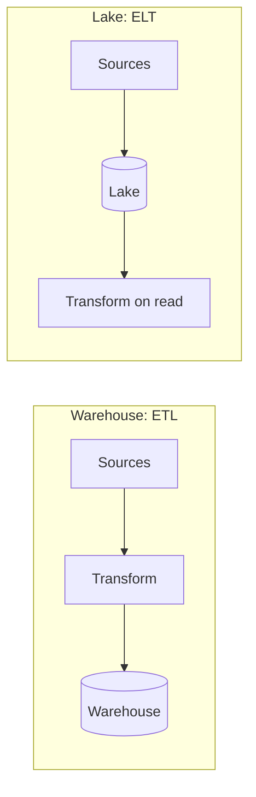
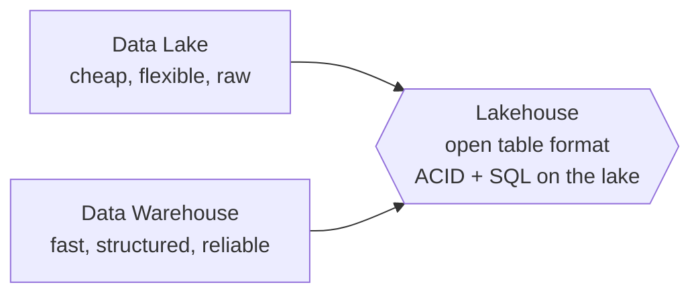
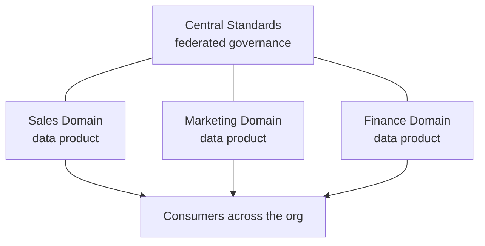
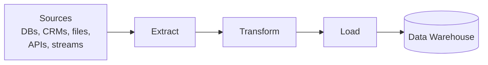
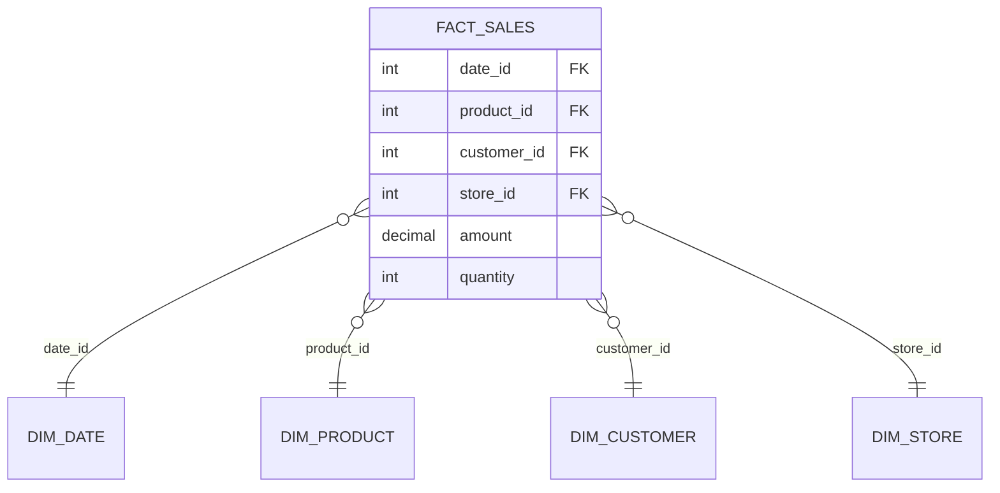
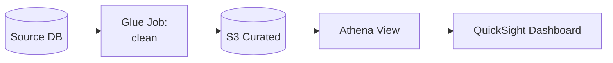
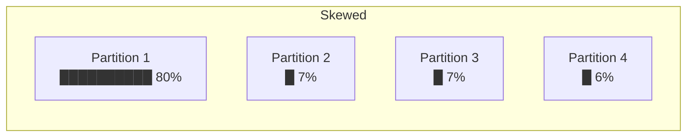
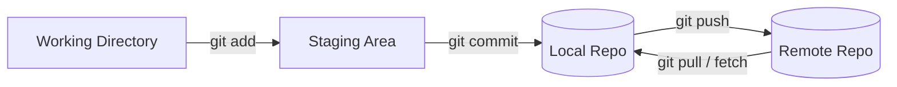

# 01 - Foundation

> AWS Certified Data Engineer Associate (DEA-C01) - Section 1 notes

## Contents

- [Part 1: Introduction](#part-1-introduction)
  - [Course Services](#course-services)
- [Part 2: Data Engineering](#part-2-data-engineering)
  - [Data Types](#data-types)
  - [Data Properties](#data-properties)
  - [Data Warehouse vs Data Lakes (and Lakehouses)](#data-warehouse-vs-data-lakes-and-lakehouses)
  - [Data Mesh](#data-mesh)
  - [ETL Pipelines](#etl-pipelines)
  - [Data Sources & Formats](#data-sources--formats)
  - [Data Modeling](#data-modeling)
  - [Database Performance Optimization](#database-performance-optimization)
  - [Data Sampling Techniques](#data-sampling-techniques)
  - [Data Skew Mechanisms](#data-skew-mechanisms)
  - [Data Validation and Profiling](#data-validation-and-profiling)
  - [Aggregation & SQL Regular Expressions](#aggregation--sql-regular-expressions)
  - [Git Review](#git-review)
- [Exam Cheat Sheet](#exam-cheat-sheet)

---

# Part 1: Introduction

## Course Services

| Category | Services |
|---|---|
| **Analytics** | Amazon EMR, AWS Lake Formation, Amazon Redshift, Amazon Kinesis, AWS Glue, Amazon Managed Streaming for Apache Kafka (MSK), Amazon OpenSearch Service, Amazon QuickSight, Amazon Athena |
| **App Integration** | Amazon EventBridge, AWS Step Functions, Amazon AppFlow, Amazon SNS, Amazon SQS, Amazon Managed Workflows for Apache Airflow (MWAA) |
| **Cloud Financial Management** | AWS Budgets, AWS Cost Explorer |
| **Compute** | AWS Batch, Amazon EC2, AWS Lambda, AWS Serverless Application Repository |
| **Containers** | Amazon ECR, Amazon ECS, Amazon EKS |
| **Database** | Amazon DocumentDB (MongoDB compatible), Amazon DynamoDB, Amazon Keyspaces (Apache Cassandra), Amazon MemoryDB for Redis, Amazon Neptune, Amazon RDS |
| **Developer Tools** | AWS CLI, AWS CDK, AWS CodeBuild, AWS CodeCommit, AWS CodeDeploy, AWS CodePipeline |
| **Frontend Web** | Amazon API Gateway |
| **Machine Learning** | Amazon SageMaker |
| **Management & Governance** | AWS CloudFormation, AWS CloudTrail, AWS Config, AWS Well-Architected Tool, Amazon Managed Grafana, AWS Systems Manager, Amazon CloudWatch |
| **Migration & Transfer** | AWS Application Discovery Service, AWS Application Migration Service, AWS DMS, AWS DataSync, AWS Transfer Family, AWS Snow Family |
| **Networking & Content Delivery** | Amazon CloudFront, AWS PrivateLink, Amazon Route 53, Amazon VPC |
| **Security, Identity & Compliance** | AWS IAM, AWS KMS, Amazon Macie, AWS Secrets Manager, AWS Shield, AWS WAF |
| **Storage** | AWS Backup, Amazon EBS, Amazon EFS, Amazon S3 |

---

# Part 2: Data Engineering

## Data Types

| | **Structured** | **Semi-Structured** | **Unstructured** |
|---|---|---|---|
| Definition | Organized in a defined manner or schema, typically in relational databases | Not as organized as structured, but has some structure via tags, hierarchies, or patterns | No predefined structure or schema |
| Characteristics | Easily queryable, rows and columns, consistent structure | Elements tagged or categorized, more flexible than structured but not as chaotic as unstructured | Not easily queryable without preprocessing, various formats |
| Examples | Database tables, CSV files with consistent columns, Excel spreadsheets | XML and JSON files, email headers, log files with varied formats | Free-form text files, video, audio, images, emails and word documents |

> **Note:** An email is both. Headers (date, subject, sender) are semi-structured; the body is unstructured.

---

## Data Properties

The "3 V's" of data.

| Property | Definition | Characteristics | Examples |
|---|---|---|---|
| **Volume** | The amount or size of data being dealt with at any given time | Ranges from gigabytes to petabytes; challenges in storing, processing, and analyzing | Social media platform processing terabytes of daily posts, images, videos; retailer with years of transactions totaling petabytes |
| **Velocity** | Speed at which new data is generated, collected, and processed | High velocity needs real-time or near-real-time processing; rapid ingestion can be critical | IoT sensors streaming readings every millisecond; high-frequency trading where milliseconds matter |
| **Variety** | The different types, structures, and sources of data | Structured, semi-structured, or unstructured; multiple sources and formats | Business analyzing relational DBs + emails + JSON logs; healthcare combining EMRs, wearables, patient feedback forms |

---

## Data Warehouse vs Data Lakes (and Lakehouses)

### Data Warehouse

A centralized repository optimized for analysis where data from different sources is stored in a **structured** format.

**Characteristics**

- Designed for complex queries and analysis
- Data is cleaned, transformed, and loaded (ETL process)
- Typically uses a star or snowflake schema
- Optimized for read-heavy operations

**Examples**

- Amazon Redshift
- Google BigQuery
- Azure Synapse Analytics (formerly Azure SQL Data Warehouse)

### Data Lake

A storage repository that holds vast amounts of **raw data in its native format**, including structured, semi-structured, and unstructured data.

**Characteristics**

- Can store large volumes of raw data without a predefined schema
- Data is loaded as-is, no need for preprocessing
- Supports batch, real-time, and stream processing
- Can be queried for data transformation or exploration purposes

**Examples**

- Amazon S3 (when used as a data lake)
- Azure Data Lake Storage
- Hadoop Distributed File System (HDFS)

### Warehouse vs Lake

| Aspect | Data Warehouse | Data Lake |
|---|---|---|
| Schema | **Schema-on-write** (predefined schema before writing data) | **Schema-on-read** (schema defined at the time of reading data) |
| Pipeline Pattern | Extract - Transform - Load (**ETL**) | Extract - Load - Transform (**ELT**), or just Load for storage |
| Data Types | Primarily structured data | Structured, semi-structured, and unstructured |
| Agility | Less agile due to predefined schema | More agile, accepts raw data without a predefined structure |
| Cost | Typically more expensive because of optimizations for complex queries | Cost-effective storage, but costs can rise when processing large amounts of data |
| AWS Service | Amazon Redshift | Amazon S3 (+ Glue, Athena, Lake Formation) |



### Data Lakehouse

A hybrid architecture that combines the best features of data lakes and data warehouses. It aims to provide the performance, reliability, and capabilities of a warehouse while keeping the flexibility, scale, and low-cost storage of a lake.

**Characteristics**

- Supports both structured and unstructured data
- Allows for schema-on-write and schema-on-read
- Provides capabilities for both detailed analytics and machine learning tasks
- Typically built on top of cloud or distributed architectures
- Benefits from **open table formats** (Apache Iceberg, Delta Lake, Apache Hudi) that bring ACID transactions to big data

**Examples**

- **Amazon SageMaker Lakehouse + S3 Tables (Apache Iceberg)**: AWS's current direction (see Section 2)
- AWS Lake Formation (with S3 and Redshift Spectrum)
- Delta Lake: open-source storage layer that brings ACID transactions to Apache Spark and big data workloads
- Databricks Lakehouse Platform: unified platform combining lake and warehouse capabilities
- Azure Synapse Analytics: Microsoft's service bringing together big data and data warehousing



---

## Data Mesh

- More about **governance and organization** than technology
- Individual teams own **"data products"** within a given domain
- These data products serve various "use cases" around the organization
- **"Domain-based data management"**
- **Federated governance** with central standards
- **Self-service** tooling & infrastructure
- Data lakes, warehouses, etc. may be part of it



---

## ETL Pipelines

Extract, Transform, Load. A process used to move data from source systems into a data warehouse.



**Extract**

- Retrieve raw data from source systems: databases, CRMs, flat files, APIs, or other data repositories
- Ensure data integrity during the extraction phase
- Can be done in real time or in batches, depending on requirements

**Transform**

- Convert the extracted data into a format suitable for the target data warehouse
- Can involve various operations:
  - Data cleansing (removing duplicates, fixing errors)
  - Data enrichment (adding data from other sources)
  - Format changes (date formatting, string manipulation)
  - Aggregations or computations (calculating totals or averages)
  - Encoding or decoding data
  - Handling missing values

**Load**

- Move the transformed data into the target data warehouse or another data repository
- Can be done in batches (all at once) or in a streaming manner (as data becomes available)
- Ensure that data maintains its integrity during the loading phase

### Managing ETL Pipelines

- This process must be **automated** in some reliable way
- **AWS Glue**
- **Orchestration services:**
  - Amazon EventBridge
  - Amazon Managed Workflows for Apache Airflow (Amazon MWAA)
  - AWS Step Functions
  - AWS Lambda
  - Glue Workflows

---

## Data Sources & Formats

### Data Sources

| Source | Notes |
|---|---|
| **JDBC** (Java Database Connectivity) | Platform-independent, **language-dependent** (Java) |
| **ODBC** (Open Database Connectivity) | **Platform-dependent** (because of drivers), language-independent |
| Raw logs | Application, server, access logs |
| APIs | REST, SaaS endpoints |
| Streams | Kinesis, Kafka, IoT |

### Data Formats

#### CSV (Comma-Separated Values)

Text-based format that represents data in tabular form, where each line is a row and values within a row are separated by commas.

- **When to Use:**
  - Small to medium datasets
  - Data interchange between systems with different technologies
  - Human-readable and editable data storage
  - Importing/exporting data from databases or spreadsheets
- **Systems:** SQL databases, Excel, Pandas (Python), R, many ETL tools

#### JSON (JavaScript Object Notation)

Lightweight, text-based, human-readable data interchange format that represents structured or semi-structured data using key-value pairs.

- **When to Use:**
  - Data interchange between a web server and a web client
  - Configurations and settings for software applications
  - Use cases that need a flexible schema or nested data structures
- **Systems:** Web browsers, most programming languages (JavaScript, Python, Java, etc.), RESTful APIs, NoSQL databases (MongoDB)

#### Avro

Binary, **row-based** format that stores both the data and its schema, so it can be processed later by different systems without needing the original system's context.

- **When to Use:**
  - Big data and real-time processing systems
  - When **schema evolution** (changes in data structure) is needed
  - Efficient serialization for data transport between systems
- **Systems:** Apache Kafka, Apache Spark, Apache Flink, Hadoop ecosystem

#### Parquet

**Columnar** storage format optimized for analytics. Allows for efficient compression and encoding schemes.

- **When to Use:**
  - Analyzing large datasets with analytics engines
  - When reading specific columns instead of entire records is beneficial
  - Storing data on distributed systems where I/O and storage need optimization
- **Systems:** Hadoop ecosystem, Apache Spark, Apache Hive, Apache Impala, Amazon Redshift Spectrum, Amazon Athena

#### ORC (Optimized Row Columnar) *(added)*

**Columnar** format similar to Parquet, originally built for Apache Hive. Strong compression and supports predicate pushdown.

- **When to Use:** Hive-heavy workloads, large analytic scans
- **Systems:** Apache Hive, Spark, Presto/Trino, Athena, EMR

### Format Comparison

| Format | Layout | Encoding | Schema | Compression | Best For |
|---|---|---|---|---|---|
| **CSV** | Row | Text | None | Poor | Small data, interchange, spreadsheets |
| **JSON** | Row | Text | Flexible / nested | Poor | APIs, configs, semi-structured |
| **Avro** | Row | Binary | Embedded, supports evolution | Good | Streaming, Kafka, write-heavy |
| **Parquet** | Columnar | Binary | Embedded | Excellent | Analytics, Athena/Redshift Spectrum |
| **ORC** | Columnar | Binary | Embedded | Excellent | Hive, analytics |

> **Rule of thumb:** row formats (CSV, JSON, Avro) are good for **writing** whole records. Columnar formats (Parquet, ORC) are good for **reading** a few columns across many rows, which is what analytics does. Converting to Parquet/ORC is the #1 way to cut Athena cost.

---

## Data Modeling

### Star Schema

- **Fact table**: the measurable events (sales, clicks, transactions), mostly numbers + foreign keys
- **Dimension tables**: the descriptive context (who, what, where, when)
- Connected with **primary / foreign keys**
- Represented visually with an **Entity Relationship Diagram (ERD)**



### Snowflake Schema *(added)*

- A star schema where the **dimensions are normalized** into sub-dimensions (e.g. `DIM_PRODUCT` → `DIM_CATEGORY`)
- Less storage redundancy, but **more joins** = slower queries
- Star is simpler and usually faster for analytics

### Data Lineage

A visual representation that traces the flow and transformations of data through its lifecycle, from its source to its final destination.

- **Importance:**
  - Helps track errors back to their source
  - Ensures compliance with regulations
  - Provides a clear understanding of how data is moved, transformed, and consumed within systems



### Schema Evolution

The ability to adapt and change the schema of a dataset over time without disrupting existing processes or systems.

- **Importance:**
  - Ensures data systems can adapt to changing business requirements
  - Allows for the addition, removal, or modification of columns/fields in a dataset
  - Maintains backwards compatibility with older records

**AWS Glue Schema Registry**

- Schema discovery, compatibility, validation, registration...
- Works with streaming (Kinesis, MSK/Kafka) to enforce schemas on producers and consumers

---

## Database Performance Optimization

| Technique | What It Does | Benefits |
|---|---|---|
| **Indexing** | Creates lookup structures on columns | Avoid full table scans! Enforce data uniqueness and integrity |
| **Partitioning** | Splits data by a key (e.g. `year/month/day`) | Reduces amount of data scanned, helps data lifecycle management, enables parallel processing |
| **Compression** | Shrinks data on disk | Speeds up data transfer, reduces storage & disk reads |

**Compression notes**

- Examples: **GZIP, LZOP, BZIP2, ZSTD** (Redshift COPY examples)
  - Various tradeoffs between compression ratio & speed
- **Columnar compression**: similar values in a column compress extremely well

**Partitioning example (S3 data lake)**

```
s3://my-lake/sales/year=2026/month=09/day=27/part-0001.parquet
```

A query with `WHERE year=2026 AND month=09` only scans that folder (**partition pruning**).

---

## Data Sampling Techniques

| Technique | How It Works | Why Use It |
|---|---|---|
| **Random Sampling** | Everything has an equal chance of selection | Simple, unbiased |
| **Stratified Sampling** | Divide population into homogeneous subgroups (**strata**), then randomly sample within each stratum | Ensures representation of each subgroup |
| **Systematic** | Pick every *n*th item (e.g. every third item) | Easy on ordered data |
| **Cluster** | Randomly pick whole groups | Cheap when data is naturally grouped |
| **Convenience** | Use what's easiest to access | Fast, but biased |
| **Judgmental** | Expert picks the sample | Domain-driven, but subjective |

---

## Data Skew Mechanisms

Data skew is the **unequal distribution or imbalance of data** across nodes or partitions in distributed computing systems.

- **"The celebrity problem"**
  - Even partitioning doesn't work if your traffic is uneven
  - Imagine you're IMDb... Brad Pitt could overload his partition
- **Causes:**
  - Non-uniform distribution of data
  - Inadequate partitioning strategy
  - Temporal skew (e.g. all traffic hits "today's" partition)
- Important to **monitor data distribution** and alert when skew issues arise



### Addressing Data Skew

1. **Adaptive Partitioning:** dynamically adjust partitioning based on data characteristics for a more balanced distribution
2. **Salting:** add a random factor or "salt" to the key to spread data more uniformly (e.g. `brad_pitt_1`, `brad_pitt_2`, ...)
3. **Repartitioning:** regularly redistribute data based on its current distribution
4. **Sampling:** use a sample of the data to determine distribution and adjust processing strategy
5. **Custom Partitioning:** define custom rules or functions for partitioning based on domain knowledge

---

## Data Validation and Profiling

| Dimension | Definition | Checks | Why It Matters |
|---|---|---|---|
| **Completeness** | All required data is present, nothing essential missing | Missing values, null counts, % of populated fields | Missing data leads to inaccurate analyses and insights |
| **Consistency** | Values are consistent across datasets and don't contradict each other | Cross-field validation, comparing across sources or periods | Inconsistent data causes confusion and wrong conclusions |
| **Accuracy** | Data is correct, reliable, and represents what it should | Compare with trusted sources, validate against known standards or rules | Inaccurate data leads to false insights and poor decisions |
| **Integrity** | Data stays correct and consistent over its lifecycle and across systems | Referential integrity (foreign key checks), relationship validations | Preserves relationships so data remains trustworthy over time |

**On AWS** *(added)*

- **AWS Glue Data Quality**: define rules in **DQDL** (Data Quality Definition Language) and run them in Glue jobs or on the Data Catalog

```
Rules = [
    IsComplete "customer_id",
    IsUnique "order_id",
    ColumnValues "amount" > 0,
    Completeness "email" > 0.95
]
```

- **AWS Glue DataBrew**: visual data profiling and cleaning, no code

---

## Aggregation & SQL Regular Expressions

### Common Aggregations

- `COUNT`, `SUM`, `AVG`, `MIN`, `MAX`
- Grouped with `GROUP BY`, filtered after grouping with `HAVING`

```sql
SELECT region, SUM(amount) AS total_sales
FROM sales
GROUP BY region
HAVING SUM(amount) > 10000;
```

### Pivoting

- Pivoting is the act of turning **row-level data into columnar data**
- How this works is very database-specific. Some have a `PIVOT` command
- Example: a sales table with a salesperson and amount in each row, but we want a report by salesperson

**Before (rows)**

| salesperson | quarter | amount |
|---|---|---|
| Alice | Q1 | 100 |
| Alice | Q2 | 150 |
| Bob | Q1 | 200 |
| Bob | Q2 | 120 |

**After (pivoted)**

| salesperson | Q1 | Q2 |
|---|---|---|
| Alice | 100 | 150 |
| Bob | 200 | 120 |

```sql
-- Works in any SQL engine
SELECT salesperson,
       SUM(CASE WHEN quarter = 'Q1' THEN amount END) AS q1,
       SUM(CASE WHEN quarter = 'Q2' THEN amount END) AS q2
FROM sales
GROUP BY salesperson;
```

### SQL Regular Expressions

- Pattern matching: think of a much more powerful `LIKE`
- Operators (PostgreSQL / Redshift syntax):

| Operator | Meaning |
|---|---|
| `~` | Matches regex (case-sensitive) |
| `~*` | Matches regex (case-insensitive) |
| `!~` | Does NOT match (case-sensitive) |
| `!~*` | Does NOT match (case-insensitive) |

**Regular Expression 101**

| Pattern | Meaning | Example |
|---|---|---|
| `^` | Match at the start of a string | `^boo` matches "book" |
| `$` | Match at the end of a string | `boo$` matches "boo" but not "book" |
| `\|` | Alternation | `sit\|sat` matches "sit" and "sat" |
| `[a-z]` | Range | Any lowercase letter |
| `{n}` | Repeat | `[a-z]{4}` matches any 4 lowercase letters |
| `\d` | Any digit | |
| `\w` | Any letter, digit, or underscore | |
| `\s` | Whitespace | |
| `\t` | Tab | |

```sql
-- Emails ending in .edu, case-insensitive
SELECT * FROM users WHERE email ~* '\.edu$';
```

---

## Git Review

### Setting Up and Configuration

| Command | Purpose |
|---|---|
| `git init` | Initialize a new Git repository |
| `git config` | Set configuration values (user info, aliases, etc.) |
| `git config --global user.name "Your Name"` | Set your name |
| `git config --global user.email "your@email.com"` | Set your email |

### Basic Commands

| Command | Purpose |
|---|---|
| `git clone <repository>` | Clone (download) a repository from an existing URL |
| `git status` | Check the status of changes in the working directory |
| `git add <filename>` | Add changes in the file to the staging area |
| `git add .` | Add all new and changed files to the staging area |
| `git commit -m "message"` | Commit staged changes with a message |
| `git log` | View commit logs |



### Branching with Git

| Command | Purpose |
|---|---|
| `git branch` | List all local branches |
| `git branch <branchname>` | Create a new branch |
| `git checkout <branchname>` | Switch to a specific branch |
| `git checkout -b <branchname>` | Create a new branch and switch to it |
| `git merge <branchname>` | Merge the specified branch into the current branch |

### Remote Repositories

| Command | Purpose |
|---|---|
| `git remote add <name> <url>` | Add a remote repository |
| `git remote` | List all remote repositories |
| `git push <remote> <branch>` | Push a branch to a remote repository |
| `git pull <remote> <branch>` | Pull changes from a remote branch into the current local branch |

### Undoing Changes

| Command | Purpose |
|---|---|
| `git reset` | Reset the staging area to match the most recent commit, without affecting the working directory |
| `git reset --hard` | Reset the staging area **and** working directory to match the most recent commit |
| `git revert <commit>` | Create a new commit that undoes all changes from a previous commit (safe for shared branches) |

### Advanced Git

| Command | Purpose |
|---|---|
| `git stash` | Temporarily save changes not ready for a commit |
| `git stash pop` | Restore the most recently stashed changes |
| `git rebase <branch>` | Reapply changes from one branch onto another |
| `git cherry-pick <commit>` | Apply changes from a specific commit to the current branch |

### Git Collaboration and Inspection

| Command | Purpose |
|---|---|
| `git blame <file>` | Show who changed each line of a file and when |
| `git diff` | Show changes between commits, commit and working tree, etc. |
| `git fetch` | Fetch changes from a remote without merging them |

### Git Maintenance and Data Recovery

| Command | Purpose |
|---|---|
| `git fsck` | Check the database for errors |
| `git gc` | Clean up and optimize the local repository |
| `git reflog` | Record when refs were updated locally, useful for recovering lost commits |

---

## Exam Cheat Sheet

| If the question says... | Answer |
|---|---|
| Schema-on-write, structured, complex BI queries | **Data Warehouse (Redshift)** |
| Schema-on-read, raw data in native format | **Data Lake (S3)** |
| ACID transactions + SQL on the data lake | **Lakehouse (Iceberg / S3 Tables / SageMaker Lakehouse)** |
| Domain teams own their own data products | **Data Mesh** |
| Orchestrate an ETL pipeline with DAGs | **Amazon MWAA (Airflow)** |
| Orchestrate with a visual state machine | **AWS Step Functions** |
| Serverless ETL | **AWS Glue** |
| Streaming data with schema evolution | **Avro + Glue Schema Registry** |
| Reduce Athena scan cost / speed up analytics | **Convert to Parquet/ORC + partition + compress** |
| Java app connecting to a database | **JDBC** |
| Language-independent DB connectivity | **ODBC** |
| One key overloading a partition (hot partition) | **Data skew → salting / better partition key** |
| Ensure each subgroup is represented in a sample | **Stratified sampling** |
| Define and run data quality rules | **Glue Data Quality (DQDL)** |
| Visual profiling and cleaning, no code | **Glue DataBrew** |
| Trace where data came from and how it changed | **Data lineage** |
| Rows into columns for a report | **Pivot** |