# 02 - Storage

> AWS Certified Data Engineer Associate (DEA-C01) - Section 2 notes

## Contents

1. [Amazon S3 Introduction](#amazon-s3-introduction)
2. [S3 Security](#amazon-s3---security)
3. [S3 Versioning](#amazon-s3---versioning)
4. [S3 Replication (CRR & SRR)](#amazon-s3---replication-crr--srr)
5. [S3 Storage Classes](#s3-storage-classes)
6. [S3 Express One Zone](#s3-express-one-zone)
7. [Lifecycle Rules](#amazon-s3---moving-between-storage-classes)
8. [S3 Event Notifications](#s3-event-notifications)
9. [S3 Performance](#amazon-s3---performance)
10. [S3 Encryption](#amazon-s3---object-encryption)
11. [S3 Access Points](#s3---access-points)
12. [Apache Iceberg & S3 Tables](#apache-iceberg-table-format)
13. [S3 Storage Lens](#s3---storage-lens)
14. [Amazon EBS](#amazon-ebs)
15. [Amazon EFS](#amazon-efs---elastic-file-system)
16. [EFS vs EBS vs Instance Store](#amazon-efs-vs-amazon-ebs)
17. [AWS Backup](#aws-backup)
18. [Exam Cheat Sheet](#exam-cheat-sheet)

---

## Amazon S3 Introduction

- Amazon S3 is one of the main building blocks of AWS
- Advertised as "infinitely scaling" storage
- Many websites use Amazon S3 as a backbone
- Many AWS services use Amazon S3 as an integration as well

### Amazon S3 Use Cases

| Category | Use Cases |
|---|---|
| Protection | Backup and storage, Disaster Recovery, Archive |
| Hosting | Application hosting, Media hosting, Static website, Software delivery |
| Data | Data lakes & big data analytics, Hybrid cloud storage |

### Amazon S3 - Buckets

- Amazon S3 allows people to store objects (files) in "buckets" (directories)
- Buckets are defined at the **region level**
- S3 looks like a global service, but buckets are created in a region

- **Naming:**
  - **Shared Global Namespace**: must have a globally unique name (across all regions, all accounts)
  - **Account Regional Namespace**: allows "reuse" of the same bucket name across regions

- **Naming constraints:**
  - No uppercase, no underscore
  - 3-63 characters long
  - Not an IP
  - Must start with a lowercase letter or number
  - Must NOT start with the prefix `xn--`
  - Must NOT end with the suffix `-s3alias`

### Amazon S3 - Objects

- Objects (files) have a **Key**
- The key is the FULL path:
  - `s3://my-bucket/my_file.txt`
  - `s3://my-bucket/my_folder1/another_folder/my_file.txt`
- The key is composed of **prefix** + **object name**

```
s3://my-bucket/ my_folder1/another_folder/ my_file.txt
                └──────── prefix ───────┘ └ object name ┘
```

- There is no concept of "directories" within buckets (although the UI will trick you into thinking otherwise)
- Anything and everything in Amazon S3 is actually a key with a very long name that contains slashes (`/`)

- **Object values** are the content of the body
  - Max object size is **50 TB**
  - If uploading more than **5 GB**, must use **multi-part upload**
- **Metadata**: list of text key / value pairs (system or user metadata)
- **Tags**: Unicode key / value pairs (up to 10), useful for security / lifecycle
- **Version ID**: if versioning is enabled

### Amazon S3 Hands-On Notes

- When creating a bucket, the name must be globally unique (or unique at the regional level if using the Account Regional Namespace)

---

## Amazon S3 - Security

| Type | Mechanism | Notes |
|---|---|---|
| **User-Based** | IAM Policies | Which API calls are allowed for a specific IAM user |
| **Resource-Based** | Bucket Policies | Bucket-wide rules from the S3 console, allows cross-account |
| **Resource-Based** | Object ACL | Finer grain (can be disabled) |
| **Resource-Based** | Bucket ACL | Less common (can be disabled) |

> **Note:** An IAM principal can access an S3 object if
> **(IAM permissions ALLOW it OR the resource policy ALLOWS it) AND there's no explicit DENY**

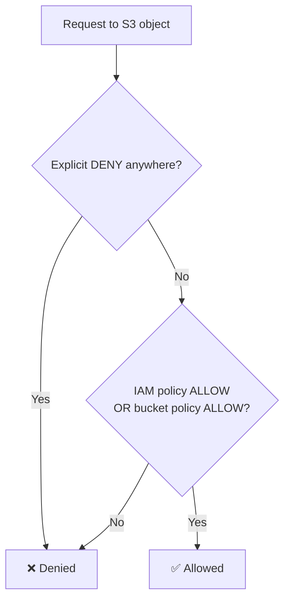

- **Encryption:** encrypt objects in Amazon S3 using encryption keys

### S3 Bucket Policies

- JSON-based policies
  - **Resources**: buckets and objects
  - **Effect**: Allow / Deny
  - **Actions**: set of APIs to Allow or Deny
  - **Principal**: the account or user to apply the policy to

```json
{
  "Version": "2012-10-17",
  "Statement": [
    {
      "Sid": "PublicRead",
      "Effect": "Allow",
      "Principal": "*",
      "Action": ["s3:GetObject"],
      "Resource": ["arn:aws:s3:::examplebucket/*"]
    }
  ]
}
```

- Use an S3 bucket policy to:
  - Grant public access to the bucket
  - Force objects to be encrypted at upload
  - Grant access to another account (Cross Account)

### Bucket Settings for Block Public Access

**Block all public access: On**

- **Block public access to buckets and objects granted through new access control lists (ACLs):** On
- **Block public access to buckets and objects granted through any access control lists (ACLs):** On
- **Block public access to buckets and objects granted through new public bucket or access point policies:** On
- **Block public and cross-account access to buckets and objects through any public bucket or access point policies:** On

**Key Notes**

- These settings were created to prevent company data leaks
- If you know your bucket should never be public, leave these settings on
- Can be set at the account level

---

## Amazon S3 - Versioning

- You can version your files in Amazon S3
- It is enabled at the **bucket level**
- Same key overwrite will change the "version": 1, 2, 3...
- It is best practice to version your buckets
  - Protect against unintended deletes (ability to restore a version)
  - Easy rollback to a previous version
- Notes:
  - Any file that was not versioned prior to enabling versioning will have version `null`
  - Suspending versioning does not delete the previous versions

---

## Amazon S3 - Replication (CRR & SRR)

- **Must enable Versioning** in source and destination buckets
- **Cross-Region Replication (CRR)**
- **Same-Region Replication (SRR)**
- Buckets can be in different AWS accounts
- Copying is **asynchronous**
- Must give proper IAM permissions to S3

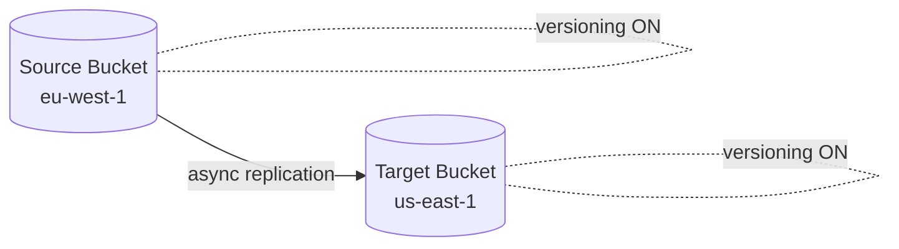

| Type | Use Cases |
|---|---|
| **CRR** | Compliance, lower latency access, replication across accounts |
| **SRR** | Log aggregation, live replication between production and test accounts |

### Additional Replication Notes

- After you enable Replication, **only new objects are replicated**
- Optionally, you can replicate existing objects using **S3 Batch Replication**
  - Replicates existing objects and objects that failed replication
- For DELETE operations:
  - **Can replicate delete markers** from source to target (optional setting)
  - Deletions with a version ID are not replicated (to avoid malicious deletes)
- **There is no "chaining" of replication**
  - If bucket 1 replicates into bucket 2, which replicates into bucket 3
  - Then objects created in bucket 1 are **not** replicated into bucket 3

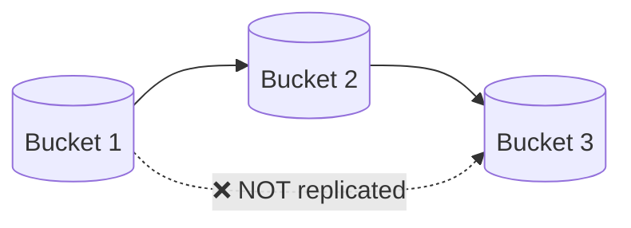

### Amazon S3 - Replication Time Control (RTC)

- Feature of Amazon S3 Replication that guarantees replication speed
- **99.99% of new objects replicated within 15 minutes**
- Provides predictable, auditable replication time
- Publishes CloudWatch metrics for monitoring
- Alerts you if replication falls behind
- Can replicate to the same or a different AWS Region
- Helps you meet compliance or business requirements
- Extra cost per GB for the replication

---

## S3 Storage Classes

- Amazon S3 Standard - General Purpose
- Amazon S3 Standard-Infrequent Access (IA)
- Amazon S3 One Zone-Infrequent Access
- Amazon S3 Glacier Instant Retrieval
- Amazon S3 Glacier Flexible Retrieval
- Amazon S3 Glacier Deep Archive
- Amazon S3 Intelligent-Tiering

- Can move between classes manually or using **S3 Lifecycle configurations**

### S3 Durability and Availability

- **Durability:**
  - High durability (**99.999999999%, 11 9's**) of objects across multiple AZs
  - If you store 10,000,000 objects with Amazon S3, you can on average expect to incur a loss of a single object once every 10,000 years
  - **Same for all storage classes**
- **Availability:**
  - Measures how readily available a service is
  - Varies depending on storage class
  - Example: S3 Standard has 99.99% availability = not available ~53 minutes a year

### Storage Class Comparison

| Class | Availability | AZs | Min Storage Duration | Retrieval | Best For |
|---|---|---|---|---|---|
| **Standard** | 99.99% | ≥3 | None | Milliseconds | Frequently accessed data |
| **Standard-IA** | 99.9% | ≥3 | 30 days | Milliseconds (fee) | DR, backups |
| **One Zone-IA** | 99.5% | 1 | 30 days | Milliseconds (fee) | Re-creatable / secondary copies |
| **Glacier Instant** | 99.9% | ≥3 | 90 days | Milliseconds (fee) | Accessed ~once a quarter |
| **Glacier Flexible** | 99.99% | ≥3 | 90 days | Minutes to 12 hrs | Archive |
| **Glacier Deep Archive** | 99.99% | ≥3 | 180 days | 12 to 48 hrs | Long-term archive |
| **Intelligent-Tiering** | 99.9% | ≥3 | None | Milliseconds (no fee) | Unknown / changing access patterns |

### S3 Standard - General Purpose

- 99.99% availability
- Used for frequently accessed data
- Low latency and high throughput
- Sustains 2 concurrent facility failures
- Use cases: Big Data analytics, mobile & gaming applications, content distribution...

### S3 Storage Classes - Infrequent Access

- For data that is less frequently accessed, but requires rapid access when needed
- Lower cost than S3 Standard

- **Amazon S3 Standard-Infrequent Access (S3 Standard-IA)**
  - 99.9% availability
  - Use cases: Disaster Recovery, backups

- **Amazon S3 One Zone-Infrequent Access (S3 One Zone-IA)**
  - High durability (11 9's) in a single AZ; **data lost when AZ is destroyed**
  - 99.5% availability
  - Use cases: storing secondary backup copies of on-premises data, or data you can recreate

### Amazon S3 Glacier Storage Classes

- Low-cost object storage meant for archiving / backup
- Pricing: price for storage + object retrieval cost

- **Amazon S3 Glacier Instant Retrieval**
  - Millisecond retrieval, great for data accessed once a quarter
  - Minimum storage duration of **90 days**

- **Amazon S3 Glacier Flexible Retrieval**
  - Expedited (1 to 5 minutes), Standard (3 to 5 hours), Bulk (5 to 12 hours, free)
  - Minimum storage duration of **90 days**

- **Amazon S3 Glacier Deep Archive**
  - Standard (12 hours), Bulk (48 hours)
  - Minimum storage duration of **180 days**

### S3 Intelligent-Tiering

- Small monthly monitoring and auto-tiering fee
- Moves objects automatically between Access Tiers based on usage
- **There are no retrieval charges in S3 Intelligent-Tiering**

| Tier | Type | Trigger |
|---|---|---|
| Frequent Access | Automatic | Default tier |
| Infrequent Access | Automatic | Not accessed for 30 days |
| Archive Instant Access | Automatic | Not accessed for 90 days |
| Archive Access | Optional | Configurable from 90 days to 700+ days |
| Deep Archive Access | Optional | Configurable from 180 days to 700+ days |

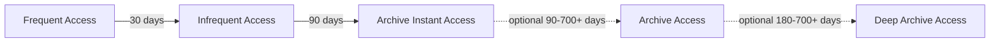

---

## S3 Express One Zone

- High performance, **single Availability Zone** storage
- Objects stored in a **Directory bucket** (bucket in a single AZ)
- Handles 100,000s of requests per second with **single-digit millisecond** latency
- Up to **10x better performance** than S3 Standard (50% lower request costs)
- High durability (11 9's within the AZ) and availability (99.95%)
- Co-locate your storage and compute resources in the same AZ (reduces latency)
- Use cases: latency-sensitive apps, data-intensive apps, AI & ML training, financial modeling, media processing, HPC...
- Best integrated with SageMaker Model Training, Athena, EMR, Glue...

---

## Amazon S3 - Moving Between Storage Classes

- You can transition objects between storage classes
- For infrequently accessed objects, move them to **Standard-IA**
- For archive objects that you don't need fast access to, move them to **Glacier or Glacier Deep Archive**
- Moving objects can be automated using **Lifecycle Rules**

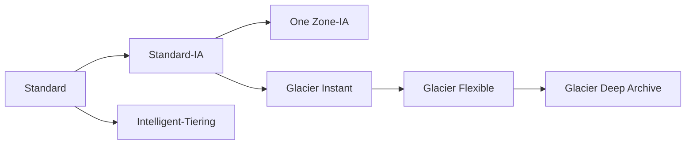

### Amazon S3 - Lifecycle Rules

- **Transition Actions**: configure objects to transition to another storage class
  - Move objects to Standard-IA class 60 days after creation
  - Move to Glacier for archiving after 6 months
- **Expiration Actions**: configure objects to expire (delete) after some time
  - Access log files can be set to delete after 365 days
  - **Can be used to delete old versions of files (if versioning is enabled)**
  - Can be used to delete incomplete multi-part uploads
- Rules can be created for a certain **prefix** (example: `s3://mybucket/mp3/*`)
- Rules can be created for certain **object Tags** (example: `Department: Finance`)

### Lifecycle Rules - Scenario 1

> Your application on EC2 creates image thumbnails after profile photos are uploaded to Amazon S3. These thumbnails can be easily recreated, and only need to be kept for 60 days. The source images should be able to be immediately retrieved for these 60 days, and afterwards, the user can wait up to 6 hours. How would you design this?

- S3 source images can be on **Standard**, with a lifecycle configuration to transition them to **Glacier** after 60 days
- S3 thumbnails can be on **One Zone-IA**, with a lifecycle configuration to delete them after 60 days

### Lifecycle Rules - Scenario 2

> A rule in your company states that you should be able to recover your deleted S3 objects immediately for 30 days, although this may happen rarely. After this time, and for up to 365 days, deleted objects should be recoverable within 48 hours.

- **Enable S3 Versioning** in order to have object versions, so "deleted objects" are in fact hidden by a "delete marker" and can be recovered
- Transition the "noncurrent versions" of the object to **Standard-IA**
- Transition afterwards the "noncurrent versions" to **Glacier Deep Archive**

### Amazon S3 Analytics - Storage Class Analysis

- Helps you decide when to transition objects to the right storage class
- Recommendations for **Standard** and **Standard-IA**
  - Does NOT work for One Zone-IA or Glacier
- Report is updated daily
- 24 to 48 hours to start seeing data analysis
- Good first step to put together Lifecycle Rules

---

## S3 Event Notifications

- Events: `S3:ObjectCreated`, `S3:ObjectRemoved`, `S3:ObjectRestore`, `S3:Replication`...
- Object name filtering possible (e.g. `*.jpg`)
- **Use case:** generate thumbnails of images uploaded to S3
- **Can create as many "S3 events" as desired**
- S3 event notifications typically deliver events in seconds but can sometimes take a minute or longer

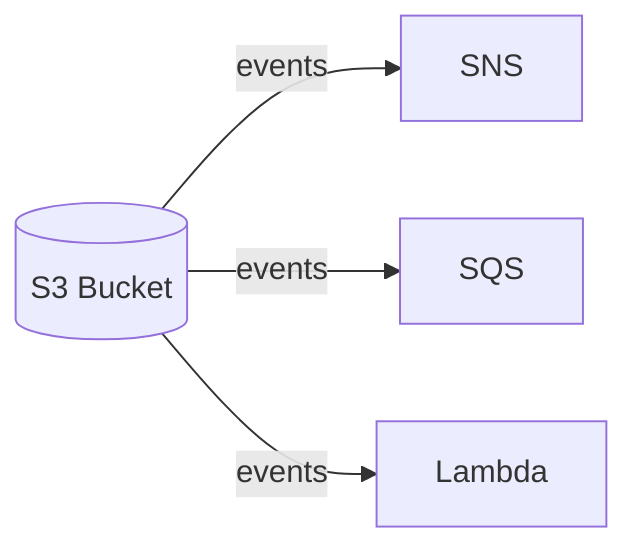

### S3 Event Notifications - IAM Permissions

S3 pushes events (object created/deleted/restored/replicated) to **SNS**, **SQS**, or **Lambda**.

**Key idea:** S3 has no IAM role. Each *destination* attaches a **resource-based policy** granting `s3.amazonaws.com` permission. The receiver grants access to the sender.

| Destination | Action | Policy type |
|---|---|---|
| SNS | `SNS:Publish` | SNS access policy |
| SQS | `SQS:SendMessage` | SQS access policy |
| Lambda | `lambda:InvokeFunction` | Lambda resource policy |

All three share the same shape:

```json
{
  "Effect": "Allow",
  "Action": "SNS:Publish",
  "Principal": { "Service": "s3.amazonaws.com" },
  "Resource": "arn:aws:sns:us-east-1:123456789012:MyTopic",
  "Condition": {
    "ArnLike": { "aws:SourceArn": "arn:aws:s3:::MyBucket" }
  }
}
```

`aws:SourceArn` prevents the **confused deputy** problem. Without it, any bucket in any account could publish to your topic.

> **Exam:** "S3 events aren't reaching the destination" → missing resource policy on the destination, not a role on S3. Console wires Lambda's automatically; IaC does not.

### S3 Event Notifications with EventBridge

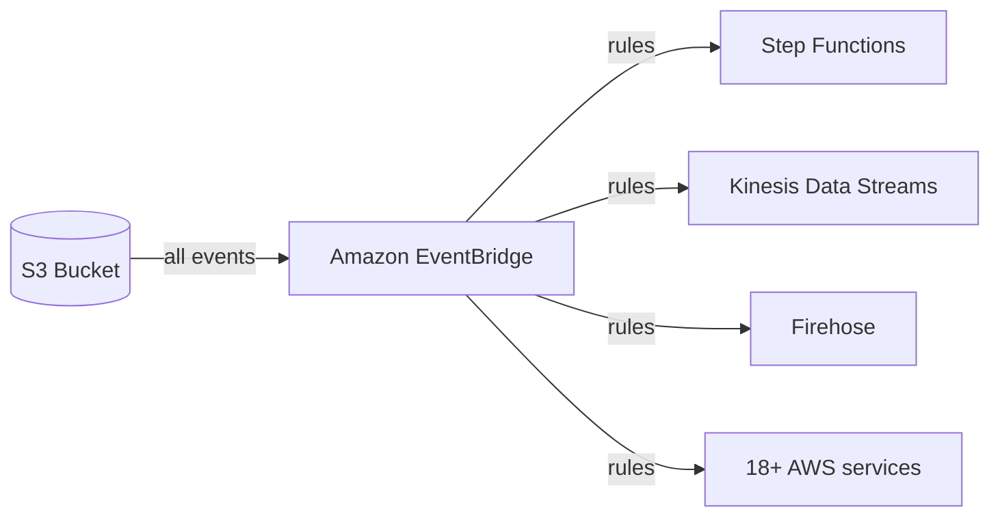

S3 sends **all** events to EventBridge; rules decide where they go. Removes the SNS/SQS/Lambda-only limit of native notifications.

**What you gain:**
- **Advanced filtering**: JSON rules on metadata, object size, name
- **Multiple destinations**: Step Functions, Kinesis Data Streams, Firehose, and 15+ more
- **EventBridge features**: archive, replay events, reliable delivery

> **Exam:** native S3 notifications = 3 destinations, prefix/suffix filtering only. Need a richer destination, content-based filtering, fan-out to several targets, or event replay → route through EventBridge.

---

## Amazon S3 - Performance

### S3 - Baseline Performance

- Amazon S3 automatically scales to high request rates, latency 100-200 ms
- Your application can achieve at least **3,500 PUT/COPY/POST/DELETE or 5,500 GET/HEAD requests per second per prefix in a bucket**
- There are no limits to the number of prefixes in a bucket

| Object Path | Prefix |
|---|---|
| `bucket/folder1/sub1/file` | `/folder1/sub1/` |
| `bucket/folder1/sub2/file` | `/folder1/sub2/` |
| `bucket/1/file` | `/1/` |
| `bucket/2/file` | `/2/` |

- If you spread reads across all four prefixes evenly, you can achieve **22,000 requests per second** for GET and HEAD (4 × 5,500)

### S3 Performance - Uploads

- **Multi-Part Upload:**
  - Recommended for files > 100 MB, **must use for files > 5 GB**
  - Can help parallelize uploads (speed up transfers)
- **S3 Transfer Acceleration:**
  - Increase transfer speed by transferring the file to an AWS edge location, which forwards the data to the S3 bucket in the target region
  - Compatible with multi-part upload

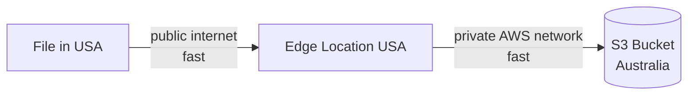

### S3 Performance - Byte-Range Fetches

- Parallelize GETs by requesting specific byte ranges
- Better resilience in case of failures
- Can be used to **speed up downloads**
- Can be used to **retrieve only partial data** (for example, only the head of a file)

---

## Amazon S3 - Object Encryption

You can encrypt objects in S3 buckets using one of the following methods:

- **Server-Side Encryption (SSE)**
  - SSE with Amazon S3-Managed Keys (**SSE-S3**) - *Enabled by Default*
  - SSE with KMS Keys stored in AWS KMS (**SSE-KMS**)
  - Dual-Layer SSE with KMS Keys (**DSSE-KMS**)
  - SSE with Customer-Provided Keys (**SSE-C**)
- **Client-Side Encryption**

> It's important to understand which ones are for which situations for the exam.

### Encryption Comparison

| Method | Who Manages Keys | Header | Audit (CloudTrail) | HTTPS Required | Pick When... |
|---|---|---|---|---|---|
| **SSE-S3** | AWS (fully) | `AES256` | No | No | Default, no requirements |
| **SSE-KMS** | AWS KMS (you control) | `aws:kms` | ✅ Yes | No | Need key control + audit |
| **DSSE-KMS** | AWS KMS (2 layers) | `aws:kms:dsse` | ✅ Yes | No | Compliance needs multi-layer |
| **SSE-C** | You (outside AWS) | Key sent per request | No | ✅ Yes | Must own keys, AWS encrypts |
| **Client-Side** | You (fully) | N/A | No | Recommended | Encrypt before it leaves your app |

### Amazon S3 Encryption - SSE-S3

- Encryption using keys handled, managed, and owned by AWS
- Object is encrypted server-side
- Encryption type is **AES-256**
- Must set header **`"x-amz-server-side-encryption": "AES256"`**
- **Enabled by default for new buckets & new objects**

### Amazon S3 Encryption - SSE-KMS

- Encryption using keys handled and managed by AWS KMS (Key Management Service)
- KMS advantages: user control + audit key usage using CloudTrail
- Object is encrypted server-side
- Encryption type is **AES-256**
- Must set header **`"x-amz-server-side-encryption": "aws:kms"`**

### SSE-KMS Limitation

- If you use SSE-KMS, you may be impacted by the KMS limits
- When you upload, it calls the **GenerateDataKey** KMS API
- When you download, it calls the **Decrypt** KMS API
- Counts towards the KMS quota per second (5,500, 10,000, or 30,000 req/s based on region)
- You can request a quota increase using the Service Quotas Console

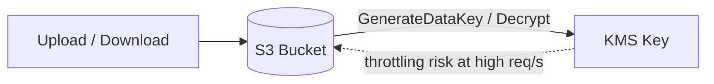

### Amazon S3 Encryption - DSSE-KMS

- Dual-Layer Server-Side Encryption using keys handled and managed by AWS KMS
- Object is encrypted twice server-side: KMS Key (1st layer) + S3 Managed Key (2nd layer)
- For compliance standards requiring multi-layer encryption (higher cost & latency than SSE-KMS)
- Must set header **`"x-amz-server-side-encryption": "aws:kms:dsse"`**

### Amazon S3 Encryption - SSE-C

- Server-Side Encryption using keys fully managed by the customer outside of AWS
- Amazon S3 does **NOT** store the encryption key you provide
- **HTTPS must be used**
- Encryption key must be provided in HTTP headers for every HTTP request made

### Amazon S3 Encryption - Client-Side Encryption

- Use client libraries such as the **Amazon S3 Client-Side Encryption Library**
- Clients must encrypt data themselves before sending to Amazon S3
- Clients must decrypt data themselves when retrieving from Amazon S3
- Customer fully manages the keys and encryption cycle

### Amazon S3 Encryption in Transit (SSL/TLS)

- Encryption in flight is also called SSL/TLS
- Amazon S3 exposes two endpoints:
  - **HTTP Endpoint**: non-encrypted
  - **HTTPS Endpoint**: encryption in flight
- **HTTPS is recommended**
- **HTTPS is mandatory for SSE-C**
- Most clients use the HTTPS endpoint by default

Force encryption in transit with a bucket policy:

```json
{
  "Effect": "Deny",
  "Principal": "*",
  "Action": "s3:GetObject",
  "Resource": "arn:aws:s3:::my-bucket/*",
  "Condition": { "Bool": { "aws:SecureTransport": "false" } }
}
```

### Default Encryption vs. Bucket Policies

- **SSE-S3 encryption is automatically applied to new objects stored in an S3 bucket**
- Optionally, you can "force encryption" using a bucket policy and refuse any API call to PUT an S3 object without encryption headers (for SSE-KMS or SSE-C)

> **Note:** Bucket Policies are evaluated **before** "Default Encryption"

---

## S3 - Access Points

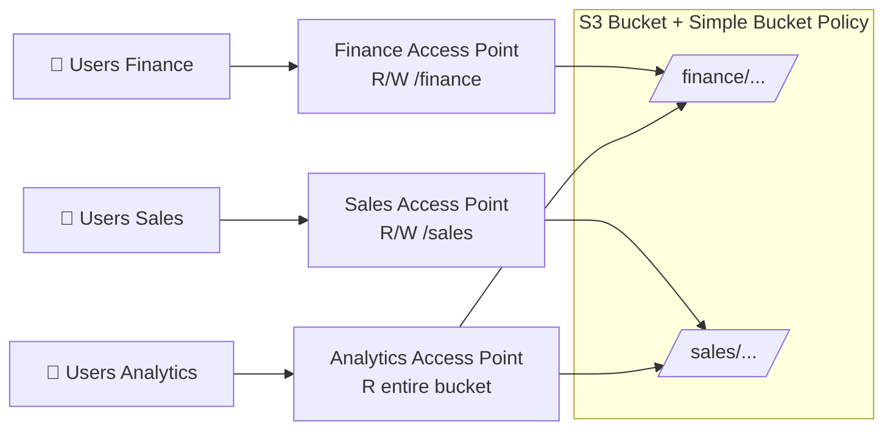

| Users | Access Point | Access Point Policy | Bucket Target |
|---|---|---|---|
| Users (Finance) | Finance Access Point | Grant R/W to `/finance` prefix | `/finance/...` |
| Users (Sales) | Sales Access Point | Grant R/W to `/sales` prefix | `/sales/...` |
| Users (Analytics) | Analytics Access Point | Grant R to entire bucket | `/finance/...` and `/sales/...` |

The S3 Bucket itself only needs a **Simple Bucket Policy**.

- Access Points simplify security management for S3 Buckets
- Each Access Point has:
  - Its own DNS name (Internet Origin or VPC Origin)
  - An access point policy (similar to bucket policy) to manage security at scale

### S3 - Access Points - VPC Origin

- We can define the access point to be accessible only from within the VPC
- You must create a **VPC Endpoint** to access the Access Point (Gateway or Interface Endpoint)
- The **VPC Endpoint Policy** must allow access to the target bucket and Access Point

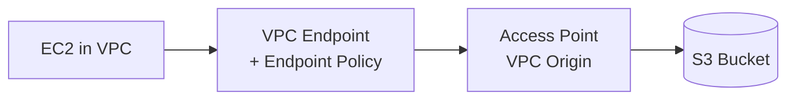

---

## Apache Iceberg Table Format

- The heart of Amazon's data lakehouse system they are building out
  - This seems to be the direction AWS is converging on as a data platform
  - Combined with Amazon SageMaker Lakehouse
- A managed data lake solution
- Built around **"Table Buckets"**
  - These store data in Apache Iceberg format
  - So you can just issue SQL queries through anything that supports Iceberg

### Iceberg Features

| Feature | What It Gives You |
|---|---|
| **Table format for data lakes** | Petabyte-scale, originally from Netflix |
| **ACID Compliance** | Transactional consistency for adds, removals, modifications; row-level updates and deletes for GDPR compliance |
| **Schema Evolution** | Update tables safely as data evolves |
| **Hidden Partitioning** | Partition evolution, update partition schemes and data volumes |
| **Time Travel** | Query historical data, verify changes between updates, easy rollback |
| **Efficient Metadata Management** | Fast planning on huge tables |

- New preferred AWS interface: **Amazon SageMaker Lakehouse**
- Works with Spark, Flink, Trino, Presto, Hive
- Integrated with AWS Glue, Redshift, EMR, and Athena

---

## Amazon S3 Tables: Table Buckets & Intelligent-Tiering

- Purpose-built for tabular data
  - Better than just storing data in regular S3 buckets
  - Up to **3x faster query performance, 10x more transactions per second**
- But it's more expensive
- **Managed table optimization:**
  - Compaction
  - Snapshot management
  - Unreferenced file removal
- IAM and Service Control Policies (AWS Organizations) integration
  - New, distinct service namespace: **`s3tables`**

### Table Buckets

- ARNs are also under the *s3tables* namespace
  - `arn:aws:s3tables:Region:OwnerAccountID:bucket/bucket-name`
- Table buckets contain tables, which may be organized into *namespaces*
  - This is the same concept as a "database" in other services, which contains multiple related tables
- Types of table buckets:
  - Customer-managed
  - AWS-managed (S3 metadata table, inventory tables)
- Names only need to be unique **within your account**
  - **Must be lowercase!** Or won't integrate with Lake Formation / Glue
  - Same restriction on namespaces
  - Cannot be changed
- May have IAM policies attached
- May have tags attached

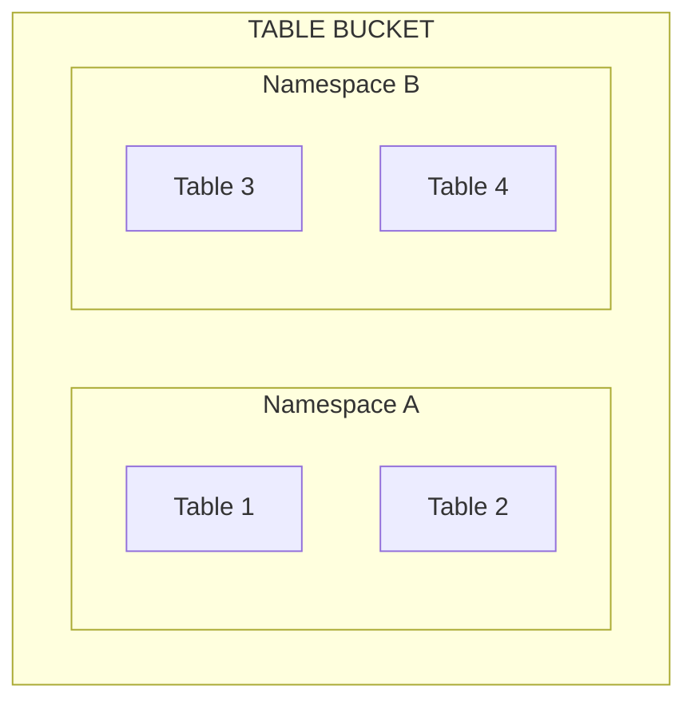

### S3 Tables Intelligent-Tiering

- Cost optimization feature
  - Automatically moves data between storage tiers based on access frequency
- **Frequent Access (Standard)**
  - Default; accessing a table will move it back here
  - **Compaction table maintenance only occurs in this tier**
- **Infrequent Access**: if data untouched for 30 days
- **Archive Instant Access**: if data untouched for 90 days
- All tiers have 99.9% availability and 99.999999999% durability

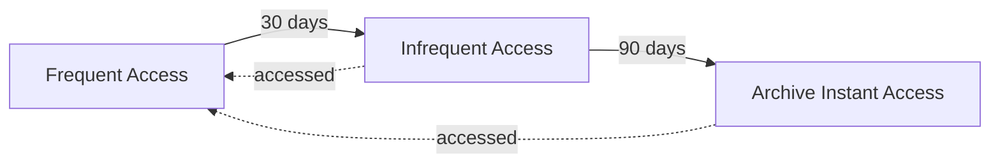

### S3 Tables: Replicas

- Automatic replication for backup / availability / compliance
- **Read-only replicas**
  - Potentially across regions and across accounts
- Use cases:
  - Minimize latency with local replicas
  - Centralize analytics by replicating into a single region
  - Compliance / data residency
  - Test / dev environments
- Intelligent-Tiering can apply to replicas to minimize costs

### S3 Tables: Security

- The standard tools apply to table buckets and tables:
  - IAM identity-based policies (user, group, or role)
  - Resource-based policies
  - AWS Organizations Service Control Policies (SCPs)
- Other access management tools:
  - SQL commands (operations map to specific IAM permissions)
  - Lake Formation
- **Encryption:** SSE-S3 or SSE-KMS
- **VPC endpoints via PrivateLink:**
  - Gateway and Interface endpoints (for finer-grained control)
  - Endpoint Policies may restrict by table or bucket
  - Dual-stack IPv4 and IPv6 endpoints
- **Public access and HTTP not allowed**

---

## S3 - Storage Lens

- Understand, analyze, and optimize storage across your **entire AWS Organization**
- Discover anomalies, identify cost efficiencies, and apply data protection best practices (30 days of usage & activity metrics)
- Aggregate data for organization, specific accounts, regions, buckets, or prefixes
- Default dashboard or create your own dashboards
- Can be configured to **export metrics daily to an S3 bucket** (CSV, Parquet)

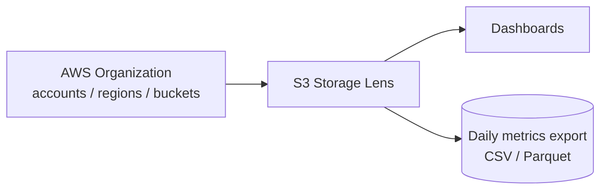

### Storage Lens - Default Dashboard

- Visualize summarized insights and trends for both free and advanced metrics
- Default dashboard shows Multi-Region and Multi-Account data
- Preconfigured by Amazon S3
- **Can't be deleted, but can be disabled**

### Storage Lens - Metrics

| Category | Provides Insights For | Example Metrics | Use Case |
|---|---|---|---|
| **Summary** | General S3 storage | `StorageBytes`, `ObjectCount` | Fastest-growing or unused buckets/prefixes |
| **Cost-Optimization** | Managing storage costs | `NonCurrentVersionStorageBytes`, `IncompleteMultipartUploadStorageBytes` | Incomplete MPUs older than 7 days, objects to transition to cheaper class |
| **Data-Protection** | Data protection features | `VersioningEnabledBucketCount`, `MFADeleteEnabledBucketCount`, `SSEKMSEnabledBucketCount`, `CrossRegionReplicationRuleCount` | Buckets not following data-protection best practices |
| **Access-Management** | S3 Object Ownership | `ObjectOwnershipBucketOwnerEnforcedBucketCount` | Which Object Ownership settings buckets use |
| **Event** | S3 Event Notifications | `EventNotificationEnabledBucketCount` | Which buckets have event notifications configured |
| **Performance** | S3 Transfer Acceleration | `TransferAccelerationEnabledBucketCount` | Which buckets have Transfer Acceleration enabled |
| **Activity** | How storage is requested | `AllRequests`, `GetRequests`, `PutRequests`, `ListRequests`, `BytesDownloaded` | Request patterns |
| **Detailed Status Code** | HTTP status codes | `200OKStatusCount`, `403ForbiddenErrorCount`, `404NotFoundErrorCount` | Spot access/permission errors |

### Storage Lens - Free vs. Paid

| | **Free Metrics** | **Advanced Metrics & Recommendations** |
|---|---|---|
| Availability | Automatic for all customers | Paid |
| Contents | ~28 usage metrics | Activity, Advanced Cost Optimization, Advanced Data Protection, Status Code |
| CloudWatch Publishing | ❌ | ✅ (no additional charge) |
| Prefix Aggregation | ❌ | ✅ |
| Data Retention | **14 days** | **15 months** |

---

## Amazon EBS

- An **EBS (Elastic Block Store) Volume** is a **network** drive you can attach to your instances while they run
- It allows your instances to persist data, even after their termination
- **They can only be mounted to one instance at a time** (at the Cloud Practitioner level)
- They are bound to a **specific Availability Zone**
- Analogy: think of them as a **"network USB stick"**

### EBS Volume

- It's a network drive (i.e. not a physical drive)
  - It uses the network to communicate with the instance, which means there might be a bit of latency
  - Can be detached from an EC2 instance and attached to another one quickly
- It's locked to an Availability Zone (AZ)
  - An EBS Volume in `us-east-1a` cannot be attached to `us-east-1b`
  - To move a volume across, you first need to **snapshot** it
- Has a provisioned capacity (size in GBs, and IOPS)
  - You get billed for all the provisioned capacity
  - You can increase the capacity of the drive over time

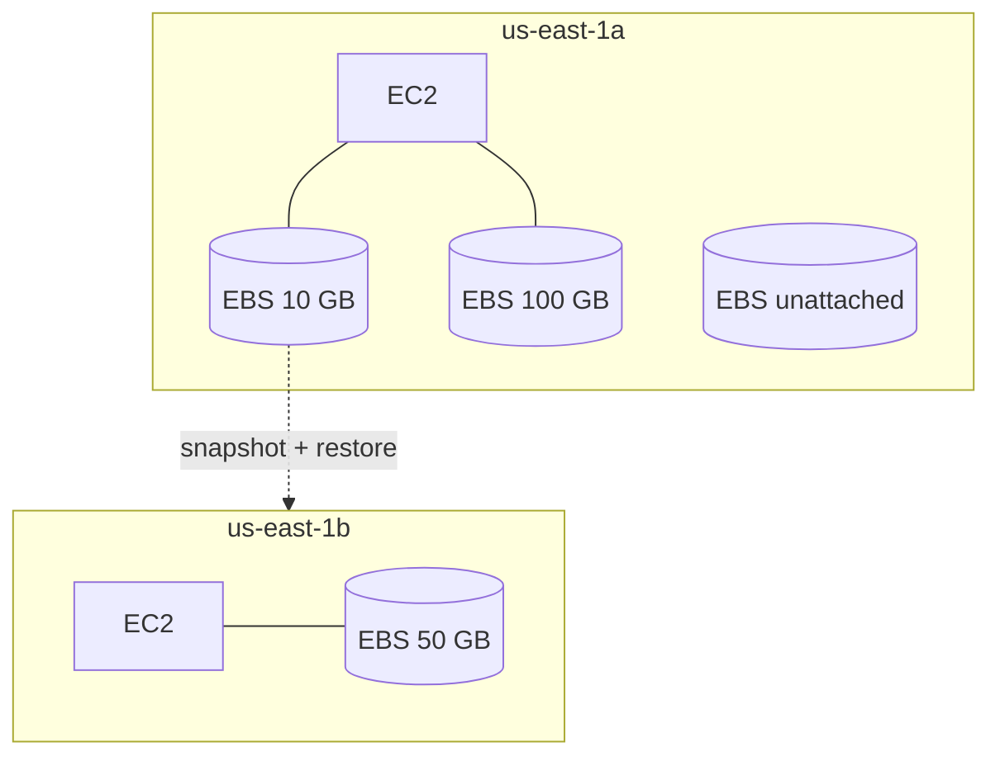

### EBS Volume Types *(added for exam)*

| Type | Category | Key Points | Use Case |
|---|---|---|---|
| **gp2** | General Purpose SSD | IOPS tied to size (3 IOPS/GB, burst to 3,000) | Boot volumes, dev/test |
| **gp3** | General Purpose SSD | 3,000 IOPS / 125 MB/s baseline, IOPS & throughput set **independently** | Most workloads, cheaper than gp2 |
| **io1 / io2 Block Express** | Provisioned IOPS SSD | Up to 64,000+ IOPS, **Multi-Attach** support | Critical DBs needing sustained IOPS |
| **st1** | Throughput Optimized HDD | Can't be boot volume | Big data, data warehouses, log processing |
| **sc1** | Cold HDD | Lowest cost, can't be boot volume | Infrequently accessed data |

### EBS Snapshots *(added for exam)*

- Point-in-time backup of an EBS volume, stored in S3 (you don't see the bucket)
- Not necessary to detach the volume, but recommended
- Can copy snapshots **across AZs or Regions** (this is how you move a volume)
- **EBS Snapshot Archive**: 75% cheaper, 24 to 72 hours to restore
- **Recycle Bin**: retention rules to recover accidentally deleted snapshots

### Delete on Termination Attribute

| Volume Type | Device | Snapshot | Size (GiB) | Volume Type | IOPS | Throughput (MB/s) | Delete on Termination | Encryption |
|---|---|---|---|---|---|---|---|---|
| Root | /dev/xvda | snap-09f18f682fd23a1b1 | 8 | General Purpose SSD (gp2) | 100 / 3000 | N/A | ✅ | Not Encrypted |
| EBS | /dev/sdb | (search) | 8 | General Purpose SSD (gp2) | 100 / 3000 | N/A | ⬜ | Not Encrypted |

- Controls the EBS behavior when an EC2 instance terminates
  - By default, the **root** EBS volume is deleted (attribute enabled)
  - By default, any **other** attached EBS volume is not deleted (attribute disabled)
- This can be controlled by the AWS console / AWS CLI
- **Use case:** preserve root volume when instance is terminated

### Elastic EBS Volumes

- You don't have to detach a volume or restart your instance to change it
  - Just go to **Actions → Modify Volume** in the console
- **Increase volume size**
  - You can only increase, **not decrease**
- **Change volume type**
  - gp2 → gp3
  - Specify desired IOPS or throughput performance (or it will guess)
- **Adjust performance**
  - Increase or decrease

---

## Amazon EFS - Elastic File System

- Managed **NFS** (network file system) that can be mounted on many EC2 instances
- EFS works with EC2 instances in **multi-AZ**
- Highly available, scalable, expensive (**3x gp2**), pay per use

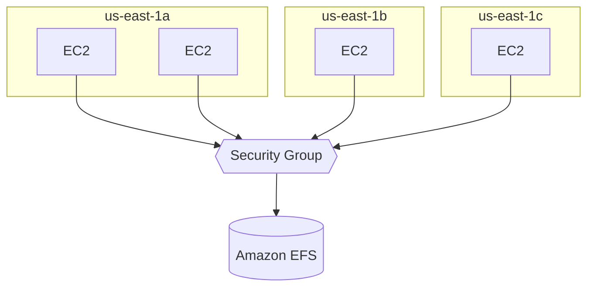

- **Use cases:** content management, web serving, data sharing, WordPress
- Uses **NFSv4.1** protocol
- Uses **security groups** to control access to EFS
- **Compatible with Linux-based AMIs (not Windows)**
- Encryption at rest using KMS
- **POSIX** file system (~Linux) that has a standard file API
- File system scales automatically, pay-per-use, **no capacity planning!**

### EFS - Performance

- **EFS Scale**
  - 1000s of concurrent NFS clients, 10 GB+/s throughput
  - Grows to petabyte-scale network file system, automatically
- **Performance Mode** (set at EFS creation time)
  - **General Purpose (default)**: latency-sensitive use cases (web server, CMS, etc.)
  - **Max I/O**: higher latency, throughput, highly parallel (big data, media processing)
- **Throughput Mode**
  - **Bursting**: 1 TB = 50 MiB/s + burst of up to 100 MiB/s
  - **Provisioned**: set your throughput regardless of storage size, ex: 1 GiB/s for 1 TB storage
  - **Elastic**: automatically scales throughput up or down based on your workloads
    - Up to 3 GiB/s for reads and 1 GiB/s for writes
    - Used for **unpredictable workloads**

### EFS - Storage Classes

- **Storage Tiers** (lifecycle management feature: move file after N days)
  - **Standard**: for frequently accessed files
  - **Infrequent Access (EFS-IA)**: cost to retrieve files, lower price to store
  - **Archive**: rarely accessed data (few times each year), 50% cheaper
  - Implement **lifecycle policies** to move files between storage tiers
- **Availability and durability**
  - **Standard**: Multi-AZ, great for prod
  - **One Zone**: One AZ, great for dev, backup enabled by default, compatible with IA (EFS One Zone-IA)
- **Over 90% in cost savings**

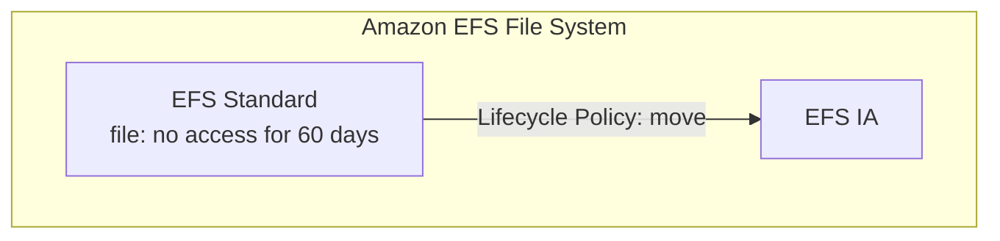

---

## Amazon EFS vs Amazon EBS

### EBS Volumes

- One instance (except **Multi-Attach io1/io2**)
- Locked at the **Availability Zone (AZ)** level
- **gp2:** IO increases if the disk size increases
- **gp3 & io1:** can increase IO independently
- To migrate an EBS volume across AZs:
  - Take a snapshot
  - Restore the snapshot to another AZ
  - EBS backups use IO and you shouldn't run them while your application is handling a lot of traffic
- Root EBS volumes of instances get terminated by default if the EC2 instance gets terminated (you can disable that)

### EFS - Elastic File System

- Mounting 100s of instances across AZs
- EFS to share website files (WordPress)
- Only for Linux instances (POSIX)
- EFS has a higher price point than EBS
- Can leverage Storage Tiers for cost savings

### Side-by-Side

| | **EBS** | **EFS** | **Instance Store** *(added)* |
|---|---|---|---|
| Type | Block storage (network drive) | Network file system (NFSv4.1) | Physical disk on host |
| Attach to | 1 instance (Multi-Attach io1/io2) | 100s-1000s of instances | Only its own instance |
| Scope | Single AZ | Multi-AZ (One Zone option) | Single host |
| Capacity | Provisioned, pay for provisioned | Auto-scales, pay per use | Fixed by instance type |
| OS | Linux & Windows | **Linux only** | Linux & Windows |
| Persistence | Survives instance stop/terminate (non-root) | Independent of instances | **Lost on stop/terminate** (ephemeral) |
| Performance | Up to high IOPS (io2) | Scales with clients | **Highest IOPS** (millions) |
| Cost | Cheaper | ~3x gp2 | Included with instance |

> **Remember:** EFS vs EBS vs Instance Store
> - Shared file system across instances/AZs, WordPress → **EFS**
> - Boot volume, single-instance DB, Windows → **EBS**
> - Temporary high-performance scratch space, buffers, cache → **Instance Store**
> - Windows shared file system → **FSx for Windows** (neither)

---

## AWS Backup

- Fully managed service
- Centrally manage and automate backups across AWS services
- No need to create custom scripts and manual processes

| Supported Services |
|---|
| Amazon EC2 / Amazon EBS |
| Amazon S3 |
| Amazon RDS (all DB engines) / Amazon Aurora / Amazon DynamoDB |
| Amazon DocumentDB / Amazon Neptune |
| Amazon EFS / Amazon FSx (Lustre & Windows File Server) |
| AWS Storage Gateway (Volume Gateway) |

- Supports **cross-region** backups
- Supports **cross-account** backups
- Supports **PITR** (Point-In-Time Recovery) for supported services
- On-Demand and Scheduled backups
- Tag-based policies
- You create backup policies known as **Backup Plans:**
  - Backup frequency (every 12 hours, daily, weekly, monthly, cron expression)
  - Backup window
  - Transition to Cold Storage (Never, Days, Weeks, Months, Years)
  - Retention Period (Always, Days, Months, Years)

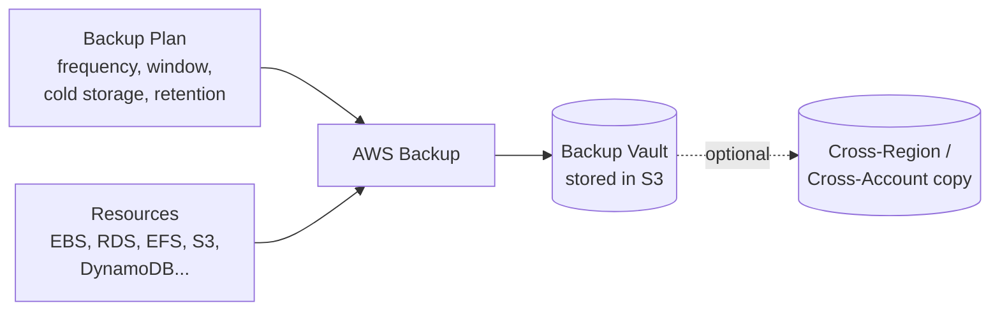

### AWS Backup Vault Lock

- Enforce a **WORM (Write Once Read Many)** state for all the backups stored in your AWS Backup Vault
- Additional layer of defense to protect your backups against:
  - Inadvertent or malicious delete operations
  - Updates that shorten or alter retention periods
- **Even the root user cannot delete backups when enabled**

---

## Exam Cheat Sheet

| If the question says... | Answer |
|---|---|
| Replicate existing objects / retry failed replication | **S3 Batch Replication** |
| Guaranteed replication within 15 minutes | **S3 Replication Time Control (RTC)** |
| Unknown or changing access patterns | **S3 Intelligent-Tiering** |
| Recreatable data, cheapest IA option | **S3 One Zone-IA** |
| Accessed once a quarter, needs ms retrieval | **Glacier Instant Retrieval** |
| Cheapest archive, 12-48 hr retrieval OK | **Glacier Deep Archive** |
| Single-digit ms latency, co-located with compute | **S3 Express One Zone** |
| Recommendations on when to transition (Standard → IA) | **S3 Storage Class Analysis** |
| Org-wide storage visibility / anomalies | **S3 Storage Lens** |
| Events to Step Functions / Kinesis / advanced filtering / replay | **S3 → EventBridge** |
| S3 events not arriving | **Missing resource policy on destination** |
| Faster uploads over long distances | **S3 Transfer Acceleration** |
| Large file upload (> 5 GB) | **Multi-Part Upload** |
| Read only the header of a file / parallel download | **Byte-Range Fetches** |
| Need audit trail of key usage | **SSE-KMS** (CloudTrail) |
| KMS throttling at high request rates | **SSE-KMS quota limit**, request increase |
| Compliance requires two layers of encryption | **DSSE-KMS** |
| Keys must stay outside AWS, AWS does encryption | **SSE-C** (HTTPS required) |
| Different teams need different prefix permissions | **S3 Access Points** |
| ACID, time travel, schema evolution on a data lake | **Apache Iceberg / S3 Tables** |
| Table bucket not integrating with Glue / Lake Formation | **Name not lowercase** |
| Keep root volume after instance termination | **Disable Delete on Termination** |
| Move EBS volume to another AZ | **Snapshot → restore** |
| Shared Linux file system across AZs | **EFS** |
| Unpredictable EFS throughput | **EFS Elastic throughput** |
| Centralized backups across services + WORM | **AWS Backup + Vault Lock** |