# 03 - Databases

DynamoDB, RDS and Aurora, the other purpose-built AWS databases, and Redshift. Exam tells and gotchas are inline under each topic, with a decision cheat sheet at the end.

## Contents

- [SQL vs NoSQL](#sql-vs-nosql)
- [Amazon DynamoDB](#amazon-dynamodb)
  - [Basics](#dynamodb-basics)
  - [Primary keys](#dynamodb-primary-keys)
  - [Capacity modes (WCU and RCU)](#dynamodb-capacity-modes)
  - [Consistency](#dynamodb-consistency)
  - [Partitions and throttling](#dynamodb-partitions-and-throttling)
  - [APIs](#dynamodb-apis)
  - [PartiQL](#dynamodb-partiql)
  - [Indexes (LSI and GSI)](#dynamodb-indexes)
  - [DAX](#dynamodb-accelerator-dax)
  - [Streams](#dynamodb-streams)
  - [TTL](#dynamodb-time-to-live-ttl)
  - [Patterns with S3](#dynamodb-patterns-with-s3)
  - [Security and other features](#dynamodb-security-and-other-features)
  - [Global tables, backups, import and export](#dynamodb-global-tables-backups-import-and-export)
  - [Exam tells](#dynamodb-exam-tells)
- [Amazon RDS](#amazon-rds)
  - [What is RDS](#what-is-rds)
  - [ACID](#acid)
  - [Multi-AZ vs read replicas](#rds-multi-az-vs-read-replicas)
  - [Locks](#shared-and-exclusive-locks)
  - [Best practices](#rds-best-practices)
  - [Exam tells](#rds-exam-tells)
- [Amazon Aurora](#amazon-aurora)
- [Other purpose-built databases](#other-purpose-built-databases)
  - [DocumentDB](#amazon-documentdb)
  - [ElastiCache](#amazon-elasticache)
  - [MemoryDB for Redis](#amazon-memorydb-for-redis)
  - [Keyspaces](#amazon-keyspaces)
  - [Neptune](#amazon-neptune)
  - [Timestream](#amazon-timestream)
  - [Which database when](#which-database-when)
- [Amazon Redshift](#amazon-redshift)
  - [Intro and architecture](#redshift-intro-and-architecture)
  - [Node types](#redshift-node-types)
  - [Spectrum](#redshift-spectrum)
  - [Performance: MPP, columnar, compression, sort keys](#redshift-performance)
  - [Durability, scaling, resizing](#redshift-durability-scaling-and-resizing)
  - [Distribution styles](#redshift-distribution-styles)
  - [Data flows and COPY](#redshift-data-flows-and-the-copy-command)
  - [Snapshot copy grants](#redshift-snapshot-copy-grants)
  - [DBLINK](#dblink)
  - [Integrations](#redshift-integration-with-other-services)
  - [WLM, concurrency scaling, SQA](#redshift-workload-management-wlm)
  - [VACUUM and ANALYZE](#vacuum-and-analyze)
  - [Anti-patterns](#redshift-anti-patterns)
  - [Newer features](#newer-redshift-features)
  - [Redshift ML](#amazon-redshift-ml)
  - [Security](#redshift-security)
  - [Serverless](#redshift-serverless)
  - [Materialized views](#redshift-materialized-views)
  - [Data sharing](#redshift-data-sharing)
  - [Lambda UDF](#redshift-lambda-udf)
  - [Federated queries](#redshift-federated-queries)
  - [System tables and views](#redshift-system-tables-and-views)
  - [Data API](#redshift-data-api)
  - [Exam tells](#redshift-exam-tells)
- [Decision cheat sheet](#decision-cheat-sheet)

---

## SQL vs NoSQL

### Traditional architecture

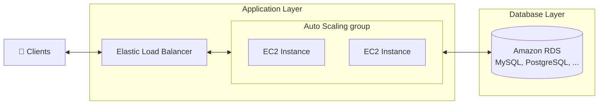

- Traditional applications leverage RDBMS databases
- These databases have the SQL query language
- Strong requirements about how the data should be modeled
- Ability to do query joins, aggregations, complex computations
- Vertical scaling (getting a more powerful CPU / RAM / IO)
- Horizontal scaling (increasing read capability by adding EC2 / RDS read replicas)

### NoSQL databases

- NoSQL databases are non-relational databases and are **distributed**
- NoSQL databases include MongoDB, DynamoDB, ...
- NoSQL databases do not support query joins (or just limited support)
- All the data that is needed for a query is present in one row
- NoSQL databases don't perform aggregations such as `SUM`, `AVG`
- NoSQL databases scale **horizontally**
- There's no "right or wrong" for NoSQL vs SQL, they just require you to model the data differently and think about user queries differently

| | SQL (RDS, Aurora, Redshift) | NoSQL (DynamoDB, DocumentDB, Keyspaces) |
|---|---|---|
| Schema | Fixed, defined up front | Flexible, per-item |
| Joins and aggregations | Yes | No (model so one row answers the query) |
| Scaling | Vertical, read replicas | Horizontal, automatic |
| Consistency | Strong by default (ACID) | Eventual by default, strong optional |
| Best for | Complex queries, transactions, reporting | Known access patterns at massive scale, low latency |

---

## Amazon DynamoDB

- Fully managed, highly available with replication across multiple AZs
- NoSQL database, not a relational database
- Scales to massive workloads, distributed database
- Millions of requests per second, trillions of rows, 100s of TB storage
- Fast and consistent in performance (low latency on retrieval)
- Integrated with IAM for security, authorization and administration
- Enables event-driven programming with DynamoDB Streams
- Low cost and auto-scaling capabilities
- Standard and Infrequent Access (IA) table classes

### DynamoDB basics

- DynamoDB is made of **tables**
- Each table has a **primary key** (must be decided at creation time)
- Each table can have an infinite number of items (= rows)
- Each item has **attributes** (can be added over time, can be null)
- Maximum size of an item is **400 KB**
- Data types supported:
  - **Scalar types**: String, Number, Binary, Boolean, Null
  - **Document types**: List, Map
  - **Set types**: String Set, Number Set, Binary Set

### DynamoDB primary keys

**Option 1: Partition key only (HASH)**

- Partition key must be unique for each item
- Partition key must be "diverse" so that the data is distributed
- Example: `User_ID` for a users table

| **User_ID** *(Primary Key: Partition Key)* | First_Name | Last_Name | Age |
|---|---|---|---|
| 7791a3d6-... | John | William | 46 |
| 873e0634-... | Oliver | | 24 |
| a80f73a1-... | Katie | Lucas | 31 |

- **Primary key** = `User_ID` (partition key)
- **Attributes** = `First_Name`, `Last_Name`, `Age`
- Note: Oliver has no `Last_Name`, items don't need the same attributes (schemaless)

**Option 2: Partition key + sort key (HASH + RANGE)**

- The combination must be unique for each item
- Data is grouped by partition key, ordered by sort key within the partition
- Example: users-games table, `User_ID` for partition key and `Game_ID` for sort key

**Partition key exercise**

- We're building a movie database. What is the best partition key to maximize data distribution?
  - `movie_id`
  - `producer_name`
  - `leader_actor_name`
  - `movie_language`
- `movie_id` has the highest cardinality so it's a good candidate
- `movie_language` doesn't take many values and may be skewed towards English, so it's not a great choice

### DynamoDB in big data

Common use cases:

- Mobile apps
- Gaming
- Digital ad serving
- Live voting
- Audience interaction for live events
- Sensor networks
- Log ingestion
- Access control for web-based content
- E-commerce shopping carts
- Web session management

### DynamoDB capacity modes

Control how you manage your table's capacity (read/write throughput).

| | **Provisioned** | **On-Demand** (default for new tables) |
|---|---|---|
| You specify | Reads/writes per second (RCU/WCU) | Nothing, scales automatically |
| Planning | Needed, or enable auto scaling | None |
| Billing | Pay for provisioned capacity whether used or not | Pay per request (RRU/WRU), roughly 2.5x more per unit |
| Throttling | Yes, if you exceed capacity and burst is gone | Effectively none |
| Best for | Steady, predictable traffic | Unknown or spiky workloads, new apps |

- You can switch between modes once every 24 hours

**Provisioned mode**

- Tables must have provisioned read and write capacity units
- **Read Capacity Units (RCU)**: throughput for reads
- **Write Capacity Units (WCU)**: throughput for writes
- Option to set up auto scaling of throughput to meet demand
- Throughput can be exceeded temporarily using **burst capacity** (up to 5 minutes of unused capacity is banked)
- If burst capacity has been consumed, you get `ProvisionedThroughputExceededException`
- It's then advised to do an **exponential backoff** retry (built into the SDKs)

**Write Capacity Units (WCU)**

- One WCU represents **one write per second for an item up to 1 KB** in size
- If the items are larger than 1 KB, more WCUs are consumed

Formula: `WCU = items per second × ceil(item size in KB / 1 KB)`

| Example | Scenario | Calculation | Result |
|---|---|---|---|
| 1 | 10 items/sec, 2 KB each | 10 × (2 KB / 1 KB) | **20 WCUs** |
| 2 | 6 items/sec, 4.5 KB each | 6 × (5 KB / 1 KB) *(4.5 rounds up to 5)* | **30 WCUs** |
| 3 | 120 items/min, 2 KB each | (120 / 60) × (2 KB / 1 KB) | **4 WCUs** |

**Read Capacity Units (RCU)**

- One RCU represents **one strongly consistent read** per second, or **two eventually consistent reads** per second, for an item **up to 4 KB** in size
- If the items are larger than 4 KB, more RCUs are consumed
- Transactional reads cost 2x a strongly consistent read

Formulas:

- Strongly consistent: `RCU = reads per second × ceil(item size / 4 KB)`
- Eventually consistent: `RCU = (reads per second / 2) × ceil(item size / 4 KB)`

| Example | Scenario | Calculation | Result |
|---|---|---|---|
| 1 | 10 strongly consistent reads/sec, 4 KB each | 10 × (4 KB / 4 KB) | **10 RCUs** |
| 2 | 16 eventually consistent reads/sec, 12 KB each | (16 / 2) × (12 KB / 4 KB) | **24 RCUs** |
| 3 | 10 strongly consistent reads/sec, 6 KB each | 10 × (8 KB / 4 KB) *(6 KB rounds up to 8 KB)* | **20 RCUs** |

**On-demand mode**

- Reads/writes automatically scale up/down with your workload
- No capacity planning needed (WCU / RCU)
- Unlimited WCU and RCU, no throttling, more expensive
- You're charged for reads/writes that you use in terms of **RRU** and **WRU**
  - **Read Request Units (RRU)**: throughput for reads (same math as RCU)
  - **Write Request Units (WRU)**: throughput for writes (same math as WCU)
- About 2.5x more expensive per unit than provisioned capacity (use with care for steady workloads)
- Use cases: unknown workloads, unpredictable application traffic

### DynamoDB consistency

- **Eventually consistent read (default)**
  - If we read right after a write, it's possible we'll get stale data because of replication
- **Strongly consistent read**
  - If we read right after a write, we get the correct data
  - Set `ConsistentRead=True` in API calls (`GetItem`, `BatchGetItem`, `Query`, `Scan`)
  - Consumes twice the RCU
  - Not supported on GSIs (only the base table and LSIs)

### DynamoDB partitions and throttling

- Data is stored in partitions
- Partition keys go through a **hashing algorithm** to decide which partition they go to
- To compute the number of partitions:
  - `# of partitions (by capacity) = (RCUs Total / 3000) + (WCUs Total / 1000)`
  - `# of partitions (by size) = Total Size / 10 GB`
  - `# of partitions = ceil(max(# by capacity, # by size))`
- WCUs and RCUs are **spread evenly across partitions**

**Partition limits:** each partition handles up to **3,000 RCU**, **1,000 WCU**, and **10 GB**

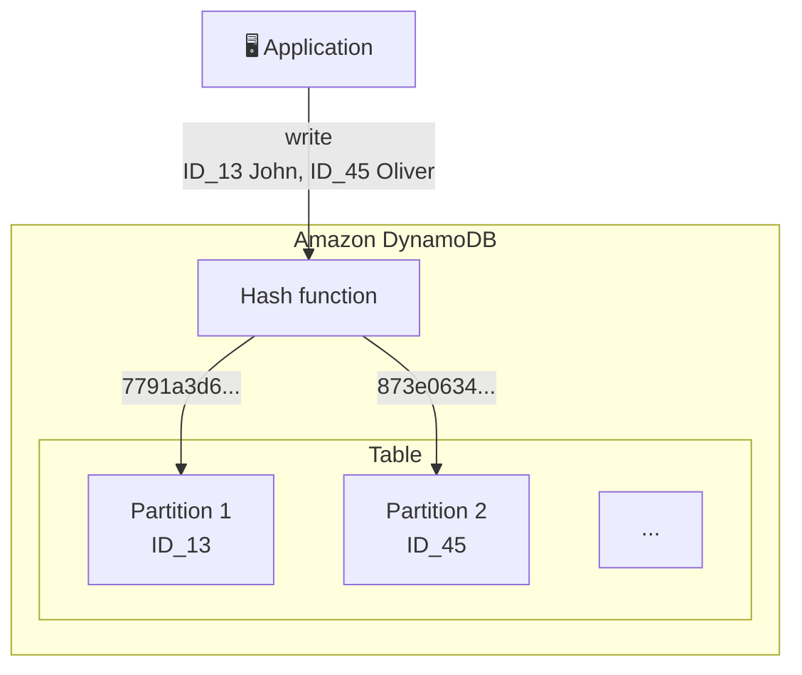

**Throttling**

- If we exceed provisioned RCUs or WCUs, we get `ProvisionedThroughputExceededException`
- Reasons:
  - **Hot keys**: one partition key is being read too many times (e.g. a popular item)
  - **Hot partitions**: capacity is split evenly, so one busy partition throttles even if the table total is fine
  - **Very large items**: RCU and WCU depend on item size
- Solutions:
  - **Exponential backoff** when the exception is encountered (already in the SDK)
  - **Distribute partition keys** as much as possible (add a random suffix or shard the key, "write sharding")
  - If it's a read issue, use **DynamoDB Accelerator (DAX)**
  - Adaptive capacity helps automatically by moving unused capacity to hot partitions, but it is not instant and can't exceed the per-partition limits

### DynamoDB APIs

**Writing data**

- **PutItem**
  - Creates a new item or fully replaces an old item (same primary key)
  - Consumes WCUs
- **UpdateItem**
  - Edits an existing item's attributes or adds a new item if it doesn't exist
  - Can be used to implement **atomic counters**: a numeric attribute that's unconditionally incremented
- **Conditional writes**
  - Accepts a write/update/delete only if conditions are met, otherwise returns an error
  - Helps with concurrent access to items (optimistic locking)
  - No performance impact

**Reading data**

- **GetItem**
  - Read based on primary key
  - Primary key can be **HASH** or **HASH+RANGE**
  - Eventually consistent read (default)
  - Option to use strongly consistent reads (more RCU, might take longer)
  - **ProjectionExpression** can be specified to retrieve only certain attributes
- **Query** returns items based on:
  - **KeyConditionExpression**
    - Partition key value (**must be the = operator**), required
    - Sort key value (=, <, <=, >, >=, Between, Begins with), optional
  - **FilterExpression**
    - Additional filtering after the Query operation (before data is returned to you)
    - Use only with non-key attributes (does not allow HASH or RANGE attributes)
    - Does **not** reduce RCU consumed, you pay for what was read before the filter
  - Returns the number of items specified in **Limit**, or up to 1 MB of data
  - Ability to paginate the results (`LastEvaluatedKey`)
  - Can query a table, a Local Secondary Index, or a Global Secondary Index
- **Scan**
  - Scans the entire table and then filters out data (inefficient)
  - Returns up to 1 MB of data, use pagination to keep reading
  - Consumes a lot of RCU
  - Limit impact using **Limit** or reduce the size of the result and pause
  - For faster performance, use **Parallel Scan**
    - Multiple workers scan multiple data segments at the same time
    - Increases throughput and RCU consumed
    - Limit the impact of parallel scans just like you would for Scans
  - Can use **ProjectionExpression** and **FilterExpression** (no change to RCU)

**Deleting data**

- **DeleteItem**
  - Delete an individual item
  - Ability to perform a conditional delete
- **DeleteTable**
  - Delete a whole table and all its items
  - Much quicker than calling **DeleteItem** on all items

**Batch operations**

- Save on latency by reducing the number of API calls
- Operations are done in parallel for better efficiency
- Part of a batch can fail, in which case we need to retry the failed items

| | **BatchWriteItem** | **BatchGetItem** |
|---|---|---|
| Operations | Up to **25** `PutItem` and/or `DeleteItem` in one call | Return items from one or more tables, up to **100** items |
| Data limit | Up to **16 MB** written, up to **400 KB** per item | Up to **16 MB** of data |
| Notes | **Can't update items** (use `UpdateItem`) | Items are retrieved in parallel to minimize latency |
| Failures | `UnprocessedItems` for failed writes (exponential backoff or add WCU) | `UnprocessedKeys` for failed reads (exponential backoff or add RCU) |

**Transactions**

- `TransactWriteItems` and `TransactGetItems`: all-or-nothing across up to **100 items** in one or more tables
- Cost 2x the normal capacity (one read to prepare, one to commit)
- Use when a scenario says "atomic across multiple items" or "either both updates happen or neither"

### DynamoDB PartiQL

- SQL-compatible query language for DynamoDB
- Select, insert, update, and delete data in DynamoDB using SQL-like syntax
- Supports `INSERT`, `UPDATE`, `SELECT`, `DELETE` (not everything in SQL)
- Supports batch operations and transactions
- Run queries across multiple DynamoDB tables
- Run PartiQL queries from the console, NoSQL Workbench, DynamoDB APIs, CLI, SDK

```sql
SELECT OrderID, Total
FROM Orders
WHERE OrderID IN [1, 2, 3]
ORDER BY OrderID DESC
```

```sql
SELECT * FROM "demo_indexes"
WHERE "user_id" = 'partitionKeyValue' AND "game_ts" = 'sortKeyValue'
```

- Gotcha: a PartiQL `SELECT` without the partition key in the `WHERE` clause becomes a full **Scan**, with Scan cost

### DynamoDB indexes

**Local Secondary Index (LSI)**

- **Alternative sort key** for your table (same **partition key** as the base table)
- The sort key consists of one scalar attribute (String, Number, or Binary)
- Up to **5** LSIs per table
- **Must be defined at table creation time**
- **Attribute projections**: `KEYS_ONLY`, `INCLUDE`, `ALL`
- Supports strongly consistent reads
- Shares the base table's RCU/WCU

| **User_ID** *(Partition Key)* | **Game_ID** *(Sort Key)* | Game_TS *(LSI Sort Key)* | Score | Result |
|---|---|---|---|---|
| 7791a3d6-... | 4421 | "2021-03-15T17:43:08" | 92 | Win |
| 873e0634-... | 4521 | "2021-06-20T19:02:32" | | Lose |
| a80f73a1-... | 1894 | "2021-02-11T04:11:31" | 77 | Win |

- **Primary key** = `User_ID` + `Game_ID`
- **Attributes** = `Game_TS`, `Score`, `Result`
- LSI on `Game_TS` lets you query a user's games by timestamp instead of `Game_ID`

**Global Secondary Index (GSI)**

- **Alternative primary key** (HASH or HASH+RANGE) from the base table
- Speed up queries on non-key attributes
- The index key consists of scalar attributes (String, Number, or Binary)
- **Attribute projections**: `KEYS_ONLY`, `INCLUDE`, `ALL`
- Must provision RCUs and WCUs for the index (own capacity, separate from the table)
- **Can be added/modified after table creation**
- Up to **20** GSIs per table
- Eventually consistent only

**TABLE** (query by `User_ID`)

| **User_ID** *(Partition Key)* | **Game_ID** *(Sort Key)* | Game_TS *(Attribute)* |
|---|---|---|
| 7791a3d6-... | 4421 | "2021-03-15T17:43:08" |
| 873e0634-... | 4521 | "2021-06-20T19:02:32" |
| a80f73a1-... | 1894 | "2021-02-11T04:11:31" |

**INDEX GSI** (query by `Game_ID`)

| **Game_ID** *(Partition Key)* | **Game_TS** *(Sort Key)* | User_ID *(Attribute)* |
|---|---|---|
| 4421 | "2021-03-15T17:43:08" | 7791a3d6-... |
| 4521 | "2021-06-20T19:02:32" | 873e0634-... |
| 1894 | "2021-02-11T04:11:31" | a80f73a1-... |

| | **LSI** | **GSI** |
|---|---|---|
| Partition key | Same as table | Different |
| Sort key | Different | Any |
| When created | Table creation only | Any time |
| Max per table | 5 | 20 |
| Capacity | Shares table's | Own RCU/WCU |
| Strongly consistent reads | Yes | No |
| 10 GB per partition key limit | Yes | No |

**Indexes and throttling**

- GSI:
  - **If writes are throttled on the GSI, the main table is throttled too**, even if the WCU on the main table is fine
  - Choose your GSI partition key carefully and assign its WCU carefully
- LSI:
  - Uses the WCUs and RCUs of the main table
  - No special throttling considerations

### DynamoDB Accelerator (DAX)

- Fully managed, highly available, seamless in-memory cache for DynamoDB
- **Microsecond latency** for cached reads and queries
- Doesn't require application logic modification (compatible with existing DynamoDB APIs)
- Solves the **hot key problem** (too many reads of the same item)
- **5 minute TTL** for cache (default)
- Up to **11 nodes** in the cluster (1 primary + 10 read replicas)
- Multi-AZ (**3 nodes minimum** recommended for production)
- Secure (encryption at rest with KMS, VPC, IAM, CloudTrail)
- Write-through: writes go to DynamoDB and the cache. Only caches eventually consistent reads, strongly consistent reads bypass DAX

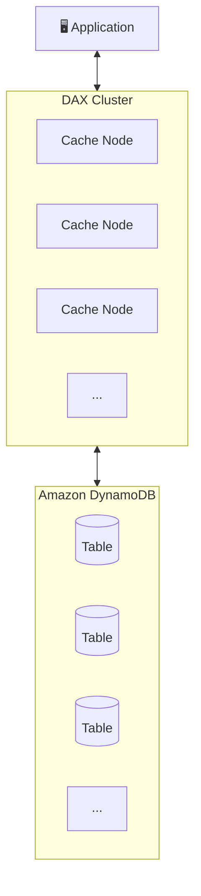

**DAX vs ElastiCache**

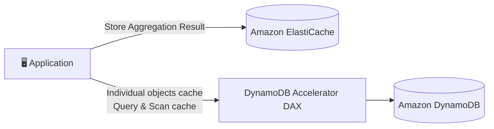

| | **DAX** | **ElastiCache** |
|---|---|---|
| Caches | Individual objects, Query and Scan results | Aggregation results (computed data) |
| Sits | Directly in front of DynamoDB | Beside the app, app manages it |
| Code changes | None (same DynamoDB API) | App logic handles read/write to cache |

### DynamoDB Streams

- Ordered stream of item-level modifications (create/update/delete) in a table
- Stream records can be:
  - Sent to **Kinesis Data Streams**
  - Read by **AWS Lambda**
  - Read by **Kinesis Client Library applications**
- Data retention up to **24 hours**
- Use cases:
  - React to changes in real time (welcome email to users)
  - Analytics
  - Insert into derivative tables
  - Insert into OpenSearch Service
  - Implement cross-region replication (this is how Global Tables work)

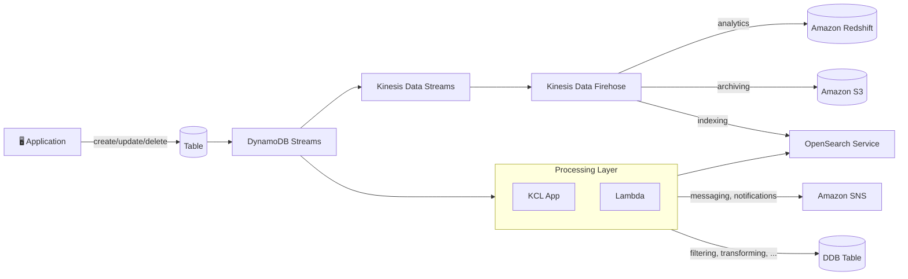

- Ability to choose the information that will be written to the stream:
  - **KEYS_ONLY**: only the key attributes of the modified item
  - **NEW_IMAGE**: the entire item, as it appears after it was modified
  - **OLD_IMAGE**: the entire item, as it appeared before it was modified
  - **NEW_AND_OLD_IMAGES**: both the new and old images of the item
- DynamoDB Streams are made of shards, just like Kinesis Data Streams
- You don't provision shards, this is automated by AWS
- **Records are not retroactively populated in a stream after enabling it**

**DynamoDB Streams vs Kinesis Data Streams for DynamoDB**

| | **DynamoDB Streams** | **Kinesis Data Streams** |
|---|---|---|
| Retention | 24 hours | Up to 365 days |
| Ordering | Strict per item | Not guaranteed, duplicates possible |
| Consumers | Lambda, KCL (2 per shard) | Up to 5 standard, 20 with enhanced fan-out |
| Downstream | Lambda logic | Firehose, Flink, Redshift streaming |
| Pick when | Simple triggers, Global Tables, exact ordering | Long retention, many consumers, analytics pipelines |

**DynamoDB Streams and AWS Lambda**

- You need to define an **Event Source Mapping** to read from DynamoDB Streams
- The Lambda function needs the **appropriate permissions** (`dynamodb:GetRecords`, `GetShardIterator`, `DescribeStream`, `ListStreams`)
- Your Lambda function is invoked **synchronously** by the event source mapping
- A poison record blocks the shard until it expires unless you set `MaximumRetryAttempts`, `BisectBatchOnFunctionError`, and an on-failure destination (SQS or SNS), same pattern as Kinesis

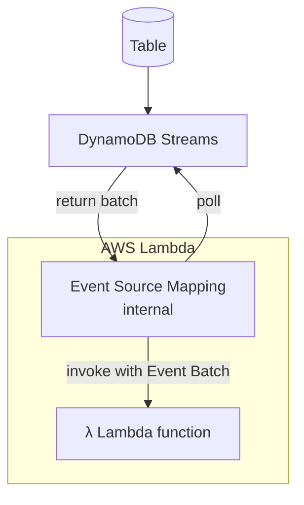

### DynamoDB Time To Live (TTL)

- Automatically delete items after an expiry timestamp
- **Doesn't consume any WCUs** (no extra cost)
- The TTL attribute must be a **Number** data type with a **Unix epoch timestamp** value (seconds)
- Expired items deleted within a few days of expiration (usually under 48 hours)
- Expired items that haven't been deleted yet **still appear in reads/queries/scans** (filter them out if you don't want them)
- Expired items are deleted from both LSIs and GSIs
- A delete operation for each expired item enters **DynamoDB Streams** (can help recover or archive expired items)
- Use cases: keep only current items, session data, adhere to regulatory retention rules

**Current time:** Friday, September 10, 2021, 11:56:11 AM (epoch `1631274971`)

**SessionData (Table)**

| **User_ID** | Session_ID | ExpTime (TTL) | Status |
|---|---|---|---|
| 7791a3d6-... | 74686572652 | 1631188571 | ⏰ Expired |
| 873e0634-... | 6e6f7468696 | 1631274971 | |
| a80f73a1-... | 746f2073656 | 1631102171 | ⏰ Expired |

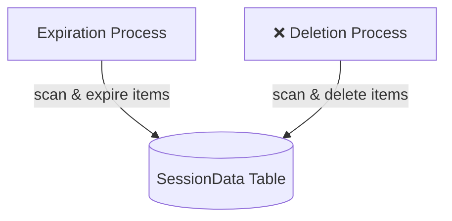

### DynamoDB patterns with S3

**Large objects pattern**

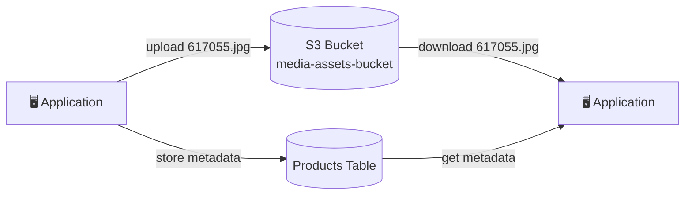

**Products (Table)**

| **Product_ID** | Product_Name | Image_URL |
|---|---|---|
| 759692 | Jeans | https://media-assets-bucket.us-east-1.amazonaws.com/759692.jpg |
| 315972 | Coat | https://media-assets-bucket.us-east-1.amazonaws.com/315972.jpg |
| 617055 | Shirt | https://media-assets-bucket.us-east-1.amazonaws.com/617055.jpg |

- Store the large object (image) in **S3**, store only its **metadata + URL** in DynamoDB
- Works around the **400 KB max item size** in DynamoDB

**Indexing S3 object metadata**

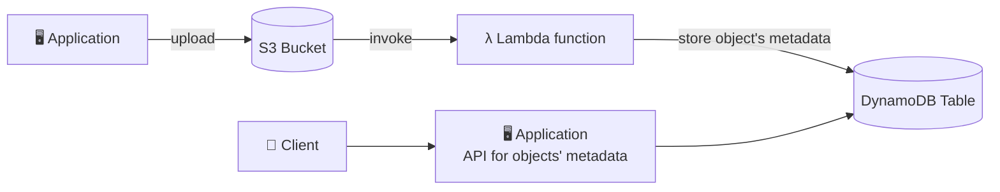

Client queries via the API:

- Search by date
- Total storage used by a customer
- List of all objects with certain attributes
- Find all objects uploaded within a date range

- S3 upload triggers Lambda (S3 Event Notification), Lambda writes metadata to DynamoDB
- Query DynamoDB instead of listing/scanning S3, which is slow and limited

### DynamoDB security and other features

- **Security**
  - VPC endpoints (gateway endpoint, free) to access DynamoDB without using the internet
  - Access fully controlled by IAM
  - Encryption at rest using AWS KMS (on by default) and in transit using SSL/TLS
- **Backup and restore**
  - Point-in-time recovery (PITR), like RDS, up to 35 days
  - On-demand backups, kept until you delete them
  - No performance impact
- **Global Tables**
  - Multi-region, multi-active, fully replicated, high performance
- **DynamoDB Local**
  - Develop and test apps locally without accessing the DynamoDB web service
- AWS Database Migration Service (DMS) can be used to migrate to DynamoDB (from MongoDB, Oracle, MySQL, S3, ...)

**Users interact with DynamoDB directly**

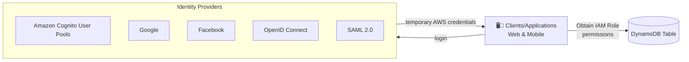

- Users log in through an identity provider and receive **temporary AWS credentials**
- Credentials map to an **IAM role** whose permissions control what they can do in DynamoDB
- No backend server needed between the client and DynamoDB

**Fine-grained access control**

- Using **Web Identity Federation** or **Cognito Identity Pools**, each user gets AWS credentials
- You can assign an IAM role to these users with a **Condition** to limit their API access to DynamoDB
- **LeadingKeys**: limit row-level access for users on the primary key
- **Attributes**: limit specific attributes the user can see

```json
{
  "Version": "2012-10-17",
  "Statement": [
    {
      "Effect": "Allow",
      "Action": [
        "dynamodb:GetItem", "dynamodb:BatchGetItem", "dynamodb:Query",
        "dynamodb:PutItem", "dynamodb:UpdateItem", "dynamodb:DeleteItem",
        "dynamodb:BatchWriteItem"
      ],
      "Resource": "arn:aws:dynamodb:us-west-2:123456789012:table/MyTable",
      "Condition": {
        "ForAllValues:StringEquals": {
          "dynamodb:LeadingKeys": ["${cognito-identity.amazonaws.com:sub}"]
        }
      }
    }
  ]
}
```

- The `LeadingKeys` condition means users can only access items where the **partition key matches their own Cognito identity ID**

### DynamoDB global tables, backups, import and export

**Global Tables**

- Multi-region, multi-active (write anywhere), replicated automatically
- Requires **DynamoDB Streams** with `NEW_AND_OLD_IMAGES` on the table
- Last writer wins on conflicts
- Use for low-latency global apps or multi-region DR

**Export to S3**

- Full or incremental export of a table to S3 in DynamoDB JSON or Ion, no RCU consumed
- Requires **PITR** enabled
- Lands in S3 where Athena, Glue, or Redshift Spectrum can read it. This is the exam answer for "analyze DynamoDB data without impacting the table"

**Import from S3**

- Create a new table from CSV, DynamoDB JSON, or Ion files in S3, no WCU consumed
- Only creates new tables, can't load into an existing one

### DynamoDB exam tells

| Scenario | Answer |
|---|---|
| Hot partition, throttling on reads | DAX, or redesign the partition key |
| Hot partition, throttling on writes | Write sharding (random suffix on the key), or on-demand mode |
| GSI throttling the base table | Give the GSI more WCU or pick a better GSI key |
| Need a different sort key, table exists | GSI (LSI can't be added later) |
| Strongly consistent reads on an index | Must be an LSI |
| Run analytics or SQL on table data | Export to S3 then Athena, never Scan |
| React to item changes in real time | Streams + Lambda |
| Keep change history > 24h or many consumers | Kinesis Data Streams for DynamoDB |
| Auto-expire session or temp data | TTL (free) |
| Item > 400 KB | Store in S3, keep the pointer in DynamoDB |
| Atomic update across several items | Transactions |
| Unpredictable traffic, new app | On-demand mode |
| Steady traffic, cost sensitive | Provisioned with auto scaling |
| Multi-region active-active | Global Tables (needs Streams) |
| Lambda can't reach DynamoDB from a private subnet | Gateway VPC endpoint |

---

## Amazon RDS

### What is RDS

- Hosted relational database
  - Amazon Aurora
  - MySQL
  - PostgreSQL
  - MariaDB
  - Oracle
  - SQL Server
- Not for "big data"
  - Might appear on the exam as an example of what not to use
  - Or in the context of migrating from RDS to Redshift
- Managed: patching, backups (automated, 0 to 35 days retention), snapshots, monitoring, Multi-AZ, read replicas
- You cannot SSH into the instance

### ACID

RDS databases offer full ACID compliance:

- **Atomicity**: either the transaction as a whole is executed, or if part of it fails, the whole transaction is rolled back
- **Consistency**: the data written to the database must adhere to all rules and constraints
- **Isolation**: each transaction is independent of the others
- **Durability**: all changes made to the database are permanent once successfully committed

### RDS Multi-AZ vs read replicas

Two different features that get confused constantly.

| | **Multi-AZ** | **Read replicas** |
|---|---|---|
| Purpose | High availability, failover | Read scaling, reporting offload |
| Replication | Synchronous | Asynchronous (replica lag) |
| Serves reads? | No (standby is idle) | Yes |
| Count | 1 standby (or 2 readable standbys with Multi-AZ DB cluster) | Up to 15 |
| Failover | Automatic, ~60 to 120 seconds, same DNS name | Manual promotion |
| Cross-region | No | Yes |
| Cost | ~2x instance | Per replica |

- Exam tell: "zero data loss on failure" is Multi-AZ. "Reporting queries slow down the app" is a read replica. "Both" is common in real designs

**RDS Proxy**

- Managed connection pooler in front of RDS/Aurora
- The answer when "Lambda is exhausting database connections"
- Also speeds up failover (connections survive)

### Shared and exclusive locks

- Relational databases implicitly "lock" tables to prevent two things writing to it at the same time, or reading while a write is in process
- Tables or rows can also be explicitly locked to ensure data integrity and concurrency control
- Types of locks:
  - **Shared locks**: allow reads, prevent writes. Can be held by multiple transactions (`FOR SHARE`)
  - **Exclusive locks**: prevent all reads and writes to a resource. Only one transaction can hold it (`FOR UPDATE`)

Examples (MySQL):

- **Lock an entire table**
  - `LOCK TABLES employees WRITE;` locks the entire `employees` table for write operations
  - `UNLOCK TABLES;` releases the lock
  - Note: Redshift also has a `LOCK` command for the same purpose
- **Shared lock** (allow reads, prevent other writes during this transaction)
  - `SELECT * FROM employees WHERE department = 'Finance' FOR SHARE;`
- **Exclusive lock** (prevent all reads and writes during this transaction)
  - `SELECT * FROM employees WHERE employee_id = 123 FOR UPDATE;`
- Make sure the transactions holding locks complete, or you can end up with a **deadlock**

```sql
-- Table lock
LOCK TABLES employees WRITE;
UNLOCK TABLES;

-- Shared lock
SELECT * FROM employees WHERE department = 'Finance' FOR SHARE;

-- Exclusive lock
SELECT * FROM employees WHERE employee_id = 123 FOR UPDATE;
```

| Lock type | Others can read? | Others can write? |
|---|---|---|
| **Shared** (`FOR SHARE`) | ✅ Yes | ❌ No |
| **Exclusive** (`FOR UPDATE`) | ❌ No | ❌ No |

### RDS best practices

**Operational guidelines**

- Use CloudWatch to monitor memory, CPU, storage, replica lag
- Perform automatic backups during the daily low in write IOPS
- Insufficient I/O will make recovery after failure slow
  - Migrate to a DB instance with more I/O
  - Move to General Purpose or Provisioned IOPS storage
- Set TTL on DNS for your DB instances to 30 seconds or less in your apps (so failover is picked up)
- Test failover before you need it
- Provision enough RAM to include your entire working set
  - If your **ReadIOPS** metric is small and stable, you're good
- Rate limits in Amazon API Gateway can be used to protect your database

**Query optimization**

- Use indexes to accelerate SELECT statements
  - Use `EXPLAIN` plans to identify the indexes you need
- Avoid full table scans
- Use `ANALYZE TABLE` periodically
- Simplify WHERE clauses
- Engine-specific optimizations

**DB-specific tweaks**

- MySQL, MariaDB
  - Keep tables well under 16 TB, ideally under 100 GB
  - Have enough RAM to hold indexes of actively used tables
  - Try to have fewer than 10,000 tables
  - Use InnoDB as the storage engine
- PostgreSQL
  - When bulk loading: disable DB backups and Multi-AZ, tweak `maintenance_work_mem`, `max_wal_size`, `checkpoint_timeout`, disable `synchronous_commit` and `autovacuum`, ensure tables are logged
  - Re-enable `autovacuum` afterwards
- SQL Server
  - Use RDS DB Events to monitor failovers
  - Do not enable simple recovery mode, offline mode, or read-only mode (this breaks Multi-AZ)
  - Deploy into all AZs
- Oracle is its own beast

### RDS exam tells

| Scenario | Answer |
|---|---|
| Petabyte analytics on RDS is slow | Wrong tool, move to Redshift |
| OLTP app needs HA | Multi-AZ |
| Reporting slows down the app | Read replica (or federated query / zero-ETL into Redshift) |
| Lambda exhausts connections | RDS Proxy |
| Need to replicate RDS into Redshift continuously | Zero-ETL (Aurora, RDS MySQL) or DMS |
| Migrate on-prem Oracle to Aurora | DMS + Schema Conversion Tool |

---

## Amazon Aurora

- Aurora is a proprietary technology from AWS (not open source)
- MySQL and PostgreSQL compatible (your drivers work as if Aurora were MySQL or Postgres)
- "AWS cloud optimized": up to **5x faster than MySQL**, **3x faster than PostgreSQL** on RDS
- **1/10 the cost** of commercial databases, about 20% more than RDS but more efficient
- Storage automatically grows in increments of 10 GB, up to **128 TiB** (256 TiB on recent engine versions)
- Up to **15 read replicas**, replication faster than MySQL (sub 10 ms replica lag)
- Failover is near instantaneous, HA native
- Continuous backup to S3, replication across regions and AZs
- Automatic scaling with **Aurora Serverless** (v2 scales in fine-grained ACU increments without pausing)

**Security**

- VPC network isolation
- At rest with KMS (data, backups, snapshots, and replicas can be encrypted)
- In transit with SSL

### Aurora high availability and read scaling

- **6 copies** of your data across **3 AZs**:
  - **4 of 6** needed for writes
  - **3 of 6** needed for reads
  - Self healing with peer-to-peer replication
  - Storage is striped across 100s of volumes
- **One Aurora instance takes writes** (master / writer)
- Automated failover for master in **less than 30 seconds**
- Master + up to **15 Aurora read replicas** serve reads
- Support for **cross-region replication** (Aurora Global Database: sub-second lag, RPO ~1s, RTO under a minute)

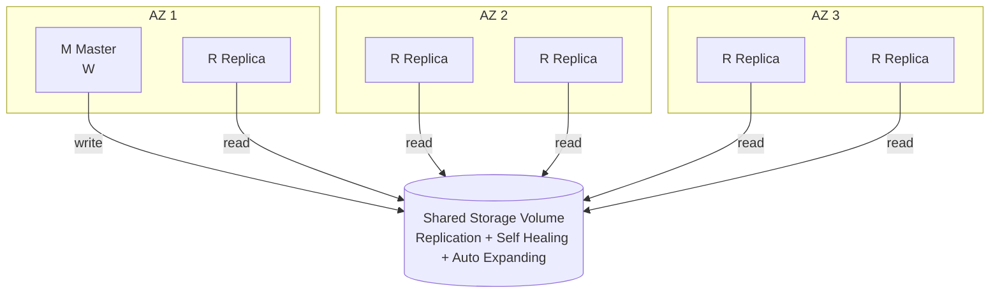

### Aurora DB cluster

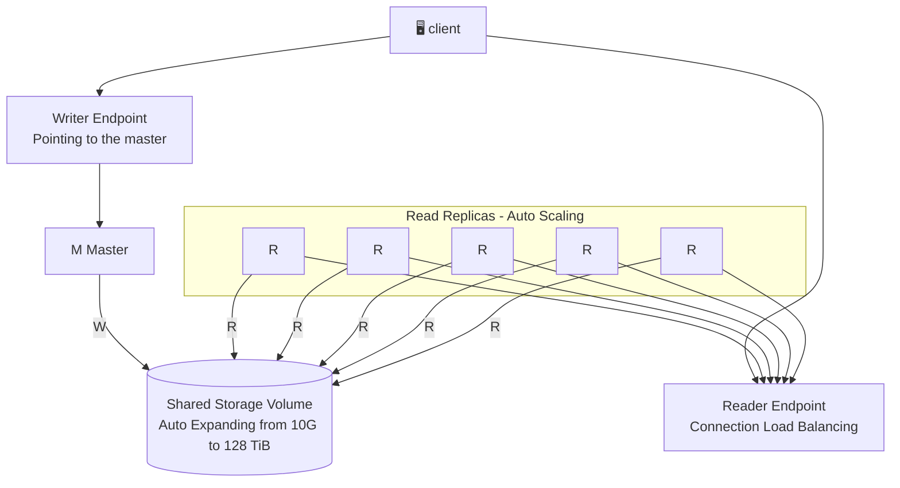

- **Writer endpoint**: always points to the master, even after failover
- **Reader endpoint**: load balances connections across all read replicas
- Read replicas can **auto scale**
- Shared storage auto expands from **10 GB** up to the max

### Features of Aurora

- Automatic failover
- Backup and recovery
- Isolation and security
- Industry compliance
- Push-button scaling
- Automated patching with zero downtime
- Advanced monitoring
- Routine maintenance
- **Backtrack**: rewind the cluster to any point in time without restoring a backup (Aurora MySQL only)
- **Zero-ETL integration with Redshift**: continuous replication into Redshift with no pipeline

**Exam tells**

- "Highest availability relational DB on AWS" is Aurora
- "Undo a bad migration quickly" is Backtrack
- "Variable workload, don't want to size instances" is Aurora Serverless v2
- "Analytics on Aurora data in Redshift without ETL" is zero-ETL

---

## Other purpose-built databases

### Amazon DocumentDB

- Aurora is an "AWS implementation" of PostgreSQL / MySQL. **DocumentDB is the same for MongoDB** (a NoSQL document database)
- MongoDB is used to store, query, and index **JSON data**
- Similar deployment concepts as Aurora
- Fully managed, highly available with replication across **3 AZs**
- Storage automatically grows in increments of **10 GB**
- Automatically scales to workloads with **millions of requests per second**
- Exam tell: the word **MongoDB** or "document database" in the question

### Amazon ElastiCache

- Managed **Redis** or **Memcached** in-memory cache
- Sits beside the app, the app decides what to cache (read-through or lazy loading, write-through)
- Sub-millisecond reads for session stores, leaderboards, computed aggregations, relieving RDS read load
- Not durable by itself (Redis has optional persistence, Memcached none)
- Exam tell: "reduce read load on RDS" is ElastiCache. "Cache DynamoDB reads with no code changes" is DAX

### Amazon MemoryDB for Redis

- Redis-compatible, **durable, in-memory database service**
- Ultra-fast performance, **over 160 million requests/second**
- Durable in-memory storage with a **Multi-AZ transactional log**
- Scales from 10s of GB to 100s of TB
- Use cases: web and mobile apps, online gaming, media streaming

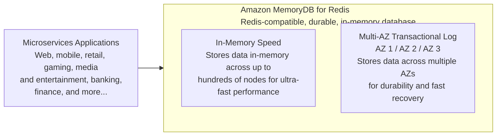

- **MemoryDB vs ElastiCache:** both Redis-compatible, but MemoryDB is a **durable primary database** (data survives failures via the Multi-AZ log). ElastiCache is a **cache** in front of another database

### Amazon Keyspaces

- Managed **Apache Cassandra**-compatible database service
- Serverless, scalable, highly available, fully managed
- Automatically scales tables up/down based on the application's traffic
- Tables are replicated 3 times across multiple AZs
- Uses the Cassandra Query Language (CQL)
- Single-digit millisecond latency at any scale, 1000s of requests per second
- Capacity: on-demand mode or provisioned mode with auto scaling
- Encryption, backup, point-in-time recovery (PITR) up to 35 days
- Use cases: IoT device info, time-series data
- Exam tell: the word **Cassandra** or **CQL**

### Amazon Neptune

- Fully managed **graph** database
- A popular graph dataset would be a **social network**
  - Users have friends
  - Posts have comments
  - Comments have likes from users
  - Users share and like posts
- Highly available across **3 AZs**, with up to **15 read replicas**
- Build and run applications working with highly connected datasets, optimized for these complex queries
- Can store up to **billions of relations** and query the graph with **millisecond latency**
- Great for **knowledge graphs** (Wikipedia), **fraud detection**, **recommendation engines**, **social networking**

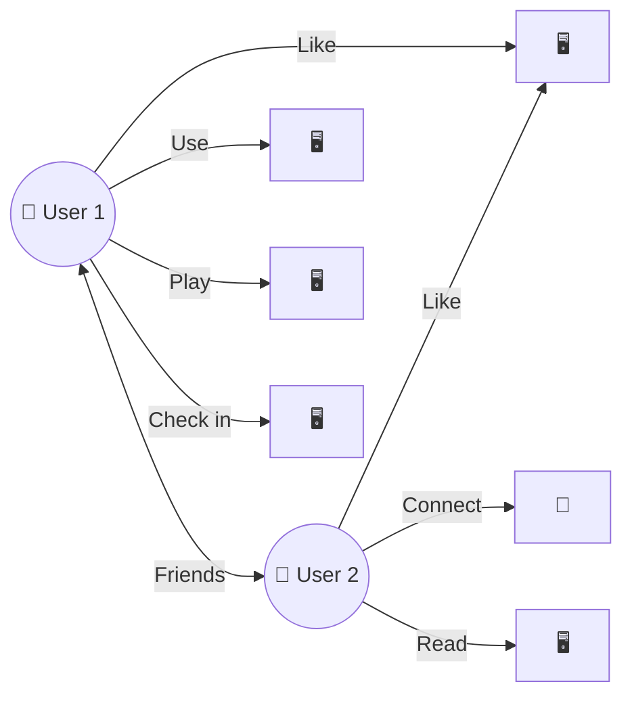

**Query languages:** Gremlin, openCypher, SPARQL

Neptune data (RDF triples):

| Subject | Predicate | Object |
|---|---|---|
| :Alice | :knows | :Bob |
| :Bob | :knows | :Charlie |
| :Alice | :age | "30" |
| :Bob | :age | "25" |

Same question in each language: "Who does Alice know?"

SPARQL
```sparql
SELECT ?person
WHERE {
  :Alice :knows ?person .
}
```

Gremlin
```groovy
g.V().has('name', 'Alice')
  .out('knows').values('name')
```

openCypher
```cypher
MATCH (a:Person {name: "Alice"})-[:KNOWS]->(b)
RETURN b.name
```

| Language | Graph model | Style |
|---|---|---|
| **SPARQL** | RDF (subject-predicate-object triples) | SQL-like pattern matching |
| **Gremlin** | Property graph | Step-by-step traversal |
| **openCypher** | Property graph | ASCII-art pattern matching `()-[]->()` |

### Amazon Timestream

- Fully managed, fast, scalable, serverless **time series database**
- Automatically scales up/down to adjust capacity
- Store and analyze trillions of events per day
- 1000s of times faster and 1/10th the cost of relational databases for time series
- Scheduled queries, multi-measure records, SQL compatibility
- Data storage tiering: recent data kept in memory, historical data in cost-optimized magnetic storage
- Built-in time series analytics functions (interpolation, smoothing, approximation)
- Encryption in transit and at rest
- Use cases: IoT apps, operational metrics, real-time analytics

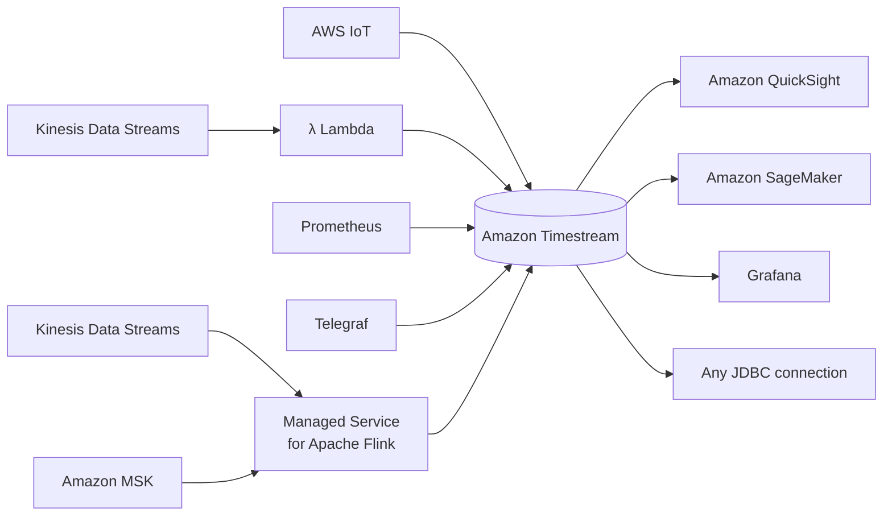

- **Ingest (left):** AWS IoT, Kinesis Data Streams (via Lambda), Prometheus, Telegraf, Kinesis Data Streams / Amazon MSK (via Flink)
- **Consume (right):** QuickSight (dashboards), SageMaker (ML), Grafana (monitoring), any JDBC connection

### Which database when

| Question says | Pick |
|---|---|
| Key-value, massive scale, single-digit ms | DynamoDB |
| Relational, transactions, joins, OLTP | RDS / Aurora |
| Petabyte analytics, OLAP, BI | Redshift |
| Query files in S3 without loading | Athena (or Redshift Spectrum if you already have Redshift) |
| MongoDB / JSON documents | DocumentDB |
| Cassandra / CQL | Keyspaces |
| Graph, relationships, fraud rings, recommendations | Neptune |
| Time series, IoT metrics | Timestream |
| Cache in front of RDS | ElastiCache |
| Cache in front of DynamoDB, no code change | DAX |
| Redis as a durable primary DB | MemoryDB |
| Full-text search, log analytics | OpenSearch (covered elsewhere) |

---

## Amazon Redshift

### Redshift intro and architecture

**What is Redshift**

- Fully managed, petabyte-scale data warehouse service
- 10x better performance than other data warehouses via machine learning, massively parallel query execution, and columnar storage
- Designed for **OLAP**, not OLTP
- Cost effective
- SQL, ODBC, JDBC interfaces
- Scale up or down on demand
- Built-in replication and backups
- Monitoring via CloudWatch / CloudTrail

**Use cases**

- Accelerate analytics workloads
- Unified data warehouse and data lake
- Data warehouse modernization
- Analyze global sales data
- Store historical stock trade data
- Analyze ad impressions and clicks
- Aggregate gaming data
- Analyze social trends

**Architecture**

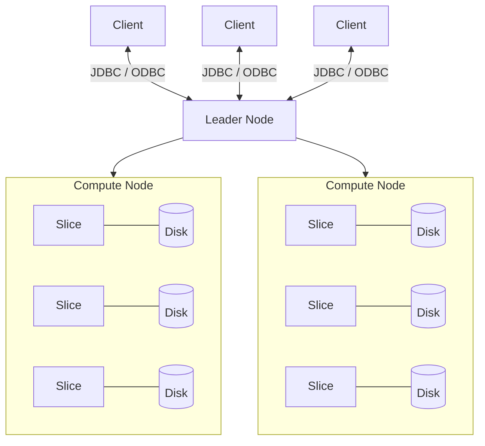

- **Clients** connect via JDBC / ODBC to the **leader node** only
- **Leader node**: parses queries, builds the execution plan, distributes work, aggregates results. Stores no table data, not billed on multi-node clusters
- **Compute nodes**: execute the plan and return intermediate results to the leader
- **Node slices**: each compute node is split into slices. Each slice gets its own chunk of memory, CPU, and disk and processes its portion of the data in parallel. Slices are the unit of parallelism, and the distribution style decides which slice each row lands on
- A single-node cluster runs leader and compute on the same box. Fine for a lab, not for production

### Redshift node types

| | **DC2** | **RA3** |
|---|---|---|
| Storage | Local SSD, fixed per node | Local SSD cache + Redshift Managed Storage (S3-backed) |
| Compute and storage | Scale together | Scale independently, pay per TB stored |
| Data sharing, Multi-AZ, cross-region features | No | Yes |
| Status | Legacy | Default choice |

- Exam tell: "storage is 90% full but CPU is 20%" on DC2 is the setup for "migrate to RA3"
- Anything involving data sharing, Multi-AZ, or Serverless interop requires RA3

### Redshift Spectrum

- Query exabytes of data in S3 without loading it into Redshift
- Limitless concurrency, horizontal scaling
- Separate storage and compute resources (Spectrum has its own fleet)
- Wide variety of data formats: Parquet, ORC, Avro, JSON, CSV, and more
- Supports Gzip and Snappy compression
- Needs an **external schema** backed by the **Glue Data Catalog** (or a Hive metastore), and the cluster's IAM role needs S3 and Glue read access
- Cluster and S3 bucket must be in the **same region**
- Billed per TB scanned (same model as Athena), so partition and use columnar formats
- Can join S3 external tables with local Redshift tables in one query

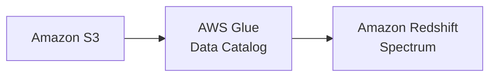

**Spectrum vs Athena**

- Both query S3 via the Glue Catalog and bill per TB scanned
- Spectrum when you already have a Redshift cluster and need to join hot warehouse tables with cold S3 data
- Athena when there's no cluster and you want pure serverless

### Redshift performance

- **Massively Parallel Processing (MPP)**: queries split across slices
- **Columnar data storage**: only the columns a query needs are read from disk
- **Column compression**: each column stored with its own encoding, less I/O. `ENCODE AUTO` or COPY's automatic compression picks the encoding
- When loading data into Redshift, use the **COPY** command, not row-by-row INSERTs

**Sort keys**

- Decide the physical order of rows on disk, so range filters on the sort key skip blocks (zone maps)
- **Compound** (default): sorted by column 1, then 2, then 3. Best when queries filter on a prefix of the key, like `date` then `region`
- **Interleaved**: equal weight to each column. Best when queries filter on any single column unpredictably. Slower to VACUUM and load
- Pick the column you filter or join on most, usually a date for time series
- Exam tell: "queries filter by date range" is a sort key on date. "Joins on customer_id are slow" is a DISTKEY on customer_id, plus optionally the same column as sort key

### Redshift durability, scaling, and resizing

**Durability**

- Replication within the cluster
- Backup to S3, with optional asynchronous copy to another region
- Automated snapshots (retention 1 to 35 days), plus manual snapshots kept until deleted
- Failed drives / nodes automatically replaced
- Historically limited to a single AZ. **Multi-AZ** is now available for RA3 provisioned clusters, which is the answer when a question requires AZ-level resilience

**Scaling (older process)**

- Vertical and horizontal scaling on demand
- During scaling:
  - A new cluster is created while your old one remains available for reads
  - CNAME is flipped to the new cluster (a few minutes of downtime)
  - Data moved in parallel to new compute nodes

**Resizing Redshift clusters**

- **Elastic resize**
  - Quickly add or remove nodes of the same type
  - It *can* change node types, but not without dropping connections (it creates a whole new cluster)
  - Cluster is down for a few minutes
  - Tries to keep connections open across the downtime
  - Limited to doubling or halving for some DC2 types, roughly 4x up or down for RA3
- **Classic resize**
  - Change node type and/or number of nodes
  - Cluster is read-only for hours to days
- **Snapshot, restore, resize**
  - Used to keep the cluster available during a classic resize
  - Copy cluster, resize the new cluster, cut over

Decision rule:

- Need it fast with minimal downtime: elastic
- Changing to a node count elastic doesn't allow: classic
- Can't tolerate read-only for hours during a classic resize: snapshot, restore, resize
- Keep getting resize questions at all: the real answer is often Serverless, or RA3 so storage scales on its own

### Redshift distribution styles

- **AUTO**
  - Redshift figures it out based on the size of the data (**default when not specified**)
  - Progresses ALL -> KEY -> EVEN as the table grows
- **EVEN**
  - Rows distributed across slices round-robin

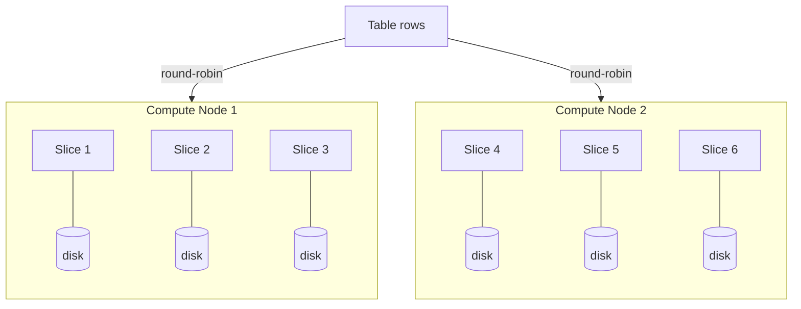

- **KEY**
  - Rows distributed based on the hash of one column

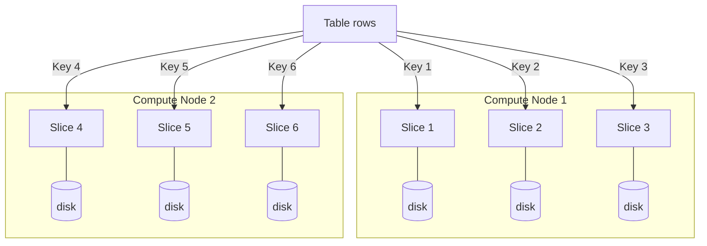

- **ALL**
  - Entire table is copied to every node (one copy per node, on the first slice)

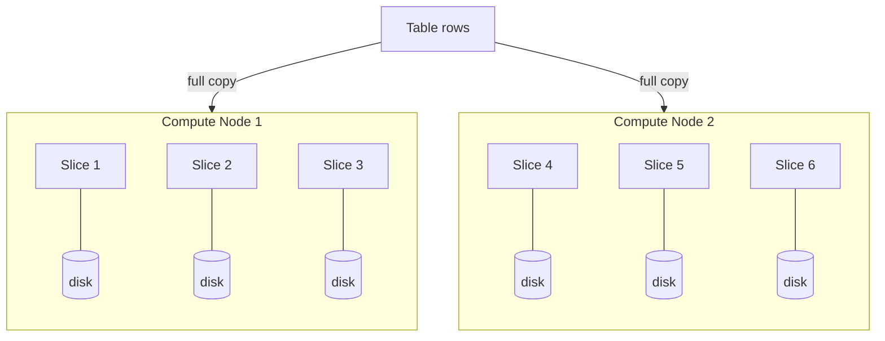

| Style | Use for | Risk |
|---|---|---|
| **KEY** | Big fact tables, on the join column shared with other big tables | Skew if the key has hot values |
| **ALL** | Small, slow-changing dimension tables | Storage = nodes × table size, every write hits every node |
| **EVEN** | No obvious join column, or table isn't joined | Every join needs a shuffle |
| **AUTO** | Don't know yet | Fine as a default |

- Two tables with the same DISTKEY column hash matching values to the same slice, which is what makes the join local
- Exam tell: big fact table joined to a small lookup table, "joins are slow." Answer is KEY on the fact table's join column plus ALL on the lookup. Picking ALL for the fact table is the trap
- Check skew with `SVV_TABLE_INFO` (`skew_rows`)

### Redshift data flows and the COPY command

**Importing / exporting data**

- **COPY** command
  - Parallelized, efficient
  - From S3, EMR, DynamoDB, remote hosts (SSH)
  - S3 loads need an IAM role (or access keys). A **manifest file** is optional, used for exact file control or atomic loads
- **UNLOAD** command
  - Unload query results from a table into files in S3 (CSV, or Parquet for data lake export)
- **Enhanced VPC routing**
  - Forces COPY and UNLOAD traffic through your VPC instead of the public internet, so you can use S3 VPC endpoints, security groups, and flow logs
- **Auto-copy from Amazon S3**
  - Copy job watches an S3 path and loads new files automatically
- **Amazon Aurora / RDS zero-ETL integration**
  - Continuous replication from Aurora or RDS MySQL into Redshift, no pipeline to build
- **Redshift streaming ingestion**
  - From Kinesis Data Streams or MSK directly into a **materialized view**, no S3 staging, seconds of latency

**COPY command: more depth**

- Use COPY to load large amounts of data from outside Redshift
- If your data is already in Redshift in another table:
  - Use `INSERT INTO ... SELECT`
  - Or `CREATE TABLE AS`
- COPY can decrypt data as it is loaded from S3 (hardware-accelerated SSL keeps it fast)
- Gzip, lzop, bzip2, and zstd compression supported, plus uncompressed columnar formats (Parquet, ORC)
- Automatic compression option
  - Analyzes the data being loaded and figures out the optimal compression scheme
  - Only runs on an empty table with no encodings set
- Special case: narrow tables (lots of rows, few columns)
  - Load with a single COPY transaction if possible
  - Otherwise hidden metadata columns consume too much space

**COPY best practices (exam loves these)**

- Split input into multiple files, ideally a multiple of the slice count, so every slice loads in parallel. One giant file means one slice does all the work
- Compress the files
- Use a manifest when you need atomic loads or exact file lists
- Check `STL_LOAD_ERRORS` when a load fails
- `MAXERROR` lets a load tolerate N bad rows

```sql
COPY sales
FROM 's3://my-bucket/sales/'
IAM_ROLE 'arn:aws:iam::123456789012:role/RedshiftCopyRole'
FORMAT AS PARQUET;

UNLOAD ('SELECT * FROM sales WHERE sale_date >= ''2026-01-01''')
TO 's3://my-bucket/export/sales_'
IAM_ROLE 'arn:aws:iam::123456789012:role/RedshiftCopyRole'
FORMAT AS PARQUET
PARTITION BY (region);
```

### Redshift snapshot copy grants

For cross-region copies of KMS-encrypted snapshots:

- Say you have a KMS-encrypted Redshift cluster and a snapshot of it, and you want to copy that snapshot to another region for backup
- In the **destination** region:
  - Create a KMS key if you don't already have one
  - Specify a unique name for your snapshot copy grant
  - Specify the KMS key ID for which you're creating the copy grant
- In the **source** region:
  - Enable copying of snapshots to the copy grant you just created
- Exam tell: "cross-region snapshot copy fails for an encrypted cluster" is a missing snapshot copy grant

### DBLINK

- Connect Redshift to PostgreSQL (possibly in RDS)
- Good way to copy and sync data between PostgreSQL and Redshift

```mermaid
flowchart LR
    R[("Amazon Redshift")] <--> P[("PostgreSQL instance (RDS)")]
```

```sql
CREATE EXTENSION postgres_fdw;
CREATE EXTENSION dblink;
CREATE SERVER foreign_server
    FOREIGN DATA WRAPPER postgres_fdw
    OPTIONS (host '<amazon_redshift_ip>', port '<port>', dbname '<database_name>', sslmode 'require');
CREATE USER MAPPING FOR <rds_postgresql_username>
    SERVER foreign_server
    OPTIONS (user '<amazon_redshift_username>', password '<password>');
```

- This SQL runs on the **Postgres** side. RDS treats Redshift as a foreign server and pulls from it. The direction is the opposite of federated queries
- Modern alternatives the exam prefers: federated query (Redshift reads RDS/Aurora live), zero-ETL integration (Aurora/RDS replicates into Redshift), DMS (ongoing replication with transforms). If any of those is an option, dblink is almost never the intended answer

### Redshift integration with other services

- S3
- DynamoDB
- EMR / EC2
- Database Migration Service
- AWS Glue Connector for Redshift

```mermaid
flowchart LR
    S3["Amazon S3"] --> R
    DDB["Amazon DynamoDB"] --> R
    EMR["Amazon EMR / EC2"] --> R
    DMS["AWS DMS"] --> R
    Glue["AWS Glue"] --> R
    R[("Amazon Redshift")]
```

How each one actually gets data in:

- S3: `COPY` (bulk load) and `UNLOAD` (export), plus Spectrum to query in place
- DynamoDB: `COPY FROM 'dynamodb://table'`, consumes read capacity on the table
- EMR / EC2: `COPY FROM 'emr://cluster'` or SSH, used for streaming output of a host
- DMS: CDC replication from an operational DB into Redshift (stages through S3)
- Glue: JDBC connector reads/writes Redshift from a Spark job, also stages through S3

The pattern: almost everything goes through S3 under the hood. Glue and DMS both land files in a temp S3 bucket and then issue COPY. That's why a Glue job writing to Redshift needs an S3 bucket and an IAM role with S3 permissions.

### Redshift Workload Management (WLM)

WLM is Redshift's query queueing system. It decides how many queries run at once, how much memory each gets, and which queue a query goes to based on who sent it or what query group it's tagged with. Without it, one analyst's 2-hour query can hog the cluster and your BI dashboards stall.

- Prioritize short, fast queries vs long, slow queries
- Query queues
- Via console, CLI, or API

**Automatic WLM** (default, use this)

- Redshift manages concurrency and memory per queue
- Up to 8 queues
- Large queries (big hash joins) get lower concurrency, small queries (inserts, scans, aggregations) get higher concurrency
- Per queue you configure:
  - **Priority**: relative importance of queries in this queue (`lowest` to `highest`, plus `critical` for superusers)
  - **Concurrency scaling mode**: per-queue setting that lets Redshift spin up temporary extra clusters when queries are queuing, then drop them when the backlog clears. Set to `auto` to enable it for that queue
  - **User groups**: when a member of a listed user group runs a query, it automatically runs in this queue
  - **Query groups**: a label the client sets with `SET query_group TO 'etl'` routes the query to this queue
  - **Query monitoring rules (QMR)**: metrics-based rules per queue, like "abort if runtime > 10 min" or "log if rows scanned > 1 billion"

**Manual WLM**

- One default queue with concurrency level of 5 (5 queries at once)
- Superuser queue with concurrency level 1
- Define up to 8 queues, up to total concurrency level 50
  - Each can have a defined concurrency scaling mode, concurrency level, user groups, query groups, memory percent, timeout, query monitoring rules
  - Can also enable **queue hopping**: timed-out queries "hop" to the next queue to try again
- Only reach for manual WLM when a question needs guaranteed fixed memory for a specific workload

**Concurrency scaling**

- Automatically adds transient cluster capacity to handle an increase in concurrent queries
- Supports virtually unlimited concurrent users and queries
- WLM queues decide which queries are sent to the concurrency scaling cluster
- Covers reads **and** writes (COPY, INSERT, UPDATE, DELETE, CTAS)
- One free hour of concurrency scaling credit per day the main cluster runs, then billed per second

**Short Query Acceleration (SQA)**

- Prioritizes short-running queries over longer-running ones
- Short queries run in a dedicated space, won't wait in a queue behind long queries
- Can be used in place of WLM queues for short queries
- Works with `CREATE TABLE AS` (CTAS) and read-only queries (`SELECT`)
- Uses machine learning to predict a query's execution time
- Can configure how many seconds counts as "short" (default dynamic, max 20s)
- On by default

**WLM vs SQA**: not alternatives, SQA sits on top of WLM. A query comes in, SQA checks if it looks short. If yes, it runs immediately. If no, it goes through normal WLM routing.

Exam tells:

- "Long-running queries are blocking short ones": WLM queues, or SQA if the short ones are reads
- "Queries are queuing at peak hours": concurrency scaling
- "Runaway query is eating the cluster": query monitoring rule
- "Long ETL jobs block the BI team's dashboards": separate queues with higher priority for the BI user group
- Default stance: auto WLM plus SQA on, concurrency scaling on the interactive queue

### VACUUM and ANALYZE

**VACUUM**

- Recovers space from deleted rows and re-sorts rows (deletes in Redshift only mark rows, they don't free space)
- `VACUUM FULL`: default. Re-sorts all rows and reclaims space from deleted rows
- `VACUUM DELETE ONLY`: reclaims deleted row space without re-sorting
- `VACUUM SORT ONLY`: re-sorts the table without reclaiming disk space
- `VACUUM REINDEX`: re-initializes interleaved sort keys
- `VACUUM ... BOOST`: runs with more resources, faster but heavier on the cluster
- Redshift runs **auto vacuum** in the background during idle periods, so manual VACUUM is for after big deletes or loads

**ANALYZE**

- Updates table statistics the query planner uses
- Stale stats mean bad query plans
- Redshift runs **auto analyze** too, and COPY updates stats on empty tables
- Check `SVV_TABLE_INFO` columns `unsorted` (needs VACUUM) and `stats_off` (needs ANALYZE)

Exam tell: "performance degraded after a large batch of deletes and updates" is VACUUM. "Query plans got worse after loading a lot of new data" is ANALYZE.

### Redshift anti-patterns

- Small datasets: use RDS instead
- OLTP: use RDS or DynamoDB instead
- Unstructured data: ETL first with Glue or EMR
- BLOB data: store references to large binary files in S3, not the files themselves

### Newer Redshift features

- **RA3 nodes with managed storage**
  - Independent scaling of compute and storage
  - SSD cache local, data in S3-backed managed storage
- **Redshift data lake export**
  - Unload Redshift query results to S3 in Apache Parquet format
  - Parquet is 2x faster to unload and consumes up to 6x less storage
  - Compatible with Redshift Spectrum, Athena, EMR, SageMaker
  - Automatically partitioned (`PARTITION BY`)
- **Spatial data types**: `GEOMETRY`, `GEOGRAPHY`
- **Cross-region data sharing**
  - Share live data across Redshift clusters without copying
  - Requires RA3 node type
  - Secure, across regions and across accounts

### Amazon Redshift ML

Train and run ML models with plain SQL from inside Redshift. SageMaker does the training under the hood.

```mermaid
flowchart LR
    L["Collect and load data<br>into your data warehouse"] --> R["Amazon Redshift ML"]
    R --> C["Create<br>CREATE MODEL in SQL"]
    C --> T["Train<br>SageMaker Autopilot tunes<br>and trains the best model"]
    T --> D["Deploy<br>Redshift auto-deploys the<br>model as a SQL function"]
    D <--> P["Predict<br>SQL queries return predictions<br>(churn, pricing, risk)"]
```

- `CREATE MODEL ... FROM (SELECT ...) TARGET col FUNCTION fn_name IAM_ROLE ...`
- Training data is exported to S3, SageMaker Autopilot trains it, the model is compiled back into Redshift
- Predictions run locally in the cluster as a function, no SageMaker call per row
- Also supports BYOM (bring your own SageMaker model) and remote inference against a SageMaker endpoint
- Needs an IAM role with SageMaker and S3 access, and an S3 bucket for the training handoff

Exam tell: pick Redshift ML when the data is already in Redshift and the user is a SQL analyst, not a data scientist. If the team already has a model in SageMaker, that's BYOM, not retraining.

### Redshift security

- **Encryption at rest**: KMS (default option) or a **Hardware Security Module (HSM)**
  - HSM: must use a client and server certificate to configure a trusted connection between Redshift and the HSM
  - Migrating an unencrypted cluster to an HSM-encrypted one: create the new encrypted cluster, then move the data to it
- **Encryption in transit**: SSL/TLS for JDBC/ODBC
- **Network**: VPC, security groups, enhanced VPC routing for COPY/UNLOAD
- **Access privileges for users and groups**
  - Use `GRANT` and `REVOKE` in SQL
  - Example: `GRANT SELECT ON TABLE foo TO bob;`
- **Column-level grants**: `GRANT SELECT (col1, col2) ON table TO role`
- **Row-level security (RLS)**: policies that filter rows per user or role
- **Dynamic data masking**: mask columns (e.g. show last 4 of a card number) based on who's querying
- **Role-based access control (RBAC)**: database roles with granted privileges, plus system-defined roles like `sys:dba`
- **IAM authentication**: `GetClusterCredentials` for temporary DB passwords, IAM Identity Center for SSO
- **Audit logging**: connection, user, and user activity logs to S3 or CloudWatch
- Exam tell: "analysts must not see PII columns" is column-level grants or dynamic data masking. "Each sales rep sees only their region" is row-level security. "Enforce the data lake catalog's permissions" is Lake Formation with Spectrum

### Redshift Serverless

- Automatic scaling and provisioning for your workload
- Optimizes cost and performance
- Uses ML to maintain performance across variable and sporadic workloads
- Easy spinup of development and test environments
- Easy ad hoc business analysis
- You get back a serverless endpoint, JDBC/ODBC connection, or just query via the console's query editor

**Namespace vs workgroup** (the terms the exam uses)

- **Namespace**: the data side. Database, users, schemas, encryption key, IAM roles. "What's stored"
- **Workgroup**: the compute side. Base RPU capacity, VPC and subnets, security groups, endpoint. "What runs queries"
- One namespace has one workgroup attached at a time

**Getting started**

- Need an IAM role with this policy
- Define your
  - Database name
  - Admin user credentials
  - VPC
  - Encryption settings (AWS-owned KMS by default)
  - Audit logging
- Can manage snapshots and recovery points after creation

```json
{
  "Version": "2012-10-17",
  "Statement": [
    {
      "Effect": "Allow",
      "Action": "redshift-serverless:*",
      "Resource": "*"
    }
  ]
}
```

- That policy is way too broad for anything real. Fine for a lab, but the exam's least-privilege answer is never `*` on `*`

**Resource scaling**

- Capacity measured in **Redshift Processing Units (RPUs)**
- You pay for RPU-hours, billed per second with a 60-second minimum per query, plus storage. Nothing when idle
- **Base RPUs**
  - Default 128
  - Adjustable from 8 to 1024 in increments of 8 to improve query performance
- **Max RPUs**
  - Set a usage limit (RPU-hours per day/week/month) to control costs, with an action of log, alert, or turn off
  - Or increase it to improve throughput
- Recovery points auto-created every 30 minutes, kept 24 hours. Snapshots work like provisioned

**Serverless limitations**

- Does everything provisioned Redshift can, except:
  - Parameter groups
  - Manual WLM (it uses auto WLM, you can't configure queues)
  - AWS Partner integration
  - Maintenance windows / version tracks
- Workgroup is private to the VPC by default. Can be set to publicly accessible if needed
- Only the SYS monitoring views, not STL/STV tables

**Monitoring**

- Monitoring views
  - `SYS_QUERY_HISTORY`
  - `SYS_LOAD_HISTORY`
  - `SYS_SERVERLESS_USAGE`
  - ... and many more
- CloudWatch Logs
  - Connection and user logs enabled by default
  - Optional user activity log
  - Under `/aws/redshift/serverless`
- CloudWatch metrics
  - `QueriesCompletedPerSecond`, `QueryDuration`, `QueriesRunning`, etc.
  - Dimensions: DatabaseName, latency (short/medium/long), QueryType, stage

### Redshift materialized views

- Contain precomputed results based on SQL queries over one or more base tables
  - This differs from a normal view in that it actually stores the results of the query
- Speeds up complex queries, especially on large tables
- Query materialized views just like any other table or view
- Queries return faster since they use precomputed results without touching the base tables
- Particularly useful for predictable, recurring queries, like populating QuickSight dashboards

Example: "What were the total sales by event?" gets answered from `tickets_mv` instead of re-joining `events` and `sales` every time.

```mermaid
flowchart BT
    E["events<br>(eventid, catid, eventname)"] --> J((refresh))
    S["sales<br>(salesid, eventid, cust, price)"] --> J
    J --> MV["tickets_mv<br>(eventname, total_sales)"]
```

```sql
CREATE MATERIALIZED VIEW tickets_mv AS
SELECT e.eventname, SUM(s.price) AS total_sales
FROM events e
JOIN sales s ON s.eventid = e.eventid
GROUP BY e.eventname;

REFRESH MATERIALIZED VIEW tickets_mv;
```

| eventname | total_sales |
|---|---|
| Dolly Parton | 10.00 |
| Gotterburg | 48.00 |

AWS docs example (TICKIT sample DB, old-style comma join syntax, same as explicit `JOIN ... ON`):

```sql
CREATE MATERIALIZED VIEW tickets_mv AS
    select  catgroup,
            sum(qtysold) as sold
    from    category c, event e, sales s
    where   c.catid = e.catid
    and     e.eventid = s.eventid
    group by catgroup;
```

**Using materialized views**

- `CREATE MATERIALIZED VIEW ...`
- Keeping them refreshed
  - `REFRESH MATERIALIZED VIEW`
  - Set `AUTO REFRESH YES` on creation so Redshift refreshes in the background when base tables change
- Refresh is **incremental** when the SQL allows it (simple inner joins, aggregates), otherwise a full recompute
- Materialized views can be built from other materialized views, useful for reusing expensive joins
- **Auto query rewrite**: Redshift can silently route a matching query to the MV even if the query doesn't name it
- **Streaming ingestion** from Kinesis Data Streams or MSK lands in an MV, so this is how real-time data gets into Redshift
- Regular view = saved query, runs the join every time. Materialized view = stored result, fast reads, stale until refreshed

Exam tell: "dashboard runs the same expensive aggregation repeatedly" is a materialized view. "Needs the data current" means add auto refresh. "No staleness allowed at all" means an MV is the wrong pick.

### Redshift data sharing

- Securely share live data across Redshift clusters for read purposes
- Why?
  - Workload isolation
  - Cross-group collaboration
  - Sharing data between dev/test/prod
  - Licensing data access in AWS Data Exchange
- Can share DBs, schemas, tables, views, and/or UDFs
  - Fine-grained access control

```mermaid
flowchart LR
    P[("Analytics<br>(producer)")] -->|live data sharing| C[("Reporting<br>(consumer)")]
```

- **Producer / consumer architecture**
  - Producer creates a datashare, adds objects, grants it to a consumer namespace or account
  - Consumer creates a database from the datashare and queries it like local tables
  - Producer controls security
  - Isolation ensures producer performance is unaffected by consumers
  - Data is live and transactionally consistent
- No copy, no ETL: the consumer reads the producer's data on managed storage directly
- Read-only on the consumer side
- Both clusters must be **encrypted** and must use **RA3 nodes or Serverless** (DC2 can't share)
- Works across accounts and across regions, cross-region involves data transfer charges
- Producer's storage is billed to the producer, consumer pays only for its own compute
- Types of data shares
  - Standard
  - AWS Data Exchange
  - AWS Lake Formation managed

Exam tell: "reporting team's queries slow down the ETL cluster" is data sharing to a separate consumer cluster, not a bigger cluster. "Must not duplicate data" or "always current" rules out snapshot restore and UNLOAD/COPY. If the question mentions DC2 nodes, the first step is migrating to RA3.

### Redshift Lambda UDF

- Use custom functions in AWS Lambda inside SQL queries
  - Using any language you want
  - Do anything you want: call other services (AI), access external systems, integrate with Location Service
- Register with `CREATE EXTERNAL FUNCTION`
- Must `GRANT USAGE ON LANGUAGE EXFUNC` for permissions

```mermaid
flowchart LR
    R[("Amazon Redshift")] <--> L["AWS Lambda"]
```

```sql
CREATE EXTERNAL FUNCTION exfunc_sum(INT, INT)
RETURNS INT
VOLATILE
LAMBDA 'lambda-sum'
IAM_ROLE 'arn:aws:iam::123456789012:role/RedshiftLambdaRole';

GRANT USAGE ON LANGUAGE exfunc TO analyst;

SELECT exfunc_sum(1, 2);
```

- Redshift batches rows into one Lambda invocation (JSON payload), not one call per row. Batches are sized to stay under Lambda's 6 MB payload limit
- Three UDF types: **SQL** (fastest), **Python** (runs in the cluster, no network), **Lambda** (anything, slower)
- Lambda UDFs can't be used in a materialized view that needs incremental refresh
- Supported on Serverless too

**Permissions**

- Use the `AWSLambdaRole` managed policy to grant Lambda permissions to your cluster's IAM role, or roll your own policy allowing `lambda:InvokeFunction` scoped to the function ARN (the least-privilege answer)
- The role must be **attached to the cluster** (or Serverless namespace) and named in `CREATE EXTERNAL FUNCTION`, same pattern as COPY from S3
- Can invoke functions in other accounts in the same region using **IAM role chaining**: `IAM_ROLE 'arn:...:role/RedshiftRole,arn:...:role/OtherAccountRole'` (comma-separated, no spaces, first role must be allowed to assume the second). COPY, UNLOAD, and Spectrum accept the same syntax

```json
{
  "Version": "2012-10-17",
  "Statement": [
    {
      "Effect": "Allow",
      "Action": "lambda:InvokeFunction",
      "Resource": "arn:aws:lambda:us-east-1:123456789012:function:lambda-sum"
    }
  ]
}
```

**JSON contract**

Redshift communicates with Lambda using JSON. One invocation carries a batch of rows.

Request (Redshift to Lambda):

```json
{
  "request_id": "23FF1F97-F28A-44AA-AB67-266ED976BF40",
  "cluster": "arn:aws:redshift:xxxx",
  "user": "adminuser",
  "database": "db1",
  "external_function": "public.foo",
  "query_id": 5678234,
  "num_records": 4,
  "arguments": [
    [1, 2],
    [3, null],
    null,
    [4, 6]
  ]
}
```

Response (Lambda to Redshift):

```json
{
  "success": true,
  "error_msg": "my function isn't working",
  "num_records": 4,
  "results": [
    1,
    4,
    null,
    7
  ]
}
```

- `arguments` is one inner array per row, one element per function parameter
- `results` must be the same length and order as `arguments`
- A whole-row `null` in arguments means all inputs were null, return `null` for it
- `error_msg` only matters when `success` is false, Redshift surfaces it as the query error

Exam tell: "call an external API or AI service from SQL" or "needs a language Redshift doesn't support in-cluster" is a Lambda UDF. "Simple string or math logic" is a SQL or Python UDF, because the Lambda round trip is overkill.

### Redshift federated queries

- Query and analyze across databases, warehouses, and lakes
- Ties Redshift to Amazon RDS or Aurora for PostgreSQL and MySQL
  - Incorporate live data in RDS into your Redshift queries
  - Avoids the need for ETL pipelines
- Offloads computation to remote databases to reduce data movement (predicate pushdown)

```mermaid
flowchart TB
    R[("Amazon Redshift")] <--> RDS[("Amazon RDS<br>PostgreSQL / MySQL")]
    R <--> A[("Amazon Aurora<br>PostgreSQL / MySQL")]
```

```sql
CREATE EXTERNAL SCHEMA orders_live
FROM POSTGRES
DATABASE 'orders' SCHEMA 'public'
URI 'orders-db.xxxx.us-east-1.rds.amazonaws.com' PORT 5432
IAM_ROLE 'arn:aws:iam::123456789012:role/RedshiftFederatedRole'
SECRET_ARN 'arn:aws:secretsmanager:us-east-1:123456789012:secret:orders-db';

SELECT c.name, SUM(o.amount)
FROM orders_live.orders o
JOIN customers c ON c.id = o.customer_id
GROUP BY c.name;
```

Course example (Aurora Postgres):

```sql
CREATE EXTERNAL SCHEMA apg
FROM POSTGRES
DATABASE 'database-1' SCHEMA 'myschema'
URI 'endpoint to aurora hostname'
IAM_ROLE 'arn:aws:iam::123456789012:role/Redshift-SecretsManager-RO'
SECRET_ARN 'arn:aws:secretsmanager:us-west-2:123456789012:secret:federation/test/dataplane-apg-creds-YbVKQw';

SELECT count(*) FROM apg.lineitem;
-- count
-- -------
-- 11760
```

**Limits**

- **Read-only** access to external data sources
- Costs are incurred on the external DB (CPU and IOPS on the RDS instance), not a Redshift charge
- You can query RDS/Aurora from Redshift, **but not the other way around** (that direction is dblink)

**Setup**

- Must establish connectivity between your Redshift cluster and RDS / Aurora
  - Put them in the same VPC subnet, or use VPC peering
  - The RDS security group must allow inbound from the Redshift security group on 5432/3306
- Credentials must be in **AWS Secrets Manager**
- Include secret access in the IAM role for your Redshift cluster
- Connect using `CREATE EXTERNAL SCHEMA`
  - The same command connects to S3 / Redshift Spectrum (`FROM DATA CATALOG`) and to data shares (`FROM REDSHIFT`)
- The `SVV_EXTERNAL_SCHEMAS` view lists available external schemas

```json
{
  "Version": "2012-10-17",
  "Statement": [
    {
      "Sid": "AccessSecret",
      "Effect": "Allow",
      "Action": [
        "secretsmanager:GetResourcePolicy",
        "secretsmanager:GetSecretValue",
        "secretsmanager:DescribeSecret",
        "secretsmanager:ListSecretVersionIds"
      ],
      "Resource": "arn:aws:secretsmanager:us-west-2:123456789012:secret:my-rds-secret-VNenFy"
    },
    {
      "Sid": "VisualEditor1",
      "Effect": "Allow",
      "Action": [
        "secretsmanager:GetRandomPassword",
        "secretsmanager:ListSecrets"
      ],
      "Resource": "*"
    }
  ]
}
```

Setup checklist:

1. Network path: same VPC or VPC peering, and the RDS security group allows inbound from the Redshift security group
2. Secret in Secrets Manager with the RDS username and password
3. IAM role with `GetSecretValue` on that secret, attached to the cluster
4. `CREATE EXTERNAL SCHEMA ... FROM POSTGRES` (or `MYSQL`) with `IAM_ROLE` and `SECRET_ARN`
5. Verify with `SELECT * FROM SVV_EXTERNAL_SCHEMAS`

Exam tells:

- "Join warehouse data with live transactional data" or "without building ETL" is federated query
- The question wants to **write** to RDS: federated is read-only, wrong answer
- Continuous replication rather than ad hoc live joins: zero-ETL integration
- "Federated queries are degrading the OLTP app": point the external schema at an Aurora read replica, or switch to zero-ETL
- Timeout means network (subnet, security group). Access denied means IAM or the secret

### Redshift system tables and views

Contain info about how Redshift is functioning.

| Prefix | What | Example |
|---|---|---|
| SYS | Monitor query and workload usage (newest, works on provisioned and Serverless) | `SYS_QUERY_HISTORY` |
| STV | Transient snapshots of current system state, in memory | `STV_WLM_QUERY_STATE`, `STV_TBL_PERM` |
| SVV | Metadata about DB objects, often built on STV | `SVV_TABLE_INFO`, `SVV_EXTERNAL_SCHEMAS` |
| STL | Generated from logs persisted to disk | `STL_QUERY`, `STL_LOAD_ERRORS` |
| SVCS | Query details across main and concurrency scaling clusters | `SVCS_QUERY_SUMMARY` |
| SVL | Query details on main cluster only | `SVL_QLOG`, `SVL_QUERY_REPORT` |

Mental rule: ST* is raw (STL on disk, STV in memory), SV* is a convenient view on top (SVL for main cluster, SVV for metadata, SVCS when concurrency scaling is involved).

The five that matter for the exam:

- `STL_LOAD_ERRORS`: COPY failed, why. The one you'll see most
- `SVV_TABLE_INFO`: skew, unsorted rows, stale stats. Tells you when to VACUUM or ANALYZE
- `STL_QUERY` / `SYS_QUERY_HISTORY`: what ran and how long
- `STV_WLM_QUERY_STATE`: what's queued right now
- `SVV_EXTERNAL_SCHEMAS`: Spectrum and federated schemas

Example: execution time of recent queries

```sql
SELECT q.query, q.starttime, q.endtime,
       datediff(seconds, q.starttime, q.endtime) AS execution_time,
       q.aborted, qr.queue_time, qr.exec_time,
       qr.total_exec_time
FROM stl_query q
JOIN svl_qlog qr ON q.query = qr.query
WHERE q.starttime > (GETDATE() - INTERVAL '1 day')
ORDER BY q.starttime DESC;
```

- Serverless only exposes the SYS views. If the question says Serverless and lists STL tables as options, those are wrong

### Redshift Data API

- Secure HTTP endpoint for SQL statements to Redshift clusters
  - Provisioned or Serverless
  - Individual or batch queries
- Asynchronous
- Does not require managing connections, no drivers needed
- Passwords not sent via API
  - Uses AWS Secrets Manager or temporary credentials
- Can be invoked by the AWS SDK (C++, Go, Java, JavaScript, .NET, Node.js, PHP, Python, Ruby)
- AWS CloudTrail captures API calls

```mermaid
flowchart LR
    U["Users"] --> A["Application"] --> S["AWS SDK /<br>Redshift Data API"] --> R[("Amazon Redshift")]
```

```python
import boto3
client = boto3.client("redshift-data")

resp = client.execute_statement(
    WorkgroupName="my-wg",          # or ClusterIdentifier for provisioned
    Database="dev",
    SecretArn="arn:aws:secretsmanager:...:secret:redshift-creds",
    Sql="SELECT count(*) FROM sales"
)
stmt_id = resp["Id"]

# poll until FINISHED
client.describe_statement(Id=stmt_id)
client.get_statement_result(Id=stmt_id)
```

- Async means `execute_statement` returns immediately with an ID. You poll `describe_statement` or subscribe to an EventBridge event on completion
- No VPC connectivity needed from the caller, it's a public AWS API endpoint, so a Lambda doesn't need to be in the cluster's VPC

**Other use cases**

- Application integration: REST endpoints
- ETL orchestration with AWS Step Functions
  - Serverless data processing workflows
  - Event-driven ETL
- Access from SageMaker notebooks
- Use with Amazon EventBridge
  - Set `WithEvent=true` on `execute_statement` to have Redshift publish an EventBridge event when the statement finishes, so you don't poll. Lambda or Step Functions triggers on `FINISHED` or `FAILED`
  - Schedule Data API operations: EventBridge Scheduler can call `ExecuteStatement` directly on a schedule, zero code

```mermaid
flowchart TB
    SF["Step Functions"] --> API
    EB["EventBridge"] --> API
    B["AWS Batch"] --> API
    EC2["EC2"] --> API
    L["Lambda"] --> API
    GW["API Gateway"] --> API
    SM["SageMaker"] --> API
    API["Redshift Data API"] --> R[("Amazon Redshift")]
```

- Step Functions has a native `redshift-data` integration, no Lambda needed
- API Gateway plus Lambda plus Data API is the "expose Redshift as a REST endpoint" pattern

**Finer points**

| Limit | Value |
|---|---|
| Query duration | 24 hours |
| Active queries | 500 |
| Query result size (gzipped) | 100 MB |
| Result retention time | 24 hours |
| Query statement size | 100 KB |
| Packet for query (data per row) | 64 KB |
| Client token retention time | 8 hours |
| TPS quota per API | 30 for ExecuteStatement |

API calls:

- `ExecuteStatement`, `BatchExecuteStatement`
- `DescribeStatement`, `DescribeTable`
- `GetStatementResult`, `CancelStatement`
- Users must have the same IAM role or permissions to operate on a given statement
- The cluster must be in a VPC (all modern clusters are). The **caller** does not need VPC access

- `BatchExecuteStatement` runs multiple statements as one transaction, so a multi-step load (truncate staging, COPY, merge) fully commits or rolls back
- The client token is for idempotency: if Step Functions retries the same call with the same token, Redshift won't run the query twice

Exam tells:

- Lambda, Step Functions, or EventBridge needs to run SQL on Redshift: Data API. The JDBC alternative means Lambda in a VPC, connection pools, and the 15-minute timeout
- "Notify when the query completes without polling": `WithEvent`
- "Run nightly SQL with minimal infrastructure": EventBridge Scheduler calling the Data API directly
- "Export a large result set": `UNLOAD` to S3 (triggered via the Data API), not `GetStatementResult`, because of the 100 MB limit

### Redshift exam tells

| Scenario | Answer |
|---|---|
| Fact table joined to small dimension is slow | DISTKEY on join column (fact) + DISTSTYLE ALL (dimension) |
| Queries filter by date range | Sort key on the date column |
| Storage full, CPU idle (DC2) | Migrate to RA3 |
| Need AZ-level resilience | Multi-AZ (RA3) |
| Query S3 without loading | Spectrum (external schema via Glue Catalog) |
| Load fails | `STL_LOAD_ERRORS` |
| Load is slow with one big file | Split into multiple files (multiple of slice count), compress |
| Slow after mass deletes | VACUUM |
| Bad plans after big load | ANALYZE |
| Short queries stuck behind long ones | WLM queues or SQA |
| Queuing at peak | Concurrency scaling |
| Runaway query | Query monitoring rule |
| Reporting cluster slows ETL cluster | Data sharing to a consumer cluster |
| Same expensive aggregation daily | Materialized view with auto refresh |
| Real-time from Kinesis/MSK | Streaming ingestion into a materialized view |
| Live join to RDS/Aurora, no ETL | Federated query |
| Continuous replication from Aurora/RDS | Zero-ETL integration |
| Call an external API from SQL | Lambda UDF |
| Lambda/Step Functions need to run SQL | Data API |
| Cross-region copy of encrypted snapshot fails | Snapshot copy grant |
| Variable, sporadic workload, no cluster sizing | Redshift Serverless |
| Analysts must not see PII columns | Column-level grants or dynamic data masking |
| Each user sees only their rows | Row-level security |
| OLTP, small data, or BLOBs | Not Redshift (RDS, DynamoDB, S3) |

---

## Decision cheat sheet

**DynamoDB vs RDS vs Redshift**

| | DynamoDB | RDS / Aurora | Redshift |
|---|---|---|---|
| Workload | OLTP, key-value, massive scale | OLTP, relational, transactions | OLAP, analytics, BI |
| Query | Key lookups, no joins | Full SQL, joins | Full SQL, joins, aggregations at scale |
| Scale | Horizontal, automatic | Vertical + read replicas | MPP cluster or Serverless |
| Latency | Single-digit ms | ms | Seconds to minutes |
| Streams / CDC | DynamoDB Streams | DMS, zero-ETL to Redshift | Streaming ingestion in |

**Getting data into Redshift**

| Source | Mechanism |
|---|---|
| S3 (batch) | COPY, auto-copy |
| S3 (query in place) | Spectrum |
| Kinesis / MSK | Streaming ingestion (materialized view) |
| Aurora / RDS (continuous) | Zero-ETL |
| Aurora / RDS (live, ad hoc) | Federated query |
| Any DB (CDC with transforms) | DMS |
| Spark job | Glue JDBC connector (stages via S3) |
| DynamoDB | COPY from dynamodb:// |
| Another Redshift cluster | Data sharing |

**Caching**

| In front of | Use |
|---|---|
| DynamoDB, no code change | DAX |
| RDS / anything, app-managed | ElastiCache |
| Need Redis as the primary store | MemoryDB |
| Redshift repeated queries | Materialized view, result cache (automatic) |