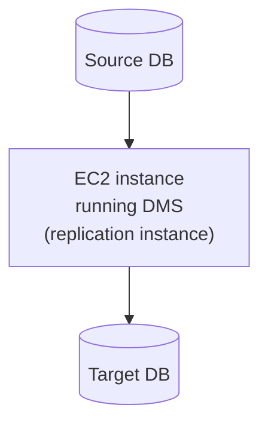
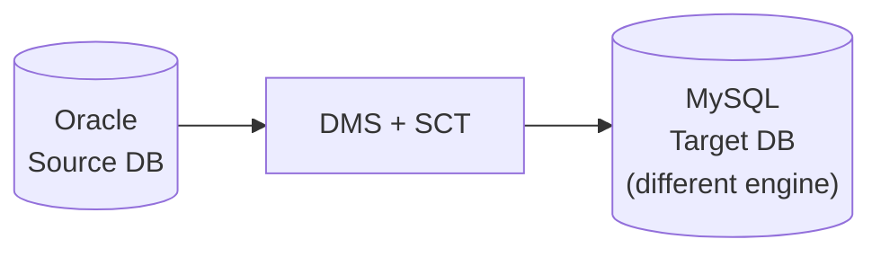
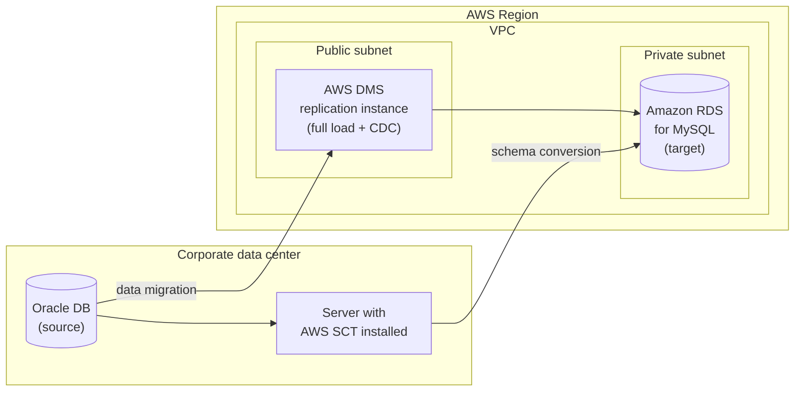
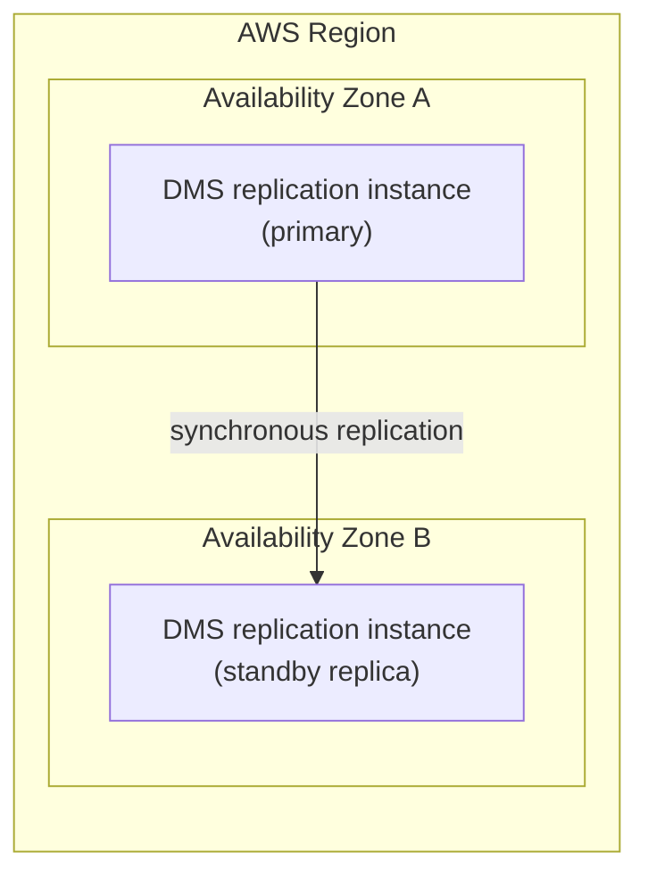
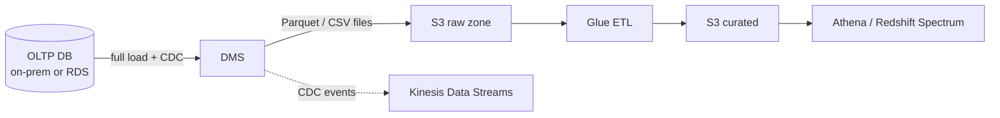
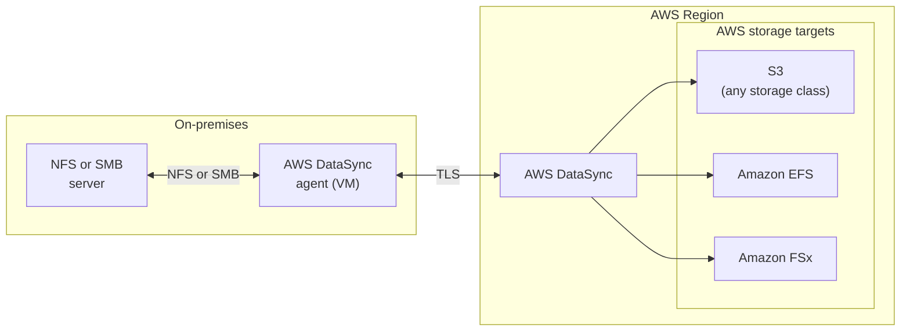
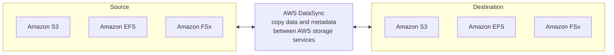
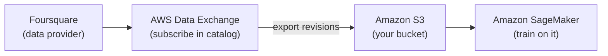
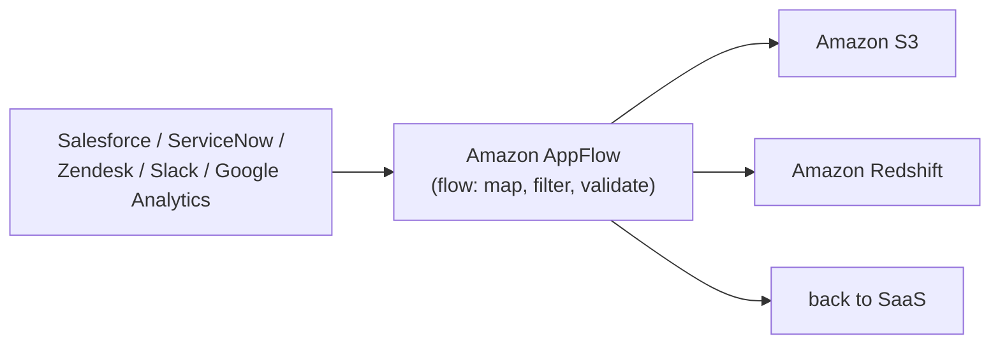

# 04 - Migration and Transfer

How data gets into AWS from somewhere else: databases (DMS), file systems (DataSync), partner uploads (Transfer Family), SaaS apps (AppFlow), third-party datasets (Data Exchange), and physical shipping (Snow Family). Exam tells inline, decision table at the end.

## Contents

- [AWS Database Migration Service (DMS)](#aws-database-migration-service-dms)
  - [Sources and targets](#dms-sources-and-targets)
  - [Schema Conversion Tool (SCT)](#aws-schema-conversion-tool-sct)
  - [Task types and CDC](#dms-task-types-and-cdc)
  - [Continuous replication](#dms-continuous-replication)
  - [Multi-AZ deployment](#dms-multi-az-deployment)
  - [Replication instance sizing and DMS Serverless](#dms-replication-instance-sizing-and-dms-serverless)
  - [DMS as a data lake feed](#dms-as-a-data-lake-feed)
  - [Exam tells](#dms-exam-tells)
- [AWS DataSync](#aws-datasync)
  - [NFS / SMB to AWS](#datasync-nfs--smb-to-aws)
  - [Between AWS storage services](#datasync-between-aws-storage-services)
  - [Exam tells](#datasync-exam-tells)
- [AWS Data Exchange](#aws-data-exchange)
- [AWS Transfer Family](#aws-transfer-family)
- [Amazon AppFlow](#amazon-appflow)
- [AWS Snow Family](#aws-snow-family)
- [AWS Storage Gateway](#aws-storage-gateway)
- [Decision cheat sheet](#decision-cheat-sheet)

---

## AWS Database Migration Service (DMS)

- Quickly and securely migrate databases to AWS, resilient, self healing
- The source database remains available during the migration
- Supports:
  - **Homogeneous** migrations: Oracle to Oracle, MySQL to Aurora MySQL
  - **Heterogeneous** migrations: Microsoft SQL Server to Aurora Postgres (needs SCT)
- Continuous data replication using **CDC** (change data capture)
- You must create a **replication instance** (an EC2 instance DMS manages) to run the tasks, or use DMS Serverless

- The replication instance does the work: reads from the source, optionally transforms (rename, filter, remap types), writes to the target
- It needs network reach to both ends: VPN or Direct Connect for on-prem, security groups for RDS. Timeouts are network, access denied is credentials

### DMS sources and targets

**Sources**

- On-premises and EC2 instances
  - Oracle, MS SQL Server, MySQL, MariaDB, PostgreSQL, MongoDB, SAP, DB2
- Azure: Azure SQL Database
- Amazon RDS: all engines including Aurora
- Amazon S3
- DocumentDB

**Targets**

- On-premises and EC2 instances
  - Oracle, MS SQL Server, MySQL, MariaDB, PostgreSQL, SAP
- Amazon RDS (all engines including Aurora)
- Redshift, DynamoDB, S3
- OpenSearch Service
- Kinesis Data Streams
- Apache Kafka (MSK)
- DocumentDB and Amazon Neptune
- Redis and Babelfish

Worth noticing: S3, Kinesis, Kafka, and Redshift as targets are what make DMS a data engineering tool, not just a migration tool. CDC into Kinesis or S3 is how you turn an OLTP database into a stream or a lake feed.

### AWS Schema Conversion Tool (SCT)

- Converts your database schema from one engine to another
- Example OLTP: SQL Server or Oracle to MySQL, PostgreSQL, Aurora
- Example OLAP: Teradata or Oracle to Amazon Redshift

- You do not need SCT if you are migrating the same DB engine
  - On-premises PostgreSQL to RDS PostgreSQL: still PostgreSQL, RDS is just the platform
- SCT converts schema (tables, types, indexes, views, stored procedures). DMS moves rows. Neither does the other's job
- SCT produces an **assessment report** flagging what it can't convert automatically (usually stored procedures, triggers, proprietary functions). "Migration failed on PL/SQL procedures" is an SCT assessment answer
- For data warehouse migrations (Teradata, Netezza, Greenplum to Redshift), SCT also has **data extraction agents** that pull terabytes in parallel to S3 or Snowball, then COPY into Redshift

| Migration | Tool |
|---|---|
| Oracle to Oracle on RDS, MySQL to Aurora MySQL | DMS only (homogeneous) |
| Oracle to Aurora Postgres, SQL Server to MySQL | SCT first, then DMS (heterogeneous) |
| Teradata / Netezza to Redshift | SCT + DMS, or SCT extraction agents for huge volumes |

### DMS task types and CDC

| Task type | What it does | Use when |
|---|---|---|
| **Full load** | Copies existing data once | One-time migration, downtime acceptable |
| **Full load + CDC** | Copies existing data, then streams ongoing changes | Minimal-downtime migration, cut over when lag is zero |
| **CDC only** | Streams changes from a point in time | Source already loaded another way, or feeding a stream / lake continuously |

**CDC prerequisites on the source** (the "CDC task fails to start" answer):

- Oracle: archive log mode + supplemental logging
- MySQL / MariaDB / Aurora MySQL: binary logging on, `binlog_format = ROW`, retention long enough for the task
- PostgreSQL: `wal_level = logical`, replication slot
- SQL Server: transaction log backups, CDC or replication enabled on the DB

If the question says CDC is failing or missing changes, check the source log settings before anything else.

**Validation and monitoring**

- **Data validation** compares source and target row by row after full load and during CDC (adds load, costs time, but it's the "verify migration completed accurately" answer)
- CloudWatch metrics: `CDCLatencySource` (how far behind reading), `CDCLatencyTarget` (how far behind applying), `FreeableMemory`, `CPUUtilization` on the replication instance
- Task logs go to CloudWatch Logs

### DMS continuous replication

- SCT runs on-prem next to the source, converts the Oracle schema, and applies it to the RDS target first
- DMS replication instance does a full load, then stays running in CDC mode reading Oracle redo logs and applying changes to MySQL
- Cut over the app when CDC lag reaches zero
- The replication instance sits in a **public subnet** because it needs to reach on-prem over the internet (or VPN / Direct Connect). The RDS target is in a **private subnet**, reachable only from the DMS security group
- SCT and DMS take separate paths: SCT creates the converted schema on the target, DMS just moves rows into it. Skip SCT on a heterogeneous migration and DMS creates crude tables with generic types and no indexes, constraints, or procedures

### DMS Multi-AZ deployment

- When Multi-AZ is enabled, DMS provisions and maintains a synchronous standby replica of the replication instance in a different AZ
- Advantages:
  - Provides data redundancy
  - Eliminates I/O freezes
  - Minimizes latency spikes

- What's replicated is the replication instance's own state (task checkpoints, cached changes), not your source or target data. If the primary dies mid-CDC, the standby picks up from the last checkpoint instead of restarting the task
- Same idea as RDS Multi-AZ: synchronous, standby takes no load, roughly 2x cost
- Separate from the target RDS being Multi-AZ, that's its own checkbox

### DMS replication instance sizing and DMS Serverless

- Instance class decides CPU and memory. Full load is CPU-bound, CDC with many transactions is memory-bound
- Allocated storage holds logs and cached changes during CDC. Running out stalls the task
- "Migration is slow" or "CDC latency keeps growing" is usually an undersized replication instance, a single-threaded full load, or LOB settings
- **LOB handling**: full LOB mode is slow but complete, limited LOB mode truncates at a size you set. "Large objects missing or truncated after migration" is this setting
- **Parallel load**: split large tables by partition or ranges so multiple threads load at once
- **DMS Serverless**: AWS sizes and scales the replication capacity automatically (measured in DCUs). Pick it when the question says "no capacity management" or the workload is unpredictable

### DMS as a data lake feed

The data engineer use of DMS, beyond migration:

- **S3 target**: full load writes one file per table, CDC writes change files with an `Op` column (I/U/D). Output can be CSV or **Parquet**, partitioned by date. Glue then merges the changes (or you use Iceberg / Hudi for upserts)
- **Kinesis / Kafka target**: every row change becomes an event, which is the zero-code way to make an OLTP database event-driven
- **Redshift target**: DMS stages through S3 and issues COPY, so it needs an S3 bucket and permissions
- Exam tell: "replicate changes from an on-prem database into the data lake continuously" is DMS CDC to S3, not a scheduled Glue JDBC extract

### DMS exam tells

| Scenario | Answer |
|---|---|
| Migrate with minimal downtime | Full load + CDC, cut over at zero lag |
| Different engine on each side | SCT first, then DMS |
| Same engine, different platform | DMS only |
| CDC task won't start or misses changes | Source log settings (binlog ROW, archive log, logical WAL) |
| Task must survive an AZ failure | Multi-AZ replication instance |
| Migration slow, latency growing | Bigger replication instance, parallel load, or Serverless |
| LOBs missing or cut off | LOB mode setting |
| Verify the data matches after migration | DMS data validation |
| Stream DB changes into Kinesis or the lake | DMS CDC with Kinesis or S3 target |
| Teradata to Redshift, tens of TB | SCT data extraction agents |
| Don't want to manage capacity | DMS Serverless |

---

## AWS DataSync

- Move large amounts of data to and from
  - On-premises / other cloud to AWS (NFS, SMB, HDFS, S3 API, ...): needs an agent
  - AWS to AWS (different storage services): no agent needed
- Can synchronize to:
  - Amazon S3 (any storage class, including Glacier and Glacier Deep Archive)
  - Amazon EFS
  - Amazon FSx (Windows, Lustre, NetApp ONTAP, OpenZFS)
- Replication tasks can be scheduled hourly, daily, weekly
- **File permissions and metadata are preserved** (NFS POSIX, SMB ACLs, timestamps, ownership)
- One agent task can use **10 Gbps**, and you can set a bandwidth limit
- Incremental after the first run: only changed files move
- Encrypted in transit (TLS), verifies data integrity end to end
- Moves **files**, not database rows. Databases are DMS

### DataSync: NFS / SMB to AWS

- Agent is a VM you run on-prem (VMware, Hyper-V, KVM, or on a Snowcone), not needed for AWS-to-AWS transfers
- Can also run the agent on EC2 to pull from another cloud's object storage
- HDFS source: the way to move data off an on-prem Hadoop cluster into S3
- Can write directly into any S3 storage class, so archive straight to Glacier Deep Archive without a lifecycle rule

### DataSync: between AWS storage services

- No agent needed for AWS-to-AWS transfers
- Works across accounts and across regions
- Copies metadata (permissions, timestamps, ownership) which plain `aws s3 cp` or S3 replication don't preserve for file systems
- Where it beats the alternatives:
  - **S3 to S3 across accounts or regions**: S3 replication is continuous and bucket-wide. DataSync is scheduled, filterable by path, and does a one-time bulk copy including existing objects
  - **EFS or FSx to S3**: no native replication exists for that, DataSync is the only managed path. "Archive an EFS file system to S3" is DataSync
  - **S3 to EFS**: hydrate a file system from the lake for an app that needs POSIX access

### DataSync exam tells

| Scenario | Answer |
|---|---|
| File shares, NFS / SMB, "preserve permissions" | DataSync |
| HDFS off on-prem Hadoop into S3 | DataSync (HDFS agent) |
| Ongoing sync of log files from on-prem to the lake | DataSync on a schedule |
| EFS or FSx to S3 | DataSync |
| S3 bucket copy, one time, cross account | DataSync (or S3 Batch Replication) |
| S3 continuous, bucket-wide | S3 replication, not DataSync |
| Database tables | DMS, not DataSync |
| Limit bandwidth during business hours | DataSync bandwidth throttle |

---

## AWS Data Exchange

- Find, subscribe to, and use third-party data in the cloud
  - Reuters: curates data from over 2.2 million unique news stories per year in multiple languages
  - Change Healthcare: processes and anonymizes more than 14 billion healthcare transactions and $1 trillion in claims annually
  - Dun & Bradstreet: maintains a database of more than 330 million global business records
  - Foursquare: location data derived from 220 million unique consumers, including more than 60 million global commercial venues
- Once subscribed to a data product, use the AWS Data Exchange API (or auto-export) to load data directly into Amazon S3, then analyze it with any AWS analytics or machine learning service

- Browse the catalog, subscribe to a product, export its revisions to your S3 bucket
- Once it's in S3 it's just data: SageMaker, Glue, Athena, Redshift Spectrum all read it the same way
- **Auto-export** sends each new revision to your bucket as the provider publishes it, so the pipeline stays current with no manual step

**Delivery types** (the part that affects your design)

- **Files**: provider publishes revisions, you export to S3. The most common one
- **AWS Data Exchange for Redshift**
  - Find and subscribe to third-party data you can query in your Redshift data warehouse in minutes
  - Delivered as a Redshift **data share**, so no copy, live data, and you need RA3 or Serverless on your side
  - Also lets you license your own data to others through Data Exchange
- **AWS Data Exchange for APIs**
  - Find and subscribe to third-party APIs with consistent access using the AWS SDKs
  - Consistent AWS-native authentication and governance, no separate vendor API keys
- **Lake Formation**: provider grants Lake Formation permissions on their catalog tables

Exam tells:

- "Incorporate a third-party dataset into the data lake without managing vendor contracts or credentials" is Data Exchange with S3 auto-export
- "Query the vendor's data in Redshift without loading it" is Data Exchange for Redshift (a data share)
- "Monetize our dataset for other AWS customers" is publishing on Data Exchange

---

## AWS Transfer Family

- Fully managed service for file transfers into and out of Amazon S3 or Amazon EFS using FTP-family protocols
- Supported protocols:
  - **AWS Transfer for SFTP** (SSH File Transfer Protocol)
  - **AWS Transfer for FTPS** (FTP over TLS)
  - **AWS Transfer for FTP** (plaintext, only within a VPC, never public)
  - **AS2** for B2B EDI exchanges
- Managed infrastructure, scalable, reliable, highly available (Multi-AZ)
- Pay per provisioned endpoint per hour plus data transferred in GB
- Store and manage users' credentials within the service, or integrate with existing authentication systems (Microsoft Active Directory, LDAP, Okta, Amazon Cognito, custom via Lambda / API Gateway)
- Usage: sharing files, public datasets, CRM, ERP, partner feeds

```mermaid
flowchart LR
    AD["Microsoft AD / LDAP /<br/>custom identity provider"] <-->|"authenticate"| TF
    U["Users<br/>(FTP client)"] --> R53["Route 53<br/>(optional custom DNS)"] --> TF

    subgraph TF["AWS Transfer Family"]
        SFTP["Transfer for SFTP"]
        FTPS["Transfer for FTPS"]
        FTP["Transfer for FTP<br/>(only within VPC)"]
    end

    TF -->|"IAM role"| S3["Amazon S3"]
    TF -->|"IAM role"| EFS["Amazon EFS"]
```

- Each user maps to an IAM role that scopes what they can see in the bucket (home directory, optionally a logical directory so they never see the real bucket path)
- Optional: Route 53 for a vanity hostname, VPC endpoint for private access, static IPs via an Elastic IP on a VPC-hosted endpoint for partners who allowlist
- Files land in S3 and trigger your normal flow: S3 event, Lambda, Glue, or an EventBridge rule. Transfer Family also has **managed workflows** for post-upload steps (decrypt, tag, copy) without writing a Lambda

Why it exists: partners and legacy systems that can only talk FTP. Instead of running an EC2 FTP server and syncing to S3, the partner uploads straight into the bucket.

Exam tells:

- "Third party sends files via SFTP, must land in S3 with no servers to manage" is Transfer Family
- "Existing users with AD credentials" is Transfer Family with the AD or custom identity provider, not IAM users
- FTP over the public internet is not an option. The answer is SFTP or FTPS
- "Partner needs a fixed IP to allowlist" is a VPC endpoint with an Elastic IP
- Transfer Family is a server other people **push** to. DataSync is an agent you run that **pulls** from your own storage on a schedule

---

## Amazon AppFlow

Managed integration for moving data between **SaaS apps** and AWS without code.

- Sources: Salesforce, SAP, ServiceNow, Zendesk, Slack, Google Analytics, Marketo, and more
- Destinations: S3, Redshift, Snowflake, Salesforce, EventBridge
- Triggers: on demand, on a schedule, or on an event in the source app
- Transforms in the flow: field mapping, filtering, validation, masking
- Encrypted in transit, can run over PrivateLink for sources that support it
- Writes to S3 as JSON, CSV, or Parquet

Exam tell: any question with a SaaS app as the data source (Salesforce is the classic) and S3 or Redshift as the destination is AppFlow. Not Glue, not Lambda calling the vendor API, not DMS.

---

## AWS Snow Family

Physical devices for when the network is too slow or doesn't exist.

| Device | Capacity | Use |
|---|---|---|
| **Snowcone** | 8 to 14 TB | Small, rugged, edge locations, can run a DataSync agent |
| **Snowball Edge** | up to 80 TB storage optimized, or compute optimized with GPU | Bulk transfer, edge compute (EC2, Lambda) |
| **Snowmobile** | up to 100 PB per truck | Data center exodus |

- You order it, AWS ships it, you load it, ship it back, AWS loads it into S3
- Rule of thumb: if the transfer would take more than a week over your link, ship it. 100 TB on 100 Mbps is about 100 days
- Snowball Edge can run **OpsHub** and local compute, and SCT extraction agents can write to it for warehouse migrations
- Encrypted with KMS, tamper evident, wiped after import

Exam tell: "petabytes," "limited bandwidth," "remote site with no connectivity," or a time constraint the network can't meet is Snow. Glacier? Data goes into S3 first, then lifecycle to Glacier. Snow devices don't write to Glacier directly.

---

## AWS Storage Gateway

Hybrid storage: on-prem apps keep using NFS, SMB, or iSCSI while the data lives in AWS.

| Type | Presents | Backed by | Use |
|---|---|---|---|
| **S3 File Gateway** | NFS / SMB file share | S3 objects (one object per file) | On-prem apps write files, they appear in S3 for the data lake |
| **FSx File Gateway** | SMB share | FSx for Windows | Branch office access to a central Windows file system |
| **Volume Gateway** | iSCSI block volumes | EBS snapshots in S3 | Backup, cached or stored modes |
| **Tape Gateway** | Virtual tape library | S3 / Glacier | Replace physical tape backup |

- S3 File Gateway is the one that matters for data engineering: a legacy app drops a file on "the share" and it's an S3 object a few seconds later, so Glue or Lambda can pick it up
- Local cache for frequently read files, so reads don't round trip to S3 every time

Exam tell: "on-prem application must keep writing to a file share, but data needs to be in S3" is S3 File Gateway. Versus DataSync, which is a scheduled copy, not a live mount.

---

## Decision cheat sheet

| Moving | Use |
|---|---|
| Database tables, one time | DMS full load |
| Database with ongoing changes, minimal downtime | DMS full load + CDC |
| Database to a different engine | SCT then DMS |
| Database changes into Kinesis or the data lake | DMS CDC to Kinesis / S3 |
| On-prem file shares (NFS, SMB, HDFS) to S3 / EFS / FSx | DataSync (with agent) |
| Between AWS storage services, preserve metadata | DataSync (no agent) |
| S3 to S3, continuous, bucket-wide | S3 replication |
| Partner pushes files via SFTP / FTPS | Transfer Family |
| SaaS app data (Salesforce, ServiceNow) to S3 / Redshift | AppFlow |
| Third-party vendor dataset | Data Exchange |
| Petabytes, no bandwidth | Snow Family |
| On-prem app keeps a live file share backed by S3 | S3 File Gateway |
| Legacy tape backup to the cloud | Tape Gateway |

Push vs pull:

- **You pull from your own stuff**: DataSync, DMS, AppFlow, Storage Gateway
- **Others push to you**: Transfer Family
- **Vendor publishes, you subscribe**: Data Exchange