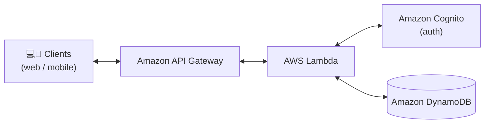
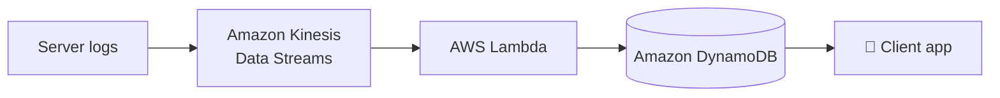
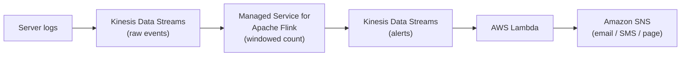
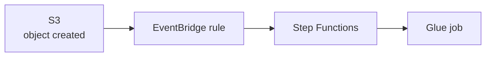
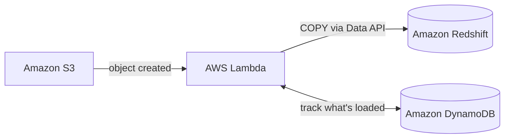
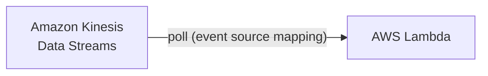
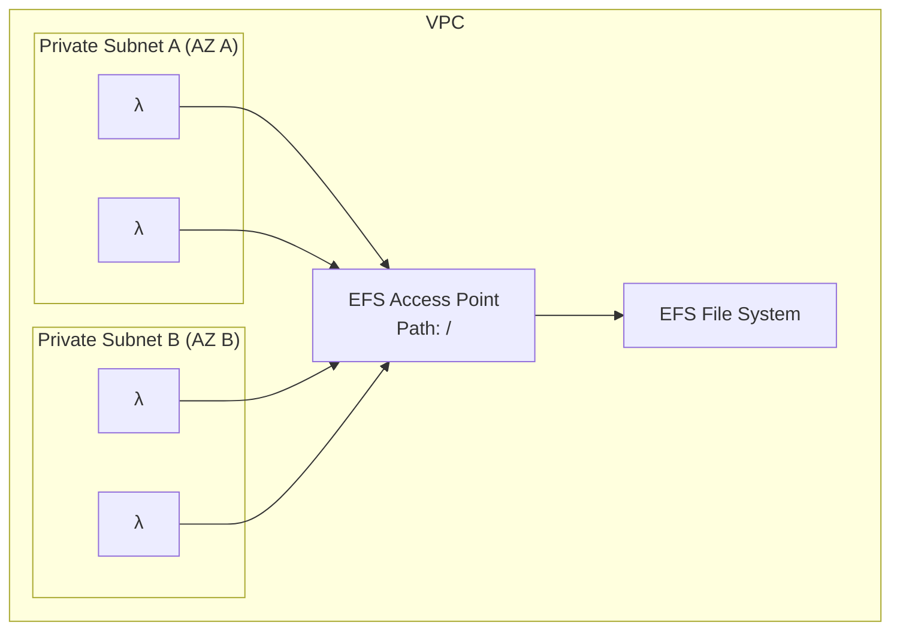
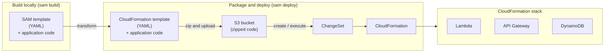
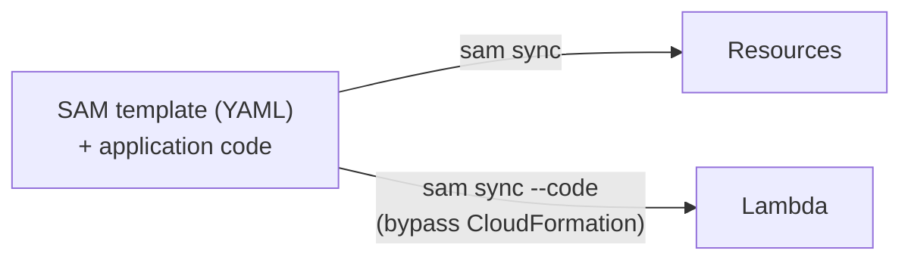

# 05 - Compute

EC2 (the machines under everything), Lambda (serverless functions), SAM (deploying serverless), Batch (containers at scale), and where ECS and Fargate fit. Exam tells inline, decision table at the end.

## Contents

- [EC2](#ec2)
  - [EC2 in big data](#ec2-in-big-data)
  - [Instance families and storage](#ec2-instance-families-and-storage)
  - [Pricing models](#ec2-pricing-models)
  - [Graviton-based instances](#ec2-graviton-based-instances)
  - [Exam tells](#ec2-exam-tells)
- [AWS Lambda](#aws-lambda)
  - [What is Lambda](#what-is-lambda)
  - [How a function runs](#how-a-lambda-function-runs)
  - [Invocation models](#lambda-invocation-models)
  - [Concurrency](#lambda-concurrency)
  - [Limits](#lambda-limits)
  - [Example architectures](#lambda-example-architectures)
  - [Why not just run a server](#why-not-just-run-a-server)
  - [Main uses and languages](#lambda-main-uses-and-languages)
  - [Triggers](#lambda-triggers)
  - [Lambda and OpenSearch](#lambda-and-amazon-opensearch-service)
  - [Lambda and Data Pipeline](#lambda-and-data-pipeline)
  - [Lambda and Redshift](#lambda-and-redshift)
  - [Lambda and Kinesis](#lambda-and-kinesis)
  - [Error handling and destinations](#lambda-error-handling-and-destinations)
  - [Lambda in a VPC](#lambda-in-a-vpc)
  - [File systems mounting](#lambda-file-systems-mounting)
  - [Storage options](#lambda-storage-options)
  - [Exam tells](#lambda-exam-tells)
- [AWS SAM](#aws-sam)
  - [Recipe](#aws-sam-recipe)
  - [Deployment deep dive](#sam-deployment-deep-dive)
  - [SAM Accelerate (sam sync)](#sam-accelerate-sam-sync)
- [AWS Batch](#aws-batch)
- [ECS and Fargate](#ecs-and-fargate)
- [Decision cheat sheet](#decision-cheat-sheet)

---

## EC2

A virtual machine you rent by the second. You pick an instance type (CPU, memory, storage, network), an AMI (OS image), and a subnet. You manage everything above the hypervisor: patching, scaling, what runs on it. Every EC2 instance lives in a subnet inside a VPC, with a security group as its firewall and an IAM instance role for AWS permissions (never access keys on disk).

### EC2 in big data

- On-demand, Spot, and Reserved instances:
  - **Spot**: can tolerate loss, low cost. Use checkpointing (ML training, EMR task nodes)
  - **Reserved**: long-running clusters, databases (over a year)
  - **On-demand**: remaining workloads
- Auto Scaling
  - Leverage for EMR, etc.
  - Automated for DynamoDB, Auto Scaling Groups, etc.
- EC2 is behind EMR
  - **Master node**: coordinates the cluster, runs YARN resource manager
  - **Core nodes**: run tasks **and** store data in HDFS
  - **Task nodes**: run tasks only, no HDFS. Safe to put on Spot because losing one loses no data

Where EC2 shows up as a data engineer: mostly as the thing under other services. EMR, Redshift nodes, DMS replication instances, MWAA workers, OpenSearch nodes are all EC2 with the management hidden. Glue and Athena are serverless on purpose. You run raw EC2 yourself only for things that don't fit a managed service: a Kafka Connect cluster, a scraper that outgrows Lambda's 15 minutes, a DataSync agent, an SCT server, a legacy binary.

### EC2 instance families and storage

| Family | Optimized for | Data use |
|---|---|---|
| `m` | General purpose | Default, EMR master |
| `c` | Compute | CPU-heavy transforms |
| `r` | Memory | Spark (memory-bound), EMR core nodes |
| `i` / `d` | Local NVMe / HDD storage | Shuffle-heavy Spark, Kafka brokers |
| `g` / `p` | GPU | ML training and inference |
| `t` | Burstable | Dev, small agents |

Size suffix is scale: `large`, `xlarge`, `4xlarge`, etc.

Storage:

- **EBS**: network-attached block disk, survives stops, snapshots to S3. gp3 is the default, io2 for high IOPS
- **Instance store**: local NVMe, fastest, gone when the instance stops. Scratch and shuffle only
- **EFS**: shared NFS file system across many instances
- **S3**: not a disk, but where data actually lives. Instances read and write it via the API

### EC2 pricing models

| Model | Discount | Commitment | Use |
|---|---|---|---|
| On-demand | None | None | Default, unpredictable |
| Reserved / Savings Plans | ~40 to 70% | 1 or 3 years | Steady 24/7 workloads |
| Spot | up to 90% | None, reclaimable with 2 min notice | Fault-tolerant batch, EMR task nodes |
| Dedicated hosts | Premium | Varies | Licensing or compliance |

### EC2 Graviton-based instances

**AWS Graviton** is Amazon's own ARM-based family of processors, powering several EC2 instance types:

- General purpose: M7g, T4g
- Compute optimized: C7g, C6g
- Memory optimized: R7g, X2gd
- Storage optimized: Im4gn, Is4gen
- Accelerated computing (game streaming, ML inference): G5g

- Offers the best price-performance (roughly 20 to 40% better than comparable x86)
- Option for many data engineering services: MSK, RDS, MemoryDB, ElastiCache, OpenSearch, EMR, Lambda (arm64 runtime), Fargate
- The `g` in the instance name means Graviton (`m7g`, `r7g`)
- Catch: ARM, so native binaries and some Python wheels need an arm64 build. Pure Python and Java just work

### EC2 exam tells

| Scenario | Answer |
|---|---|
| Reduce EMR cost for a fault-tolerant batch job | Spot for task nodes, on-demand for master and core |
| Spark job memory constrained | `r` family |
| Instance needs to read S3 | IAM instance role, never access keys |
| Lambda times out at 15 min, can't be chunked | EC2, ECS/Fargate, Glue, or Batch |
| Lower cost for same performance | Graviton |
| Serverless option exists in the answers | It's almost always the intended one over EC2 |

---

## AWS Lambda

### What is Lambda

- A way to run code snippets "in the cloud"
  - Serverless
  - Continuous scaling
- Often used to process data as it's moved around (the glue between services)

### How a Lambda function runs

- You upload code (zip or container image up to 10 GB) and set a handler, runtime, memory, and timeout
- Lambda spins up an **execution environment** (a micro VM), runs the handler per event, and reuses the environment for a while
- **Cold start**: first invocation in a new environment pays for init (runtime boot, imports, connections). Warm invocations skip it
- **Memory sets CPU**: you pick memory from 128 MB to 10 GB and CPU scales proportionally. A CPU-bound function often gets faster and cheaper by raising memory
- **Pricing**: requests plus GB-seconds (memory × duration). Free tier covers a lot of small pipelines
- **Timeout**: max 15 minutes. Hard ceiling, no exceptions
- Code outside the handler runs once per environment, so put SDK clients and DB connections there to reuse them across warm invocations

### Lambda invocation models

| Model | Who calls | Behavior on error | Examples |
|---|---|---|---|
| **Synchronous** | Caller waits for the response | Caller gets the error, handles retry | API Gateway, ALB, Cognito, CLI `invoke` |
| **Asynchronous** | Event is queued, caller moves on | Lambda retries twice, then DLQ or on-failure destination | S3, SNS, EventBridge, CodeCommit |
| **Event source mapping (poll)** | Lambda polls the source | Batch retried until success, expiry, or retry limit | Kinesis, DynamoDB Streams, SQS, MSK |

The distinction that matters: S3 and SNS **push** to Lambda, Kinesis and SQS are **polled** by Lambda. Diagrams draw the arrow into Lambda either way.

### Lambda concurrency

- Default account limit is 1,000 concurrent executions per region (raise via quota request)
- **Reserved concurrency**: a hard cap and a guaranteed floor for one function, carved out of the account pool. Free. Set to 0 to disable the function. Protects downstream systems and other functions from a runaway
- **Provisioned concurrency**: N environments kept warm so there's no cold start. Paid whether used or not. Can auto scale on a schedule
- Provisioned counts against reserved on the same function, so provisioned can't exceed reserved

| Scenario | Answer |
|---|---|
| Function must not overwhelm an RDS instance | Reserved concurrency (cap it) |
| One function hogs concurrency and others throttle | Reserved on the hog |
| API-facing function has bad p99 on first request | Provisioned concurrency |
| Must scale to 500 instantly at 9am | Provisioned with scheduled auto scaling |

### Lambda limits

| Limit | Value |
|---|---|
| Timeout | 15 minutes |
| Memory | 128 MB to 10,240 MB |
| Ephemeral `/tmp` | 512 MB to 10,240 MB |
| Deployment package | 50 MB zipped, 250 MB unzipped (including layers) |
| Container image | 10 GB |
| Layers | 5 per function |
| Sync payload | 6 MB request and response |
| Async payload | 256 KB |
| Environment variables | 4 KB total |
| Concurrency | 1,000 default per region |

### Lambda example architectures

**Serverless website**



- API Gateway: HTTPS front door, routing, throttling, caching, no servers
- Lambda: the business logic, runs per request, scales to zero
- Cognito: user sign-up, sign-in, and tokens. API Gateway can validate the Cognito token directly so Lambda never sees unauthenticated calls
- DynamoDB: the data store, pay per request, no capacity to manage
- Static assets (HTML, JS) would sit in S3 behind CloudFront, not in this diagram
- Exam tells: "no servers to manage," "unpredictable traffic," "scale to zero" is this stack. EC2 plus an Auto Scaling Group in the middle is the trap. User auth for a web/mobile app is Cognito, not IAM users

**Order history app**



- Server logs (order events) are pushed into a Kinesis Data Stream, usually by the Kinesis Agent or the SDK
- Lambda is attached as a consumer via an event source mapping, gets batches of records, parses them
- Lambda writes each order into DynamoDB keyed by customer
- The client app queries DynamoDB by customer ID to show order history, single-digit ms
- Why Kinesis sits in the middle: it buffers bursts, keeps records for replay, and lets you add a second consumer later (Firehose to S3 for the lake) without touching producers

**Transaction rate alarm**



- Raw transaction events land in the first stream
- Flink runs a **sliding or tumbling window** over the stream, e.g. count transactions per minute, and emits a record only when the count crosses a threshold
- That alert record goes into a second stream
- Lambda consumes it and publishes to SNS, which fans out to email, SMS, or a pager
- Why Flink and not Lambda for the counting: Lambda sees one batch with no memory between invocations. "More than 100 in any 5-minute window" needs state across batches, which is what Flink windows are for
  - **Tumbling**: fixed, non-overlapping (count per minute)
  - **Sliding**: fixed size, overlapping (last 5 min, evaluated every 10 s)
  - **Session**: grouped by activity, closes after a gap
  - **Watermark**: how long to wait for late events before finalizing a window
- The course slide says "Kinesis Data Analytics." That's the old name, the exam uses Managed Service for Apache Flink

### Why not just run a server

- Server management (patches, monitoring, hardware failures) is someone else's pager
- Servers can be cheap, but scaling a fleet for peak means paying for idle capacity off-peak
- You only pay for processing time you actually use
- Easier to split development between front end and back end

### Lambda main uses and languages

Main uses:

- Real-time file processing (S3 event, parse the file, rudimentary ETL)
- Real-time stream processing (Kinesis, DynamoDB Streams)
- ETL
- Cron replacement (EventBridge schedule)
- Process AWS events (the glue between services)

Supported languages: Node.js, Python, Java, C#, Go, PowerShell, Ruby, plus any language via a custom runtime or container image.

### Lambda triggers

**Push** (service invokes Lambda):

- S3 (object created / deleted)
- SNS
- API Gateway
- EventBridge / CloudWatch Events (cron replacement, scheduled triggers)
- CloudWatch Logs
- Cognito
- CloudFormation
- CloudFront (Lambda@Edge)
- CodeCommit
- Config
- Lex
- SES
- Step Functions
- IoT
- Alexa
- Application Load Balancer
- Manual invocation (`Invoke` API, console, CLI)

**Poll** (Lambda reads via an event source mapping):

- Kinesis Data Streams
- DynamoDB Streams
- SQS
- MSK / self-managed Kafka

**Special case:**

- Kinesis Data Firehose: Lambda is called inline to transform records before delivery to S3, Redshift, or OpenSearch

Push vs poll matters because batch size, `IteratorAge`, `MaximumRetryAttempts`, `BisectBatchOnFunctionError`, and on-failure destinations only apply to the polled sources.

### Lambda and Amazon OpenSearch Service


- New file lands in S3, S3 event notification invokes Lambda
- Lambda reads the object, parses it (JSON lines, CSV, logs), and bulk-indexes the records into OpenSearch via the `_bulk` API
- OpenSearch makes the data searchable and powers dashboards (OpenSearch Dashboards, formerly Kibana)
- Lambda needs an IAM role with `s3:GetObject` and `es:ESHttpPost`, and must be in the VPC if the domain is VPC-only
- The course slide still says Elasticsearch. Same service, renamed OpenSearch in 2021

**S3 + Lambda vs Firehose to OpenSearch**

- S3 event + Lambda: files already landing in S3, custom parsing, index only some objects
- Firehose: the data is a stream (logs, clickstream), buffering and retries handled for you, and you want a copy in S3 too
- Gotchas: a huge S3 object can't be indexed in one 15-minute invocation (split it or use Glue). A burst of uploads hammers the domain (put SQS between S3 and Lambda, or use Firehose). Failed writes need a retry path (Firehose has a backup bucket built in, with Lambda you build a DLQ)

### Lambda and Data Pipeline


- Data Pipeline can be scheduled with preconditions to check S3
- But Lambda lets you activate it at random times (event-driven instead of on a timer)

**AWS Data Pipeline is deprecated**: closed to new customers, AWS points to Glue, Step Functions, or MWAA. It appears in old slides and as a distractor on the exam, where it's the wrong answer. The modern version of this pattern:



- "Run the ETL when a file arrives" is S3 event to EventBridge to Step Functions, or a Glue workflow with an event trigger
- "Run it on a schedule" is EventBridge Scheduler

### Lambda and Redshift



- Best practice for loading data into Redshift is the COPY command
- But you can use Lambda if you need to respond to new data that shows up at any time
- Can use DynamoDB to keep track of what's been loaded (file name, status, timestamp) so a retry doesn't double-load
- Lambda can batch up new data and load it with COPY

Updates to the 2019 slide:

- Lambda issues the COPY through the **Redshift Data API**, not JDBC. No VPC, no connection pool, no waiting. Lambda fires `ExecuteStatement` and exits, `WithEvent` if something needs to know when it finishes
- **Redshift auto-copy from S3** now does this whole slide with zero code. If a question offers it, it beats the Lambda version
- The DynamoDB box is an idempotency ledger: S3 events are at-least-once, so the same file can trigger twice
- "Batch up" matters: thousands of tiny COPYs each hold a transaction and leave the table unsorted. Let files accumulate and load many at once with a manifest
- Exam tells: "load into Redshift as soon as files land" is S3 event to Lambda to Data API COPY, or auto-copy. "Load efficiently" is COPY with multiple files, never row-by-row INSERT from Lambda

### Lambda and Kinesis



- Your Lambda code receives an event with a **batch** of stream records
  - You specify a batch size when setting up the trigger (up to 10,000 records)
  - Too large a batch size can cause timeouts
  - Batches may also be split beyond Lambda's payload limit (6 MB)
- Lambda will retry the batch until it succeeds or the data expires
  - This can stall the shard if you don't handle errors properly
  - Use more shards to ensure processing isn't totally held up by errors (the 2019 answer; bounding retries and bisecting is the real fix)
- Lambda processes shard data synchronously, in order, one invocation per shard at a time

Event source mapping settings:

| Setting | What it does |
|---|---|
| `BatchSize` | Records per invocation, up to 10,000 |
| `MaximumBatchingWindowInSeconds` | Wait up to N seconds to fill a batch (fewer, fuller invocations) |
| `ParallelizationFactor` | Up to 10 concurrent invocations per shard, still ordered per partition key |
| `MaximumRetryAttempts` | Stop retrying a bad batch after N tries |
| `MaximumRecordAgeInSeconds` | Skip records older than N seconds |
| `BisectBatchOnFunctionError` | Split a failing batch in half and retry, isolates the poison record |
| `DestinationConfig` (on-failure) | Send metadata of the failed batch to SQS or SNS |
| `TumblingWindowInSeconds` | Keep state across invocations for simple windowed aggregates |
| `StartingPosition` | `LATEST`, `TRIM_HORIZON`, or `AT_TIMESTAMP` |
| `FilterCriteria` | Only invoke for records matching a pattern, skips the rest for free |

- Watch `IteratorAge`. Climbing means Lambda is falling behind. Fixes in order: raise `ParallelizationFactor`, make the function faster, add shards. If it spikes on one shard only, it's a poison record or hot shard
- **Enhanced fan-out** gives Lambda a dedicated 2 MB/s per shard instead of sharing the read limit with other consumers. The answer for "multiple consumers and Lambda is throttled on reads"

### Lambda error handling and destinations

- **Async retries**: 2 automatic retries with backoff, then the event is dropped unless you configure a destination
- **Dead-letter queue (DLQ)**: SQS or SNS that receives the failed event (async only). Older mechanism
- **Destinations**: on-success and on-failure targets (SQS, SNS, EventBridge, another Lambda) with the full invocation record including the error. Preferred over DLQ
- **Event source mapping failures**: `DestinationConfig` sends batch metadata (shard, sequence numbers) to SQS or SNS, not the records themselves. You replay from the stream using that metadata
- **Function errors vs invocation errors**: a function that raises an exception returns `StatusCode 200` with `FunctionError: Unhandled`. Only a throttle or a bad request returns a non-200. Step Functions and SDK callers need to check `FunctionError`, not just the status code

### Lambda in a VPC

- By default Lambda runs outside your VPC and reaches AWS services over public endpoints
- Attach it to a VPC only when it needs a private resource: RDS, Redshift, ElastiCache, EFS, a VPC-only OpenSearch domain
- Once in a VPC it loses internet and public endpoints. It needs a **NAT gateway** (internet) or **VPC endpoints** (S3 gateway endpoint is free, DynamoDB gateway endpoint is free, others are interface endpoints) to reach AWS services
- Needs at least two private subnets in different AZs and a security group
- `ec2:CreateNetworkInterface` and friends on the execution role (`AWSLambdaVPCAccessExecutionRole` managed policy)
- Exam tell: "Lambda in a VPC can't reach S3" is a missing S3 gateway endpoint or NAT. "Lambda can't connect to RDS" is the security group on RDS not allowing the Lambda security group

### Lambda file systems mounting

- Lambda functions can access EFS file systems if they are running in a VPC
- Configure Lambda to mount EFS file systems to a local directory during initialization (e.g. `/mnt/data`)
- Must use **EFS Access Points** (enforce a path and POSIX user/group)
- Limitations: watch out for the EFS connection limits (one function instance = one connection) and connection burst limits



- When EFS is right: a large library or model that won't fit in a layer, shared read-write scratch across invocations, or code that only knows how to open files. Classic case: "ML model is 2 GB, Lambda needs it at startup"
- When it's wrong: anything that's really object storage (S3), or temp space for one invocation (`/tmp`, up to 10 GB)
- The EFS mount target must be in the same AZs as the Lambda subnets, and the security group must allow NFS (port 2049) from the Lambda security group
- A burst of 1,000 concurrent invocations is 1,000 NFS connections. Reserved concurrency is the throttle

### Lambda storage options

| | Ephemeral storage `/tmp` | Lambda layers | Amazon S3 | Amazon EFS |
|---|---|---|---|---|
| Max size | 10,240 MB | 5 layers per function, up to 250 MB total (unzipped) | Elastic | Elastic |
| Persistence | Ephemeral | Durable | Durable | Durable |
| Content | Dynamic | Static | Dynamic | Dynamic |
| Storage type | File system | Archive | Object | File system |
| Operations supported | Any file system operation | Immutable | Atomic with versioning | Any file system operation |
| Pricing | Included in Lambda (first 512 MB, then per GB-s) | Included in Lambda | Storage + requests + data transfer | Storage + data transfer + throughput |
| Sharing / permissions | Function only | IAM | IAM | IAM + NFS |
| Relative data access speed | Fastest | Fastest | Fast | Very fast |
| Shared across all invocations | No (a warm instance may reuse its own, never rely on it) | Yes (read-only) | Yes | Yes (read-write) |
| Needs VPC | No | No | No | Yes |

The row that decides most questions is **Content: static vs dynamic**. Layers are for things shipped with the code that never change at runtime. Everything else is `/tmp`, S3, or EFS.

Quick picks:

- Dependencies or a shared helper library across many functions: **layer**
- Scratch space for one invocation (unzip, intermediate CSV): **`/tmp`**
- Read or write durable objects, the normal case: **S3**
- Large model or dataset as a local file, or read-write shared state between concurrent invocations: **EFS**

### Lambda exam tells

| Scenario | Answer |
|---|---|
| Job runs longer than 15 minutes | Not Lambda: Glue, Batch, Fargate, Step Functions splitting it up |
| Function is slow and CPU-bound | Raise memory (CPU scales with it) |
| Cold start latency on an API | Provisioned concurrency |
| Protect a downstream DB from too many connections | Reserved concurrency, or RDS Proxy |
| Shared libraries across functions | Layer |
| 2 GB model needed at startup | EFS mount |
| Lambda in VPC can't reach S3 | S3 gateway VPC endpoint (or NAT) |
| Kinesis consumer falling behind | `ParallelizationFactor`, then more shards |
| Poison record stalls the shard | `MaximumRetryAttempts` + `BisectBatchOnFunctionError` + on-failure destination |
| Async invocations failing silently | On-failure destination or DLQ |
| Only process some stream records | Event source mapping `FilterCriteria` |
| Invoke only when both files have arrived | Not Lambda alone: Step Functions or an EventBridge rule with state in DynamoDB |
| Payload over 6 MB | Pass an S3 key, not the data |

---

## AWS SAM

**SAM = Serverless Application Model**

- Framework for developing and deploying serverless applications
- All the configuration is YAML
- Generates complex CloudFormation from a simple SAM YAML file
- Supports anything from CloudFormation: Outputs, Mappings, Parameters, Resources
- SAM can use CodeDeploy to deploy Lambda functions (gradual traffic shifting with aliases)
- SAM can help you run Lambda, API Gateway, DynamoDB locally (Docker)

### AWS SAM recipe

SAM is a shorthand on top of CloudFormation for serverless apps. You write a short YAML template, SAM expands it into full CloudFormation.

- Transform header indicates it's a SAM template:
  - `Transform: 'AWS::Serverless-2016-10-31'`
- Write code
  - `AWS::Serverless::Function` (Lambda + role + triggers in one block)
  - `AWS::Serverless::Api` (API Gateway)
  - `AWS::Serverless::SimpleTable` (DynamoDB)
  - `AWS::Serverless::StateMachine` (Step Functions)
- Package and deploy: `sam deploy` (optionally preceded by `sam package`, which zips the code and uploads it to S3)
- Quickly sync local changes to AWS Lambda (SAM Accelerate): `sam sync --watch`
- Test locally with Docker: `sam local invoke`, `sam local start-api`

```yaml
AWSTemplateFormatVersion: '2010-09-09'
Transform: 'AWS::Serverless-2016-10-31'

Resources:
  LoadRawFunction:
    Type: AWS::Serverless::Function
    Properties:
      Runtime: python3.12
      Handler: app.handler
      CodeUri: src/
      MemorySize: 512
      Timeout: 300
      Policies:
        - S3WritePolicy:
            BucketName: !Ref RawBucket
      Events:
        Nightly:
          Type: Schedule
          Properties:
            Schedule: cron(0 6 * * ? *)

  RawBucket:
    Type: AWS::S3::Bucket
```

That one `Function` block becomes a Lambda function, an IAM role, an EventBridge rule, and the permission for EventBridge to invoke it. In raw CloudFormation that's four resources.

Where it sits next to what you know:

- **SAM** = CloudFormation with sugar for Lambda, API Gateway, DynamoDB, Step Functions. Deploys as a CloudFormation stack
- **CDK** = write the same thing in Python or TypeScript, it generates CloudFormation
- **Terraform** = separate state file, no CloudFormation underneath, multi-cloud

### SAM deployment deep dive



1. `sam build`: installs dependencies, expands the SAM shorthand into a full CloudFormation template
2. `sam deploy`: zips the code, uploads it to an S3 bucket, creates a CloudFormation **ChangeSet**, and executes it
3. CloudFormation creates or updates the **stack**: Lambda, API Gateway, DynamoDB, roles, permissions, all tracked together

SAM is not its own deployment engine. The last mile is always CloudFormation, so:

- **ChangeSet** is a preview of what will change before it runs (same role as `terraform plan`)
- **Stack** is the unit. Delete the stack and everything in it goes away together
- **Rollback** is automatic if a resource fails mid-deploy
- **Drift detection** tells you if someone changed a resource in the console behind the template's back
- The S3 bucket exists because CloudFormation can't read code off your laptop

### SAM Accelerate (sam sync)

- SAM Accelerate is a set of features to reduce latency while deploying resources to AWS
- `sam sync`
  - Synchronizes your project declared in SAM templates to AWS
  - Synchronizes code changes to AWS without updating infrastructure (uses service APIs and bypasses CloudFormation)



| Command | What changes | How | Speed |
|---|---|---|---|
| `sam sync` | Infra and code | CloudFormation stack update | Minutes |
| `sam sync --code` | Code only | Direct `UpdateFunctionCode` API call, bypasses CloudFormation | Seconds |
| `sam sync --code --resource-id HelloWorldLambdaFunction` | One resource's code | Direct API call | Seconds |
| `sam sync --watch` | Whatever you save | Watches files; config change uses `sam sync`, code-only change uses `sam sync --code` | Continuous |

The catch: bypassing CloudFormation means the stack no longer matches what's deployed (drift). SAM Accelerate is for dev and test. Prod goes through `sam deploy` so the stack stays the source of truth.

---

## AWS Batch

- Run batch jobs as Docker images
- Dynamic provisioning of the instances (EC2 and Spot), or **Fargate** for fully serverless compute
- Optimal quantity and type based on volume and requirements
- No cluster to manage
- You pay for the underlying EC2 or Fargate resources, Batch itself is free
- Schedule Batch jobs using EventBridge (CloudWatch Events)
- Orchestrate Batch jobs using AWS Step Functions

How it's organized:

- **Job definition**: the Docker image, vCPU, memory, command, IAM role
- **Job queue**: where jobs wait, with priority
- **Compute environment**: the EC2, Spot, or Fargate pool that runs them, scales up and down with the queue
- **Array jobs** run the same definition N times with an index, for embarrassingly parallel work. **Job dependencies** chain them

### AWS Batch vs Glue

| | Glue | Batch |
|---|---|---|
| Runs | Apache Spark (Scala or Python) or Python Shell, ETL focused | Any Docker image, any language, any job |
| Resources | Fully managed, you pick DPUs / workers | Created in your account, managed by Batch |
| Extras | Data Catalog, crawlers, bookmarks, Data Quality | None, it's a job runner |
| Pick when | ETL, anything that touches the Catalog, Athena, or Redshift Spectrum | Non-ETL compute: simulations, ML preprocessing, video encoding, a legacy binary |

For any non-ETL work, Batch is probably better. For ETL, Glue.

Exam tells: "long-running compute job," "Docker image," "existing script that needs more than 15 minutes," "scientific or ML workload" is Batch. "Transform data and register it in the Catalog" is Glue. "Need Spot for cost on a fault-tolerant batch" fits Batch and EMR, not Glue (Glue Flex is the closest Glue equivalent).

---

## ECS and Fargate

Containers, for when Lambda is too small and EC2 is too much.

- **ECS**: AWS's container orchestrator. You define a task (container image, CPU, memory, role) and a service (how many copies, load balancer)
- **EKS**: managed Kubernetes, same job with the Kubernetes API. Pick when the team already runs Kubernetes
- **Fargate**: the serverless launch type for ECS and EKS. No EC2 to manage, pay per vCPU-second. Also the compute behind Batch when you don't want instances
- **ECR**: the container registry where images live

Where it fits in data engineering:

- A scraper or API poller that needs more than 15 minutes or persistent connections: **Fargate task** triggered by EventBridge Scheduler
- A long-running consumer (Kafka Connect, a custom Kinesis consumer with KCL): **ECS service**
- Airflow workers in MWAA are Fargate under the hood
- A Spark job: **not** ECS, use Glue or EMR (EMR on EKS exists if you're already on Kubernetes)

| | Lambda | Fargate | EC2 |
|---|---|---|---|
| Max duration | 15 min | Unlimited | Unlimited |
| Scales to zero | Yes | Yes (tasks) | No |
| You manage | Code | Container | OS and everything |
| Startup | ms to seconds | ~30 to 60 s | Minutes |
| Pick for | Event-driven, short | Long jobs, services, custom runtimes | Legacy, special hardware, max control |

Exam tell: "runs longer than 15 minutes, no servers to manage, containerized" is Fargate. If it also says "batch jobs with a queue," it's Batch on Fargate.

---

## Decision cheat sheet

| Need | Use |
|---|---|
| React to an event, finish in under 15 min | Lambda |
| Scheduled small job | Lambda + EventBridge Scheduler |
| Scheduled job over 15 min, custom code | Fargate task or Batch |
| Spark ETL, Catalog integration | Glue |
| Spark / Hadoop with cluster control, Spot savings | EMR |
| Docker batch jobs with queueing and Spot | AWS Batch |
| Long-running service or consumer | ECS / Fargate |
| Full control, special hardware, legacy software | EC2 |
| Deploy a serverless app as code | SAM (or Terraform / CDK) |
| Fast dev loop on Lambda code | `sam sync --watch` |
| Same performance, lower cost | Graviton instances |
| Fault-tolerant, interruptible | Spot |
| Steady 24/7 | Reserved / Savings Plans |

Push vs poll for Lambda:

- **Push**: S3, SNS, API Gateway, EventBridge. Lambda is invoked
- **Poll**: Kinesis, DynamoDB Streams, SQS, MSK. Lambda reads batches via an event source mapping, and that's where batch size, retries, bisect, and `IteratorAge` live