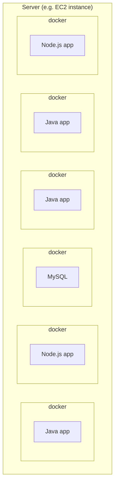
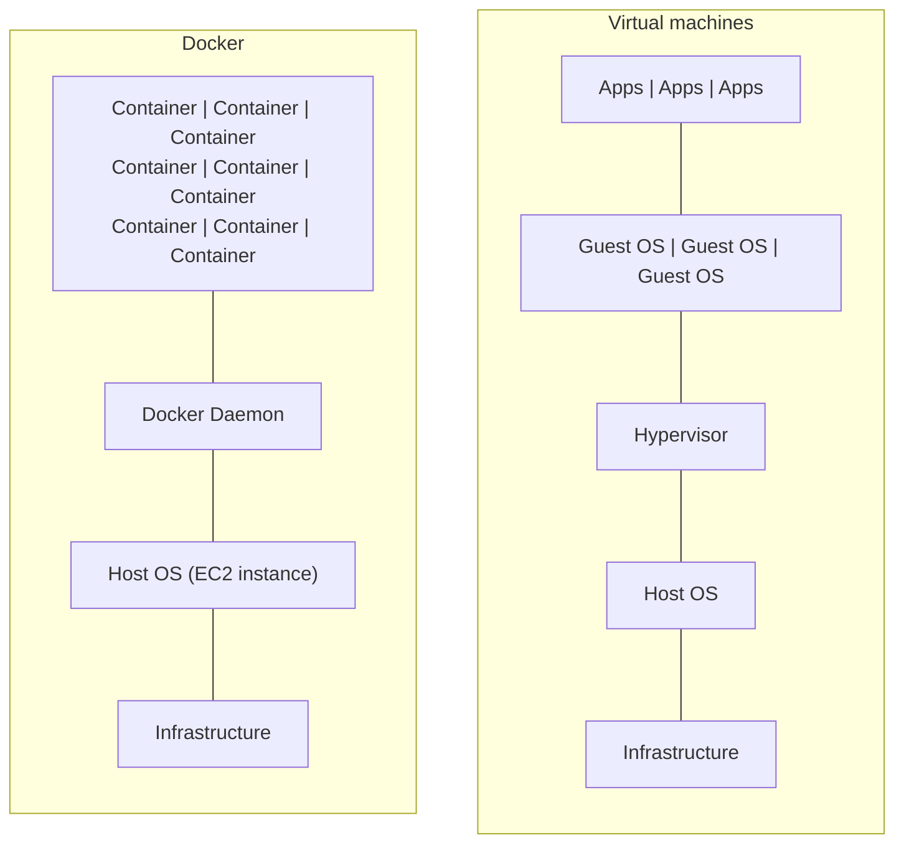
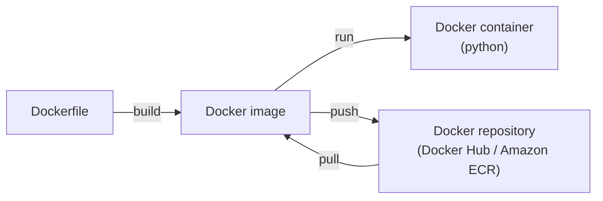
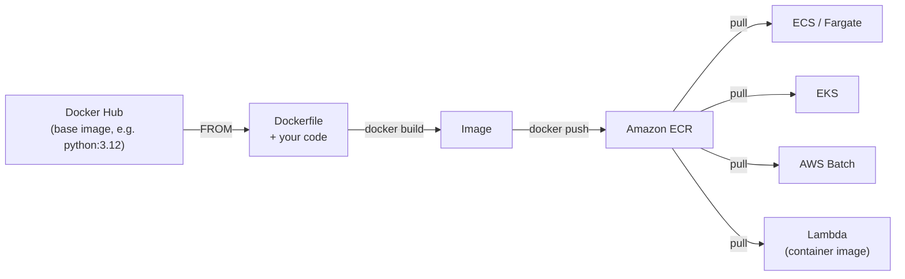
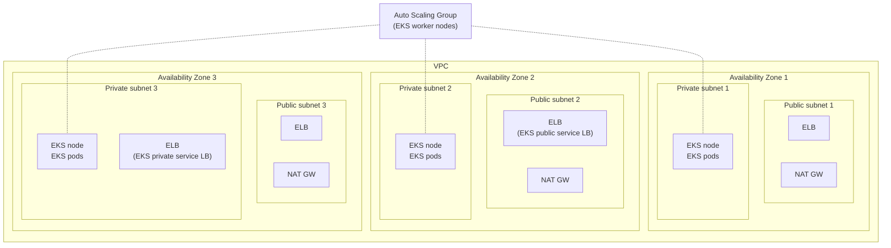

# 06 - Containers

Docker basics, then the three ways to run containers on AWS: ECS, EKS, and Fargate as the serverless compute under either. Exam tells inline, decision table at the end.

## Contents

- [Docker](#docker)
  - [What is Docker](#what-is-docker)
  - [Docker on an OS](#docker-on-an-os)
  - [Docker versus virtual machines](#docker-versus-virtual-machines)
  - [Where images are stored](#where-are-docker-images-stored)
  - [Getting started with Docker](#getting-started-with-docker)
  - [Container management on AWS](#docker-container-management-on-aws)
- [Amazon ECR](#amazon-ecr)
- [Amazon ECS](#amazon-ecs)
  - [Core concepts](#ecs-core-concepts)
  - [Launch types](#ecs-launch-types)
  - [IAM roles](#ecs-iam-roles)
  - [Load balancer integrations](#ecs-load-balancer-integrations)
  - [Data volumes](#ecs-data-volumes)
  - [Auto scaling](#ecs-auto-scaling)
  - [Exam tells](#ecs-exam-tells)
- [Amazon EKS](#amazon-eks)
  - [Overview](#eks-overview)
  - [Diagram](#eks-diagram)
  - [Node types](#eks-node-types)
  - [Data volumes](#eks-data-volumes)
  - [Exam tells](#eks-exam-tells)
- [Containers in data engineering](#containers-in-data-engineering)
- [Decision cheat sheet](#decision-cheat-sheet)

---

## Docker

### What is Docker

- Docker is a software development platform to deploy apps
- Apps are packaged in **containers** that can be run on any OS
- Apps run the same regardless of where they're run
  - Any machine
  - No compatibility issues
  - Predictable behavior
  - Less work
  - Easier to maintain and deploy
  - Works with any language, any OS, any technology
- Use cases: microservices architecture, lift-and-shift apps from on-premises to the AWS cloud

Vocabulary:

- **Image**: the frozen template (your code plus dependencies), built from a **Dockerfile**
- **Container**: a running instance of an image
- **Registry / repository**: where images are stored (Docker Hub, ECR)
- **Orchestrator**: decides where containers run and restarts them (ECS, EKS / Kubernetes)

### Docker on an OS



- One server, one OS kernel, many containers
- Each container packages an app with its own dependencies (Java version, Node version, libraries), isolated from the others
- Containers share the host kernel, so they start in seconds and use far less overhead than VMs
- Same image runs identically on your laptop, EC2, ECS, Fargate, Batch, Lambda

### Docker versus virtual machines

- Docker is "sort of" a virtualization technology, but not exactly
- Resources are shared with the host, so many containers on one server



| | Container | Virtual machine |
|---|---|---|
| Isolates | Processes, filesystem, network namespace | Entire OS with its own kernel |
| Startup | Seconds | Minutes |
| Size | MBs | GBs |
| Overhead | Minimal, shares the host kernel through the Docker daemon | Full guest OS per VM on a hypervisor |
| Isolation | Weaker (shared kernel) | Stronger |
| Example | Docker on an EC2 instance | The EC2 instance itself |

So the picture is two layers of virtualization: EC2 is a VM on AWS hardware, and Docker runs containers inside that VM. Fargate uses Firecracker micro-VMs to give each task VM-level isolation while keeping container-level startup, which is why it's safe for multi-tenant workloads.

### Where are Docker images stored?

- Docker images are stored in Docker repositories
- **Docker Hub** (https://hub.docker.com)
  - Public repository
  - Find base images for many technologies or OS (e.g. Ubuntu, MySQL, Python, ...)
- **Amazon ECR** (Amazon Elastic Container Registry)
  - Private repository
  - Public repository (Amazon ECR Public Gallery https://gallery.ecr.aws)

### Getting started with Docker



```dockerfile
FROM ubuntu:18.04

COPY . /app
RUN make /app

CMD python3 /app/app.py
```

- `FROM`: base image to start from
- `COPY`: copy files from your machine into the image
- `RUN`: command executed at build time (install dependencies, compile)
- `CMD`: command executed when the container starts
- Other common ones: `WORKDIR` (set the working directory), `ENV` (environment variables), `EXPOSE` (document a port), `ENTRYPOINT` (fixed executable, `CMD` becomes its args)
- **Build** the Dockerfile into an image, **push** the image to a repository, **pull** it on the server, **run** it as a container

```bash
docker build -t my-scraper:1.0 .
docker run --rm my-scraper:1.0
docker tag my-scraper:1.0 123456789012.dkr.ecr.us-east-1.amazonaws.com/my-scraper:1.0
aws ecr get-login-password | docker login --username AWS --password-stdin 123456789012.dkr.ecr.us-east-1.amazonaws.com
docker push 123456789012.dkr.ecr.us-east-1.amazonaws.com/my-scraper:1.0
```

### Docker container management on AWS

- **Amazon Elastic Container Service (ECS)**: AWS's own orchestrator
- **Amazon Elastic Kubernetes Service (EKS)**: managed Kubernetes
- **AWS Fargate**
  - Amazon's own serverless container platform
  - Works with ECS and EKS
- **Amazon ECR**: store container images

---

## Amazon ECR

- Private, IAM-controlled registry in your account, encrypted at rest with KMS
- ECR Public for public images
- Where ECS, EKS, Fargate, Batch, Lambda container images, and SageMaker pull from
- **Image scanning** for CVEs on push (basic or enhanced via Inspector)
- **Lifecycle policies** to expire old tags so the repo doesn't grow forever
- **Cross-region and cross-account replication**
- Image tags are mutable by default. Set tag immutability so `latest` can't be silently overwritten under a running task



Permissions to pull: `ecr:GetAuthorizationToken`, `ecr:BatchGetImage`, `ecr:GetDownloadUrlForLayer`. Lambda container images **must** be in ECR, not Docker Hub.

Exam tell: "Fargate task can't pull the image" is the execution role missing ECR permissions, or a task in a private subnet with no NAT and no ECR interface endpoints plus S3 gateway endpoint (ECR stores layers in S3).

---

## Amazon ECS

### ECS core concepts

| Term | What it is |
|---|---|
| **Cluster** | Logical grouping of tasks or services, backed by EC2 instances or Fargate capacity |
| **Task definition** | The blueprint: container image(s), CPU, memory, ports, environment variables, IAM task role, logging, volumes. Versioned |
| **Task** | One running instance of a task definition. Use for one-off or scheduled jobs |
| **Service** | Keeps N tasks running, replaces failed ones, attaches to a load balancer, auto scales. Use for long-running processes |
| **Container agent** | Runs on each EC2 instance to register it with the cluster (not needed on Fargate) |

A scheduled scraper is a **task** run by EventBridge Scheduler. A Kafka Connect cluster or API is a **service**.

### ECS launch types

**EC2 launch type**

- ECS = Elastic Container Service
- Launch Docker containers on AWS = launch **ECS tasks** on ECS clusters
- **You must provision and maintain the infrastructure (the EC2 instances)**
- Each EC2 instance must run the ECS agent to register in the ECS cluster
- AWS takes care of starting / stopping containers
- Supports Spot via capacity providers, bin-packs tasks onto instances for density

**Fargate launch type**

- Launch Docker containers on AWS
- **You do not provision the infrastructure (no EC2 instances to manage)**
- **It's all serverless**
- You just create task definitions
- AWS runs ECS tasks for you based on the CPU / RAM you need
- To scale, just increase the number of tasks. No more EC2 instances
- Fargate Spot for interruptible workloads at a discount

**ECS Managed Instances** (newer): AWS provisions and patches the EC2 instances for you, a middle ground between EC2 and Fargate when you need instance-level features (GPUs, specific instance types) without the ops.

| | EC2 launch type | Fargate |
|---|---|---|
| You manage | Instances, AMI, patching, scaling the fleet | Nothing below the task |
| Pricing | Per instance (whole instance, whether full or not) | Per task vCPU-second and GB-second |
| Startup | Fast if capacity exists | ~30 to 60 s per task |
| GPUs, instance store, daemon containers | Yes | No |
| Density / cost at steady high load | Better (bin-packing) | Worse |
| Pick for | Steady, dense, special hardware | Spiky, simple, "no servers" |

### ECS IAM roles

Two different roles, confused constantly:

- **EC2 instance profile (EC2 launch type only)**
  - Used by the **ECS agent** on the instance
  - Makes API calls to the ECS service
  - Sends container logs to CloudWatch Logs
  - Pulls Docker images from ECR
  - References sensitive data in Secrets Manager or SSM Parameter Store
- **ECS task role**
  - Allows each task to have a specific role
  - Use different roles for the different ECS services you run
  - Task role is defined in the **task definition**
  - This is what your code uses to call S3, DynamoDB, Kinesis, etc.
- **Task execution role** (both launch types)
  - Used by ECS itself to start the task: pull from ECR, write logs, fetch secrets. On Fargate it does what the instance profile does on EC2

Exam tell: "container can't write to S3" is the **task role**. "Task fails to start, can't pull image or fetch secret" is the **execution role** (or instance profile on EC2).

### ECS load balancer integrations

- **Application Load Balancer** supported and works for most use cases (HTTP/HTTPS, path routing, dynamic port mapping)
- **Network Load Balancer** recommended only for high throughput / high performance use cases, or to pair with AWS PrivateLink
- **Classic Load Balancer** supported but not recommended (no advanced features, no Fargate)

### ECS data volumes

**EFS**

- Mount EFS file systems onto ECS tasks
- Works for both **EC2** and **Fargate** launch types
- Tasks running in any AZ share the same data in the EFS file system
- **Fargate + EFS = serverless**
- Use cases: persistent multi-AZ shared storage for your containers

**S3 Files** (newer)

- Mount an S3 bucket onto ECS tasks as a file system
- Works for **Fargate** and **ECS Managed Instances** (EC2 launch type is NOT supported)
- Changes sync automatically to the S3 bucket
- Use cases: containers needing shared file access to data that already lives in S3

**Bind mounts and ephemeral storage**

- Fargate tasks get 20 GB of ephemeral storage by default (up to 200 GB), gone when the task stops. Scratch only
- EC2 launch type can also use EBS volumes on the host and Docker volumes

### ECS auto scaling

- **Service auto scaling**: scale the number of tasks on CPU, memory, ALB request count, or a custom metric (SQS queue depth is the classic for worker services). Target tracking, step, or scheduled
- **Cluster auto scaling** (EC2 launch type): capacity providers add or remove instances so there's room for the tasks. On Fargate there's no cluster to scale, just tasks

### ECS exam tells

| Scenario | Answer |
|---|---|
| Containers, no servers to manage | Fargate |
| Containers need GPU or instance store | EC2 launch type |
| Scale workers with the queue | Service auto scaling on SQS `ApproximateNumberOfMessagesVisible` |
| Task can't call S3 / DynamoDB | Task role in the task definition |
| Task can't start, image pull or secret fails | Execution role (or instance profile) |
| Shared persistent storage across tasks and AZs | EFS |
| Containers need files that live in S3, no code change | S3 Files mount (Fargate) |
| Expose HTTP service | ALB |
| Very high throughput or PrivateLink | NLB |
| Cheap, interruptible containers | Fargate Spot or EC2 Spot capacity provider |
| Scheduled container job | EventBridge Scheduler running an ECS task |

---

## Amazon EKS

### EKS overview

- Amazon EKS = Amazon Elastic **Kubernetes** Service
- A way to launch **managed Kubernetes clusters on AWS**
- Kubernetes is an open-source system for automatic deployment, scaling, and management of containerized (usually Docker) applications
- It's an alternative to ECS, similar goal but different API
- EKS supports **EC2** worker nodes or **Fargate** for serverless containers
- Use case: your company already uses Kubernetes on-premises or in another cloud and wants to migrate to AWS using Kubernetes
- **Kubernetes is cloud-agnostic** (can be used in any cloud: Azure, GCP, on-prem)
- AWS runs the control plane (API server, etcd) in its own account. You run (or Fargate runs) the worker nodes in your VPC

Vocabulary map:

| ECS | Kubernetes / EKS |
|---|---|
| Cluster | Cluster |
| Task definition | Pod spec (in a Deployment manifest) |
| Task | Pod |
| Service | Deployment + Service |
| Container instance | Node |
| ALB integration | Ingress (AWS Load Balancer Controller) |
| Task role | IAM Roles for Service Accounts (IRSA) / Pod Identity |

### EKS diagram



- **EKS nodes** (worker nodes) are EC2 instances in private subnets across 3 AZs, grouped in an Auto Scaling Group
- **Pods** run on the nodes. A pod is one or more containers, the Kubernetes unit of deployment
- A Kubernetes **service** exposes pods through a load balancer: a **public** ELB in a public subnet to reach the web, or a **private** ELB in a private subnet for internal traffic
- **NAT gateways** in the public subnets give the private nodes outbound internet (pull images, call APIs)
- The EKS **control plane** (Kubernetes API, etcd) is managed by AWS and not shown, it lives outside your VPC
- Same network layout as ECS, RDS, Redshift, and Lambda in a VPC: load balancers and NAT in public subnets, compute in private

### EKS node types

- **Managed node groups**
  - Creates and manages nodes (EC2 instances) for you
  - Nodes are part of an ASG managed by EKS
  - Supports On-Demand or Spot instances
  - Default choice
- **Self-managed nodes**
  - Nodes created by you are registered to the EKS cluster and managed by an ASG
  - You can use a prebuilt AMI, the Amazon EKS Optimized AMI
  - Supports On-Demand or Spot instances
  - Max control, max work
- **AWS Fargate**
  - No maintenance required, no nodes managed
  - Each pod gets its own isolated compute
  - No DaemonSets, no GPUs, no privileged containers

### EKS data volumes

- Need to specify a **StorageClass** manifest on your EKS cluster
- Leverages a **Container Storage Interface (CSI)** compliant driver
- Support for:
  - Amazon EBS (block, single AZ, one pod at a time)
  - Amazon EFS (shared, multi-AZ, works with Fargate)
  - Amazon FSx for Lustre (high-performance, S3-linked, HPC and ML)
  - Amazon FSx for NetApp ONTAP

### EKS exam tells

| Scenario | Answer |
|---|---|
| "Kubernetes" anywhere in the question | EKS |
| Already running Kubernetes on-prem, moving to AWS | EKS |
| Must run the same on AWS and another cloud | EKS (Kubernetes is portable) |
| Kubernetes with no nodes to manage | EKS on Fargate |
| Pods need shared storage, Fargate | EFS CSI driver |
| Spark on an existing Kubernetes cluster | EMR on EKS |
| None of the above, just containers | ECS, it's simpler |

---

## Containers in data engineering

Most of your stack already runs in containers you never see: Glue, Lambda, Batch, Fargate, MWAA workers, SageMaker, Redshift Serverless. The places you touch Docker directly:

- **Lambda container images**: dependencies over 250 MB (big ML libraries, geospatial stacks). Image up to 10 GB, must live in ECR
- **Fargate tasks**: a scraper, poller, or transform that needs more than 15 minutes or a custom runtime, triggered by EventBridge Scheduler or Step Functions
- **AWS Batch**: array jobs and job queues on top of ECS/Fargate for embarrassingly parallel work
- **Long-running consumers**: Kafka Connect, a KCL app, a Flink job you run yourself, as an ECS service
- **MWAA**: Airflow workers are Fargate under the hood, and custom operators run in that image
- **Local dev**: Postgres, Kafka, LocalStack in Docker Compose for testing pipelines without AWS
- **EMR on EKS**: Spark on a shared Kubernetes cluster when the platform team already runs one

Where containers are the wrong answer: Spark ETL (use Glue or EMR), ad hoc SQL (Athena), anything event-driven that finishes in minutes (Lambda).

---

## Decision cheat sheet

| Need | Use |
|---|---|
| Store images | ECR |
| Run containers, don't know Kubernetes | ECS |
| Run containers, team knows Kubernetes or needs portability | EKS |
| No servers under either | Fargate launch type |
| GPUs, instance store, daemon agents | EC2 launch type / managed node groups |
| One-off or scheduled container job | ECS task via EventBridge Scheduler, or Batch |
| Always-on container service | ECS service (or Kubernetes Deployment) |
| Shared persistent storage across containers | EFS |
| Container reads files already in S3 | S3 Files mount (Fargate), or the SDK |
| Code needs AWS permissions | ECS task role / EKS IRSA |
| ECS can't pull image or secret | Execution role, or VPC endpoints |
| Spark | Not containers directly: Glue, EMR, or EMR on EKS |
| Under 15 minutes, event-driven | Lambda, not containers |

Rough ladder of control vs effort: Lambda < Fargate < ECS on EC2 < EKS < raw EC2. Pick the leftmost one that fits.