# 07 - Analytics

The query and processing layer: Glue (catalog and ETL), Lake Formation (permissions), Athena (SQL on S3), Spark and EMR (distributed compute), Kinesis and MSK (streaming), Flink (stream processing), OpenSearch (search), and QuickSight (BI). Exam tells inline, decision cheat sheet at the end.

## Contents

- [AWS Glue](#aws-glue)
  - [What is AWS Glue](#what-is-aws-glue)
  - [Crawler and Data Catalog](#glue-crawler--data-catalog)
  - [Glue and S3 partitions](#glue-and-s3-partitions)
  - [Glue + Hive](#glue--hive)
  - [Glue ETL](#glue-etl)
  - [DynamicFrame](#glue-etl---the-dynamicframe)
  - [Transformations](#glue-etl---transformations)
  - [ResolveChoice](#glue-etl---resolvechoice)
  - [Worker types and Glue versions](#glue-worker-types-and-versions)
  - [Modifying the Data Catalog from ETL scripts](#modifying-the-glue-data-catalog-from-etl-scripts)
  - [Job bookmarks](#running-etl-jobs-with-bookmarks)
  - [Costs and anti-patterns](#glue-costs-and-anti-patterns)
  - [Streaming ETL](#glue-streaming-etl)
  - [Flex jobs](#aws-glue-flex-jobs)
  - [Glue Studio](#aws-glue-studio)
  - [Glue Data Quality](#aws-glue-data-quality)
  - [Glue DataBrew](#aws-glue-databrew)
  - [Handling PII in DataBrew](#handling-pii-in-databrew-transformations)
  - [Glue Workflows](#aws-glue-workflows)
  - [Exam tells](#glue-exam-tells)
- [AWS Lake Formation](#aws-lake-formation)
  - [Overview and pricing](#lake-formation-overview)
  - [Building a data lake](#lake-formation-building-a-data-lake)
  - [The finer points](#lake-formation-the-finer-points)
  - [Data permissions](#data-permissions-in-lake-formation)
  - [Data filters](#data-filters-in-lake-formation)
  - [Exam tells](#lake-formation-exam-tells)
- [Amazon Athena](#amazon-athena)
  - [What is Athena](#what-is-athena)
  - [Athena + Glue](#athena--glue)
  - [Workgroups](#athena-workgroups)
  - [Cost model](#athena-cost-model)
  - [Security](#athena-security)
  - [Optimizing performance](#athena-optimizing-performance)
  - [Partition projection](#partition-projection)
  - [ACID transactions with Iceberg](#athena-acid-transactions)
  - [Apache Iceberg](#apache-iceberg)
  - [CREATE TABLE AS SELECT (CTAS)](#create-table-as-select-ctas)
  - [Federated queries](#athena-federated-queries)
  - [Fine-grained access to the Glue Data Catalog](#athena-fine-grained-access-to-the-glue-data-catalog)
  - [Athena for Apache Spark](#amazon-athena-for-apache-spark)
  - [Exam tells](#athena-exam-tells)
- [Apache Spark](#apache-spark)
  - [How Spark works](#how-spark-works)
  - [Structured Streaming](#spark-structured-streaming)
  - [Spark + Kinesis](#spark-streaming--kinesis)
  - [Spark + Redshift](#spark--redshift)
- [Amazon EMR](#amazon-emr)
  - [What is EMR](#what-is-emr)
  - [An EMR cluster](#an-emr-cluster)
  - [EMR usage](#emr-usage)
  - [AWS integration](#emr--aws-integration)
  - [EMR storage](#emr-storage)
  - [Promises and scaling](#emr-promises)
  - [Managed scaling](#emr-managed-scaling)
  - [What's Hadoop](#so-whats-hadoop)
  - [EMR Serverless](#emr-serverless)
  - [EMR on EKS](#emr-on-eks)
  - [Exam tells](#emr-exam-tells)
- [Amazon Kinesis Data Streams](#amazon-kinesis-data-streams)
  - [Capacity modes](#kinesis-data-streams---capacity-modes)
  - [Security](#kinesis-data-streams---security)
  - [Producers](#kinesis-data-streams---producers)
  - [KPL](#kinesis-producer-library-kpl)
  - [Kinesis Agent](#kinesis-agent)
  - [Consumers](#kinesis-data-streams---consumers)
  - [KCL](#kinesis-client-library-kcl)
  - [Enhanced fan-out](#kinesis-enhanced-fan-out)
  - [Scaling and resharding](#kinesis-scaling-and-resharding)
  - [Handling duplicates](#kinesis-handling-duplicates)
  - [Troubleshooting](#kinesis-troubleshooting)
  - [Exam tells](#kinesis-data-streams-exam-tells)
- [Amazon Data Firehose](#amazon-data-firehose)
  - [Delivery diagram](#firehose-delivery-diagram)
  - [Buffer sizing](#firehose-buffer-sizing)
  - [Format conversion and dynamic partitioning](#firehose-format-conversion-and-dynamic-partitioning)
  - [Data Streams vs Firehose](#kinesis-data-streams-vs-firehose)
- [Managed Service for Apache Flink](#managed-service-for-apache-flink-msaf)
  - [Flink capabilities](#apache-flink-capabilities)
  - [Windowing and watermarks](#windowing-and-watermarks)
  - [Costs](#msaf-costs)
  - [RANDOM_CUT_FOREST](#random_cut_forest)
- [Amazon MSK](#amazon-msk)
  - [Kafka at a high level](#apache-kafka-at-a-high-level)
  - [Configuration](#msk---configuration)
  - [Security](#msk---security)
  - [Monitoring](#msk---monitoring)
  - [MSK Connect](#msk-connect)
  - [MSK Serverless](#msk-serverless)
  - [Kinesis vs MSK](#amazon-kinesis-vs-amazon-msk)
- [Amazon OpenSearch Service](#amazon-opensearch-service)
  - [Concepts](#opensearch-concepts)
  - [Shards and redundancy](#shards-and-redundancy)
  - [Managed service options](#amazon-opensearch-service-managed)
  - [Security](#opensearch-security)
  - [Securing dashboards](#securing-dashboards)
  - [Anti-patterns](#opensearch-anti-patterns)
  - [Storage tiers](#cold--warm--ultrawarm--hot-storage)
  - [Index State Management](#index-state-management)
  - [Cross-cluster replication](#cross-cluster-replication)
  - [Stability and performance](#opensearch-stability-and-performance)
  - [OpenSearch Serverless](#amazon-opensearch-serverless)
  - [Exam tells](#opensearch-exam-tells)
- [Amazon QuickSight](#amazon-quicksight)
  - [What is it](#what-is-quicksight)
  - [Data sources](#quicksight-data-sources)
  - [SPICE](#spice)
  - [Use cases and anti-patterns](#quicksight-use-cases)
  - [Security](#quicksight-security)
  - [Cross-region and cross-account](#quicksight--redshift--rds-cross-region)
  - [User management](#quicksight-user-management)
  - [Pricing](#quicksight-pricing)
  - [Dashboards and embedding](#quicksight-dashboards)
  - [ML Insights](#quicksight-machine-learning-insights)
  - [Calculated fields](#quicksight-calculated-fields)
  - [Level-aware calculations](#level-aware-calculations-lac)
  - [FLOAT vs FIXED](#float-vs-fixed-data-types)
  - [Exam tells](#quicksight-exam-tells)
- [Decision cheat sheet](#decision-cheat-sheet)

---

## AWS Glue

### What is AWS Glue?

- Serverless **discovery and definition** of table definitions and schema
  - S3 data lakes
  - RDS
  - Redshift
  - Most other SQL databases
- Custom **ETL jobs**
  - Trigger-driven, on a schedule, or on demand
  - Fully managed

### Glue crawler / Data Catalog

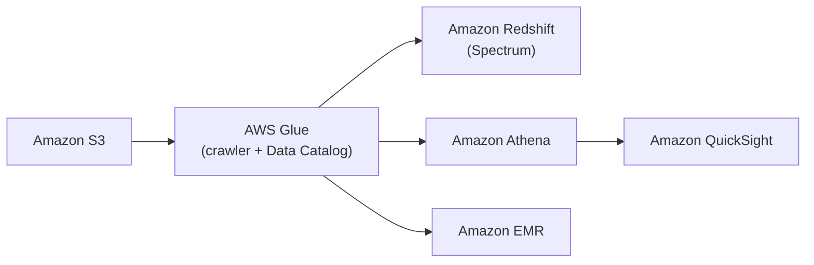

- Glue crawler scans data in S3 and **infers the schema**
- Can run periodically (schedule) or on demand
- Populates the **Glue Data Catalog**
  - Stores only the table definition (columns, types, format, location, partitions)
  - Original data stays in S3
- Once cataloged, you can treat unstructured data like it's structured, from Redshift Spectrum, Athena, EMR, and QuickSight (via Athena)

Things the slides skip:

- **Crawlers aren't required.** `CREATE TABLE` in Athena, a Glue job with `enableUpdateCatalog`, or Terraform `aws_glue_catalog_table` all populate the Catalog. A crawler is for when you don't know the schema or it drifts
- **Partition discovery is the real job.** Crawlers pick up new Hive partitions (`year=2026/month=10/`). The cheaper alternative for a known layout is **partition projection** in Athena, which needs no crawl at all
- **Schema inference gotchas**: a crawler reading a few files can type a column as `bigint`, then hit a string later. Mixed types across partitions cause `HIVE_BAD_DATA` in Athena. Crawlers can also split one dataset into many tables when paths or schemas differ; use the "create a single schema for each S3 path" grouping option
- **Classifiers**: built-in for JSON, CSV, Parquet, Avro, ORC. Custom grok classifiers for log formats
- **Exclusions**: glob patterns to skip `_SUCCESS` files, temp folders, other formats in the same prefix
- **Incremental crawls**: "crawl new folders only", or S3 event mode where the crawler consumes SQS notifications and only touches changed paths
- **Partition indexes** on a Catalog table speed up `GetPartitions` when a table has thousands of partitions
- **Cost**: billed per DPU-hour of crawl time, 10-minute minimum

### Glue and S3 partitions

- The Glue crawler extracts partitions based on how your S3 data is organized
- Think up front about how you will query your data lake in S3
- Example: devices send sensor data every hour
- Do you query primarily by **time ranges**? Organize as `yyyy/mm/dd/device`
- Do you query primarily by **device**? Organize as `device/yyyy/mm/dd`

The rule: **put the column you filter on first**, because S3 prefixes are read left to right and pruning only works on the leading path components.

---

## Glue, Hive, and ETL

### Glue + Hive

- Hive lets you run SQL-like queries from EMR
- The Glue Data Catalog can serve as a Hive **metastore**
- You can also import a Hive metastore into Glue

A Hive metastore is just a database of table definitions for files: names, columns, types, format, location, partitions. The Glue Data Catalog is AWS's managed, Hive-compatible version, which is why Athena, Spectrum, EMR, and Spark all read the same tables.

### Glue ETL

- Automatic code generation
- Scala or Python
- Encryption
  - Server-side (at rest)
  - SSL (in transit)
- Can be event-driven
- Can provision additional **DPUs** (data processing units) to increase performance of the underlying Spark jobs
  - Enabling job metrics helps you understand the maximum capacity in DPUs you need
  - Plot maximum needed executors vs maximum allocated executors in the **Glue console** (not CloudWatch), as well as ETL data movement
- Errors reported to CloudWatch
  - Can tie into SNS for notification

Additional notes:

- Transform, clean, and enrich data before analysis
  - Generate ETL code in Python or Scala, and modify it
  - Or provide your own Spark / PySpark scripts
  - Target can be S3, JDBC (RDS, Redshift), or the Glue Data Catalog
- Fully managed, cost effective, pay only for resources consumed
- Jobs run on a **serverless Spark platform**
- **Glue Scheduler** to schedule jobs, **Glue Triggers** to automate runs based on events

### Glue ETL - the DynamicFrame

- A **DynamicFrame** is a collection of **DynamicRecords**
  - DynamicRecords are self-describing and have a schema
  - Very much like a Spark DataFrame, but with more ETL features
  - Scala and Python APIs

The practical difference: a DataFrame requires one fixed schema, so a column with mixed types breaks it. A DynamicFrame keeps **both types** on the record and lets you resolve the ambiguity later with `ResolveChoice`. Convert with `.toDF()` and `.fromDF()` when you want Spark SQL, Catalyst optimization, or window functions, which DynamicFrames don't have.

### Glue ETL - transformations

- **Bundled transformations:**
  - `DropFields`, `DropNullFields`: remove (null) fields
  - `Filter`: specify a function to filter records
  - `Join`: to enrich data
  - `Map`: add fields, delete fields, perform external lookups
- **Machine learning transformations:**
  - **`FindMatches ML`**: identify duplicate or matching records in your dataset, even when the records have no common unique identifier and no fields match exactly
- Format conversions: CSV, JSON, Avro, Parquet, ORC, XML
- Apache Spark transformations (example: K-Means)

### Glue ETL - ResolveChoice

- Deals with ambiguities in a DynamicFrame and returns a new one
- For example, two fields with the same name

| Option | What it does |
|---|---|
| `make_cols` | Creates a new column for each type: `price_double`, `price_string` |
| `cast` | Casts all values to a specified type |
| `make_struct` | Creates a structure containing each data type |
| `project` | Projects every type to a given type, for example `project:string` |

### Glue worker types and versions

| Worker type | DPUs | Memory | Use for |
|---|---|---|---|
| `G.1X` | 1 | 16 GB | Default, most jobs |
| `G.2X` | 2 | 32 GB | Memory-heavy, ML transforms |
| `G.4X` / `G.8X` | 4 / 8 | 64 / 128 GB | Very large shuffles |
| `G.025X` | 0.25 | 4 GB | Low-volume streaming jobs |

- One worker is reserved as the Spark **driver**, the rest are **executors**
- **Python shell jobs** run plain Python on 0.0625 or 1 DPU with no Spark, for small tasks like calling an API or running a SQL statement
- **Auto scaling** (Glue 3.0+) adds and removes executors during the run based on demand
- Glue version pins the Spark and Python versions (Glue 4.0 is Spark 3.3, Glue 5.0 is Spark 3.5)

---

## Modifying the Glue Data Catalog from ETL scripts

- ETL scripts can update your schema and partitions if necessary
- **Adding new partitions:**
  - Re-run the crawler, or
  - Have the script use `enableUpdateCatalog` and `partitionKeys`
- **Updating table schema:**
  - Re-run the crawler, or
  - Use `enableUpdateCatalog` / `updateBehavior` from the script
- **Creating new tables:**
  - `enableUpdateCatalog` / `updateBehavior` with `setCatalogInfo`
- **Restrictions:**
  - S3 only
  - JSON, CSV, Avro, Parquet only
  - Parquet requires special code
  - Nested schemas are not supported

Exam tell: "new partitions aren't showing up in Athena" has three answers, and the question's wording picks one. Re-run the crawler (scheduled), `enableUpdateCatalog` (the job registers them itself), `MSCK REPAIR TABLE` (manual), or partition projection (no metadata at all).

---

## Running ETL jobs with bookmarks

- Time-based schedules (cron style)
- **Job bookmarks**
  - Persist state from the job run
  - Prevent reprocessing of old data
  - Allow you to process **new data only** when re-running on a schedule
  - Work with S3 sources in a variety of formats
  - Work with relational databases via **JDBC** (if primary keys are in sequential order)
    - Only handles **new rows, not updated rows**
- **CloudWatch Events / EventBridge**
  - Fire off a Lambda function or SNS notification when ETL succeeds or fails
  - Invoke an EC2 run, send an event to Kinesis, activate a Step Function

Gotchas: bookmarks are per job and per transformation context, so renaming the job or the context resets them. `job.commit()` must be called or the bookmark never advances. You can **pause** bookmarks for a rerun or **reset** them to reprocess everything.

---

## Glue costs and anti-patterns

### Glue cost model

- Billed **by the second** for crawler and ETL jobs
- First million objects stored and accessed are **free** for the Glue Data Catalog
- Development endpoints for developing ETL code are charged **by the minute**

### Glue anti-patterns

- **Multiple ETL engines**
  - Glue ETL is based on Spark
  - If you want other engines (Hive, Pig, etc.) then EMR is a better fit

### Glue streaming ETL

No longer an anti-pattern:

- As of April 2020, Glue ETL supports **serverless streaming ETL**
  - Consumes from Kinesis or Kafka
  - Clean and transform in flight
  - Store results into S3 or other data stores
- Runs on **Apache Spark Structured Streaming**, so it's micro-batch, not per-record

---

## AWS Glue Flex jobs

- Execution class (`FLEX`) for **non-urgent** ETL workloads
  - Uses spare compute capacity instead of dedicated workers
  - Might have to wait for capacity to become available
- Appropriate for time-insensitive workloads (testing, one-time loads, etc.)
- Usually cheaper than standard execution (roughly 30 to 35% savings)
  - Billed only for the actual workers running and the duration they ran
  - You may end up with fewer workers than expected if capacity is limited

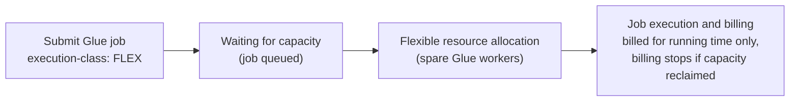

- Workers can be reclaimed mid-job, so the job may run slower or fail and retry
- Glue 3.0+ Spark jobs only
- Set per job: `--execution-class FLEX`, or in the job's run properties
- Standard is the default and gives dedicated workers that start right away

**Not supported:**
- Python shell jobs
- Streaming jobs
- Glue ML jobs

**When to use:**
- **Standard**: dedicated resources, predictable start time and performance, hard SLAs
- **Flex**: willing to trade variable performance for cost

Exam tell: "reduce Glue cost for non-time-sensitive ETL" is Flex. "Reduce cost but the job must finish by a deadline" is not Flex, it's right-sizing workers, auto scaling, or bookmarks so you process less.

---

## AWS Glue Studio

- Visual interface for ETL workflows
- **Visual job editor**
  - Create DAGs for complex workflows
  - Sources include S3, Kinesis, Kafka, JDBC
  - Transform / sample / join data
  - Target to S3 or the Glue Data Catalog
  - Supports partitioning
- **Visual job dashboard**: overviews, status, run times
- Generates PySpark or Scala code under the hood that you can view, edit, and version like any Glue job
- Home to the **Glue Studio notebook** (interactive Spark sessions for developing jobs)
- **Data Preview** runs a sample of each transform node interactively, the fastest way to debug a DynamicFrame schema problem without burning DPUs

Note: the "DAG" here is one job's transform graph, not orchestration across jobs. Orchestration is Glue Workflows, Step Functions, or MWAA.

Exam tell: "non-developers need to build ETL without writing code" is Glue Studio. "Analysts need to clean and profile data with no code" is Glue DataBrew. Don't mix them up.

---

## AWS Glue Data Quality

- Data quality rules may be created manually or **automatically** (recommended rules)
- Integrates into Glue jobs
- Uses **Data Quality Definition Language (DQDL)**
- Results can be used to **fail the job**, or just be reported to CloudWatch

### DQDL syntax

- The exam expects you to recognize the syntax
- A DQDL document consists of a **ruleset**:
  - `Rules = [IsComplete "order-id", IsUnique "order-id"]`
- Lots of built-in rule types: `Mean`, `Sum`, `CustomSql`, `Uniqueness`, `Completeness`, `ColumnValues`, `RowCount`, `DetectAnomalies`
- **Composite rules** (`and`, `or`):
  - `(ColumnValues "myCol1" > 1) OR (ColumnValues "myCol2" > 2)`
  - Evaluates left to right and **fails early**, unlike SQL
    - Unless you specify `compositeRuleEvaluation` in `additionalOptions`
- Expressions (`=`, `!=`, `>`, `<`, etc.)
- Filters (where clauses)
- Constants (storing common SQL snippets)
- Labels (apply all rules with a given label, like for a given team)

Exam tell: Glue Data Quality tests the **data**. CI/CD tests the **code**. A question about catching bad records before they reach the warehouse is Data Quality, with the action set to fail the job.

---

## AWS Glue DataBrew

- A **visual data preparation** tool
  - UI for pre-processing large data sets
  - Input from S3, a data warehouse (Redshift), or a database (JDBC, Glue Catalog tables)
  - Output to S3
- Over **250 ready-made transformations** (filter, dedupe, fill nulls, pivot, nest/unnest, split, standardize)
- **No code**: build a **recipe** of steps in the UI, then run it as a **job** at scale
- May define data quality rules
- May create datasets with custom SQL from Redshift and Snowflake
- **Security**
  - Can integrate with KMS (customer master keys only)
  - SSL in transit
  - IAM restricts who can do what
  - CloudWatch and CloudTrail

```json
{
  "RecipeAction": {
    "Operation": "NEST_TO_MAP",
    "Parameters": {
      "sourceColumns": "[\"age\",\"weight_kg\",\"height_cm\"]",
      "targetColumn": "columnName",
      "removeSourceColumns": "true"
    }
  }
}
```

Example: convert selected columns to key-value pairs.

Vocabulary:

- **Dataset**: a connection to the source (S3 path, Catalog table, JDBC)
- **Project**: the interactive session where you build a recipe on a sample
- **Recipe**: the ordered, versioned list of transformation steps (exportable as JSON)
- **Recipe job**: runs the recipe over the full dataset and writes to S3
- **Profile job**: runs data profiling only (stats, nulls, distributions, correlations, PII detection) with no transforms

Mental model: DataBrew is Power Query for AWS. Applied Steps are a **recipe**, refresh is a **recipe job**. The differences are that it scales to data that would never load on a laptop, its output is a dataset in S3 rather than a report, and there's no escape hatch into code (that's Glue Studio or a real Glue job).

Billing is per interactive session (30-minute increments) plus per node-hour for jobs, so stop the project session when you're done.

---

## Handling PII in DataBrew transformations

| Technique | Operation |
|---|---|
| Substitution | `REPLACE_WITH_RANDOM...` |
| Shuffling | `SHUFFLE_ROWS` |
| Probabilistic encryption | `ENCRYPT` |
| Nulling out or deletion | `DELETE` |
| Masking out | `MASK_CUSTOM`, `MASK_DATE`, `MASK_DELIMITER`, `MASK_RANGE` |
| Hashing | `CRYPTOGRAPHIC_HASH` |

Exam tell: "detect and anonymize PII with no code" is a DataBrew profile job (detection) plus these transformations (anonymization). "Hide PII from some users but keep it for others" is Lake Formation column filters instead, because that's an access control problem, not a transformation problem.

---

## AWS Glue Workflows

- Design multi-job, multi-crawler ETL processes that run together
- A DAG of **triggers** that start jobs and crawlers, with conditions on the results
- Create from a Glue blueprint, from the console, or the API
- **Only for orchestrating Glue operations**

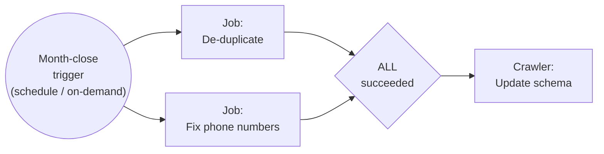

Building blocks:

- **Start trigger**: schedule (cron), on-demand, or EventBridge event
- **Jobs and crawlers**: the nodes
- **Conditional triggers**: fire the next node when watched nodes finish, with `ALL` or `ANY` of them succeeded / failed / stopped / timed out
- **Workflow run properties**: key-value pairs shared across the run, so one job can pass a value to the next
- Graph, Details, and History tabs show run status per node

### Glue workflow triggers

- Triggers within workflows start jobs or crawlers, or fire when jobs or crawlers complete
- **Schedule**: based on a cron expression
- **On demand**
- **EventBridge events**
  - Start on a single event or a batch of events
  - For example, arrival of a new object in S3
  - Optional batch conditions:
    - Batch size (number of events)
    - Batch window (within X seconds, default 15 minutes)

What workflows **can't** do:

- Call anything outside Glue (no Lambda, no Redshift Data API, no SNS, no human approval)
- Loops, retries beyond the job's own retry setting, or branching on data values
- Pass large payloads between steps (run properties are small strings)
- Wait on an external event mid-workflow

| | Glue Workflows | Step Functions | MWAA (Airflow) |
|---|---|---|---|
| Orchestrates | Glue jobs and crawlers only | Any AWS service, 200+ integrations | Anything with a Python operator |
| Logic | Success/fail conditions | Choice, Map, Parallel, Wait, Catch, Retry | Full Python, branching, backfills, SLAs |
| Setup | None, inside Glue | None, serverless | Environment to provision, costs even when idle |
| Pick when | Pure Glue pipeline | Mixed services, error handling, fan-out | Team already on Airflow, many pipelines |

Exam tell: "orchestrate several Glue jobs and crawlers with minimal setup" is Glue Workflows. The moment a Lambda, a Redshift load, a notification, or "retry with backoff" appears, it's Step Functions. "Existing Airflow DAGs" is MWAA.

---

## Glue exam tells

| Scenario | Answer |
|---|---|
| New data in S3 isn't showing in Athena | Run the crawler, `MSCK REPAIR TABLE`, `enableUpdateCatalog`, or partition projection |
| Crawler creates many tables instead of one | Grouping option: single schema per S3 path |
| Column has mixed types across files | DynamicFrame + `ResolveChoice`, or fix at the source |
| Process only new data on each run | Job bookmarks |
| Updated rows aren't picked up by bookmarks | Bookmarks only handle new rows; use CDC or a merge |
| Spark job out of memory | `G.2X` workers, or fix the skew |
| Reduce cost, no deadline | Flex jobs |
| Non-developers building ETL | Glue Studio |
| Analysts cleaning and profiling data | Glue DataBrew |
| Validate data and fail the pipeline on bad rows | Glue Data Quality with DQDL |
| Deduplicate records with no common key | `FindMatches` ML transform |
| Orchestrate Glue jobs only | Glue Workflows |
| Orchestrate Glue plus other services | Step Functions |
| Need Hive, Pig, or Presto | EMR, not Glue |

---

## AWS Lake Formation

### Lake Formation overview

- "Makes it easy to set up a secure data lake in days"
- Loading data and monitoring data flows
- Setting up partitions
- Encryption and managing keys
- Defining transformation jobs and monitoring them
- Access control
- Auditing
- **Built on top of Glue**: same Data Catalog, same crawlers, same ETL jobs

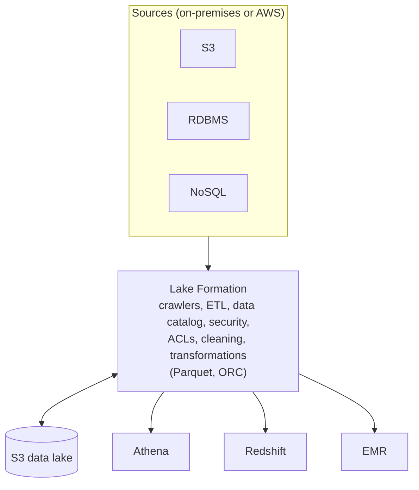

**What Lake Formation actually is today:** the **permission layer for the Data Catalog**. Everything else on that diagram is Glue. Without it, access to lake data is IAM policies on S3 paths plus IAM policies on Glue Catalog APIs. With it, you grant **table and column-level permissions in the catalog**, and Athena, Redshift Spectrum, EMR, and QuickSight enforce them. Users need no S3 permissions at all, because Lake Formation vends temporary scoped S3 credentials to the query engine on their behalf.

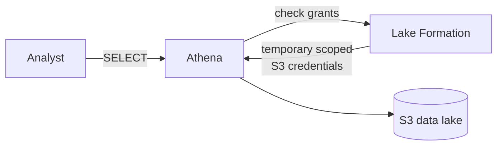

### Lake Formation pricing

- **No cost for Lake Formation itself**
- But the underlying services incur charges: Glue, S3, EMR, Athena, Redshift

### Lake Formation: building a data lake

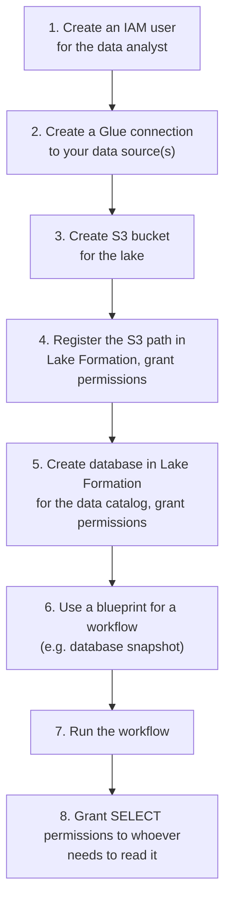

- Steps 1 to 3 are plain IAM, Glue, and S3 setup
- **Step 4 is the one that makes it a Lake Formation lake**: registering the location hands S3 access control to Lake Formation
- Steps 5 and 8 are the permission model: grants on the catalog database and tables, **not** on S3 paths
- Steps 6 and 7 are **blueprints**, prebuilt Glue workflows that ingest from a database:
  - **Database snapshot**: full copy of a table or tables
  - **Incremental database**: only new rows since last run, based on a bookmark column
  - **Log file**: CloudTrail, ALB, CloudFront logs into the lake

Two things worth pinning:

- The analyst in step 1 gets **no S3 permissions**. They get a Lake Formation `SELECT` grant in step 8, and Athena fetches scoped credentials at query time. "The analyst's IAM policy has no S3 access but Athena works" is a valid state
- Registering a location needs a role Lake Formation can assume. The service-linked role can only read, which is fine for query engines; use a custom role if Glue jobs need to write through Lake Formation

In practice most teams use their own Glue or DMS pipelines and only use Lake Formation for steps 4, 5, and 8. The permission model is the product.

### Lake Formation: the finer points

- **Cross-account Lake Formation permissions**
  - Recipient must be set up as a data lake administrator
  - Can use **AWS Resource Access Manager (RAM)** for accounts external to your organization
  - IAM permissions are also needed for cross-account access
- Lake Formation **does not support manifests** in Athena or Redshift queries
- IAM permissions on the **KMS encryption key** are needed for encrypted data catalogs
- IAM permissions are needed to create blueprints and workflows

### Data permissions in Lake Formation

- Can tie to IAM users/roles, SAML (IAM Identity Center), or external AWS accounts
- Can use policy tags (**LF-Tags**) on databases, tables, or columns
- Can select specific permissions for tables or columns

The grant has three parts:

1. **Principals**: who gets access
   - IAM users and roles
   - SAML users and groups (via IAM Identity Center)
   - External accounts (account ID or organization)
2. **Resources**: what they get access to
   - **Named data catalog resources**: a specific database, table, and optionally columns
   - **Resources matched by LF-Tags**: everything carrying a tag like `classification=public`
3. **Permissions**: what they can do
   - Table permissions: `Select`, `Insert`, `Delete`, `Describe`, `Alter`, `Drop`, `Super`
   - Column-based: include only these columns, or exclude these columns
   - **Grantable** permissions: let the principal pass the grant on

| | Named resource grants | LF-Tag based access control (TBAC) |
|---|---|---|
| Grant on | A specific database / table / column | A tag expression, e.g. `dept=finance AND sensitivity=low` |
| New table added | Must grant again | Inherits access if it carries the tag |
| Scales to | Dozens of tables | Thousands |
| Who tags | Nobody | Data owners tag at creation (tags inherit database to table to column) |
| Pick when | Small lake, one-off exception | Many tables, access by category, cross-account at scale |

A tag on a database flows down to its tables and columns unless overridden, so tagging the PII columns and granting analysts `sensitivity=low` hides exactly those columns.

### Data filters in Lake Formation

- Column, row, or cell-level security
- Apply when granting `SELECT` permission on tables
- "All columns" + row filter = **row-level security**
- "All rows" + specific columns = **column-level security**
- Specific columns + specific rows = **cell-level security**
- Create filters via the console or the `CreateDataCellsFilter` API / CLI

Example, filter `restrict-pharma` on `sales.orders`:
- Column-level access: **exclude** `customer_name`
- Row filter expression: `product_type = 'pharma'`
- Result: the grantee sees only pharma orders, and never the customer name

| Filter | Columns | Rows | Grantee sees |
|---|---|---|---|
| Row-level | All | `region = 'west'` | Every column, only west rows |
| Column-level | Exclude `ssn`, `salary` | All | Every row, no PII columns |
| Cell-level | Exclude `customer_name` | `product_type = 'pharma'` | Pharma rows, no names |

- The row filter is the tail of a SQL `WHERE` clause and can reference any column, including excluded ones
- A filter is a named object on one table. You grant `SELECT` with the filter attached, so different principals get different filters on the same table
- Enforced by Athena, Redshift Spectrum, EMR (Spark, Hive), and QuickSight. Not by direct S3 access, which Lake Formation already blocks for registered locations

### Lake Formation exam tells

| Scenario | Answer |
|---|---|
| Fine-grained access to the data lake (column, row, cell) | Lake Formation |
| "Analysts see the table but not the `ssn` column" | Column-level grant or exclude list |
| "Sales reps see only their region's rows" | Row filter |
| Hundreds of tables, permissions by department or sensitivity | LF-Tags (TBAC) |
| Share tables with another account without copying | Grant to the external account, accept via RAM |
| User authenticated through the corporate IdP | SAML principal via IAM Identity Center |
| Athena returns access denied though IAM allows S3 | Location is registered with Lake Formation, user needs an LF grant |
| Ingest from an RDS database into the lake incrementally, minimal setup | Incremental database blueprint |
| Near-real-time CDC instead | DMS, not a blueprint |
| Redshift-native tables, not the lake | Redshift RLS and dynamic data masking |

---

## Amazon Athena

### What is Athena?

- Interactive **query service for S3** using SQL
  - No need to load data, it stays in S3
- **Trino** under the hood (Presto in older engine versions; Athena engine v3 is Trino)
- **Serverless**
- Supports many data formats:
  - CSV, TSV (human readable, row-based)
  - JSON (human readable, row-based)
  - **Parquet** (columnar, splittable)
  - **ORC** (columnar, splittable)
  - **Avro** (row-based, splittable)
  - Snappy, Zlib, LZO, Gzip compression
- Unstructured, semi-structured, or structured

Note: Avro is **row-based**, not columnar. It's splittable and great for streaming writes and schema evolution; Parquet and ORC are the columnar ones you want for analytics reads.

### Some examples

- Ad hoc queries of web logs
- Querying staging data before loading into Redshift
- Analyze CloudTrail / CloudFront / VPC / ELB logs in S3
- Integration with Jupyter, Zeppelin, RStudio notebooks
- Integration with QuickSight
- Integration via ODBC / JDBC with other visualization tools

### Athena + Glue

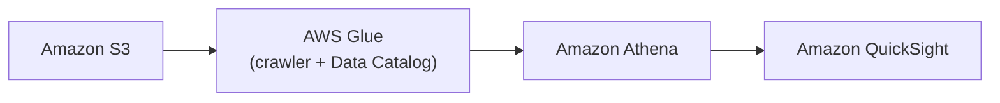

- Glue imparts structure on unstructured data in S3 so Athena can query it like a database
- The crawler scans S3, infers the schema, writes the table definition to the Data Catalog
- Athena reads the table definition from the Catalog and queries the files in place
- QuickSight sits on top of Athena for dashboards
- The Catalog holds only metadata. The data never moves out of S3

### Athena workgroups

- Organize users / teams / apps / workloads into **workgroups**
- Control query access and **track costs** by workgroup
- Integrates with IAM, CloudWatch, SNS
- Each workgroup can have its own:
  - Query history
  - **Data limits** (per-query and per-workgroup scan limits, with an alarm or a hard stop)
  - IAM policies
  - Encryption settings
  - Query result location
  - Engine version, and whether the engine is Athena SQL or Apache Spark

### Athena cost model

- Pay as you go
  - **$5 per TB scanned**
  - Successful or cancelled queries count, **failed queries do not**
  - **No charge for DDL** (`CREATE` / `ALTER` / `DROP`)
- Save a lot of money with **columnar formats** (ORC, Parquet): 30 to 90% savings and better performance
- Glue and S3 have their own charges
- **Partitioning** also reduces cost (date, hour)
- **Query result reuse**: re-running the same query within a time window (up to 7 days) returns the cached result and scans nothing
- **Provisioned capacity** is an alternative pricing model: pay per DPU-hour for dedicated capacity instead of per TB, for heavy predictable workloads

### Athena security

- **Access control**
  - IAM, ACLs, S3 bucket policies
  - `AmazonAthenaFullAccess` / `AmazonQuickSightAthenaAccess`
- **Encrypt results at rest** in the S3 staging directory
  - SSE-S3, SSE-KMS, CSE-KMS
- Cross-account access via S3 bucket policy is possible
- **TLS** encrypts data in transit between Athena and S3

### Athena anti-patterns

- Highly formatted reports / visualization: that's what QuickSight is for
- ETL: use Glue instead

### Athena: optimizing performance

- Use **columnar data** (ORC, Parquet)
- A **small number of large files** performs better than a large number of small files (128 MB or larger is a good target)
- Use **partitions**
  - If adding partitions after the fact, use `MSCK REPAIR TABLE`
  - Or `ALTER TABLE ADD PARTITION` for a single one
- Put the partition column in the `WHERE` clause or no pruning happens
- `ORDER BY` without `LIMIT` forces a single node to sort everything; add the `LIMIT`
- Filter and project early: `SELECT col1, col2` beats `SELECT *`

### Partition projection

Not on the slides but heavily tested and the fix for most partition pain:

- Instead of storing every partition in the Glue Catalog, you **describe the partition pattern** in table properties (a date range, an integer range, an enum, or an injected value)
- Athena **calculates** which partitions exist at query time instead of looking them up
- No crawler, no `MSCK REPAIR`, no `GetPartitions` call, no metadata to go stale
- Best for tables with thousands of partitions in a predictable layout, like `dt=YYYY-MM-DD`

Exam tell: "table has tens of thousands of partitions and query planning is slow" is partition projection. "New partitions appear constantly and we don't want to run a crawler" is also partition projection.

### Athena ACID transactions

- Powered by **Apache Iceberg**
  - Just add `'table_type' = 'ICEBERG'` in your `CREATE TABLE` command
- Concurrent users can safely make **row-level modifications**
- Compatible with EMR, Spark, anything that supports the Iceberg table format
- Removes the need for custom record locking
- **Time travel** operations: recover recently deleted data with a `SELECT`
- Another way of getting ACID features in Athena (Lake Formation governed tables were the older approach, now effectively superseded)
- Benefits from periodic **compaction** to preserve performance

```sql
OPTIMIZE table REWRITE DATA
    USING BIN_PACK
    WHERE catalog = 'c1'
```

`UPDATE`, `DELETE`, and `MERGE INTO` in Athena only work on Iceberg tables. On a plain Parquet table, Athena is read-only plus CTAS and `INSERT INTO`.

---

## Apache Iceberg

### What's Iceberg?

- Apache Iceberg is a **table format** for data lakes
  - Petabyte scale
  - Originally from Netflix
- **ACID compliance**
  - Transactionally consistent adds, removals, modifications
  - Row-level updates and deletes for GDPR compliance
- **Schema evolution**: update tables safely as data evolves (tracks column IDs, so renames and reorders work)
- **Hidden partitioning**: partition evolution, update partition schemes without rewriting history, and queries don't need an explicit partition filter
- **Time travel**: query historical data, verify changes between updates, easy rollback
- Efficient metadata management
- Works with Spark, Flink, Trino, Presto, Hive
- Integrated with AWS Glue, EMR, Athena, and Redshift

The three layers, which are easy to blur:

| Layer | What it is | Example |
|---|---|---|
| File format | How one file stores rows | Parquet, ORC, Avro |
| Table format | How a set of files becomes a transactional table | Iceberg, Hudi, Delta Lake |
| Catalog | Where the table pointer and schema live | Glue Data Catalog, Hive metastore |

Iceberg is the middle layer. It still writes Parquet underneath and still registers in the Glue Catalog on top.

### Iceberg + AWS Glue / S3

- Glue can take the place of Hive as Iceberg's source of table metadata
- Iceberg's API communicates with the Glue Catalog for metadata
- Iceberg stores and retrieves files from Amazon S3, usually in Parquet format
- Spark / Flink can then sit on top of the Iceberg API
- Also Athena, for ACID transactions: this is how ACID is implemented for Athena, it just uses Iceberg's ACID compliance

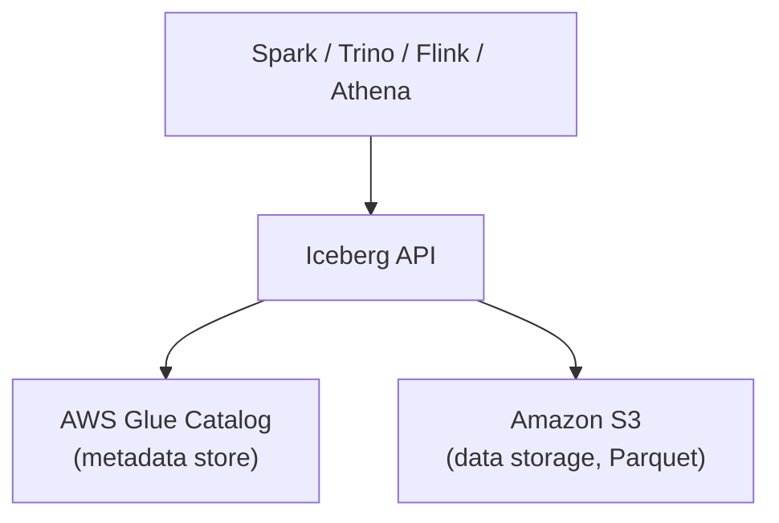

- The Glue Catalog acts as the Iceberg **catalog**: one pointer per table, to that table's current metadata file
- The metadata file in S3 holds the schema, partition spec, and the list of snapshots
- A commit **atomically swaps the catalog pointer** to a new metadata file, which is what makes it atomic

### Migrating Glue Data Catalogs to Iceberg

- Glue Data Catalogs must be made compatible with the Iceberg API
- Once done, Athena can use it for ACID transactions
- Other reasons to migrate:
  - Compliance: expire old versions of tables, audit trails
  - Historical reporting with time travel queries
  - Data lake with many active producers and consumers (consistency is needed)
- **In-place migration**
  - Leave data files where they are, just create Iceberg metadata
  - Does not allow for schema or partition changes
- **Shadow migration**
  - Copies the data over (so you duplicate the data for a while)
  - Allows additional validation
  - Easier rollback and recovery
  - Can change schema or partitioning on the way

```sql
CREATE TABLE [TARGET_DB_NAME].[TARGET_TABLE_NAME]
WITH (table_type = 'ICEBERG',
      format = 'PARQUET',
      location = 's3://[YOUR_S3_BUCKET]/[TARGET_FOLDER]/',
      is_external = false,
      vacuum_min_snapshots_to_keep = 10,          -- optional property
      vacuum_max_snapshot_age_seconds = 604800    -- optional property
     )
AS SELECT * FROM [SRC_DB_NAME].[SRC_TABLE_NAME];
```

The vacuum properties are housekeeping. Every `UPDATE` or `DELETE` creates a snapshot and leaves old files behind for time travel, so without vacuum, storage grows forever and planning slows down. `OPTIMIZE ... REWRITE DATA` compacts small files, `VACUUM` drops expired snapshots.

---

## CREATE TABLE AS SELECT (CTAS)

- You might see this in the context of Amazon Athena, but it exists in other databases as well
- Creates a new table from query results
- Can create a new table that's a **subset** of another
- Can also **convert data into a new underlying format**, which is the trick to get Athena to convert data stored in S3

```sql
CREATE TABLE new_table
WITH (
    format = 'Parquet',
    write_compression = 'SNAPPY')
AS SELECT *
FROM old_table;
```

```sql
CREATE TABLE my_orc_ctas_table
WITH (
    external_location = 's3://my_athena_results/my_orc_ctas_table/',
    format = 'ORC')
AS SELECT *
FROM old_table;
```

- `format`: Parquet, ORC, Avro, JSON, TEXTFILE
- `write_compression`: SNAPPY, GZIP, ZSTD
- `external_location`: where the files land. Omit it and Athena writes under the workgroup's result location
- `partitioned_by` and `bucketed_by` / `bucket_count` are the other properties worth knowing

Limits: the target location **must be empty**, and a CTAS writes at most **100 partitions** per statement (use `INSERT INTO` in batches beyond that).

| Want | Use |
|---|---|
| New table, new format, from a query | `CREATE TABLE AS SELECT` |
| Add rows to an existing table | `INSERT INTO ... SELECT` |
| Just the query results as files, no table | `UNLOAD` |
| Repeated conversion in a pipeline | Glue job, not CTAS |

---

## Athena federated queries

- Query data from sources **other than S3**
- **Data source connectors** translate between the source and Athena
  - These run on **AWS Lambda**
- Many are available:
  - CloudWatch, DynamoDB, DocumentDB, RDS, OpenSearch, JDBC
  - Custom connectors
  - Third-party: Cloudera, HBase, Kafka, Oracle, Snowflake, Teradata...

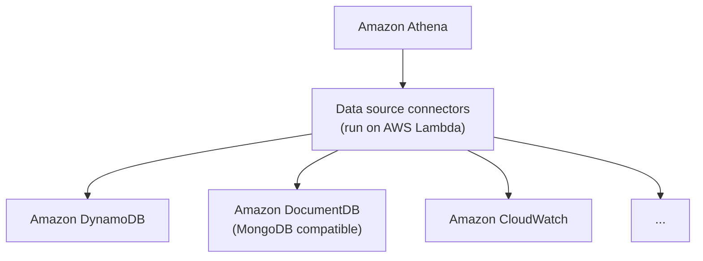

Continued:

- **Views** on federated data sources are stored in AWS Glue
- Can use with **AWS Secrets Manager**, if you configure a VPC private endpoint for it
- Some connectors integrate with AWS Glue, enabling fine-grained access control via Lake Formation
  - Redshift, BigQuery, DynamoDB, Snowflake, MySQL...
- **Cross-account** federated queries are possible with appropriate permissions
- **Passthrough queries** let you use the native query language of the data source
- Some connectors may be used as **Spark data sources**

```sql
SELECT
  log_stream as ec2_instance,
  Regexp_extract(message, '.*orderId=(\d+) .*', 1) AS orderId,
  message AS order_processor_log,
  Regexp_extract(message, '(.*):.*', 1) AS log_level
FROM MyCloudwatchCatalog."/var/ecommerce-engine/order-processor".all_log_streams
WHERE Regexp_extract(message, '(.*):.*', 1) != 'INFO'
```

Things to know beyond the slides:

- The connector Lambda is in **your** account, so federated query cost is Athena scan cost plus Lambda invocation cost, plus a **spill bucket** in S3 for results over the Lambda payload limit
- "Federated query is slow or timing out" is usually the connector Lambda's memory or timeout setting
- Don't confuse this with **Redshift** federated query, which runs from Redshift and only reaches RDS and Aurora

### Athena fine-grained access to the Glue Data Catalog

- **IAM-based database and table-level security**
  - Broader (coarser) than data filters in Lake Formation
  - Cannot restrict to specific table versions
- At a minimum you must have a policy granting access to your database **and** the Glue Data Catalog **in each region**

```json
{
  "Sid": "DatabasePermissions",
  "Effect": "Allow",
  "Action": [
    "glue:GetDatabase",
    "glue:GetDatabases",
    "glue:CreateDatabase"
  ],
  "Resource": [
    "arn:aws:glue:us-east-1:123456789012:catalog",
    "arn:aws:glue:us-east-1:123456789012:database/default"
  ]
}
```

- The **catalog** ARN is the easy one to forget. Granting the database alone is not enough
- Catalog ARNs are per region, so a multi-region setup needs a statement per region
- Resource granularity: `catalog`, `database/<name>`, `table/<db>/<table>`, `userdefinedfunction/...`
- Three permission layers must all allow the query:
  1. `athena:*` actions (`StartQueryExecution`, `GetQueryResults`) and the workgroup
  2. `glue:*` actions on the catalog, database, and table
  3. `s3:GetObject` on the data, plus write to the query results bucket

### Mapping SQL to IAM actions

- You might have policies to restrict `ALTER`/`CREATE DATABASE`, `CREATE TABLE`, `DROP DATABASE`/`DROP TABLE`, `MSCK REPAIR TABLE`, `SHOW DATABASES`/`SHOW TABLES`
- Just map these operations to their IAM actions. Example, `DROP TABLE`:

```json
{
  "Effect": "Allow",
  "Action": [
    "glue:GetDatabase",
    "glue:GetTable",
    "glue:DeleteTable",
    "glue:GetPartitions",
    "glue:GetPartition",
    "glue:DeletePartition"
  ],
  "Resource": [
    "arn:aws:glue:us-east-1:123456789012:catalog",
    "arn:aws:glue:us-east-1:123456789012:database/example_db",
    "arn:aws:glue:us-east-1:123456789012:table/example_db/test"
  ]
}
```

| Athena SQL | Glue IAM actions needed |
|---|---|
| `CREATE DATABASE` | `GetDatabase`, `CreateDatabase` |
| `ALTER DATABASE` | `GetDatabase`, `UpdateDatabase` |
| `DROP DATABASE` | `GetDatabase`, `DeleteDatabase`, `GetTables`, `GetTable`, `DeleteTable` |
| `SHOW DATABASES` | `GetDatabases` |
| `CREATE TABLE` | `GetDatabase`, `CreateTable`, `GetTable` |
| `DROP TABLE` | `GetDatabase`, `GetTable`, `DeleteTable`, `GetPartition(s)`, `DeletePartition` |
| `SHOW TABLES` | `GetDatabase`, `GetTables` |
| `MSCK REPAIR TABLE` | `GetDatabase`, `GetTable`, `GetPartitions`, `BatchCreatePartition` |
| `SELECT` | `GetDatabase`, `GetTable`, `GetPartitions`, plus `s3:GetObject` |

Two patterns rather than memorizing the table: every statement needs the **catalog** ARN plus read actions for each level it touches, and **partition actions ride along with table actions**.

### Amazon Athena for Apache Spark

- Run **Jupyter notebooks with Spark** within the Athena console
  - Notebooks may be encrypted automatically or with KMS
- Totally serverless
- Selectable as an alternate **analytics engine** (vs Athena SQL) when you create a **workgroup**
- Uses **Firecracker** for quickly spinning up Spark resources (sub-second session start)
- Programmatic API / CLI access: `create-work-group`, `create-notebook`, `start-session`, `start-calculation-execution`
- Can adjust DPUs for coordinator and executor sizes
- Pricing based on compute usage, DPU per hour

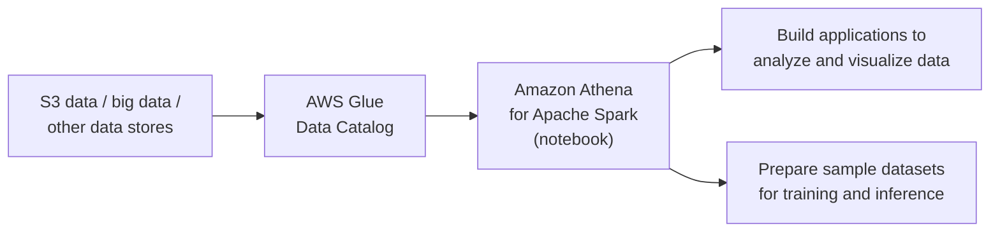

- The engine choice is per **workgroup**: Athena SQL or Apache Spark, not both in one workgroup
- It's for **interactive exploration**, not production ETL: no scheduler, no bookmarks, no triggers

### Athena exam tells

| Scenario | Answer |
|---|---|
| SQL on S3, no infrastructure | Athena + Glue Catalog |
| Reduce Athena cost | Parquet/ORC, partitioning, scan limits, result reuse |
| Tens of thousands of partitions, slow planning | Partition projection |
| New partitions not visible | Crawler, `MSCK REPAIR`, `enableUpdateCatalog`, or projection |
| Row-level `UPDATE` / `DELETE` / time travel | Iceberg table |
| Convert CSV/JSON to Parquet with SQL | CTAS |
| Export query results as files, no table | `UNLOAD` |
| Query DynamoDB, CloudWatch, or on-prem DB with SQL | Federated query (Lambda connector) |
| Restrict a user to specific tables | IAM on the Glue Catalog |
| Restrict a user to specific columns or rows | Lake Formation, not IAM |
| Limit how much a team can scan | Workgroup data limits |
| Spark exploration with no cluster | Athena for Apache Spark |
| Highly formatted reports | QuickSight, not Athena |
| Heavy repeated ETL | Glue, not Athena |

---

## Apache Spark

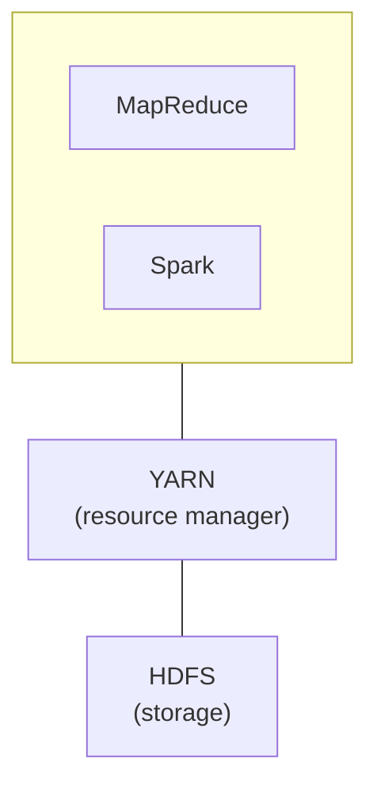

- Distributed processing framework for big data
- **In-memory caching**, optimized query execution
- Supports Java, Scala, Python, and R
- Supports code reuse across:
  - Batch processing
  - Interactive queries (**Spark SQL**)
  - Real-time analytics
  - Machine learning (**MLlib**)
  - Graph processing (**GraphX**, no longer widely used)
- **Spark Streaming**: integrated with Kinesis, Kafka, on EMR
- Spark is **NOT** meant for OLTP

Two concepts that explain most of Spark's behavior:

- **Lazy evaluation**: `filter` and `groupBy` build a plan, they don't run. Only an **action** (`write`, `count`, `show`, `collect`) triggers execution. That's why Spark can optimize the whole chain, and why errors surface on unrelated-looking lines
- **Shuffle**: `groupBy` and `join` need rows with the same key on the same machine, so Spark redistributes data over the network. Shuffles are the expensive part, and most tuning is about avoiding or shrinking them

On AWS the bottom two layers get swapped: **HDFS becomes S3** via EMRFS, YARN stays on EMR but is hidden by Glue and replaced by Kubernetes on EMR on EKS.

### How Spark works

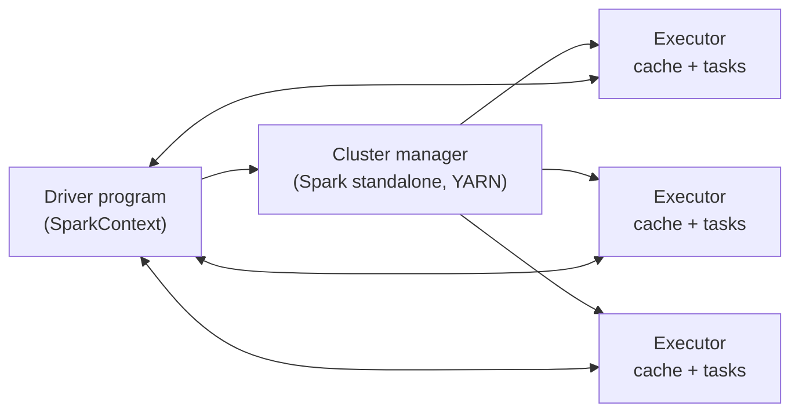

- Spark apps run as independent processes on a cluster
- The **SparkContext** (driver program) coordinates them
- SparkContext works through a **cluster manager**
- **Executors** run computations and store data
- SparkContext sends application code and tasks to executors

| Spark concept | Glue setting |
|---|---|
| Driver | One worker is reserved as the driver |
| Executor | The rest of your workers |
| Task slots | Cores per worker (4 on G.1X, 8 on G.2X) |
| Cluster manager | Managed, invisible |

Two failure modes that follow directly:

- **Driver OOM**: `.collect()`, `.toPandas()`, or a huge broadcast pulls everything back to the driver. Write to S3 instead
- **Executor OOM or spill**: one partition too big for one executor, usually skew after a `groupBy` on a hot key. More partitions, a salted key, or bigger workers

### Spark Structured Streaming

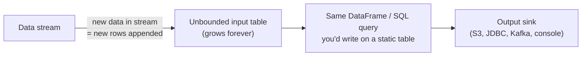

- A data stream is treated as an **unbounded input table**
- New data in the stream = new rows appended to the input table
- You write the same DataFrame or SQL code you'd write against a static table, and Spark runs it incrementally

```scala
val inputDF = spark.readStream.json("s3://logs")
inputDF.groupBy($"action", window($"time", "1 hour")).count()
       .writeStream.format("jdbc").start("jdbc:mysql//...")
```

- `readStream` / `writeStream` instead of `read` / `write`, everything in between is normal DataFrame code
- `window($"time", "1 hour")` is a tumbling window on **event time**, so late records still land in the right window
- **Output modes**: `append` (new rows only), `complete` (full result table each time), `update` (changed rows only). Aggregations need complete or update
- **Checkpointing** to S3 tracks what's been processed, which is how it recovers and gives exactly-once semantics to supported sinks
- `.withWatermark("time", "10 minutes")` bounds how long state is kept. Without it, every window's state is retained forever and the job eventually dies
- Still **micro-batch** underneath, so latency is sub-second to seconds, not per-record. That's the gap Flink fills
- On AWS this runs as a **Glue streaming ETL** job reading from Kinesis or MSK

### Spark Streaming + Kinesis

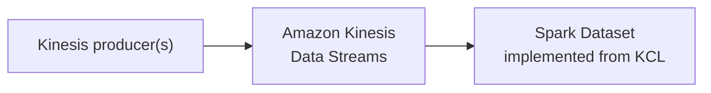

- Producers write records into a Kinesis Data Stream
- Spark reads the stream as a **Dataset** using the Kinesis connector, which is built on the **KCL**
- From there it's normal structured streaming: `readStream.format("kinesis")`, then DataFrame code
- Because it's the KCL: read parallelism is capped by **shard count**, and checkpoints live in a **DynamoDB table** named after the application

### Spark + Redshift

- The `spark-redshift` package allows Spark datasets from Redshift
  - It's a Spark SQL data source
- Useful for ETL using Spark

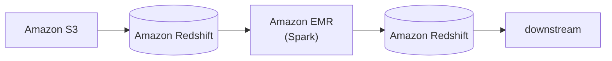

- Read a Redshift table into a Spark DataFrame, transform it, write it back
- Under the hood it does **not** stream rows over JDBC: Spark issues `UNLOAD` to S3, reads those files in parallel, and on write stages Parquet to S3 and issues `COPY`
- So the connector always needs a **temp S3 bucket** and an IAM role with S3 permissions
- Modern name: **Amazon Redshift integration for Apache Spark**, bundled into EMR 6.9+ and Glue 4.0+, with predicate and aggregation pushdown

---

## Amazon EMR

### What is EMR

- **Elastic MapReduce**
- Managed **Hadoop framework on EC2 instances**
- Includes Spark, HBase, Presto, Flink, Hive, and more
- EMR Notebooks
- Several integration points with AWS

### An EMR cluster

- **Master node**: manages the cluster
  - Tracks status of tasks, monitors cluster health
  - Single EC2 instance (can be a single-node cluster)
  - AKA "leader node"
- **Core node**: hosts **HDFS data** and runs tasks
  - Can be scaled up and down, but with some risk
  - Multi-node clusters have at least one
- **Task node**: runs tasks, does **not** host data
  - Optional
  - No risk of data loss when removing
  - Good use of **spot instances**
- To cut costs on an EMR cluster, or add capacity cheaply, spot instances on task nodes are the way

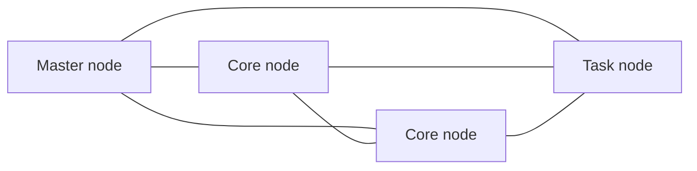

### EMR usage

**Transient vs long-running clusters**

- **Transient** clusters terminate once all steps are complete
  - Load data, process, store, then shut down
  - Saves money
- **Long-running** clusters must be manually terminated
  - Basically a data warehouse with periodic processing on large datasets
  - Can spin up task nodes using spot instances for temporary capacity
  - Can use reserved instances on long-running clusters to save money
  - Termination protection on by default, auto-termination off

**Running work**

- Frameworks and applications are specified at cluster launch
- Connect directly to the master to run jobs directly
- Or submit ordered **steps** via the console
  - Process data in S3 or HDFS
  - Output data to S3 or elsewhere
  - Once defined, steps can be invoked via the console

### EMR / AWS integration

- **EC2** for the instances that make up the nodes in the cluster
- **VPC** to configure the virtual network in which you launch instances
- **S3** to store input and output data
- **CloudWatch** to monitor cluster performance and configure alarms
- **IAM** to configure permissions
- **CloudTrail** to audit requests made to the service
- Scheduling: the slide says AWS Data Pipeline, which is **deprecated**. Use **Step Functions**, **MWAA**, or **EventBridge Scheduler**

### EMR storage

- **HDFS**
  - Hadoop Distributed File System
  - Multiple copies stored across instances for redundancy
  - Files stored as blocks (128 MB default size)
  - **Ephemeral**: HDFS data is lost when the cluster is terminated
  - Useful for caching intermediate results or workloads with significant random I/O
  - Hadoop tries to process data where it is stored on HDFS
- **EMRFS**: access S3 as if it were HDFS
  - Allows persistent storage after cluster termination
  - **EMRFS Consistent View** was optional for S3 consistency, using DynamoDB to track it
    - **Obsolete since 2021: S3 is now strongly consistent**, so you no longer need it
- **Local file system**: suitable only for temporary data (buffers, caches)
- **EBS for HDFS**
  - Allows use of EMR on EBS-only instance types
  - Deleted when the cluster is terminated
  - EBS volumes can only be attached when launching a cluster
  - If you manually detach an EBS volume, EMR treats that as a failure and replaces it

### EMR promises

- EMR charges **by the hour**, plus EC2 charges
- Provisions new nodes if a core node fails
- Can add and remove **task nodes** on the fly
  - Increases processing capacity, but not HDFS capacity
- Can resize a running cluster's **core nodes**
  - Increases both processing and HDFS capacity
- Core nodes can also be added or removed, but removing risks data loss

### EMR managed scaling

- **EMR Automatic Scaling**
  - The old way
  - Custom scaling rules based on CloudWatch metrics
  - Supports **instance groups only**
- **EMR Managed Scaling**
  - Introduced in 2020
  - Supports instance groups **and instance fleets**
  - Scales spot, on-demand, and instances in a Savings Plan within the same cluster
  - Available for Spark, Hive, and YARN workloads
- **Scale-up strategy**: first adds core nodes, then task nodes, up to the max units specified
- **Scale-down strategy**: spot nodes are always removed before on-demand instances

### So... what's Hadoop?

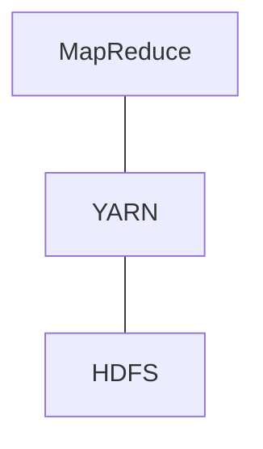

| Layer | What it does |
|---|---|
| **MapReduce** | Framework for distributed data processing. Maps data to key/value pairs, reduces intermediate results to final output. Largely supplanted by Spark |
| **YARN** | Yet Another Resource Negotiator. Manages cluster resources for multiple data processing frameworks |
| **HDFS** | Hadoop Distributed File System. Distributes data blocks across the cluster redundantly. **Ephemeral in EMR: data is lost on termination** |

---

## EMR Serverless

- Choose an **EMR release** and runtime (Spark, Hive, Presto)
- Submit queries / scripts via **job run** requests
- EMR manages the underlying capacity
  - But you can specify default worker sizes and **pre-initialized capacity**
  - EMR computes the resources needed and schedules workers accordingly
  - All within one region, across multiple AZs
- Why it matters: you no longer have to estimate how many workers your workload needs
- Serverless, really? You still think about worker sizing and configuration

### Using EMR Serverless

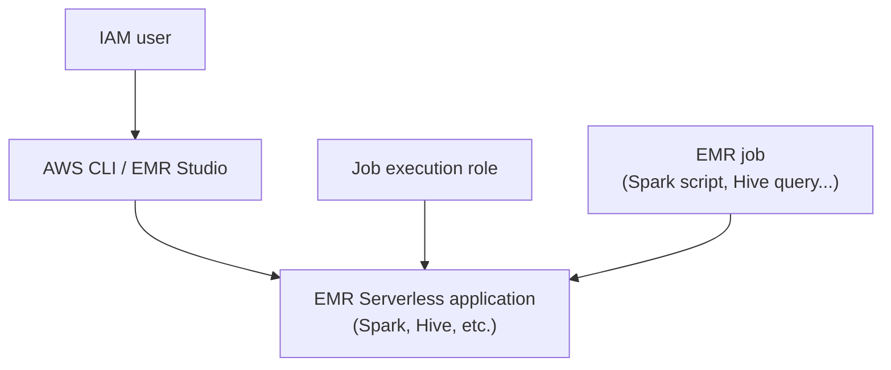

- Allow the `emr-serverless.amazonaws.com` service (trust policy on the job execution role)
- Any required S3 access for scripts and data
- Glue access (for SparkSQL), KMS keys

```bash
aws emr-serverless start-job-run \
  --application-id <application_id> \
  --execution-role-arn <execution_role_arn> \
  --job-driver '{
    "sparkSubmit": {
      "entryPoint": "s3://us-east-1.elasticmapreduce/emr-containers/samples/wordcount/scripts/wordcount.py",
      "entryPointArguments": ["s3://DOC-EXAMPLE-BUCKET/output"],
      "sparkSubmitParameters": "--conf spark.executor.cores=1 --conf spark.executor.memory=4g --conf spark.driver.cores=1 --conf spark.driver.memory=4g --conf spark.executor.instances=1"
    }
  }' \
  --configuration-overrides '{
    "monitoringConfiguration": {
      "s3MonitoringConfiguration": {
        "logUri": "s3://DOC-EXAMPLE-BUCKET/logs"
      }
    }
  }'
```

Two layers: an **application** is the long-lived container you create once (engine, release version, VPC, capacity limits), and a **job run** is one submission against it.

### EMR Serverless application lifecycle

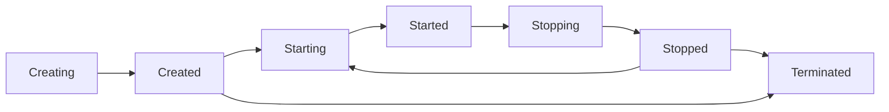

- This isn't all automatic
- You must call APIs such as `CreateApplication`, `StartApplication`, `StopApplication`, and importantly **`DeleteApplication`** to avoid excess charges
- **Auto-start**: submitting a job to a Stopped application starts it automatically
- **Auto-stop**: idle timeout (default 15 minutes) returns it to Stopped and stops billing
- **Pre-initialized capacity** is what you'd deliberately leave running to kill startup latency, and it's what costs money while idle

### Pre-initialized capacity

- Spark adds **10% overhead** to the memory requested for drivers and executors
- Be sure initial capacity is at least 10% more than requested by the job

### EMR Serverless security

- Basically the same as EMR
- **EMRFS**: S3 encryption (SSE or CSE) at rest, TLS in transit between EMR nodes and S3
- **S3**: SSE-S3, SSE-KMS
- Local disk encryption
- Spark communication between drivers and executors is encrypted
- Hive communication between the Glue metastore and EMR uses TLS
- Force HTTPS (TLS) on S3 policies with `aws:SecureTransport`

---

## EMR on EKS

- Allows submitting Spark jobs on Elastic Kubernetes Service **without provisioning EMR clusters**
- Fully managed
- Share resources between Spark and other apps on Kubernetes

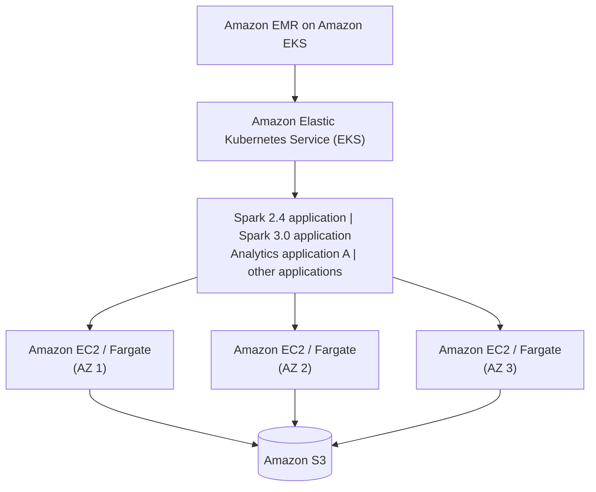

- Multiple Spark versions run side by side, each job in its own pods with its own image
- Nodes can be EC2 or Fargate, spread across AZs, all reading and writing S3
- The **EKS cluster must already exist**. "Without provisioning clusters" means without provisioning an *EMR* cluster

| | EMR on EC2 | EMR Serverless | EMR on EKS |
|---|---|---|---|
| You manage | The cluster | Nothing | The EKS cluster |
| Pick when | Hive, HBase, Presto, Spot savings, long-running | Spark or Hive, no infrastructure, specific EMR release | Already running Kubernetes, want shared capacity |
| Multiple Spark versions at once | No | Per application | Yes, per job |
| Spot | Yes | No | Yes, via node groups |

### EMR exam tells

| Scenario | Answer |
|---|---|
| Reduce EMR cost, fault-tolerant batch | Spot for task nodes, on-demand for master and core |
| Data must survive cluster termination | S3 via EMRFS, not HDFS |
| Add processing capacity without more storage | Task nodes |
| Add processing and HDFS capacity | Core nodes |
| Scale spot and on-demand in one cluster, instance fleets | EMR Managed Scaling |
| Spark job, no cluster to manage, specific EMR version | EMR Serverless |
| Spark alongside existing Kubernetes workloads | EMR on EKS |
| Serverless Spark ETL with Catalog, crawlers, bookmarks | Glue, not EMR |
| EMR Serverless cost high with no jobs running | Pre-initialized capacity, or idle timeout disabled |
| Job finishes and the cluster should go away | Transient cluster with auto-termination |

---

## Amazon Kinesis Data Streams

```mermaid
flowchart LR
    subgraph P["Producers"]
        PA["Applications"]
        PC["Client"]
        PS["SDK, KPL"]
        PG["Kinesis Agent"]
    end

    subgraph KDS["Kinesis Data Streams"]
        S1["Shard 1"]
        S2["Shard 2"]
        SN["Shard N"]
    end

    subgraph C["Consumers"]
        CA["Apps (KCL, SDK)"]
        CL["Lambda"]
        CF["Amazon Data Firehose"]
        CN["Managed Service for Apache Flink"]
    end

    P -->|"record: partition key + data blob (up to 1 MB)<br/>1 MB/sec or 1000 records/sec per shard"| KDS
    KDS -->|"record: partition key + sequence no. + data blob<br/>2 MB/sec shared, or 2 MB/sec per consumer with enhanced fan-out"| C
```

- Can scale the number of shards
- **Write record**: partition key + data blob (up to **1 MB**)
- **Read record**: partition key + **sequence number** + data blob
- Per shard: **1 MB/sec or 1000 records/sec in**, **2 MB/sec out** shared across all consumers
- **Enhanced fan-out**: 2 MB/sec per consumer per shard instead of shared
- Retention between **1 day and 365 days**
- Ability to **reprocess (replay)** data
- Once data is inserted into Kinesis it **can't be deleted** (immutability)
- Data that shares the same partition key goes to the same shard (**ordering**)
- **Producers**: AWS SDK, Kinesis Producer Library (KPL), Kinesis Agent
- **Consumers**:
  - Write your own: Kinesis Client Library (KCL), AWS SDK
  - Managed: AWS Lambda, Amazon Data Firehose, Managed Service for Apache Flink

Plain-English version: Kinesis is a pipe that holds data in order for a while so producers and consumers don't have to run at the same speed. Shards are lanes; the partition key is hashed to pick a lane; records in a lane stay in order. Reading doesn't delete anything, which is the key difference from a queue and why multiple consumers and replay both work.

Implications of the diagram:

- The **sequence number only appears on read**. It's assigned per shard, strictly increasing, and it's what a consumer checkpoints. The partition key picks the shard; the sequence number orders records within it
- **Ordering is per shard, never across the stream**
- The two limits fail differently: exceeding the write limits gives producers `ProvisionedThroughputExceededException`; exceeding 2 MB/sec out gives consumers `ReadProvisionedThroughputExceeded`, usually showing up as rising `IteratorAge`
- **1000 records/sec is the limit people hit first** with many small records. That's what KPL aggregation solves

### Kinesis Data Streams - capacity modes

**Provisioned mode**
- You choose the number of shards provisioned, scale manually or via API
- Each shard gets 1 MB/s in (or 1000 records per second)
- Each shard gets 2 MB/s out (classic or enhanced fan-out consumer)
- You pay **per shard provisioned per hour**

**On-demand mode**
- No need to provision or manage capacity
- Default capacity provisioned (4 MB/s in or 4000 records per second)
- Scales automatically based on observed throughput peak during the last 30 days
- Pay **per stream per hour** plus data in/out per GB
- Roughly 2.5x the per-GB price of provisioned, so it's for spiky or unknown traffic

### Kinesis Data Streams - security

- Control access / authorization using **IAM policies**
- **Encryption in flight** using HTTPS endpoints
- **Encryption at rest** using KMS
- You can implement client-side encryption/decryption (harder)
- **VPC endpoints** available for Kinesis to be accessed within a VPC
- Monitor API calls using **CloudTrail**

```mermaid
flowchart LR
    subgraph REGION["Region"]
        VPC["VPC"]
        subgraph ENC["Encryption at rest"]
            subgraph KDS["Kinesis Data Stream"]
                subgraph STREAM["Stream"]
                    S1["Shard 1"]
                    S2["Shard 2"]
                    S3["Shard 3"]
                end
            end
        end
    end
```

Note the layout: the stream sits **in the region, outside your VPC**. Kinesis is a regional service with a public API endpoint, so a producer or consumer in a private subnet with no NAT needs an **interface VPC endpoint** (PrivateLink) to reach it. Also, producers and consumers both need `kms:Decrypt` and `kms:GenerateDataKey` once encryption is on, and "producers fail right after enabling encryption" is that missing permission.

---

## Kinesis Data Streams - producers

- Kinesis SDK
- Kinesis Producer Library (KPL)
- Kinesis Agent
- Third-party libraries: Spark, Log4J appenders, Flume, Kafka Connect, NiFi...

```mermaid
flowchart LR
    SDK["SDK"] --> KDS["Amazon Kinesis Data Streams"]
    KPL["Kinesis Producer Library (KPL)"] --> KDS
    AGENT["Kinesis Agent"] --> KDS
    SPARK["Apache Spark"] --> KDS
    KAFKA["Kafka Connect"] --> KDS
```

| Producer | What it is | Use when |
|---|---|---|
| **SDK** | `PutRecord` (one) / `PutRecords` (batch) in any language | Simple producers, Lambda, low throughput |
| **KPL** | C++/Java library with batching, aggregation, retries, async | High throughput, many small records |
| **Kinesis Agent** | Java daemon that tails log files on a server | Server logs, no code changes |
| **Third party** | Spark, Flume, Kafka Connect, NiFi, Log4J | Existing pipelines using those tools |

### Kinesis producer SDK - PutRecord(s)

- The APIs are `PutRecord` (one) and `PutRecords` (many records)
- **`PutRecords`** uses batching and increases throughput, fewer HTTP requests
- **`ProvisionedThroughputExceeded`** if we go over the limits
- Also AWS Mobile SDK: Android, iOS, etc.
- Use case: low throughput, higher latency, simple API, AWS Lambda
- `PutRecords` can **partially fail**: check `FailedRecordCount` and retry only those entries with backoff

Managed AWS sources for Kinesis Data Streams:
- CloudWatch Logs
- AWS IoT
- Managed Service for Apache Flink

### AWS Kinesis API - exceptions

- **`ProvisionedThroughputExceeded`**
  - Happens when sending more data than a shard allows (MB/s or records/s)
  - Make sure you don't have a **hot shard** (a bad partition key sending too much data to one shard)
- **Solutions:**
  - Retries with backoff
  - Increase shards (scaling)
  - Ensure your partition key is a good one

Diagnose before you scale: with **shard-level (enhanced) monitoring**, throttling spread across all shards means you genuinely need capacity; throttling concentrated on one shard means fix the partition key. Adding shards costs roughly $11 per shard per month and does nothing for a hot key.

### Kinesis Producer Library (KPL)

- Easy to use and highly configurable **C++ / Java** library
- Used for building high performance, long-running producers
- Automated and configurable **retry** mechanism
- **Synchronous** or **asynchronous** (better performance for async)
- Submits metrics to CloudWatch for monitoring
- **Batching** (both on by default), increases throughput and decreases cost:
  - **Collect**: write to multiple shards in the same `PutRecords` API call
  - **Aggregate**: increased latency
    - Store multiple records in one record (gets past the 1000 records/sec limit)
    - Increase payload size and improve throughput (maximize the 1 MB/s limit)
- **Compression must be implemented by the user**
- KPL records must be **decoded with the KCL** or a special helper library

```mermaid
flowchart LR
    subgraph AGG1["Aggregate into one record < 1 MB"]
        R1["2 KB"]
        R2["40 KB"]
        R3["500 KB"]
    end
    subgraph AGG2["Aggregate into one record < 1 MB"]
        R4["1 KB"]
        R5["30 KB"]
        R6["80 KB"]
        R7["200 KB"]
    end
    AGG1 --> COL["Collection<br/>PutRecords"]
    AGG2 --> COL
    COL --> KDS["Kinesis Data Streams"]
```

| | Aggregation | Collection |
|---|---|---|
| What it packs | User records into one Kinesis record | Kinesis records into one API call |
| Limit it beats | 1000 records/sec per shard | API call overhead |
| Needs on the consumer | KCL or Lambda to de-aggregate | Nothing |

- Influence batching efficiency with `RecordMaxBufferedTime` (default 100 ms)

### KPL - when not to use it

- The KPL can incur an additional processing delay of up to **`RecordMaxBufferedTime`** (user-configurable)
- Larger values give higher packing efficiency and better performance
- **Applications that cannot tolerate this additional delay should use the AWS SDK directly**

### KPL retry behavior vs the SDK (IoT example)

```mermaid
flowchart LR
    IOT["IoT sensor"] -->|"KPL: buffers and retries<br/>offline 30 min, KPL keeps data"| KDS["Kinesis Data Streams"]
    IOT -->|"PutRecords (SDK): only latest data"| KDS
```

- **KPL**: if the device goes offline for 30 minutes, the KPL holds buffered records and sends them when connectivity returns. Old data arrives late, all at once, out of order
- **PutRecords (SDK)**: the call fails, you handle it, and typically only the latest reading gets sent
- Rule: if stale readings are useless, use the SDK. If every record matters, use the KPL. `RecordTtl` is the middle ground, discarding records older than a TTL
- Either way, KPL retries can produce **duplicates**, so consumers should be idempotent

### Kinesis Agent

- Monitors log files and sends them to Kinesis Data Streams
- Java-based agent, built on top of the KPL
- Install in Linux-based server environments
- **Features:**
  - Write from multiple directories and write to multiple streams
  - Routing feature based on directory / log file
  - Pre-process data before sending (single line, CSV to JSON, log to JSON...)
  - Handles **file rotation, checkpointing, and retry upon failures**

---

## Kinesis Data Streams - consumers

### Kinesis consumers - classic

- Kinesis SDK
- Kinesis Client Library (KCL)
- Kinesis Connector Library (legacy)
- Third-party libraries: Spark, Log4J appenders, Flume, Kafka Connect...
- Amazon Data Firehose
- AWS Lambda
- (Kinesis Consumer Enhanced Fan-Out)

```mermaid
flowchart LR
    KDS["Amazon Kinesis Data Streams"] --> SPARK["Apache Spark"]
    KDS --> FH["Amazon Data Firehose"]
    KDS --> L["AWS Lambda"]
    KDS --> KCL["Kinesis Client Library (KCL)"]
    KDS --> SDK["SDK"]
```

| Consumer | What it is |
|---|---|
| **SDK** | Raw `GetRecords` polling, you manage iterators and checkpoints yourself |
| **KCL** | Handles shard assignment, checkpointing (in DynamoDB), load balancing, resharding |
| **Lambda** | Event source mapping polls for you, no checkpoint code |
| **Firehose** | Managed delivery to S3, Redshift, OpenSearch, Splunk |
| **Spark / Flink** | Streaming frameworks with their own connectors |

### Kinesis consumers - `GetRecords`

- **Classic Kinesis**: records are **polled** by consumers from a shard
- Each shard has **2 MB total aggregate throughput**
- `GetRecords` returns up to **10 MB** of data (then throttles for 5 seconds) or up to **10,000 records**
- Maximum of **5 `GetRecords` API calls per shard per second** = 200 ms latency
- If 5 consumer applications consume from the same shard, each can poll once a second and receive less than 400 KB/s

```mermaid
flowchart LR
    P["Producer"] --> KDS

    subgraph KDS["Kinesis Data Streams"]
        S1["Shard 1"]
        S2["Shard 2"]
        SN["Shard N"]
    end

    CA["Consumer application A"] -->|"GetRecords()"| S1
    S1 -->|"Data"| CA
    CB["Consumer application B"] -->|"GetRecords()"| S1
    S1 -->|"Data"| CB
    CC["Consumer application C"] -->|"GetRecords()"| S1
    S1 -->|"Data"| CC
```

The **5-calls-per-second limit** usually bites before bandwidth does. It's per shard across all consumers, so the fourth or fifth application starts getting read throttles even at low data volume.

What "reading records" actually means: get a **shard iterator** (a bookmark: `TRIM_HORIZON`, `LATEST`, or a sequence number), call `GetRecords`, process the batch, then **checkpoint** the last sequence number so you can resume after a crash. Nothing is removed from the stream.

### Kinesis Client Library (KCL)

- Java-first library, also available for Go, Python, Ruby, Node, .NET
- Reads records produced with the KPL (**de-aggregation**)
- Shares multiple shards with multiple consumers in one "group", **shard discovery**
- **Checkpointing** to resume progress
- Leverages **DynamoDB** for coordination and checkpointing (**one row per shard**)
  - Make sure you provision enough WCU / RCU, or use on-demand
  - Otherwise DynamoDB may slow down the KCL
- Record processors process the data
- **`ExpiredIteratorException` means increase WCU** on the checkpoint table

```mermaid
flowchart LR
    subgraph KDS["Kinesis Data Streams"]
        S1["Shard 1"]
        S2["Shard 2"]
        S3["Shard 3"]
        S4["Shard 4"]
    end

    S1 --> A1["KCL app<br/>running on EC2"]
    S2 --> A1
    S3 --> A2["KCL app<br/>running on EC2"]
    S4 --> A2

    A1 -->|"checkpointing progress"| DDB[("Amazon DynamoDB")]
    A2 -->|"checkpointing progress"| DDB
```

- One shard is read by exactly **one worker at a time**, but one worker can own several shards
- **More workers than shards means idle workers**: read parallelism is capped by shard count
- **Application name = DynamoDB table name.** Two apps on the same stream need different names
- Resharding is handled for you, which is a big reason to use the KCL over raw `GetRecords`
- **At-least-once delivery**: a worker can process records and die before checkpointing, so consumers must be idempotent

### Kinesis Connector Library (legacy)

- Older Java library (2016), leverages the KCL
- Writes data to S3, DynamoDB, Redshift, OpenSearch
- You run it yourself on EC2

```mermaid
flowchart LR
    KDS["Amazon Kinesis<br/>Data Streams"] --> CL["Connector Library<br/>(running on EC2)"]
    CL --> S3["Amazon S3"]
    CL --> DDB["Amazon DynamoDB"]
    CL --> RS["Amazon Redshift"]
    CL --> OS["Amazon OpenSearch Service"]
```

**Deprecated.** Firehose replaced it for S3, Redshift, and OpenSearch; Lambda replaced it for everything else. If it appears as an exam option next to Firehose or Lambda, it's the wrong answer.

### AWS Lambda sourcing from Kinesis

- Lambda can source records from Kinesis Data Streams
- The Lambda consumer has a library to **de-aggregate** records from the KPL
- Lambda can run lightweight ETL to S3, DynamoDB, Redshift, OpenSearch, anywhere
- Lambda can trigger notifications / send emails in real time
- Lambda has a **configurable batch size**
- Settings that matter: `BatchSize`, `MaximumBatchingWindowInSeconds`, `ParallelizationFactor` (up to 10 per shard), `MaximumRetryAttempts`, `BisectBatchOnFunctionError`, on-failure `DestinationConfig`, `FilterCriteria`

---

## Kinesis Enhanced Fan-Out

- Feature from August 2018
- Works with **KCL 2.0** and AWS Lambda (Nov 2018)
- Each consumer gets **2 MB/s of provisioned throughput per shard**
- 20 consumers get **40 MB/s per shard aggregated**
- No more shared 2 MB/s limit
- Kinesis **pushes** data to consumers over **HTTP/2**

```mermaid
flowchart TB
    P["Producer"] --> KDS

    subgraph KDS["Kinesis Data Streams"]
        S1["Shard 1"]
    end

    CA["Consumer application A"] -->|"SubscribeToShard()"| S1
    S1 -->|"push data 2 MB/s"| CA
    CB["Consumer application B"] -->|"Subscribe..."| S1
    S1 -->|"push data 2 MB/s"| CB
```

- Register with `RegisterStreamConsumer`, then call `SubscribeToShard`; Kinesis pushes for 5 minutes per subscription (renewed automatically by the SDK/KCL)
- Latency drops from ~200 ms (classic polling) to ~70 ms
- Max **20 registered consumers** per stream
- Costs extra: per consumer-shard-hour plus per GB retrieved

### Enhanced fan-out vs standard consumers

| | Standard (classic) | Enhanced fan-out |
|---|---|---|
| Consumers | Low number (1, 2, 3) | Multiple apps on the same stream |
| Throughput | 2 MB/s shared per shard | 2 MB/s per consumer per shard |
| Delivery | Pull (`GetRecords`), 5 calls/sec limit | Push (`SubscribeToShard`, HTTP/2) |
| Latency | ~200 ms, worse with more consumers | ~70 ms |
| Cost | Included | Extra |
| Limit | Practically 2 to 3 before throttling | 20 registered per stream |

---

## Kinesis scaling and resharding

### Adding shards (shard splitting)

- Increases stream capacity (1 MB/s in per shard)
- Can be used to divide a **hot shard**
- The old shard is **closed** and deleted once its data expires

```mermaid
flowchart TB
    subgraph BEFORE["Before"]
        B1["Shard 1"]
        B2["Shard 2"]
        B3["Shard 3"]
    end
    subgraph AFTER["After"]
        A1["Shard 1"]
        A4["Shard 4 (new)"]
        A5["Shard 5 (new)"]
        A3["Shard 3"]
    end
    B2 -->|"split"| A4
    B2 -->|"split"| A5
```

### Merging shards

- Decreases stream capacity and saves cost
- Group two shards with low traffic
- Old shards are closed and deleted based on data expiration

```mermaid
flowchart TB
    subgraph BEFORE["Before"]
        B1["Shard 1"]
        B4["Shard 4"]
        B5["Shard 5"]
        B3["Shard 3"]
    end
    subgraph AFTER["After"]
        A6["Shard 6"]
        A5["Shard 5"]
        A3["Shard 3"]
    end
    B1 -->|"merge"| A6
    B4 -->|"merge"| A6
```

### Out-of-order records after resharding

- After a reshard, you can read from **child** shards
- However, data you haven't read yet could still be in the **parent**
- If you start reading the child before completing the parent, **you could read data for a particular hash key out of order**
- After a reshard, read entirely from the parent until you have no new records
- The **KCL has this logic built in**, even after resharding operations

```mermaid
flowchart LR
    IOT["IoT (e.g. with KPL)"] -->|"records 1, 2"| PS["Parent shard<br/>(holds 1, 2)"]
    IOT -->|"records 3, 4"| CS["Child shard (new)<br/>(holds 3, 4)"]
    PS -->|"split"| CS
    PS -->|"1, 2"| C["Consumer app<br/>running on EC2 (AWS SDK)"]
    CS -->|"3, 4"| C
```

Exam tell: "records arrived out of order after scaling the stream" points at a hand-rolled SDK consumer. The fix is the KCL (or Lambda, which also handles it).

### Auto-scaling and limits

- Auto-scaling is **not a native feature** of provisioned Kinesis
- The API call to change the shard count is **`UpdateShardCount`**
- You can implement auto-scaling with AWS Lambda
- Or use **on-demand mode**, where AWS handles it and these limits don't apply to you

**Scaling limitations:**

- Resharding **cannot be done in parallel**. Plan capacity in advance
- One resharding operation at a time, and it takes a few seconds
- For 1000 shards, doubling to 2000 takes about 30,000 seconds (8.3 hours)

**You can't:**
- Scale more than **10x** in a rolling 24-hour period per stream
- Scale up to more than **double** the current shard count
- Scale down below **half** the current shard count
- Scale up to more than **500 shards** in a stream
- Scale a stream with more than 500 shards down unless the result is fewer than 500
- Scale up beyond the **shard limit for your account**

---

## Kinesis handling duplicates

### Duplicates for producers

- Producer retries can create duplicates due to **network timeouts**
- The two records have identical data but **different sequence numbers**
- Fix: **embed a unique record ID in the data** and de-duplicate on the consumer side

```mermaid
flowchart LR
    P["Producers<br/>(applications, SDK, KPL)"] -->|"1. PutRecord (data)"| KDS
    KDS -.->|"2. ACK never reaches<br/>(network timeout)"| P
    P -->|"3. Retry PutRecord (data)"| KDS
    KDS -->|"4. ACK"| P

    subgraph KDS["Kinesis Data Streams"]
        R1["Seq #: 123<br/>data"]
        R2["Seq #: 124<br/>data"]
    end
```

- Both writes succeeded. The first ACK was lost, so the producer retried something Kinesis had already stored
- Kinesis can't detect this: it sees two valid calls and assigns each its own sequence number, so the sequence number is useless for de-duplication

### Duplicates for consumers

- Consumer retries can make your application read the same data twice
- Consumer retries happen when record processors restart:
  1. A worker terminates unexpectedly
  2. Worker instances are added or removed
  3. Shards are merged or split
  4. The application is deployed
- **Fixes:**
  - Make your consumer application **idempotent**
  - If the final destination can handle duplicates, do it there

Kinesis is **at-least-once**. If a question wants exactly-once with no application work, that's SQS FIFO with deduplication IDs, not Kinesis.

---

## Kinesis troubleshooting

### Producers: performance

- **Writing is too slow**
  - Service limits may be exceeded. Check for throughput exceptions and which operations are throttled. Different calls have different limits
  - There are **shard-level limits** for writes and reads
  - Other operations (`CreateStream`, `ListStreams`, `DescribeStream`) have **stream-level limits** of 5 to 20 calls per second
  - Select a partition key that distributes evenly across shards
- **Large producers**: batch things up. KPL, `PutRecords` with multiple records, or aggregate records into larger files
- **Small producers** (apps): use `PutRecords` or Kinesis Recorder in the AWS Mobile SDKs

### Other producer issues

- **Stream returns a 500 or 503 error**
  - Indicates an `AmazonKinesisException` error rate above 1%
  - Implement a retry mechanism
- **Connection errors from Flink to Kinesis**
  - Network issue or lack of resources in Flink's environment
  - Could be a VPC misconfiguration
- **Timeout errors from Flink to Kinesis**
  - Adjust `RequestTimeout` and `setQueueLimit` on `FlinkKinesisProducer`
- **Throttling errors**
  - Check for **hot shards** with enhanced (shard-level) monitoring
  - Check logs for "micro spikes" or obscure metrics breaching limits
  - Try a random partition key or improve the key's distribution
  - Use **exponential backoff**
  - **Rate-limit** (the KPL's `RateLimit` defaults to 150% of the shard limit)

"Micro spikes" matter because CloudWatch aggregates to 1-minute granularity, so a 2-second burst past the per-second limit averages out to nothing. The dashboard looks fine and you're still throttled.

### Troubleshooting consumers

- **Records get skipped with the KCL**
  - Check for unhandled exceptions on `processRecords`
  - The KCL checkpoints after `processRecords` returns, so a swallowed exception looks like success
- **Records in the same shard are processed by more than one processor**
  - May be due to failover on the record processor workers
  - Adjust **failover time** (the lease timeout, default 10 seconds)
  - Handle shutdown methods with reason **"ZOMBIE"**, and **don't checkpoint** on a ZOMBIE shutdown
- **Reading is too slow**
  - Increase the number of shards
  - `maxRecords` per call is too low
  - Your code is too slow (test an empty processor vs yours)
- **`GetRecords` returning empty results**
  - This is normal, just keep calling `GetRecords`
- **Shard iterator expires unexpectedly**
  - May need more **write capacity on the shard table in DynamoDB**
  - Iterators are valid for 5 minutes; throttled checkpoints stall the worker long enough for one to go stale
- **Record processing falling behind**
  - Increase retention period while troubleshooting (buys time before records expire)
  - Usually insufficient resources
  - Monitor with `GetRecords.IteratorAgeMilliseconds` and `MillisBehindLatest`

### Troubleshooting consumers (continued)

- **Lambda function can't get invoked**
  - Permissions issue on the execution role (`AWSLambdaKinesisExecutionRole`)
  - Function is timing out (check max execution time)
  - Breaching concurrency limits (one concurrent execution per shard, times `ParallelizationFactor`)
  - Monitor the `IteratorAge` metric; it will increase if this is a problem
- **`ReadProvisionedThroughputExceeded` exception**
  - Throttling
  - Reshard your stream
  - Reduce the size of `GetRecords` requests
  - Use **enhanced fan-out**
  - Use retries and exponential backoff
- **High latency**
  - Monitor with `GetRecords.Latency` and `IteratorAge`
  - Increase shards
  - Increase retention period
  - Check CPU and memory utilization (may need more memory)
- **500 errors**
  - Same as producers: a high error rate (>1%). Implement a retry mechanism
- **Blocked or stuck KCL application**
  - Optimize your `processRecords` method
  - Increase `maxLeasesPerWorker`
  - Enable KCL debug logs

Two metrics that look similar: **`GetRecords.Latency`** is how long one API call takes (service or network), **`IteratorAge`** is how far behind the newest record you are (you're not keeping up). Fast calls plus climbing iterator age means your processing code is the bottleneck.

Nearly every Kinesis problem is one of four causes: not enough shards, a skewed partition key, slow consumer code, or the KCL's DynamoDB table throttling.

### Kinesis Data Streams exam tells

| Scenario | Answer |
|---|---|
| Multiple apps read the same data independently | Data Streams (not SQS) |
| Need replay | Data Streams retention |
| Throttled on record count, not bytes | KPL aggregation |
| Throttled on one shard only | Fix the partition key, don't add shards |
| Ship server logs with no code changes | Kinesis Agent |
| Lowest per-record latency from the producer | SDK `PutRecord`, not KPL |
| Several consumers throttling each other on reads | Enhanced fan-out |
| Records out of order after a reshard | Use the KCL |
| Duplicate records | Unique ID in the payload, idempotent consumer |
| Unpredictable traffic, no shard management | On-demand mode |
| Consumer falling behind | `IteratorAge`, then parallelization, then shards |
| Reach Kinesis from a private subnet | Interface VPC endpoint |

---

## Amazon Data Firehose

```mermaid
flowchart LR
    subgraph P["Producers"]
        APP["Applications"]
        CL["Client"]
        SDK["SDK"]
        AG["Kinesis Agent"]
        KDS["Kinesis Data Streams"]
        CW["CloudWatch (Logs & Events)"]
        IOT["AWS IoT"]
    end

    P -->|"record up to 1 MB"| FH["Amazon Data Firehose"]
    FH <-->|"data transformation"| L["Lambda function"]

    FH -->|"batch writes"| AWSD["AWS destinations:<br/>S3, Redshift (COPY through S3), OpenSearch"]
    FH -->|"batch writes"| PART["3rd-party partners:<br/>Datadog, Splunk, New Relic, MongoDB"]
    FH -->|"batch writes"| HTTP["Custom: HTTP endpoint"]
```

- Fully managed service, no administration, no shards, no capacity to provision
- **Near real time** (buffer based on time and size)
- Load data into Redshift / S3 / OpenSearch / Splunk
- Automatic scaling
- Supports many data formats
- **Data conversion from JSON to Parquet / ORC** (only for S3)
- **Data transformation through AWS Lambda** (e.g. CSV to JSON)
- Supports **compression** when the target is S3 (GZIP, ZIP, SNAPPY)
  - **Only GZIP** if the data is further loaded into Redshift
- Pay for the amount of data going through Firehose
- Spark and the KCL do **not** read from Firehose (it's a sink, never a source)
- **Redshift is via S3**: Firehose writes files to S3, then issues `COPY`

### Firehose delivery diagram

```mermaid
flowchart LR
    SRC["Source"] -->|"delivery stream"| FH["Amazon Data Firehose"]
    FH <-.->|"data transformation<br/>(several blueprint templates available)"| L["Lambda function"]
    FH --> OUT["Output"]
    OUT --> S3O["Amazon S3<br/>output bucket"]
    S3O -.->|"COPY"| RS["Amazon Redshift"]

    FH -->|"source records"| S3B["Amazon S3<br/>other bucket"]
    FH -->|"transformation failures"| S3B
    FH -->|"delivery failures"| S3B
```

- **Data transformation**: optional Lambda, with prebuilt blueprint templates (CloudWatch Logs decompression, Apache log to JSON, syslog to CSV)
- Three things can be sent to a backup bucket:
  - **Source records**: a raw copy of everything before transformation
  - **Transformation failures**: records the Lambda rejected or returned malformed
  - **Delivery failures**: records Firehose couldn't write after retries

That backup bucket is Firehose's entire error-handling story. There's no DLQ: anything that fails lands in S3 with an error prefix and you reprocess from there.

The Lambda transform contract: for each record, return a `recordId`, a `result` of `Ok` / `Dropped` / `ProcessingFailed`, and the data. 5 MB response limit, 1-minute default timeout.

### Firehose buffer sizing

- Firehose accumulates records in a buffer
- The buffer is flushed based on **time and size** rules
- **Buffer size** (e.g. 32 MB): if reached, it's flushed
- **Buffer time** (e.g. 2 minutes): if reached, it's flushed
- Firehose can automatically increase the buffer size to increase throughput
- **High throughput** means buffer size is hit first
- **Low throughput** means buffer time is hit first

Bigger buffers mean fewer, larger files, which is better for Athena. The minimum interval is 60 seconds, which is why Firehose is "near real time."

### Firehose format conversion and dynamic partitioning

Two features worth knowing that aren't on the slides:

- **Record format conversion**: convert JSON to **Parquet or ORC** using a schema from the **Glue Catalog**, with no Lambda. The zero-code way to land columnar data in the lake
- **Dynamic partitioning**: write to `s3://bucket/customer=X/year=2026/` based on fields inside the record (via jq expressions or the Lambda transform), instead of only the default timestamp prefix

### Kinesis Data Streams vs Firehose

| | Data Streams | Firehose |
|---|---|---|
| Code | Custom producer / consumer | Fully managed |
| Latency | ~200 ms classic, ~70 ms enhanced fan-out | **Near** real time (60 s minimum) |
| Capacity | On-demand or provisioned shards | Automatic scaling |
| Storage | 1 to 365 days, replay, multiple consumers | **No data storage** |
| Destinations | Anything you code | S3, Redshift, OpenSearch, Splunk, partners, HTTP |
| Transformations | Your code, or Flink | Serverless Lambda transform |

Exam tell: "deliver streaming data to S3 with no code and no servers" is Firehose. "Sub-second latency", "replay", or "multiple applications consuming the same data" is Data Streams. The common combined answer is Data Streams with Firehose as one of its consumers.

---

## Managed Service for Apache Flink (MSAF)

- Formerly **Kinesis Data Analytics** for Apache Flink, or for Java
  - Kinesis Data Analytics always used Flink under the hood
  - Now supports Python and Scala
  - Flink is a framework for processing data streams
- MSAF integrates Flink with AWS
  - Instead of using SQL, you can develop your own Flink application from scratch and load it into MSAF via **S3**
- In addition to the **DataStream API**, there is a **Table API** for SQL access
- **Serverless**

```mermaid
flowchart LR
    KDS1["Amazon Kinesis<br/>Data Streams"] --> F["Managed Service<br/>for Apache Flink<br/>(DataStream API)"]
    MSK["Amazon MSK<br/>(Managed Streaming for Apache Kafka)"] --> F
    F --> S3["Amazon S3"]
    F --> KDS2["Amazon Kinesis Data Streams"]
    F --> FH["Amazon Data Firehose"]
```

- **Flink sources** on the left, **Flink sinks** on the right
- MSAF reads from **Kinesis Data Streams and MSK**, **not** from Firehose (Firehose is a sink only, with no read API)

| API | What it is | Use when |
|---|---|---|
| **DataStream** | Low-level Java/Scala/Python, full control over state, timers, windows | Complex event processing, custom state |
| **Table** | Relational API over streams, backs Flink SQL | Aggregations and joins expressible as SQL |

The feature that justifies Flink over everything else: **real state management**. Flink keeps state in RocksDB, checkpoints it durably, and restores from a savepoint on restart, so a windowed aggregation survives failure without losing partial counts. That's what Lambda can't do.

### Apache Flink capabilities

- **Connectors**
  - The `flink-connector-kinesis` library lets you consume a data stream from Java
  - A library of "Table API connectors" is included in Flink
    - Kafka, DynamoDB, Firehose, Kinesis, MongoDB, OpenSearch, JDBC...
  - Custom **sink** connectors allow Flink to talk to anything you have an SDK for
    - For example, a sink to a Timestream database
- **Operators**
  - Transform one or more DataStreams into a new DataStream
  - Similar to Apache Spark transformations: Map, FlatMap, Filter, Reduce, Windows, Join
  - **Physical partitioning**: controlling how records spread across parallel subtasks (`keyBy`, `rebalance`, `broadcast`, `rescale`)
  - **Task chaining**: Flink fusing consecutive operators into one task so records pass in memory instead of over the network

```mermaid
flowchart LR
    DEV["Device"] --> KDS["Amazon Kinesis Data Streams"]
    KDS --> F["Managed Service for Apache Flink"]
    F -->|"transform device data<br/>and batch insert"| TS["Amazon Timestream"]
    TS --> G["Grafana"]

    KDS --> FH["Amazon Data Firehose"]
    FH -->|"transform batches"| L["AWS Lambda"]
    FH -->|"batch records"| S3["Amazon S3<br/>landing zone (data lake)"]
    S3 --> AN["Analytics services"]
    S3 --> ML["Machine learning"]
```

That architecture is the standard IoT split: **one stream, two consumers, two speeds.** Flink takes the hot path into Timestream for live dashboards, Firehose takes the cold path into S3 for the lake.

### Common use cases

- Streaming ETL
- Continuous metric generation
- Responsive analytics

### Windowing and watermarks

The streaming concepts Flink exists for:

- **Tumbling window**: fixed, non-overlapping. Count per minute, every minute
- **Sliding window**: fixed size, overlapping. Count over the last 5 minutes, evaluated every 10 seconds
- **Session window**: groups events by activity gaps, closes after N seconds of silence
- **Watermark**: how long Flink waits for late events before finalizing a window. Trades latency for completeness
- **Event time vs processing time**: event time uses a timestamp in the record, so late records still land in the right window. Processing time uses the clock when Flink sees it

Exam tell: "real-time aggregation", "anomaly over a time window", "detect X events in Y minutes", "exactly-once stream processing" are all Flink. "Transform each record independently" is Lambda or a Firehose transform.

### Reference tables (legacy SQL applications)

- Inexpensive way to "join" data for quick lookups
  - e.g. look up the city associated with a zip code
  - Mapping is stored in **S3**, which is very inexpensive
  - Just use a `JOIN` in your queries

```mermaid
flowchart LR
    S3["Amazon S3<br/>(lookup file, e.g. zip to city)"] --> RT["In-application<br/>reference table"]
    RT --> Q["SELECT STREAM ...<br/>JOIN SourceStream ON ..."]
```

- The reference table is loaded from S3 **once at application start**, then joined against the live stream
- Static or slow-changing data only. Updating the S3 file requires reloading the reference data
- Must be small, since it's an in-memory copy

Streams carry **facts**, reference tables carry **dimensions**. In Flink the equivalent is a broadcast stream or a lookup join against an external table.

### Kinesis Data Analytics + Lambda

- AWS Lambda can be a **destination** as well
- Allows lots of flexibility for post-processing
  - Aggregating rows
  - Translating to different formats
  - Transforming and enriching data
  - Encryption
- Opens up access to other services and destinations
  - S3, DynamoDB, Aurora, Redshift, SNS, SQS, CloudWatch

The native destinations are a short list, so Lambda as a destination removes that constraint because Lambda can call any AWS API. Flink does the hard part (stateful aggregation), Lambda routes the small result.

### MSAF costs

- Pay only for resources consumed (but it's **not cheap**)
  - Charged by **Kinesis Processing Units (KPUs)** consumed per hour
  - **1 KPU = 1 vCPU + 4 GB**
- Serverless, scales automatically
- Use **IAM permissions** to access the streaming source and destination(s)
- Schema discovery (a legacy SQL-application feature; in Flink you define schemas in code or Table API DDL)

A Flink app is long-running by nature, so there's no scaling to zero. Each application also gets 50 GB of running application storage billed separately.

### `RANDOM_CUT_FOREST`

- SQL function used for **anomaly detection** on numeric columns in a stream
- AWS published a paper on it
- A novel way to identify outliers in a dataset so you can handle them
- Example: detect anomalous subway ridership during the NYC marathon
- Also what QuickSight ML Insights uses under the hood

---

## Amazon MSK

### Amazon Managed Streaming for Apache Kafka

- Alternative to Kinesis
- Fully managed Apache Kafka on AWS
  - Create, update, delete clusters
  - MSK creates and manages Kafka broker nodes and ZooKeeper nodes for you
  - Deploy the MSK cluster in **your VPC**, multi-AZ (up to 3 for high availability)
  - Automatic recovery from common Apache Kafka failures
  - Data is stored on **EBS volumes**
- You build producers and consumers
- Custom configurations for your clusters
  - **Default message size of 1 MB**
  - **Can send large messages (e.g. 10 MB) after custom configuration**

### Apache Kafka at a high level

```mermaid
flowchart LR
    SRC["Kinesis / IoT / RDS / etc."] --> P["Producers<br/>(your code)"]
    P -->|"write to topic"| B1["Broker 1"]

    subgraph MSK["MSK cluster"]
        B1 -.->|"replication"| B2["Broker 2"]
        B1 -.->|"replication"| B3["Broker 3"]
    end

    B1 -->|"poll from topic"| C["Consumers<br/>(your code)"]
    C --> DEST["EMR / S3 / SageMaker / Kinesis / RDS / etc."]
```

- Producers write to a **topic**, consumers **poll** from the topic
- **Brokers** are the servers in the cluster, and data is **replicated** across them for durability
- MSK is the managed version: AWS runs the brokers, you still write producers and consumers

Vocabulary map (same shapes, different nouns):

| Kinesis | Kafka |
|---|---|
| Stream | Topic |
| Shard | Partition |
| Partition key | Message key |
| Sequence number | Offset |
| KCL consumer | Consumer group |
| Checkpoint in DynamoDB | Offset committed to Kafka itself |

### MSK - configuration

- Choose the number of AZs (3 recommended, or 2)
- Choose the VPC and subnets
- The broker instance type (e.g. `kafka.m5.large`)
- The number of brokers per AZ (can add brokers later)
- Size of your EBS volumes (1 GB to 16 TB)

```mermaid
flowchart TB
    subgraph MSK["MSK Cluster"]
        subgraph AZ1["Availability Zone 1"]
            Z1["Apache ZooKeeper"]
            B1["Broker 1"]
            B4["Broker 4"]
        end
        subgraph AZ2["Availability Zone 2"]
            Z2["Apache ZooKeeper"]
            B2["Broker 2"]
            B5["Broker 5"]
        end
        subgraph AZ3["Availability Zone 3"]
            Z3["Apache ZooKeeper"]
            B3["Broker 3"]
            B6["Broker 6"]
        end
    end
```

### MSK - security

- **Encryption:**
  - Optional in-flight using TLS **between the brokers**
  - Optional in-flight with TLS **between clients and brokers**
  - At rest for your EBS volumes using **KMS**
- **Network security:**
  - Authorize specific security groups for your Apache Kafka clients
- **Authentication and authorization (important):**
  - Define who can read/write to which topics
  - **Mutual TLS** (AuthN) + **Kafka ACLs** (AuthZ)
  - **SASL/SCRAM** (AuthN) + **Kafka ACLs** (AuthZ)
  - **IAM Access Control** (AuthN + AuthZ)

### MSK - monitoring

- **CloudWatch metrics**
  - Basic monitoring (cluster and broker metrics)
  - Enhanced monitoring (plus enhanced broker metrics)
  - Topic-level monitoring (plus enhanced topic-level metrics)
- **Prometheus** (open-source monitoring)
  - Opens a port on the broker to export cluster, broker, and topic-level metrics
  - Set up the JMX Exporter (metrics) or Node Exporter (CPU and disk metrics)
- **Broker log delivery**
  - To CloudWatch Logs
  - To Amazon S3
  - To Kinesis Data Streams

### MSK Connect

- Managed **Kafka Connect** workers on AWS
- Auto-scaling capabilities for workers
- Deploy any Kafka Connect connector to MSK Connect as a **plugin**
  - Amazon S3, Amazon Redshift, Amazon OpenSearch, Debezium, etc.
- Example pricing: $0.11 per worker per hour

```mermaid
flowchart LR
    MSK["MSK Cluster"] -->|"pull topic data"| W["MSK Connect workers<br/>with Amazon S3 Kafka connector"]
    W -->|"write to S3"| S3["Amazon S3"]
```

### MSK Serverless

- Run Apache Kafka on MSK **without managing capacity**
- MSK automatically provisions resources and scales compute and storage
- You just define your topics and partitions
- Security: **IAM Access Control** for all clusters
- Example pricing:
  - $0.75 per cluster hour (about $558 monthly per cluster)
  - $0.0015 per partition hour (about $1.08 monthly per partition)
  - $0.10 per GB of storage each month
  - $0.10 per GB in, $0.05 per GB out

### Amazon Kinesis vs Amazon MSK

| | Kinesis Data Streams | Amazon MSK |
|---|---|---|
| Message size | **1 MB** record limit | 1 MB default, configurable higher (e.g. 10 MB) |
| Unit | Streams with **shards** | Topics with **partitions** |
| Scaling | Shard **splitting and merging** | Can only **add** partitions to a topic |
| In-flight encryption | TLS | `PLAINTEXT` or TLS |
| At-rest encryption | KMS | KMS |
| Security | IAM policies for AuthN/AuthZ | Mutual TLS + ACLs, SASL/SCRAM + ACLs, or IAM Access Control |
| Retention | 1 to 365 days | Configurable, can be effectively indefinite |
| Ops | No brokers | Brokers, storage, partitions (unless Serverless) |

Exam tell: "migrate an existing Kafka workload to AWS without changing the application" is MSK. "Build streaming from scratch, fully managed" is Kinesis. "Records larger than 1 MB" is MSK. "mTLS authentication" is MSK, since Kinesis is IAM only.

---

## Amazon OpenSearch Service

- Formerly Elasticsearch Service
- Petabyte-scale analysis and reporting

### What is OpenSearch

- A fork of Elasticsearch and Kibana
- A **search engine**
- An **analysis tool**
- A **visualization tool** (OpenSearch Dashboards = Kibana)
- A data pipeline
  - Kinesis replaces Beats and Logstash

### OpenSearch applications

- Full-text search
- Log analytics
- Security analytics
- Clickstream analytics

### OpenSearch concepts

- **Documents**: the things you are searching for. More than text, any structured JSON works. Every document has a unique ID and a type
- **Types**: define the schema and mapping shared by all documents representing the same sort of thing. **Going away** (removed in modern versions, one type per index)
- **Indices**: an index powers search into all documents within a collection of types. They contain **inverted indices** that let you search everything within them at once

### Shards and redundancy

- Documents are **hashed** to a particular shard
- Each shard may be on a different **node** in a **cluster**
- Every shard is a self-contained **Lucene index** of its own

```mermaid
flowchart TB
    subgraph IDX["Index: Shakespeare"]
        S1["Shard 1"]
        S2["Shard 2"]
        S3["Shard 3"]
        SN["..."]
    end
```

Redundancy, for an index with **two primary shards and two replicas**:

- Your application should **round-robin** requests amongst nodes
- **Write** requests are routed to the primary shard, then replicated
- **Read** requests are routed to the primary **or any replica**

```mermaid
flowchart TB
    subgraph N1["Node 1"]
        P1["Primary 1"]
        R0a["Replica 0"]
    end
    subgraph N2["Node 2"]
        R0b["Replica 0"]
        R1a["Replica 1"]
    end
    subgraph N3["Node 3"]
        P0["Primary 0"]
        R1b["Replica 1"]
    end
```

What follows from the layout:

- A primary is **never on the same node as its own replica**, so losing one node leaves every shard with a surviving copy
- **Two replicas means three copies total** of each shard. The count is replicas per primary
- **Writes don't get faster with replicas** (every write hits all copies). **Reads do**
- **Primary shard count is fixed at index creation.** Changing it requires a reindex, because the document-to-shard hash depends on it. Replica count can change any time
- More **primaries** for write throughput and data volume, more **replicas** for read throughput and availability

### Amazon OpenSearch Service (managed)

- Fully managed but **not serverless** (there is a separate serverless option)
- Scale up or down without downtime, but **not automatic**
- Pay for what you use: instance-hours, storage, data transfer
- Network isolation
- AWS integration:
  - S3 buckets (via Lambda or Kinesis)
  - Kinesis Data Streams
  - DynamoDB Streams
  - CloudWatch / CloudTrail
  - Zone awareness

**Options:**
- **Dedicated master node(s)**: choice of count and instance types
- **Domains** (the unit you create, like a cluster)
- **Snapshots** to S3
- **Zone awareness** (spread across AZs)

### OpenSearch security

- Resource-based policies
- Identity-based policies
- IP-based policies
- Request signing
- VPC
- Cognito
- **Fine-grained access control (FGAC)**: roles mapped to IAM or Cognito identities, with index, document, and field-level permissions

### Securing dashboards

- **Cognito**
- Getting inside a VPC from outside is hard...
  - Nginx reverse proxy on EC2 forwarding to the domain
  - SSH tunnel for port 5601
  - VPC Direct Connect
  - VPN

```mermaid
flowchart LR
    subgraph AWS["AWS Cloud"]
        subgraph VPC["VPC"]
            subgraph SUB["Subnet"]
                RP["Reverse proxy"]
            end
        end
        OS["Amazon OpenSearch Service"]
    end
    subgraph ONPREM["On-premises"]
        CL["Client"]
        AD["Active Directory"]
    end
    RP --> OS
    CL --> RP
    CL --> AD
```

The problem: a VPC-hosted domain has a private endpoint with no public route, and the dashboards are a web app. **Cognito is the authentication answer, not the network one.** VPN or Direct Connect is what companies actually do; the reverse proxy and SSH tunnel are workarounds.

### OpenSearch anti-patterns

- **OLTP**
  - No transactions
  - RDS or DynamoDB is better
- **Ad hoc data querying**
  - Athena is better
- Remember OpenSearch is primarily for **search and analytics**

"No transactions" means no ACID: no `BEGIN`/`COMMIT`/`ROLLBACK` across documents, no isolation between concurrent writers, and documents aren't searchable until the next refresh (~1 second). Transaction **data** in OpenSearch is completely normal as a **copy** for searching; it just can't be the system of record.

### Cold / warm / UltraWarm / hot storage

- **Hot**: standard data nodes, instance stores or EBS volumes, fastest performance
- **UltraWarm (warm)**: S3 + caching
  - Best for indices with few writes (log data, immutable data)
  - Slower performance but much lower cost
  - Must have a **dedicated master node**
- **Cold**: also S3, even cheaper
  - For "periodic research or forensic analysis on older data"
  - Must have a dedicated master and **UltraWarm enabled too**
  - Not compatible with T2 or T3 instance types on data nodes
  - With fine-grained access control, map users to the `cold_manager` role in OpenSearch Dashboards
- Data may be migrated between storage types

### Index State Management

- Automates index management policies
- Examples:
  - Delete old indices after a period of time
  - Move indices into read-only state after a period of time
  - Move indices from hot to UltraWarm to cold over time
  - Reduce replica count over time
  - Automate index snapshots
- ISM policies run every **30 to 48 minutes**, with random jitter so they don't all run at once
- Can send notifications when done

**More ISM:**

- **Index rollups**
  - Periodically roll up data into summarized indices
  - Saves storage costs
  - The new index may have fewer fields and coarser time buckets
- **Index transforms**
  - Like rollups, but to create a different view to analyze data differently
  - Groupings and aggregations

### Cross-cluster replication

- Replicate indices / mappings / metadata across domains
- Ensures high availability in an outage
- Replicate data geographically for better latency
- A **"follower"** index pulls data from a **"leader"** index
- Requires **fine-grained access control** and **node-to-node encryption**
- **Remote Reindex** allows copying indices from one cluster to another on demand

### OpenSearch stability and performance

- **3 dedicated master nodes** is best, avoids "split brain"
- Don't run out of disk space
  - Minimum storage is roughly: **source data × (1 + number of replicas) × 1.45**
- Choosing the number of shards
  - **(source data + room to grow) × (1 + indexing overhead) / desired shard size**
  - In rare cases you may need to limit shards per node, but you usually run out of disk space first
  - Rule of thumb: 10 to 50 GB per shard
- Choosing instance types
  - At least 3 nodes
  - Mostly about storage requirements
  - e.g. `m6g.large.search`, `i3.4xlarge.search`, `i3.16xlarge.search`

**Memory pressure** in the JVM can result if:
- You have unbalanced shard allocations across nodes
- You have too many shards in a cluster

Fewer shards can yield better performance if `JVMMemoryPressure` errors are encountered. Delete old or unused indices.

Cluster colors: **green** is all good, **yellow** means replicas are unassigned (usually too few nodes for the replica count), **red** means a primary is missing and data is actually unavailable.

### Amazon OpenSearch Serverless

- **On-demand auto scaling**
- Works against **"collections"** instead of provisioned domains
  - May be **"search"** or **"time series"** type
- Always encrypted with your KMS key
  - Data access policies
  - Encryption at rest is required
  - May configure security policies across many collections
- Capacity measured in **OpenSearch Compute Units (OCUs)**
  - Can set an upper limit; the lower limit is always 2 for indexing and 2 for search

Note the floor: 4 OCUs minimum means Serverless is not cheap at low volume, and it doesn't scale to zero.

### OpenSearch exam tells

| Scenario | Answer |
|---|---|
| Full-text search, fuzzy matching, autocomplete | OpenSearch |
| Log analytics with dashboards | OpenSearch + Dashboards |
| Ad hoc SQL over S3 | Athena, not OpenSearch |
| System of record for transactions | RDS or DynamoDB, not OpenSearch |
| Can't change the shard count | Reindex |
| Index grows forever | ISM rollover and delete |
| Old log data, rarely queried, cut cost | UltraWarm, then cold storage |
| Survive an AZ failure | Multi-AZ, 3 dedicated master nodes, at least 1 replica |
| Improve search performance, read-heavy | More replicas or more nodes |
| Restrict which indices or fields a user sees | Fine-grained access control |
| Authenticate dashboard users against a corporate IdP | Cognito with SAML |
| Reach a VPC domain from the corporate network | VPN or Direct Connect |
| Cluster is yellow | Replicas unassigned, too few nodes |
| `JVMMemoryPressure` errors | Too many shards, delete old indices |
| Stream data into OpenSearch with no code | Firehose |
| Stream data into OpenSearch with custom parsing | Lambda from S3 events or Kinesis |

---

## Amazon QuickSight

> Naming: the slides and the DEA-C01 exam say **QuickSight**. Your notes used "Quick Suite," which appears to be a newer product name. Both refer to the same service; this file uses QuickSight to match the exam.

### What is QuickSight?

- Fast, easy, cloud-powered **business analytics** service
- **Serverless**
- Allows all employees in an organization to:
  - Build visualizations
  - Build paginated reports
  - Perform ad hoc analysis
  - Get alerts on detected anomalies
  - Quickly get business insights from data
  - Anytime, on any device (browsers, mobile)

Mental model if you know Power BI:

| Power BI | QuickSight |
|---|---|
| Report | **Analysis** (editing) / **Dashboard** (published) |
| Dataset | Dataset |
| Import mode (VertiPaq) | **SPICE** |
| DirectQuery | Direct query |
| Power Query | Dataset prep (basic transforms) |
| DAX measures | Calculated fields |
| Workspaces | Folders and namespaces |
| Pro / Premium licenses | Author / Reader / Admin |

### QuickSight data sources

- Redshift
- Aurora / RDS
- Athena
- OpenSearch
- IoT Analytics
- EC2-hosted databases
- Files (S3 or on-premises)
  - Excel
  - CSV, TSV
  - Common or extended log format
- SaaS applications, such as Salesforce
- Any JDBC/ODBC data source

Two things the source list implies:

- **S3 isn't queried directly in a useful way.** QuickSight can read a CSV from S3 via a manifest file, but for anything partitioned or columnar you point it at **Athena**. "Visualize data in the data lake" is QuickSight on Athena, not QuickSight on S3
- **On-prem and JDBC sources need a network path**: a VPC connection, a public endpoint, or replicate the data into AWS first

### SPICE

- Datasets are imported into **SPICE**
  - **S**uper-fast, **P**arallel, **I**n-memory **C**alculation **E**ngine
  - Uses columnar storage, in-memory, machine code generation
  - Accelerates interactive queries on large datasets
- Each user gets **10 GB of SPICE**
- Highly available and durable
- Scales to hundreds of thousands of users
- Can accelerate large queries that would time out in direct query mode (hitting Athena directly)
  - But if it takes more than **30 minutes to import** your data into SPICE it will still time out
- **Note:** SPICE is not limited to Athena queries, that's just a common use case

Same tradeoff as Power BI import mode: queries get fast and stop hitting the source, but data is only as fresh as the last refresh. **Direct query** keeps data live and makes every dashboard load run a query against Athena or Redshift, which is slower and costs scan money each time.

### QuickSight use cases

- Interactive ad hoc exploration / visualization of data
- Dashboards and KPIs
- Analyze / visualize data from:
  - Logs in S3
  - On-premises databases
  - AWS (RDS, Redshift, Athena, S3)
  - SaaS applications, such as Salesforce
  - Any JDBC/ODBC data source

### QuickSight anti-patterns

- **ETL**: use Glue instead, although QuickSight can do some transformations

### QuickSight security

- **Multi-factor authentication** on your account
- **VPC connectivity**
  - Add QuickSight's IP address range to your database security groups
- **Row-level security (RLS)**
  - Column-level security (CLS) too, **Enterprise edition only**
- **Private VPC access**
  - Elastic Network Interface, AWS Direct Connect

**Resource access**
- Ensure QuickSight is authorized to use Athena / S3 / your buckets
- Managed within the QuickSight console (Manage QuickSight / Security & Permissions)

**Data access**
- Create IAM policies to restrict what data in S3 a given QuickSight user can access

**How RLS works:** create a **rules dataset**, a table mapping users or groups to the values they're allowed to see.

| UserName | Region |
|---|---|
| jonah | West |
| maria | East |
| admin | (blank = all) |

Attach it to the dataset and QuickSight appends the filter to every query that user runs. A blank value means no restriction. **CLS** is simpler: hide specific columns from specific groups. Both are Enterprise only.

The two VPC bullets are different things:

- **IP allowlisting**: QuickSight connects from AWS public IP ranges, so you open your database security group to those. Simple, but traffic goes over the public internet
- **Private VPC access**: QuickSight creates an **ENI** inside your VPC, so it connects privately with no public exposure. The right answer for anything sensitive, and the way to reach on-prem over Direct Connect

### QuickSight + Redshift: security

- By default QuickSight can only access data stored **in the same region** as the one QuickSight is running in
- So if QuickSight is in one region and Redshift in another, that's a problem
- A VPC configured to work across AWS regions won't work
- Simple solution: **create a new security group with an inbound rule authorizing access from the IP range of QuickSight servers in that region**

### QuickSight / Redshift / RDS cross-region

- Other ways to do it (if you have **Enterprise Edition**)
- Create a **private subnet** in a VPC
- Use an **Elastic Network Interface** to put QuickSight in the subnet
  - This is the part that requires Enterprise Edition
- This can also enable **cross-account** access

```mermaid
flowchart LR
    QS["Amazon QuickSight"] --> ENI

    subgraph AWS["AWS Cloud"]
        subgraph VPC["VPC - 10.0.0.0/16"]
            subgraph SUB["Private subnet (QuickSight subnet)"]
                ENI["QuickSight<br/>elastic network interface"]
            end
            RT["Route table"]
        end
    end

    ENI --- RT
```

Then create a **peering connection** between your private subnet and another private subnet containing your data. This also works for cross-account.

```mermaid
flowchart LR
    QS["Amazon QuickSight"] --> ENI

    subgraph A["VPC - Account A - 10.0.0.0/16"]
        subgraph SA["Private subnet - 10.0.0.0/24"]
            ENI["QuickSight<br/>elastic network interface"]
        end
    end

    subgraph B["VPC - Account B - 172.32.0.0/16"]
        subgraph SB["Private subnet - 172.32.0.0/24"]
            DB["Amazon RDS<br/>or Amazon Redshift"]
        end
    end

    ENI <-->|"peering connection"| DB
```

Route tables:

| QuickSight subnet | Target |
|---|---|
| 10.0.0.0/16 | local |
| 172.32.0.0/24 | pcx- |

| Data source subnet | Target |
|---|---|
| 172.32.0.0/16 | local |
| 10.0.0.0/24 | pcx- |

Each side keeps `local` for its own CIDR and adds a route pointing the **other** side's CIDR at the peering connection. Peering is **not transitive** and routes are not automatic, so both tables need the entry. The two CIDRs also **can't overlap**.

### QuickSight / Redshift / RDS cross-account

- Can use an **AWS Transit Gateway** to connect your subnets
  - Must be in the same org and region
  - Or **peer Transit Gateways** in different regions
- OR use **AWS PrivateLink**
- OR use **VPC sharing**

```mermaid
flowchart LR
    QS["Amazon QuickSight"] --> ENI

    subgraph A["VPC - Account A - 10.0.0.0/16"]
        ENI["QuickSight ENI<br/>private subnet 10.0.0.0/24"]
    end

    TGW["AWS Transit Gateway"]

    subgraph B["VPC - Account B - 172.32.0.0/16"]
        DB["Amazon RDS or<br/>Amazon Redshift"]
    end

    ENI <--> TGW <--> DB
```

Alternative, **VPC sharing**: account B shares a private subnet into account A, so the QuickSight ENI lives directly in the data's VPC with no peering or gateway.

```mermaid
flowchart LR
    QS2["Amazon QuickSight"] --> ENI2

    subgraph B2["VPC - Account B - 172.32.0.0/16"]
        subgraph SH["Shared private subnet - 172.32.0.0/24"]
            ENI2["QuickSight ENI"]
        end
        DB2["Amazon RDS or Amazon Redshift"]
    end
```

| Option | Use when |
|---|---|
| **VPC peering** | Two VPCs, simple, cheapest |
| **Transit Gateway** | Many VPCs or accounts, hub and spoke |
| **PrivateLink** | Expose one specific service, not the whole network |
| **VPC sharing** | Same AWS Organization, no network plumbing |

### QuickSight user management

- Users defined via **IAM**, or **email signup**
- **Active Directory connector** with QuickSight Enterprise Edition
  - All keys are managed by AWS; you **cannot** use customer-provided keys
  - Enterprise edition only
  - Can tweak security access using IAM if needed

### QuickSight pricing

- **Annual subscription**
  - Standard: $9 / user / month
  - Enterprise: $18 / user / month
  - With QuickSight Q: $28 / user / month
- Extra SPICE capacity (beyond 10 GB)
  - $0.25 (standard) / $0.38 (enterprise) per GB per month
- **Month to month**
  - Standard: $12 / user / month
  - Enterprise: $24 / user / month
  - With QuickSight Q: $34 / user / month
- **Enterprise edition** adds:
  - Encryption at rest
  - Microsoft Active Directory integration
  - Row-level and column-level security
  - Private VPC access (ENI)
- **Reader** pricing is per session (pay-per-session), for people who only view dashboards

### QuickSight dashboards

- **Read-only snapshots of an analysis**
- Can share with others who have QuickSight access
- Can share even more widely with **embedded dashboards**
  - Embed within an application
  - Authenticate with Active Directory / Cognito / SSO
  - QuickSight JavaScript SDK / QuickSight API
  - **Allowlist domains** where embedding is allowed

| | Analysis | Dashboard |
|---|---|---|
| What it is | The editable workspace | A published, read-only view |
| Who uses it | Authors | Readers |
| Can change visuals | Yes | No, but can filter and drill |
| Shared how | With other authors | With readers, or embedded |

Publishing **snapshots** the analysis at that moment. Later edits don't appear until you publish again.

Two embedding flavors:
- **Registered user embedding**: the viewer has a QuickSight identity, full interactivity, RLS applies per user
- **Anonymous embedding**: no QuickSight identity, for public-facing dashboards, priced by session capacity

Either way you call `GenerateEmbedUrl...` from your backend, get a short-lived URL, and hand it to the JS SDK. The domain allowlist stops someone framing your dashboard elsewhere.

### QuickSight Machine Learning Insights

- **ML-powered anomaly detection**
  - Uses **Random Cut Forest**
  - Identify top contributors to significant changes in metrics
- **ML-powered forecasting**
  - Also uses Random Cut Forest
  - Detects seasonality and trends
  - Excludes outliers and imputes missing values
- **Autonarratives**: adds the "story of your data" to your dashboards
- **Suggested insights**: an "Insights" tab displays ready-to-use suggested insights
- **QuickSight Q**: natural language questions ("what were sales last quarter by region"), priced as an add-on

### QuickSight calculated fields

- **Create new fields based on others** (for example, profit margin)
- **Mathematical and logical operators**: `/`, `*`, `AND`, `OR`, `NOT`
- **Conditional functions**: `ifelse`, `not`
- **Date functions**: date offsets, formatting
- **Numeric and mathematical functions**: `log`, `sqrt`, `round`
- **String functions**
- **Table calculation functions**: running average, running min/max
- **Aggregation functions**: `avg`, `min`, `max`, `stddev`

Row-level vs aggregate, same distinction as DAX:

- A calculated field on the **dataset** evaluates per row, like a DAX calculated column: `{price} * {quantity}`
- A calculated field in the **analysis** can aggregate, like a DAX measure: `sum({revenue}) / sum({units})`
- **Table calculations** operate over the visual's result set after aggregation

Classic mistake: `sum({profit}) / sum({revenue})` is right, `sum({profit} / {revenue})` is wrong. Also, a field defined on the **dataset** is reusable across every analysis; one defined in an **analysis** exists only there.

### Level-aware calculations (LAC)

- **Control granularity of calculations**, independent of and before aggregations done at the display level

**LAC-A: aggregate functions**

- `sum({Sales})` aggregates on the columns displayed (region, country, product)
- But you can aggregate at a different level:
  - `sum({Sales}, [{Country}])`
  - This aggregates **only by Country**
  - Country doesn't even have to be in the visual
- Works on `sum`, `count`, `percentile`

Example, a table grouped by Region, Country, Product:

| Region | Country | Product | sum({Sales}) | sum({Sales}, [{Country}]) |
|---|---|---|---|---|
| AMER | Argentina | Big Ol Database | 9,899.85 | 35,764.31 |
| AMER | Argentina | ChatBot Plugin | 742.8 | 35,764.31 |
| AMER | Argentina | ContactMatcher | 3,947.81 | 35,764.31 |

- The left column respects the visual's grouping (per product)
- The right column ignores it and totals by country, repeating down every row of that country
- The usual reason you'd want this is a **percent of total**: `sum({Sales}) / sum({Sales}, [{Country}])`

**LAC-W: window functions**

- Aggregate over a **window or partition**
  - Values calculated over some window are added to each row
  - Window functions: `sumOver`, `maxOver`, `denseRank`
  - Example: `sumOver({Sales}, [{Order ID}], PRE_AGG)`
- **`PRE_AGG`**: apply the window **prior to display-level aggregations**
- **`PRE_FILTER`**: apply **prior to any display-level filters**

| Order ID | Line Item ID | Product | Sales | Order Amount (LAC-W) |
|---|---|---|---|---|
| AMER-2018-100090 | 6288 | ContactMatcher | 502.49 | 699.19 |
| AMER-2018-100090 | 6289 | ContactMatcher | 196.7 | 699.19 |
| AMER-2018-100363 | 3836 | Storage | 2.37 | 21.38 |
| AMER-2018-100363 | 3837 | Support | 19.01 | 21.38 |

- Each row keeps its own `Sales` and gains the total for its whole order
- `502.49 + 196.7 = 699.19`, repeated on both rows

Identical to SQL's `SUM(sales) OVER (PARTITION BY order_id)`. The three evaluation stages:

| Stage | When it runs | Use for |
|---|---|---|
| `PRE_FILTER` | Before display-level filters | A total that ignores what the user filtered to |
| `PRE_AGG` | After filters, before the visual aggregates | Rolling line items up to orders |
| (default) | After the visual aggregates | Running totals and ranks over what's displayed |

One line: **LAC-A changes the grain an aggregation computes at, LAC-W adds a windowed value onto every row without changing the grain.**

### FLOAT vs FIXED data types

- With calculated fields, precision can become an issue with **FIXED** fields
  - FIXED only deals with **4 decimal points** of precision
  - Rounding and calculations can cause accuracy / overflow issues
- For more precision, use **FLOAT**
  - Accurate to **16 significant digits**
  - Avoids rounding errors on data import
  - Avoids accuracy errors on computations

### QuickSight exam tells

| Scenario | Answer |
|---|---|
| Business users need dashboards | QuickSight (on Athena, Redshift, or RDS) |
| Dashboard slow and Athena costs rising | SPICE |
| Data must be real time | Direct query |
| Sales reps see only their region's rows | Row-level security (Enterprise) |
| Hide salary from most users | Column-level security (Enterprise) |
| Reach a private RDS with no internet exposure | Private VPC access (ENI, Enterprise) |
| Query Redshift in another region or account | VPC connection + peering or Transit Gateway (Enterprise) |
| Show dashboards inside our own application | Embedded dashboards, JS SDK |
| Thousands of external users, no QuickSight accounts | Anonymous embedding, capacity pricing |
| Alert on unusual metric changes | ML Insights anomaly detection (Random Cut Forest) |
| Natural language questions | QuickSight Q |
| Users only view, never author | Reader, pay-per-session |
| Heavy data transformation | Glue, not QuickSight |

---

## Decision cheat sheet

**Query and process**

| Need | Use |
|---|---|
| SQL over S3, serverless, ad hoc | Athena |
| SQL over S3 with an existing Redshift cluster | Redshift Spectrum |
| Spark ETL, serverless, Catalog integration | Glue |
| Spark/Hadoop with cluster control, Spot savings, Hive/HBase/Presto | EMR |
| Spark with no cluster but a specific EMR release | EMR Serverless |
| Spark on an existing Kubernetes cluster | EMR on EKS |
| Interactive Spark notebook, no cluster | Athena for Apache Spark |
| Non-ETL Docker compute | AWS Batch |

**Catalog and governance**

| Need | Use |
|---|---|
| Table definitions for files in S3 | Glue Data Catalog |
| Infer schema automatically | Glue crawler |
| Table/database-level access | IAM on the Glue Catalog |
| Column, row, or cell-level access | Lake Formation data filters |
| Permissions by category across many tables | Lake Formation LF-Tags |
| ACID, upserts, time travel on S3 | Apache Iceberg |
| Validate data quality in the pipeline | Glue Data Quality (DQDL) |
| No-code data prep and PII masking | Glue DataBrew |

**Streaming**

| Need | Use |
|---|---|
| Multiple consumers, replay, sub-second | Kinesis Data Streams |
| Just deliver to S3 / Redshift / OpenSearch, no code | Amazon Data Firehose |
| Windows, watermarks, stateful processing | Managed Service for Apache Flink |
| Existing Kafka app, or messages over 1 MB | Amazon MSK |
| Simple per-record transform on a stream | Lambda |
| Spark skills on a stream, Catalog integration | Glue streaming ETL |
| Kafka to S3/Redshift/OpenSearch with no code | MSK Connect |

**Serve**

| Need | Use |
|---|---|
| Full-text search, log analytics | OpenSearch |
| Dashboards for business users | QuickSight |
| Petabyte warehouse, complex joins | Redshift |
| Key-value lookups at scale | DynamoDB |

**Orchestration**

| Need | Use |
|---|---|
| Glue jobs and crawlers only | Glue Workflows |
| Mixed services, retries, branching | Step Functions |
| Existing Airflow DAGs, many pipelines | MWAA |
| Simple schedule | EventBridge Scheduler |

**The renames to know**

| Old name | Current name |
|---|---|
| Elasticsearch Service | Amazon OpenSearch Service |
| Kibana | OpenSearch Dashboards |
| Kinesis Data Analytics for SQL | (retired) |
| Kinesis Data Analytics for Java/Flink | Managed Service for Apache Flink |
| Kinesis Data Firehose | Amazon Data Firehose |
| AWS Data Pipeline | (deprecated: Glue, Step Functions, MWAA) |
| Presto (Athena engine) | Trino (engine v3) |