# 08 - Application Integration

How services talk to each other without being wired together: SQS (queues), SNS (pub/sub), Step Functions (workflows), AppFlow (SaaS), EventBridge (events and schedules), and MWAA (Airflow). Exam tells inline, decision cheat sheet at the end.

## Contents

- [What decoupling means](#what-decoupling-means)
- [Amazon SQS](#amazon-sqs)
  - [How an SQS queue works](#how-an-sqs-queue-works)
  - [Standard queue](#aws-standard-queue)
  - [Producing messages](#sqs---producing-messages)
  - [Consuming messages](#sqs---consuming-messages)
  - [Visibility timeout](#sqs-visibility-timeout)
  - [Long polling vs short polling](#long-polling-vs-short-polling)
  - [Delay queues and message timers](#delay-queues-and-message-timers)
  - [FIFO queue](#sqs---fifo-queue)
  - [Extended client](#sqs-extended-client)
  - [Use cases](#sqs-use-cases)
  - [SQS and Auto Scaling](#sqs-and-auto-scaling)
  - [SQS as a Lambda event source](#sqs-as-a-lambda-event-source)
  - [Limits](#sqs-limits)
  - [Security](#sqs-security)
  - [Dead letter queue](#amazon-sqs---dead-letter-queue-dlq)
  - [Redrive to source](#sqs-dlq---redrive-to-source)
  - [Exam tells](#sqs-exam-tells)
- [Kinesis Data Streams vs SQS](#kinesis-data-streams-vs-sqs)
- [Amazon SNS](#amazon-sns)
  - [One message to many receivers](#one-message-to-many-receivers)
  - [Subscribers](#sns-subscribers)
  - [SNS integrations](#sns-integrates-with-a-lot-of-aws-services)
  - [How to publish](#aws-sns---how-to-publish)
  - [Security](#aws-sns---security)
  - [SNS + SQS fan out](#sns--sqs-fan-out)
  - [S3 events to multiple queues](#application-s3-events-to-multiple-queues)
  - [SNS to S3 through Firehose](#application-sns-to-s3-through-firehose)
  - [FIFO topic](#amazon-sns-fifo-topic)
  - [Message filtering](#sns-message-filtering)
  - [Exam tells](#sns-exam-tells)
- [AWS Step Functions](#aws-step-functions)
  - [State machines and states](#state-machines-and-states)
  - [Map: inline vs distributed](#map-inline-vs-distributed)
  - [Standard vs Express](#standard-vs-express-workflows)
  - [Error handling](#step-functions-error-handling)
  - [Service integration patterns](#service-integration-patterns)
  - [Exam tells](#step-functions-exam-tells)
- [Amazon AppFlow](#amazon-appflow)
- [Amazon EventBridge](#amazon-eventbridge)
  - [Schedule and event pattern](#schedule-and-event-pattern)
  - [Rules](#amazon-eventbridge-rules)
  - [Event buses](#amazon-eventbridge-event-buses)
  - [Schema registry](#amazon-eventbridge---schema-registry)
  - [Resource-based policy](#amazon-eventbridge-resource-based-policy)
  - [EventBridge Scheduler vs Rules](#eventbridge-scheduler-vs-rules)
  - [Exam tells](#eventbridge-exam-tells)
- [Amazon MWAA](#amazon-managed-workflows-for-apache-airflow-mwaa)
  - [Sample DAG](#sample-dag-in-airflow)
  - [Airflow concepts](#airflow-concepts)
  - [Airflow + MWAA](#airflow--mwaa)
  - [Integrations](#amazon-mwaa-integration)
  - [Architecture](#amazon-mwaa-architecture)
  - [Exam tells](#mwaa-exam-tells)
- [Decision cheat sheet](#decision-cheat-sheet)

---

## What decoupling means

Two parts of a system stop depending on each other directly. Instead of A calling B and waiting, A drops a message somewhere and moves on, and B picks it up when it's ready.

- **Coupled**: the web app receives an order, calls payment, waits, calls email, waits, calls inventory, waits, responds. Email being down breaks orders. A traffic spike hits every downstream service at once
- **Decoupled**: the web app writes "order placed" to a queue and responds immediately. Workers pull from the queue on their own schedule

What you get:

- **Failure isolation**: email down means messages pile up, not that orders break
- **Independent scaling**: the queue absorbs a spike while workers catch up
- **Independent deployment**: change the worker without touching the producer
- **Buffering**: a fast producer and a slow consumer can coexist

What it costs: no immediate answers, no strict ordering by default, and you handle duplicates and retries yourself.

| Service | Pattern |
|---|---|
| **SQS** | Queue, one consumer per message, distributing work |
| **SNS** | Pub/sub, one message pushed to many subscribers |
| **EventBridge** | Event bus with routing rules, connecting services by event type |
| **Kinesis** | Stream, many consumers read the same records, replay |

---

## Amazon SQS

### What's a queue?

A buffer that holds messages until a consumer is ready for them. Producers write, consumers poll and delete.

### How an SQS queue works

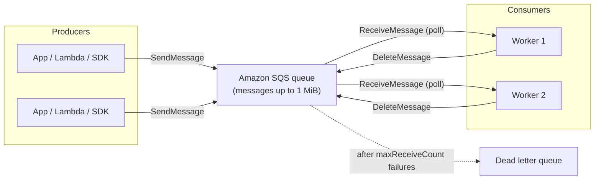

The lifecycle of one message:

1. Producer calls `SendMessage`. The message sits in the queue (default retention 4 days, up to 14)
2. A consumer calls `ReceiveMessage`. The message is returned **and hidden** from other consumers for the **visibility timeout** (default 30 s)
3. Consumer does the work, then calls `DeleteMessage`. The message is gone for good
4. If the consumer crashes or never deletes, the visibility timeout expires and the message **reappears** for someone else
5. After `maxReceiveCount` failed attempts it moves to the **dead letter queue**

Key behaviors:

- **Pull, not push.** Consumers poll
- **One consumer per message.** Unlike Kinesis, receiving hides it and deleting removes it permanently. Work is distributed, not broadcast
- **Standard queues**: unlimited throughput, at-least-once delivery, best-effort ordering
- **FIFO queues**: exact ordering within a message group, exactly-once processing, lower throughput
- Scale consumers by adding more workers; nothing to partition or shard

### AWS Standard queue

- Oldest offering (over 10 years old)
- Fully managed
- Scales from 1 message per second to tens of thousands per second (effectively unlimited TPS)
- Default retention of messages: **4 days**, maximum of **14 days**, minimum of 60 seconds
- No limit to how many messages can be in the queue
- Low latency (under 10 ms on publish and receive)
- Horizontal scaling in terms of number of consumers
- Can have **duplicate messages** (at-least-once delivery, occasionally)
- Can have **out of order messages** (best-effort ordering)
- Limitation of **1024 KiB (1 MiB) per message**

> Note: SQS raised the max payload from 256 KB to **1 MiB in August 2025**. Older material (and SNS, which is still 256 KB) says 256 KB, so don't be thrown if a practice question uses the old number.

### SQS - producing messages

- Define the **body**
- Add **message attributes** (metadata, optional)
- Provide **delay delivery** (optional)
- You get back:
  - **Message identifier**
  - **MD5 hash of the body**

### SQS - consuming messages

- Consumers:
  - **Poll** SQS for messages (receive up to **10 messages** at a time)
  - **Process** the message within the visibility timeout
  - **Delete** the message using the message ID and **receipt handle**

The receipt handle is not the message ID. It's issued per receive, so you must use the handle from *this* receive to delete.

### SQS visibility timeout

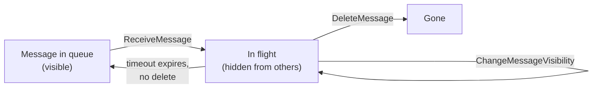

- Default **30 seconds**, configurable from 0 seconds to 12 hours
- Too **short**: the message reappears while the first consumer is still working, so it gets processed twice
- Too **long**: a crashed consumer's message is stuck invisible for that whole window before anyone retries it
- A long-running consumer can call **`ChangeMessageVisibility`** to extend its own lease while it works

Exam tell: "messages are being processed more than once" with no mention of producer retries is a visibility timeout shorter than the processing time.

### Long polling vs short polling

- **Short polling** (default, `WaitTimeSeconds = 0`): returns immediately, possibly with zero messages, and you pay for the empty call
- **Long polling** (`WaitTimeSeconds` 1 to 20): waits up to that long for a message to arrive before returning
- Long polling **reduces cost and latency**. Set it on the queue (`ReceiveMessageWaitTimeSeconds`) or per request

Exam tell: "reduce the number of empty receives and lower SQS cost" is long polling, every time.

### Delay queues and message timers

- **Delay queue**: a queue-level setting that hides every new message for 0 to 15 minutes
- **Message timer**: the same thing set per message with `DelaySeconds`, which overrides the queue setting
- Use for "don't process this for 5 minutes", like a retry backoff or a cool-down

FIFO queues support the queue-level delay but not per-message timers.

### SQS - FIFO queue

- Newer offering (First In, First Out), not available in all regions
- **Name of the queue must end in `.fifo`**
- Lower throughput: up to **3,000 messages/second with batching**, 300/s without
  - High throughput mode raises this substantially (30,000/s batched)
- Messages are **processed in order** by the consumer
- Messages are sent **exactly once**
- **5-minute interval deduplication** using a **Deduplication ID** (or content-based deduplication, an SHA-256 of the body)
- **Message Group ID** sets the ordering scope: messages in the same group are strictly ordered, different groups process in parallel

That last point is the one people miss. Ordering is **per group**, not across the whole queue. Pick the group ID to be the thing that needs sequence (`order_id`, `customer_id`) so you still get parallelism.

### SQS Extended Client

- Message size limit is 1 MiB, so how do you send large messages?
- Use the **SQS Extended Client** (Java library)

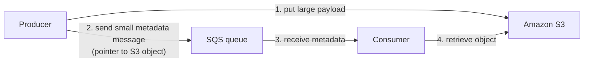

- The payload goes to S3, the queue only carries a pointer
- Supports payloads up to 2 GB
- Same pattern as the DynamoDB large-object pattern: **store the blob in S3, keep the reference in the service with a size limit**

### SQS use cases

- **Decouple applications** (for example, handle payments asynchronously)
- **Buffer writes to a database** (for example, a voting application)
- **Handle large loads of messages** coming in (for example, an email sender)
- SQS can be integrated with **Auto Scaling through CloudWatch**

### SQS and Auto Scaling

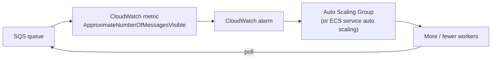

- The queue depth **is** the backlog, so it's a far better scaling signal than CPU
- The metric to scale on is `ApproximateNumberOfMessagesVisible`
- Better still is a **backlog per instance** target: queue depth divided by running instances, with a target tracking policy

Exam tell: "scale workers based on how much work is waiting" is queue depth, not CPU utilization.

### SQS as a Lambda event source

- Lambda polls the queue for you via an **event source mapping**, no code to write
- Batch size up to 10 (standard) or configurable with a batching window
- Lambda **deletes** messages automatically on success; a failure returns the whole batch to the queue
- **`ReportBatchItemFailures`** lets the function report only the failed message IDs so the successful ones aren't reprocessed
- The function's **timeout must be less than the queue's visibility timeout** (AWS recommends 6x)
- The DLQ belongs on the **queue**, not the function, for this pattern

### SQS limits

- Maximum of **120,000 in-flight messages** being processed by consumers (standard); 20,000 for FIFO
- **Batch request** has a maximum of **10 messages**
- Message content is XML, JSON, or unformatted text
- Standard queues have **unlimited TPS**
- FIFO queues support up to **3,000 messages/second** (with batching)
- Max message size is **1024 KiB** (or use the Extended Client)
- Data retention from **60 seconds to 14 days**
- **Pricing:**
  - Pay per API request
  - Pay per network usage

### SQS security

- **Encryption in flight** using the HTTPS endpoint
- Can enable **SSE (server-side encryption)** using KMS
  - Can set the CMK (customer master key) you want to use
  - SSE only encrypts the **body**, not the metadata (message ID, timestamp, attributes)
- **IAM policy** must allow usage of SQS
- **SQS queue access policy** (resource-based)
  - Finer grained control over IP
  - Control over the time the requests come in
  - This is also what lets SNS or S3 write to the queue

---

## Amazon SQS - Dead Letter Queue (DLQ)

- If a consumer fails to process a message within the visibility timeout, **the message goes back to the queue**
- We can set a threshold of how many times a message can go back to the queue
- After the **`maxReceiveCount`** threshold is exceeded, the message goes into a **dead letter queue**
- Useful for **debugging**
- **DLQ of a FIFO queue must also be a FIFO queue**
- **DLQ of a standard queue must also be a standard queue**
- Make sure to process the messages in the DLQ before they expire
  - Good to set a retention of **14 days** in the DLQ

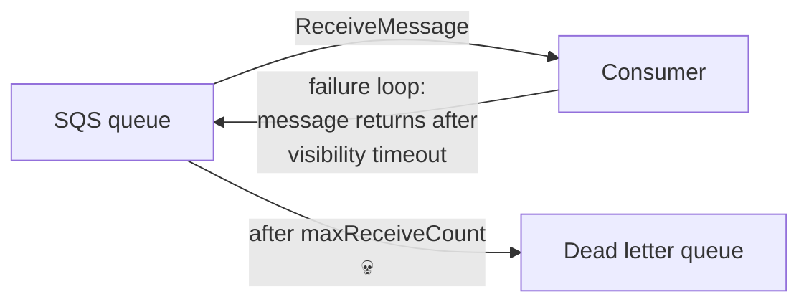

The DLQ retention point matters: the clock on a message **doesn't reset** when it moves to the DLQ. A message that spent 3 days failing in a 4-day source queue arrives at the DLQ with 1 day left unless the DLQ retention is longer.

### SQS DLQ - redrive to source

- Feature to help consume messages in the DLQ to understand what is wrong with them
- When our code is fixed, we can **redrive** the messages from the DLQ back into the source queue (or any other queue) **in batches without writing custom code**

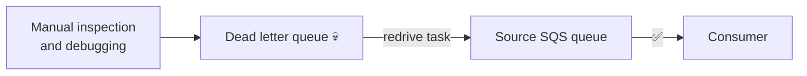

### SQS exam tells

| Scenario | Answer |
|---|---|
| Distribute work to a pool of workers, each item once | SQS |
| Strict ordering and no duplicates | SQS FIFO (name ends in `.fifo`) |
| Messages processed twice | Visibility timeout too short |
| Lots of empty receives, high cost | Long polling |
| Scale workers with the backlog | Auto scaling on `ApproximateNumberOfMessagesVisible` |
| Messages larger than 1 MiB | SQS Extended Client (payload in S3) |
| Isolate and debug poison messages | DLQ with `maxReceiveCount` |
| Reprocess fixed messages | DLQ redrive to source |
| Don't process for N minutes | Delay queue or `DelaySeconds` |
| Allow SNS or S3 to write to the queue | SQS access policy (resource-based) |
| Need replay or multiple independent consumers | Not SQS, use Kinesis or SNS fan-out |

---

## Kinesis Data Streams vs SQS

**Kinesis Data Streams:**
- Data can be **consumed many times**
- Data is deleted after the **retention period**
- **Ordering of records is preserved** (at the shard level), even during replays
- Build multiple applications reading from the same stream independently (pub/sub)
- "Streaming MapReduce" querying capability (Spark, Flink)
- **Checkpointing** needed to track progress of consumption (e.g. KCL with DynamoDB)
- Provisioned mode or on-demand mode

**SQS:**
- Queue, **decouple applications**
- **One application per queue**
- Records are **deleted after consumption** (ack / fail)
- Messages are processed independently for standard queues
- Ordering for FIFO queues (decreased throughput)
- Capability to **delay** messages
- Dynamic scaling of load (no ops)

| | Kinesis Data Streams | Amazon Data Firehose | Amazon SQS Standard | Amazon SQS FIFO |
|---|---|---|---|---|
| Managed by AWS | Yes | Yes | Yes | Yes |
| **Ordering** | Shard / key | No | No | Specify Group ID |
| **Delivery** | At least once | At least once | At least once | Exactly once |
| **Replay** | Yes | No | No | No |
| **Max data retention** | 365 days | No | 14 days | 14 days |
| **Scaling** | Provision shards: 1 MB/s producer, 2 MB/s consumer. Or on-demand | No limit | No limit | With batching: 3,000 msg/s, or 30,000 msg/s in high throughput mode |
| **Max object size** | 1 MB | 128 MB at destination | 1024 KiB (more with the extended library) | 1024 KiB (more with the extended library) |

The two rows that carry the weight:

- **Replay.** Only Kinesis has it, because only Kinesis keeps the data after a consumer reads it. "Reprocess historical data" or "a second application needs the same records later" rules out both queues
- **Ordering + delivery together.** The only exactly-once-with-ordering option is SQS FIFO, and it costs throughput. Kinesis orders per shard but is still at-least-once

The 128 MB on Firehose is the **buffer size at the destination**, not a per-record limit. A Firehose record is still capped at 1 MB.

### SQS vs Kinesis - use cases

**SQS:**
- Order processing
- Image processing
- Auto scaling queues according to messages
- Buffer and batch messages for future processing
- Request offloading

**Kinesis Data Streams:**
- Fast log and event data collection and processing
- Real-time metrics and reports
- Mobile data capture
- Gaming data feed
- Complex stream processing
- Data feed from Internet of Things

---

## Amazon SNS

### One message to many receivers

**Direct integration**

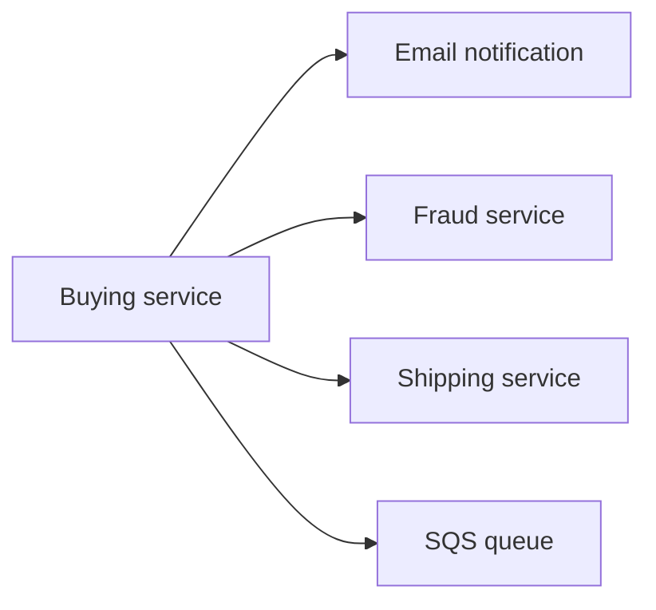

**Pub / Sub**

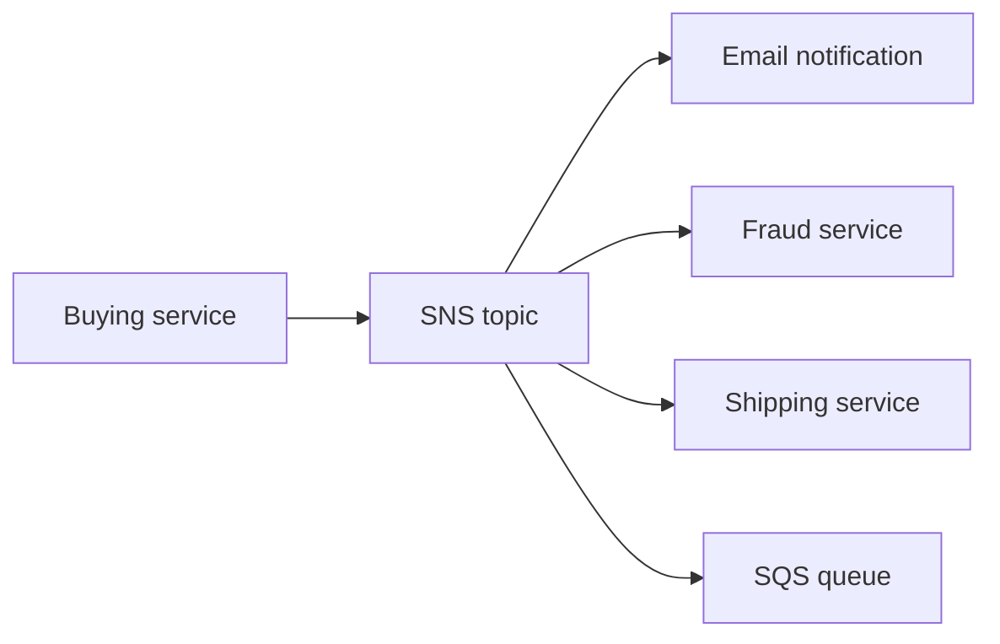

- **Direct integration**: the producer knows every receiver, and adding a fifth one means changing the buying service
- **Pub/Sub**: the producer publishes once to a **topic**, and subscribers come and go without the producer knowing or changing
- The "event producer" only sends messages to **one SNS topic**
- As many "event receivers" (**subscriptions**) as we want listen to the topic's notifications
- Each subscriber to the topic gets **all** the messages (unless you add message filtering)
- Up to **12,500,000 subscriptions** per topic
- **100,000 topics** limit

### SNS subscribers

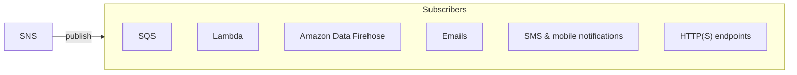

SNS **pushes** to subscribers. SQS is **polled**. That's the fundamental split between the two services.

### SNS integrates with a lot of AWS services

- Many AWS services can send data **directly to SNS** for notifications

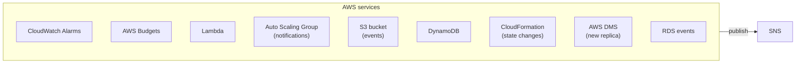

Direction check: here AWS services are the **publishers** and SNS is the destination. On the previous diagram SNS was the publisher fanning out. Both are true, and the exam flips between them.

The ones that show up on the DEA exam:

- **CloudWatch Alarms to SNS** is the standard alerting path (Glue job failures, Kinesis `IteratorAge`, Redshift disk)
- **S3 events to SNS** when more than one thing needs to react to an upload
- **AWS Budgets to SNS** for cost alerts
- **RDS and DMS events to SNS** for failover and replication notifications

### AWS SNS - how to publish

- **Topic publish** (using the SDK)
  - Create a subscription (or many)
  - Publish to the topic
- **Direct publish** (for mobile app SDKs)
  - Create a platform application
  - Create a platform endpoint
  - Publish to the platform endpoint
  - Works with Google GCM/FCM, Apple APNS, Amazon ADM

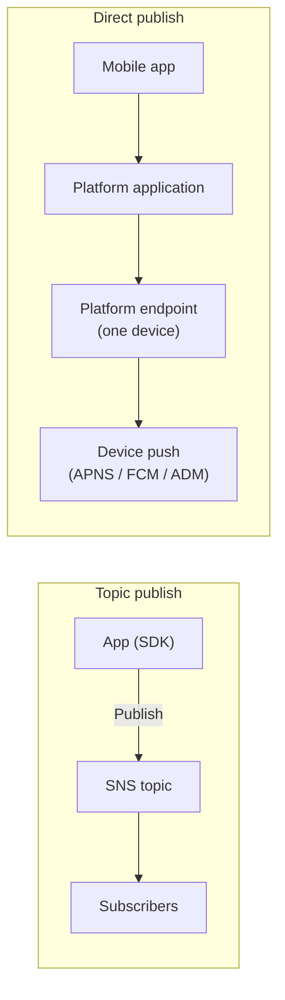

Direct publish targets **one device**, not a topic. It's for mobile push, not for the fan-out pattern.

### AWS SNS - security

- **Encryption:**
  - In-flight encryption using the HTTPS API
  - At-rest encryption using **KMS keys**
  - Client-side encryption if the client wants to perform encryption/decryption itself
- **Access controls:** IAM policies to regulate access to the SNS API
- **SNS access policies** (similar to S3 bucket policies):
  - Useful for **cross-account** access to SNS topics
  - Useful for allowing other services (S3, CloudWatch) to write to an SNS topic

---

## SNS + SQS: fan out

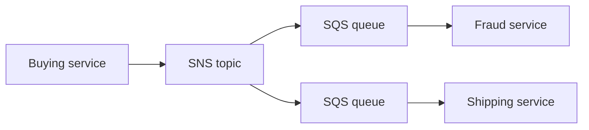

- **Push once in SNS, receive in all SQS queues** that are subscribers
- Fully decoupled, **no data loss**
- SQS allows for: **data persistence, delayed processing, and retries of work**
- Ability to **add more SQS subscribers over time**
- Make sure your SQS queue **access policy** allows SNS to write
- **Cross-region delivery**: works with SQS queues in other regions

Why the queue earns its place: SNS alone delivers to a subscriber and, if that subscriber is down, retries for a while then gives up. Put an SQS queue there and the message **waits**. That's the "no data loss" bullet, and the whole reason this pattern exists instead of SNS pushing straight to Lambda or HTTP.

Each queue also gets its own visibility timeout, retry count, and DLQ, so the fraud service failing has zero effect on shipping.

The access policy is the one that trips people in practice. The SQS resource policy must allow `sqs:SendMessage` from the `sns.amazonaws.com` principal with a condition on the topic ARN. Forget it and the subscription looks fine but nothing arrives.

### Application: S3 events to multiple queues

- For the same combination of **event type** (e.g. object create) and **prefix** (e.g. `images/`) you can only have **one S3 event rule**
- If you want to send the same S3 event to many SQS queues, use **fan-out**

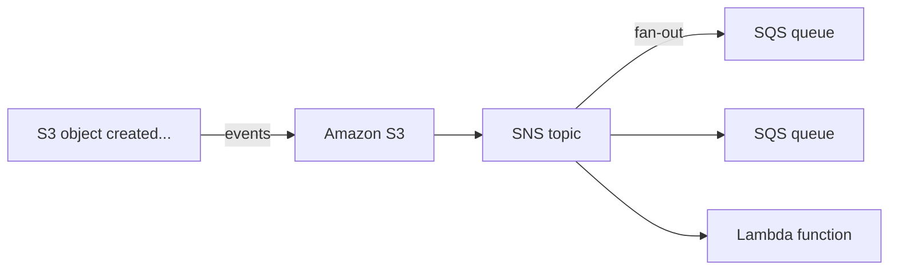

The first bullet is the constraint that forces the pattern. You can't register two rules for the same event type plus prefix. So you make that one destination an SNS topic and let SNS do the multiplying.

**Modern alternative**: turn on **S3 EventBridge notifications** for the bucket and every event goes to the default event bus, where you can write as many rules as you want with filters on prefix, suffix, or size. No per-prefix limit. If EventBridge is offered next to SNS fan-out, it's usually the cleaner answer.

### Application: SNS to S3 through Firehose

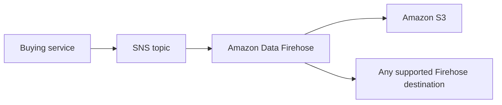

- Firehose is a **subscriber type** on the topic, like SQS or Lambda
- You get buffering, Lambda transform, JSON to Parquet conversion, compression, and delivery to S3, Redshift, OpenSearch, Splunk, or HTTP
- Gives you a **durable archive of every notification** in the lake, without the producer knowing

Direction check again: SNS is the **source**, Firehose is the **destination**. Firehose can never be a source.

### Amazon SNS: FIFO topic

- **FIFO** = First In First Out (ordering of messages in the topic)

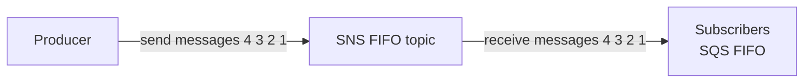

- Similar features as SQS FIFO:
  - **Ordering** by **Message Group ID** (all messages in the same group are ordered)
  - **Deduplication** using a **Deduplication ID** or content-based deduplication
- Can have SQS **Standard and FIFO** queues as subscribers
- **Limited throughput** (same throughput as SQS FIFO)

Small trap in reverse: a **FIFO topic** can feed either kind of queue, but a **Standard topic can only feed Standard queues**. End-to-end ordering needs both to be FIFO.

### SNS FIFO + SQS FIFO: fan out

- In case you need **fan out + ordering + deduplication**

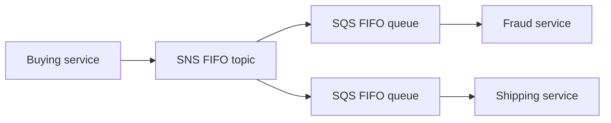

### SNS: message filtering

- **JSON policy** used to filter messages sent to an SNS topic's subscriptions
- If a subscription **doesn't have a filter policy, it receives every message**

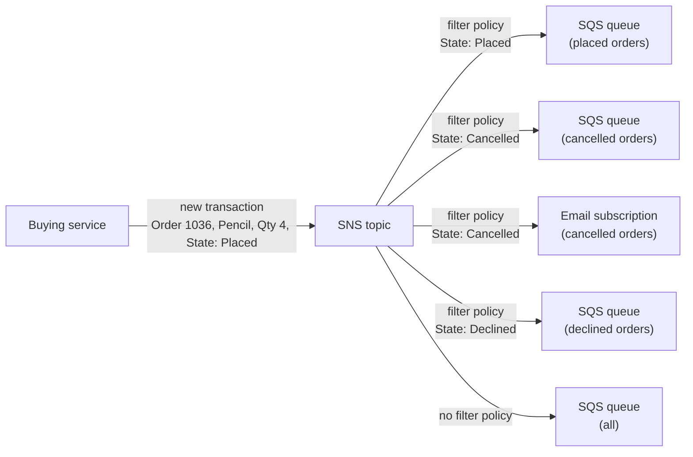

```json
{
  "State": ["Placed"]
}
```

- The policy matches against **message attributes** by default, or the message **body** if you set the filter policy scope to `MessageBody`
- Operators: exact match, `anything-but`, `prefix`, `suffix`, numeric comparisons, `exists`, and `OR` within an attribute

Without filtering you'd need a topic per event type, and the producer would have to know which topic to publish to, which recouples it.

### SNS exam tells

| Scenario | Answer |
|---|---|
| One message to multiple services | SNS |
| One message to one worker | SQS |
| Multiple consumers, each with its own retry and buffering | SNS fan-out to SQS |
| Multiple apps must react to the same S3 upload | SNS fan-out, or S3 EventBridge notifications |
| Fan out with ordering and no duplicates | SNS FIFO topic + SQS FIFO queues |
| Each subscriber wants a subset of events | SNS message filtering |
| Archive every notification in the lake | Firehose as a subscriber |
| Mobile push to a specific device | Direct publish with a platform endpoint |
| Allow S3 or CloudWatch to publish to the topic | SNS access policy |
| Message larger than 256 KB | Not SNS directly; pointer in S3 |

---

## AWS Step Functions

- **Use to design workflows**
- Easy visualizations
- **Advanced error handling and retry mechanism outside the code**
- **Audit of the history of workflows**
- Ability to **"Wait"** an arbitrary amount of time
- Max execution time of a state machine is **1 year**

### State machines and states

- Your workflow is called a **state machine**
- Each step in a workflow is a **state**
- Types of states:
  - **Task**: does something with Lambda, other AWS services, or third-party APIs
  - **Choice**: adds conditional logic via Choice Rules (comparisons)
  - **Wait**: delays the state machine for a specified time
  - **Parallel**: adds separate branches of execution
  - **Map**: runs a set of steps for **each item in a dataset, in parallel**
    - **Most relevant to data engineering.** Works with JSON, S3 objects, CSV files
  - Also **Pass**, **Succeed**, **Fail**

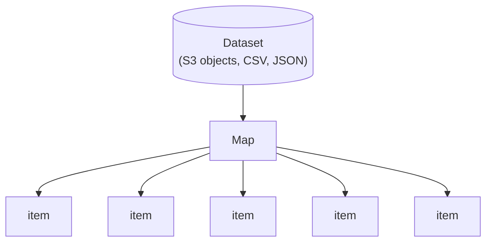

A realistic ETL state machine, which is the shape the exam describes in words:

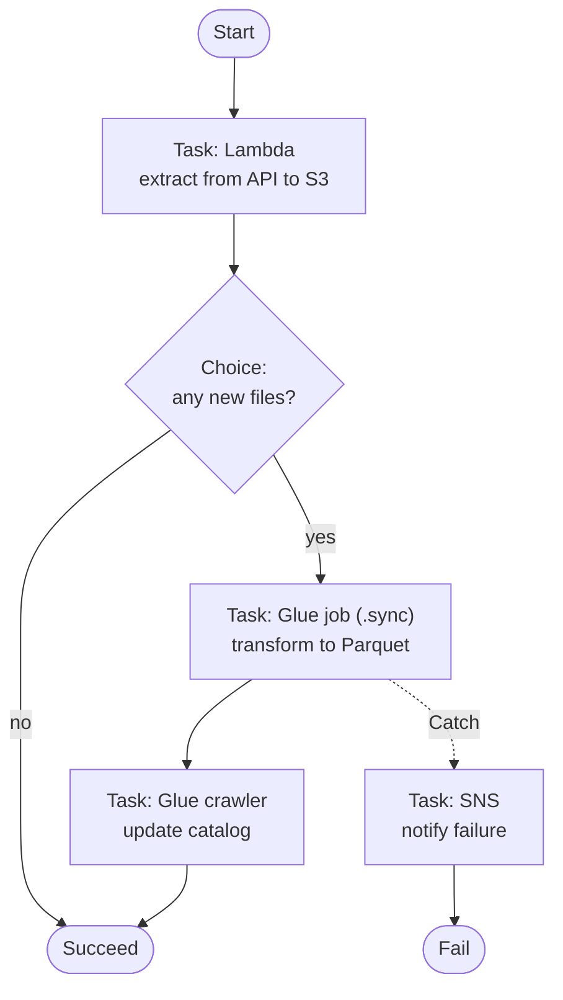

### Map: inline vs distributed

| | Inline Map | Distributed Map |
|---|---|---|
| Items | Up to 40, from the state's own input | Millions, read from S3 |
| Concurrency | Up to 40 | Up to 10,000 |
| Child executions | Run inside the parent | Separate child executions |
| History limit | Counts against the parent's 25,000 events | Doesn't |
| Reads directly from | The input JSON | S3 object list, CSV, JSON, manifest, Athena results |
| Failure tolerance | All or nothing | `ToleratedFailurePercentage` / `ToleratedFailureCount` |

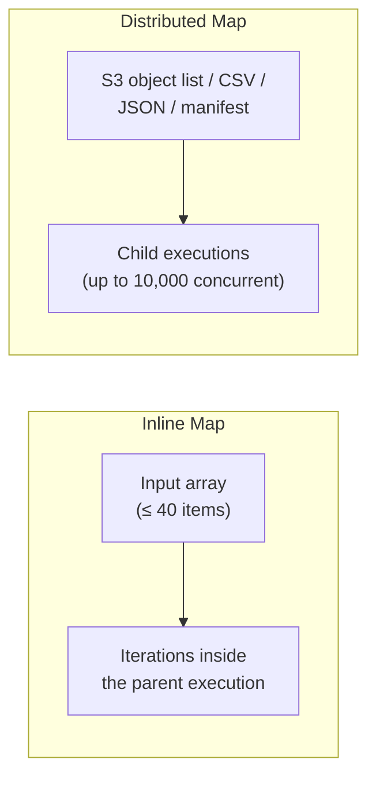

Exam tells: "process millions of S3 objects in parallel" is Distributed Map. "The workflow failed with a history limit exceeded error" is also Distributed Map, since inline Map blows the 25,000 event ceiling. "Tolerate a few bad files without failing the whole run" is `ToleratedFailurePercentage`.

### Standard vs Express workflows

| | Standard | Express |
|---|---|---|
| Duration | Up to **1 year** | **5 minutes** |
| Start rate | 2,000/s | 100,000/s |
| Execution model | **Exactly-once** | At-least-once (async) or at-most-once (sync) |
| History | Full, visible in the console | CloudWatch Logs only |
| Pricing | Per **state transition** | Per execution and duration |
| Use for | ETL orchestration, long-running, auditable | High-volume event processing, short |

ETL pipelines are **Standard**. The `.sync` integration that waits for a Glue job can't work in Express anyway, since Express can't run past 5 minutes.

### Step Functions error handling

This is the main reason to pick Step Functions over Glue Workflows:

- **`Retry`**: per state, with `IntervalSeconds`, `MaxAttempts`, `BackoffRate`, and a list of error names to match
- **`Catch`**: route a failure to a different state (cleanup, notification) instead of failing the execution
- **`TimeoutSeconds`**: so a hung task doesn't run forever
- Error names to know: `States.ALL`, `States.TaskFailed`, `States.Timeout`, `Lambda.ServiceException`, and your own custom errors

```json
{
  "Type": "Task",
  "Resource": "arn:aws:states:::glue:startJobRun.sync",
  "Parameters": { "JobName": "curate-parquet" },
  "Retry": [
    {
      "ErrorEquals": ["States.TaskFailed"],
      "IntervalSeconds": 60,
      "MaxAttempts": 2,
      "BackoffRate": 2.0
    }
  ],
  "Catch": [
    {
      "ErrorEquals": ["States.ALL"],
      "Next": "NotifyFailure"
    }
  ],
  "Next": "RunCrawler"
}
```

### Service integration patterns

Three flavors, and the middle one is what you use for Glue and EMR:

| Pattern | Resource suffix | Behavior |
|---|---|---|
| **Request/response** | none | Call the API and move on immediately |
| **Run a Job (`.sync`)** | `.sync` | Call and **wait for completion** (Glue jobs, EMR steps, Batch jobs, ECS tasks, SageMaker) |
| **Callback with task token** | `.waitForTaskToken` | Pause until something calls `SendTaskSuccess` or `SendTaskFailure` |

```mermaid
flowchart LR
    SF["Step Functions"] -->|"request/response"| A["API call, continue"]
    SF -->|".sync"| B["Start Glue job,<br/>poll until it finishes"]
    SF -->|".waitForTaskToken"| C["Pause until external<br/>system calls back<br/>(human approval, 3rd party)"]
```

Over 200 AWS services are callable directly, so most workflows need no Lambda glue at all.

### Step Functions exam tells

| Scenario | Answer |
|---|---|
| Orchestrate Glue, Lambda, and notifications together | Step Functions |
| Orchestrate Glue jobs and crawlers only | Glue Workflows (simpler) |
| Existing Airflow DAGs | MWAA |
| Retry with exponential backoff, no code | `Retry` block |
| Route failures to a cleanup or alert path | `Catch` block |
| Process millions of S3 files in parallel | Distributed Map |
| History limit exceeded | Distributed Map |
| Human approval step in the middle | `.waitForTaskToken` callback |
| Wait for a Glue job to finish before the next step | `.sync` integration |
| Very high volume, short, cheap | Express workflow |
| Long-running, auditable, exactly-once | Standard workflow |
| Pass large data between steps | Pass an S3 key, not the payload |

---

## Amazon AppFlow

- Fully managed integration service that enables you to securely transfer data between **Software-as-a-Service (SaaS) applications and AWS**
- **Sources**: Salesforce, SAP, Zendesk, Slack, and ServiceNow
- **Destinations**: AWS services like **Amazon S3, Amazon Redshift**, or non-AWS such as Snowflake and Salesforce
- **Frequency**: on a schedule, in response to events, or on demand

```mermaid
flowchart LR
    SRC["Salesforce / SAP / Zendesk /<br/>Slack / ServiceNow"] --> AF["Amazon AppFlow<br/>(flow: map, filter, validate, mask)"]
    AF --> S3["Amazon S3"]
    AF --> RS["Amazon Redshift"]
    AF --> OTH["Snowflake / Salesforce"]
```

- Transforms inside the flow: field mapping, filtering, validation, masking
- Writes to S3 as JSON, CSV, or Parquet
- Encrypted in transit, can run over **PrivateLink** for sources that support it
- Can publish to **EventBridge** so a flow completing triggers the rest of your pipeline
- **Don't spend time writing the integrations**, leverage APIs immediately

### AppFlow: sources and destinations

```mermaid
flowchart LR
    subgraph SRC["Sources"]
        S1["Salesforce"]
        S2["Amazon S3"]
        S3["Amplitude"]
        S4["Datadog"]
        S5["Dynatrace"]
        S6["Google Analytics"]
        S7["Infor Nexus"]
        S8["Marketo"]
        S9["Salesforce Pardot"]
    end

    AF["Amazon AppFlow"]

    subgraph DST["Destinations"]
        D1["Amazon Redshift"]
        D2["Amazon S3"]
        D3["Amazon Lookout for Metrics"]
        D4["Marketo"]
        D5["Salesforce"]
        D6["Snowflake"]
        D7["Upsolver"]
        D8["Zendesk"]
    end

    SRC --> AF --> DST
```

Two things the lists show:

- **S3 appears on both sides**, so AppFlow is also AWS-to-SaaS. Pushing a scored customer list from S3 back into Salesforce is a real use case
- Several sources are **observability and analytics tools** (Datadog, Dynatrace, Google Analytics, Amplitude), not just CRMs

The whole point is that you don't write or maintain API integration code: no OAuth refresh, no pagination, no rate-limit backoff, no schema drift when the vendor changes their API.

Exam tell: a **SaaS app as the data source** is AppFlow, basically every time. The distractors are Glue, a Lambda calling the vendor API, and DMS (databases, not SaaS).

---

## Amazon EventBridge

### Schedule and event pattern

- **Schedule**: cron jobs (scheduled scripts)

```mermaid
flowchart LR
    S["Schedule: every hour"] --> EB["EventBridge"] --> L["Trigger script on Lambda function"]
```

- **Event pattern**: event rules to react to a service doing something

```mermaid
flowchart LR
    E["IAM root user sign-in event"] --> EB2["EventBridge"] --> SNS["SNS topic with email notification"]
```

- Trigger Lambda functions, send SQS / SNS messages, and many other targets

Two genuinely different features sharing a service: **schedule** means nothing happened, time just passed. **Event pattern** means something happened and a rule matched it.

### Amazon EventBridge rules

```mermaid
flowchart LR
    subgraph SRC["Example sources"]
        EC2["EC2 instance<br/>(ex: start instance)"]
        CB["CodeBuild<br/>(ex: failed build)"]
        S3["S3 event<br/>(ex: upload object)"]
        TA["Trusted Advisor<br/>(ex: new finding)"]
        CT["CloudTrail<br/>(any API call)"]
        SCH["Schedule or cron<br/>(ex: every 4 hours)"]
    end

    SRC -->|"filter events<br/>(optional)"| EB["Amazon EventBridge<br/>(JSON event)"]

    subgraph DST["Example destinations"]
        direction TB
        C["Compute: Lambda, AWS Batch, ECS task"]
        I["Integration: SQS, SNS, Kinesis Data Streams"]
        O["Orchestration: Step Functions, CodePipeline, CodeBuild"]
    end

    EB --> DST
```

Everything on the bus is a **JSON event**:

```json
{
  "version": "0",
  "id": "6a7e8feb-b491-...",
  "detail-type": "EC2 Instance State-change Notification",
  "source": "aws.ec2",
  "account": "123456789012",
  "time": "2026-11-01T22:33:00Z",
  "region": "us-east-1",
  "resources": ["arn:aws:ec2:..."],
  "detail": { "instance-id": "i-abc123", "state": "running" }
}
```

- A **rule** is an event pattern matched against that JSON, plus one or more targets
- Filtering happens on `source`, `detail-type`, and anything inside `detail`
- **Input transformer** reshapes the event before it reaches the target

**CloudTrail (any API call)** is the sleeper on this slide. CloudTrail records every API call and feeds EventBridge, so you can write a rule for essentially anything anyone does, even where no dedicated event source exists.

A pattern for a data pipeline:

```json
{
  "source": ["aws.glue"],
  "detail-type": ["Glue Job State Change"],
  "detail": {
    "state": ["FAILED", "TIMEOUT"]
  }
}
```

That rule plus an SNS target is the whole "tell me when the Glue job breaks" setup, with no Lambda in between.

### Amazon EventBridge: event buses

```mermaid
flowchart LR
    AWS["AWS services<br/>(EC2, Lambda, S3...)"] --> DEF["Default event bus"]
    SAAS["AWS SaaS partners<br/>(Zendesk, Datadog...)"] --> PART["Partner event bus"]
    APPS["Custom apps"] --> CUST["Custom event bus"]
```

- Event buses can be accessed by **other AWS accounts** using **resource-based policies**
- You can **archive events** (all or filtered) sent to an event bus, indefinitely or for a set period
- Ability to **replay archived events**

Three buses, three sources, split by who publishes:

- **Default bus**: every account has one, AWS services publish to it automatically
- **Partner bus**: a SaaS vendor pushes events directly into your account. No polling their API, no webhook endpoint to run
- **Custom bus**: your own applications call `PutEvents`, keeping your domain events separate from AWS noise

**Archive and replay** is EventBridge's answer to a problem the other services solve differently. SNS has no replay. SQS deletes on acknowledgment. Kinesis keeps data up to 365 days. EventBridge archives can be **indefinite**, and replay re-publishes them so your rules fire again. That's the fix for "a bug silently dropped events for two days."

### Amazon EventBridge - Schema Registry

- EventBridge can analyze the events in your bus and **infer the schema**
- The **Schema Registry** allows you to generate code for your application, so it knows in advance how data is structured in the event bus
- Schemas can be **versioned**

### Amazon EventBridge: resource-based policy

- Manage permissions for a **specific event bus**
- Example: allow/deny events from another AWS account or AWS region
- Use case: **aggregate all events from your AWS Organization in a single AWS account or region**

```mermaid
flowchart RL
    subgraph A2["AWS account 111122223333"]
        L["Lambda function"]
    end
    subgraph A1["AWS account 123456789012"]
        BUS["EventBridge bus<br/>(central-event-bus)"]
    end
    L -->|"PutEvents"| BUS
```

```json
{
  "Version": "2012-10-17",
  "Statement": [
    {
      "Effect": "Allow",
      "Action": "events:PutEvents",
      "Principal": { "AWS": "111122223333" },
      "Resource": "arn:aws:events:us-east-1:123456789012:event-bus/central-event-bus"
    }
  ]
}
```

The policy lives on the **receiving** bus and names the **sending** account as the principal. Same shape as an S3 bucket policy or an SQS queue policy.

In a multi-account org, each account's rules forward to one **central bus** so all the rules and targets live in one place. The principal can be an Organization ID instead of listing accounts one by one.

### EventBridge Scheduler vs Rules

| | EventBridge Rules | EventBridge Scheduler |
|---|---|---|
| What it does | Match events, or a basic schedule | Schedules only, purpose-built |
| Targets | ~20 target types | 270+ AWS APIs as universal targets |
| Time zones and DST | No | Yes |
| One-time schedules | No | Yes (`at()`) |
| Flexible time windows | No | Yes, spreads load |
| Retries and DLQ per schedule | Limited | Yes |
| Scale | Shared rule quota | Millions of independent schedules |

Scheduler is the newer, better option for anything purely time-based.

### EventBridge exam tells

| Scenario | Answer |
|---|---|
| Run something on a schedule, minimal infrastructure | EventBridge Scheduler |
| React when a Glue job fails or an S3 object arrives | EventBridge rule |
| Route events by type to different targets with filtering | EventBridge (richer rules than SNS) |
| Receive events from a third-party SaaS | Partner event bus |
| Reprocess events after fixing a bug | Archive and replay |
| Aggregate events from all org accounts | Central bus + resource-based policy |
| React to an API call with no dedicated event | CloudTrail as the source |
| Generate code from event structure | Schema Registry |
| Multiple apps react to the same S3 upload | S3 EventBridge notifications, or SNS fan-out |

---

## Amazon Managed Workflows for Apache Airflow (MWAA)

- Apache Airflow is a **batch-oriented** workflow tool
- Develop, schedule, and monitor your workflows
- Workflows are defined as **Python code** that creates a **Directed Acyclic Graph (DAG)**
- Amazon MWAA provides a managed service so you don't have to install or maintain Airflow
- Use cases:
  - Complex workflows
  - ETL coordination
  - Preparing ML data

### Sample DAG in Airflow

```python
from datetime import datetime

from airflow import DAG
from airflow.decorators import task
from airflow.operators.bash import BashOperator

# A DAG represents a workflow, a collection of tasks
with DAG(dag_id="demo", start_date=datetime(2022, 1, 1),
         schedule="0 0 * * *") as dag:

    # Tasks are represented as operators
    hello = BashOperator(task_id="hello", bash_command="echo hello")

    @task()
    def airflow():
        print("airflow")

    # Set dependencies between tasks
    hello >> airflow()
```

```mermaid
flowchart LR
    H["hello<br/>(BashOperator)"] --> A["airflow<br/>(PythonDecoratedOperator)"]
```

- `>>` sets the dependency: `hello` runs, then `airflow`
- `schedule="0 0 * * *"` is the cron expression, here daily at midnight
- The UI's **Graph** view shows the DAG, and **Grid** view shows every run's task status

### Airflow concepts

- **DAG**: the workflow, a collection of tasks with dependencies. Defined in Python
- **Task**: one unit of work, created from an operator
- **Operator**: the template for what a task does. AWS ships a big provider package, so `GlueJobOperator`, `EmrAddStepsOperator`, `AthenaOperator`, `RedshiftDataOperator` all exist
- **Sensor**: a task that waits for something, like `S3KeySensor` waiting for a file to land. How Airflow does event-driven work inside a scheduled DAG
- **XComs**: how tasks pass small values to each other. Not for large payloads
- **Backfill**: rerun a DAG over a historical date range. Airflow's signature feature and the main thing Step Functions can't do
- **`start_date` and `schedule`**: a run is labeled by the start of its interval and executes at the **end** of it, which is the classic newcomer confusion

What separates Airflow from Step Functions and Glue Workflows: **the DAG is Python code**, not JSON or a console graph. You can loop, branch on config, generate tasks dynamically, and import your own libraries.

### Airflow + MWAA

- Your DAGs (Python code) are **uploaded into S3**
  - May zip them together with plugins and `requirements.txt`
- Amazon MWAA picks them up, and orchestrates and schedules the pipelines defined by each DAG
- Runs **within a VPC**, in at least **2 AZs**
- **Private or public endpoints**, IAM-managed (access to the Airflow web server)
- **Automatic scaling**: Airflow workers autoscale up to the limits you define

```mermaid
flowchart LR
    S3["Amazon Simple Storage Service (Amazon S3)"] --> MWAA["Amazon Managed Workflows<br/>for Apache Airflow"]
    MWAA --> ALL["Everything! ETL, ML, analytics,<br/>storage, databases..."]
```

Practical bits:

- **No deploy step.** Upload a `.py` to the S3 bucket and MWAA picks it up within a few minutes
- **`requirements.txt`** in the same bucket installs Python packages on the workers. A bad pin breaks the whole environment, so version it
- **Environment class** (small, medium, large) sets scheduler and worker size, and you pay for it **continuously**, not per task
- **Private web server access mode** means you need VPN, Direct Connect, or a bastion to reach the UI, same problem as OpenSearch Dashboards in a VPC

### Amazon MWAA integration

- Leverages **open-source integrations**:
  - Athena, Batch, CloudWatch, DynamoDB, DataSync
  - EMR, Fargate, EKS, Kinesis, Glue, Lambda
  - Redshift, SQS, SNS, SageMaker, S3, and more
  - Security services (AWS Secrets Manager, etc.)
- **Schedulers and workers are AWS Fargate containers**

### Amazon MWAA architecture

```mermaid
flowchart LR
    subgraph CVPC["Customer VPC"]
        SCH["Airflow schedulers"]
        BW["Base worker"]
        AW["Additional worker(s)"]
        DBVPCE["Database VPCE"]
        WSVPCE["Web server VPCE"]
    end

    subgraph SVPC["Service VPC"]
        PROXY["DB proxy"]
        META[("Meta database")]
        WEB["Airflow web server"]
    end

    SCH --- BW
    SCH --- AW
    SCH --> DBVPCE --> PROXY --> META
    WSVPCE --> WEB
    WEB -->|"public network"| USERS["Users"]

    CVPC --> CW["Amazon CloudWatch"]
    CVPC --> S3["Amazon S3"]
    CVPC --> SQS["Amazon SQS"]
    CVPC --> ECR["Amazon ECR"]
    CVPC --> KMS["AWS KMS"]
```

- **Schedulers and workers** run in your **customer VPC**
- The **metadata database and web server** run in an AWS-managed **service VPC**, reached through VPC endpoints
- **S3** holds your DAGs, plugins, and `requirements.txt`
- **SQS** is the Celery queue that hands tasks from schedulers to workers
- **ECR** holds the worker container image, **KMS** encrypts, **CloudWatch** gets logs and metrics

The split means you never manage the Airflow metadata database or web server, which is most of the operational pain of self-hosted Airflow. You do own the VPC, subnets, and security groups, so "MWAA can't reach my RDS instance" is a networking problem on your side.

The SQS box explains the scaling model: schedulers put tasks on the queue, workers pull them, and MWAA adds workers when the queue backs up, between the min and max you set.

### MWAA exam tells

| Scenario | Answer |
|---|---|
| Team has existing Airflow DAGs | MWAA |
| Complex dependencies, dynamic task generation, Python | MWAA |
| Rerun a pipeline over a historical date range | Airflow backfill |
| Wait for a file before continuing a scheduled DAG | Sensor (`S3KeySensor`) |
| Minimal cost for a few scheduled jobs | Not MWAA (it bills continuously): EventBridge Scheduler or Step Functions |
| Add a Python library to the workers | `requirements.txt` in the S3 bucket |
| Can't reach the Airflow UI | Private web server mode, needs VPN or bastion |
| Deploy a new DAG | Upload the `.py` to S3, no deploy step |

---

## Decision cheat sheet

**Messaging**

| Need | Use |
|---|---|
| Distribute work, one consumer per item | SQS |
| Strict order, no duplicates | SQS FIFO |
| One message to many consumers | SNS |
| Many consumers, each with retry and buffering | SNS fan-out to SQS |
| Many consumers reading the same data, replay | Kinesis Data Streams |
| Route by event type with rich filtering | EventBridge |
| Payload over the size limit | Pointer in S3 (SQS Extended Client) |

**Orchestration**

| Need | Use |
|---|---|
| Glue jobs and crawlers only | Glue Workflows |
| Mixed AWS services, retries, branching, approval steps | Step Functions |
| Existing Airflow, complex Python logic, backfills | MWAA |
| Just run something on a schedule | EventBridge Scheduler |
| Millions of parallel items | Step Functions Distributed Map |

**Integration**

| Need | Use |
|---|---|
| SaaS app to S3 or Redshift, no code | AppFlow |
| Database to S3 or Redshift, with CDC | DMS |
| File shares to S3 | DataSync |
| Partner pushes files via SFTP | Transfer Family |

**Push vs pull**

- **Push**: SNS, EventBridge, S3 events. The service invokes your target
- **Pull**: SQS, Kinesis. Your consumer polls

**Replay**

- **Yes**: Kinesis (retention), EventBridge (archive and replay)
- **No**: SQS (deleted on ack), SNS (fire and forget)