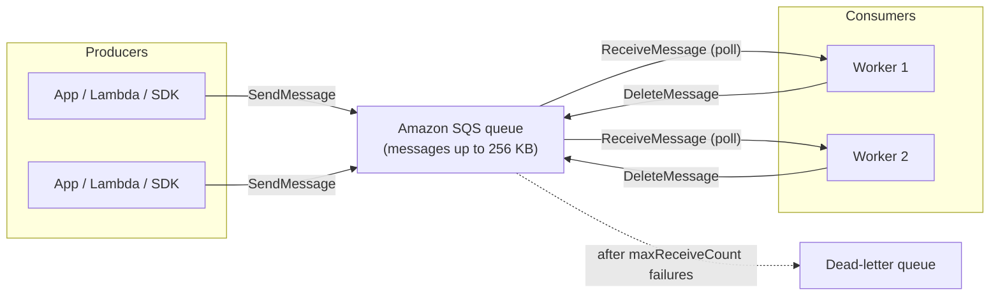

## Amazon SQS

### What's a Queue?

### How an SQS queue works

The lifecycle of one message:

1. Producer calls `SendMessage`. The message sits in the queue (default retention 4 days, up to 14)
2. A consumer calls `ReceiveMessage`. The message is returned **and hidden** from other consumers for the **visibility timeout** (default 30 s)
3. Consumer does the work, then calls `DeleteMessage`. The message is gone for good
4. If the consumer crashes or never deletes, the visibility timeout expires and the message **reappears** for someone else
5. After `maxReceiveCount` failed attempts it moves to the **dead-letter queue**

Key behaviors:

- **Pull, not push.** Consumers poll. **Long polling** (`WaitTimeSeconds` up to 20 s) waits for a message instead of returning empty, which cuts cost and latency versus short polling
- **One consumer per message.** Unlike Kinesis, reading removes it from circulation and deleting removes it permanently. Work is distributed, not broadcast
- **Standard queues**: unlimited throughput, at-least-once delivery, best-effort ordering
- **FIFO queues**: exact ordering within a message group, exactly-once processing with deduplication IDs, 300 msg/s (3,000 with batching)
- Scale consumers by adding more workers; nothing to partition or shard

### AWS Standard Queue 

- Oldest offering (over 10 years old)
- Fully managed
- Scales from 1 message per second to 15,000s per second 
- Default retention of messages: 4 days, maximum of 14 days 
- No limit to how many messages can be in the queue 
- Low latency (< 10 ms on publish and recieve)
- Horizontal scaling in terms of number of consumers 
- Can have duplicate messages (at least once for delivery, occasionally)
- Can have out of order messages (best effort ordering)
- Limitation of 1024 KB per message sent

### SQS - Producing Messages

- Define body
- Add message attributes (metadata - optional)
- Provide Delay Delivery (Optional)

- Get back
    - Message identifier 
    - MD5 hash of the body

### SQS - Consuming Messages

- Consumers... 
    - Poll SQS for messages (recieve up to 10 messages at a time)
    - Process the message within the visibility timeout
    - Delete the message using the message ID & receipt handle