# 09 - Security, Identity, and Compliance

IAM (who can do what), KMS (encryption keys), Secrets Manager, Macie (find PII), WAF and Shield (perimeter), plus a per-service security deep dive. Exam tells inline, decision cheat sheet at the end.

## Contents

- [Principle of least privilege](#principle-of-least-privilege)
- [Data masking and anonymization](#data-masking-and-anonymization)
- [Key salting](#key-salting)
- [Preventing backups or replication to disallowed regions](#preventing-backups-or-replication-to-disallowed-aws-regions)
- [IAM](#iam-introduction-users-groups-policies)
  - [Users and groups](#iam-users-and-groups)
  - [Permissions](#iam-permissions)
  - [Policy inheritance](#iam-policies-inheritance)
  - [Policy structure](#iam-policies-structure)
  - [Identity-based vs resource-based](#identity-based-vs-resource-based-policies)
  - [Policy evaluation logic](#iam-policy-evaluation-logic)
  - [Password policy](#iam---password-policy)
  - [MFA](#multi-factor-authentication-mfa)
  - [MFA device options](#mfa-device-options-in-aws)
  - [IAM roles](#iam-roles)
  - [STS and assuming roles](#sts-and-assuming-roles)
  - [Permissions boundaries and SCPs](#permissions-boundaries-and-scps)
  - [IAM Access Analyzer](#iam-access-analyzer)
  - [Exam tells](#iam-exam-tells)
- [Encryption 101](#encryption-101)
  - [In flight (TLS/SSL)](#encryption-in-flight-tls--ssl)
  - [Server-side at rest](#server-side-encryption-at-rest)
  - [Client-side](#client-side-encryption)
  - [Envelope encryption](#envelope-encryption)
- [AWS KMS](#aws-kms)
  - [Key types](#kms-key-types)
  - [Types of KMS keys and cost](#types-of-kms-keys-and-cost)
  - [Key rotation](#key-rotation)
  - [Key policies](#kms-key-policies)
  - [Copying snapshots across regions](#copying-snapshots-across-regions)
  - [Copying snapshots across accounts](#copying-snapshots-across-accounts)
  - [Multi-Region Keys and grants](#multi-region-keys-and-grants)
  - [Exam tells](#kms-exam-tells)
- [Amazon Macie](#amazon-macie)
- [AWS Secrets Manager](#aws-secrets-manager)
  - [Multi-region secrets](#aws-secrets-manager---multi-region-secrets)
  - [Secrets Manager vs Parameter Store](#secrets-manager-vs-ssm-parameter-store)
- [AWS WAF](#aws-waf---web-application-firewall)
  - [Fixed IP with a load balancer](#waf-fixed-ip-while-using-waf-with-a-load-balancer)
- [AWS Shield](#aws-shield)
- [Auditing and compliance](#auditing-and-compliance)
- [Network isolation: VPC endpoints](#network-isolation-vpc-endpoints)
- [Per-service security deep dive](#per-service-security-deep-dive)
  - [Kinesis](#security---kinesis)
  - [SQS](#security---sqs)
  - [IoT](#security---iot)
  - [S3](#security---amazon-s3)
  - [DynamoDB](#security---dynamodb)
  - [RDS and Aurora](#security---rds-and-aurora)
  - [Lambda](#security---lambda)
  - [Glue](#security---glue)
  - [EMR](#security---emr)
  - [EMR encryption](#security---emr-encryption-security-config)
  - [OpenSearch](#security---opensearch-service)
  - [Redshift](#security---redshift)
  - [Athena](#security---athena)
  - [QuickSight](#security---quicksight)
- [Decision cheat sheet](#decision-cheat-sheet)

---

## Principle of least privilege

- Grant only the permissions **required** to perform a task
- Start with broad permissions while developing
- But lock it down once you have a better idea of the exact services and operations a workload requires
- Can use **IAM Access Analyzer** to generate least-privilege policies based on access activity

---

## Data masking and anonymization

Dealing with PII or other sensitive data:

- **Masking** obfuscates data
  - For example, masking all but the last 4 digits of a credit card or SSN
  - Masking passwords
  - Supported in **Glue DataBrew** and **Redshift** (dynamic data masking)
- **Anonymization techniques**
  - Replace with random
  - Shuffle
  - Encrypt (deterministic or probabilistic)
  - Hashing
- Or just **delete it, or don't import it in the first place**

Which service does what, since the exam distinguishes them:

| Need | Service |
|---|---|
| Find PII in S3 you didn't know about | **Macie** |
| Transform PII out of a dataset, no code | **Glue DataBrew** |
| Hide columns or rows from some users in the lake | **Lake Formation** data filters |
| Hide columns from some users in Redshift | **Redshift dynamic data masking** / column grants |
| Hide rows from some users in Redshift | **Redshift row-level security** |

The split that matters: **masking transforms the data**, **access control hides it from certain users**. If the question says some users still need to see the real values, it's access control, not masking.

---

## Key salting

- Salting involves appending or prepending a random value, known as a **salt**, to a piece of data (often a password) before hashing it
- Prevents pre-computed **rainbow table attacks**, where adversaries use pre-generated hashes of common passwords to find matches
- Ensures that the same piece of data (like two identical passwords) doesn't produce the same hash across different instances
- Use strong, cryptographically secure random values for salts
- Rotate salts periodically
- **Each user should have a unique salt**
- Salt and hash passwords before storing

### Key salting: example

| Username | Salt value | String to be hashed | Hashed value = SHA256(password + salt) |
|---|---|---|---|
| user1 | `D;%yL9TS:5PalS/d` | **password123**`D;%yL9TS:5PalS/d` | `9C9B913EB1B6254F4737CE947EFD16F16E916F9D6EE5C1102A2002E48D4C88BD` |
| user2 | `)<,-<U(jLezy4j>*` | **password123**`)<,-<U(jLezy4j>*` | `6058B4EB46BD6487298B59440EC8E70EAE482239FF2B4E7CA69950DFBD5532F2` |

- Both users chose the **same password**, but the stored hashes are completely different
- Each user gets a **unique random salt**, stored alongside the hash (the salt is **not secret**)
- On login: look up the user's salt, hash `entered_password + salt`, compare to the stored value

> Note: plain SHA-256 is too fast for passwords, so real systems use **bcrypt**, **scrypt**, or **Argon2**, which have salting built in and a tunable work factor. The slide shows the concept, not production practice.

Same word, different use in data engineering: **key salting for skew** means adding a random suffix to a hot partition key so it spreads across multiple shards or partitions (Kinesis hot shards, DynamoDB write sharding, Spark skew). Same mechanic, different goal.

---

## Preventing backups or replication to disallowed AWS regions

- Compliance may prohibit data from being transferred into certain regions
- It's all too easy for backups or replication to send data to a region where it's not allowed
- **AWS Organizations' Service Control Policies (SCPs)** are one way to enforce this
- Restrict IAM policies and S3 bucket policies to allowed regions
- Take care when configuring backups and replication for **RDS, Aurora, Redshift**
- Monitor and alarm with **CloudTrail / CloudWatch**

### Keeping data where it belongs

Example: IAM policy to restrict RDS to backups in **us-east-1** and **us-west-1**

```json
{
  "Version": "2012-10-17",
  "Statement": [
    {
      "Sid": "AllowRDSActionsInSpecificRegions",
      "Effect": "Allow",
      "Action": [
        "rds:CreateDBSnapshot",
        "rds:CopyDBSnapshot"
      ],
      "Resource": "*",
      "Condition": {
        "StringEquals": {
          "aws:RequestedRegion": [
            "us-west-1",
            "us-east-1"
          ]
        }
      }
    },
    {
      "Sid": "AllowOtherRDSActions",
      "Effect": "Allow",
      "Action": "rds:*",
      "Resource": "*",
      "NotAction": [
        "rds:CreateDBSnapshot",
        "rds:CopyDBSnapshot"
      ]
    }
  ]
}
```

- The **`aws:RequestedRegion`** condition key is what pins the action to a region. It's a **global** condition key, so it works on almost any service
- First statement: snapshot actions are allowed **only** in those two regions
- Second statement: every other RDS action is allowed anywhere

Two improvements on this policy worth knowing:

- **An SCP beats an IAM policy** for this. An SCP applies to every principal in every account in the org, including admins and root. An IAM policy only covers whoever it's attached to, and another attached policy could grant around it
- **An explicit `Deny` beats a scoped `Allow`.** The policy above uses two Allow statements, which is fragile: any other policy granting `rds:*` broadly would still permit a snapshot in Frankfurt. An explicit `Deny` can never be overridden

Related condition keys in the same family:

| Key | Restricts by |
|---|---|
| `aws:RequestedRegion` | Region |
| `aws:SourceIp` | IP range |
| `aws:SourceVpce` | A specific VPC endpoint |
| `aws:SecureTransport` | Force HTTPS |
| `aws:PrincipalOrgID` | Membership in your AWS Organization |
| `aws:MultiFactorAuthPresent` | Whether the session used MFA |
| `s3:LocationConstraint` | Which region a bucket can be created in |

---

## IAM Introduction: users, groups, policies

### IAM: users and groups

- **IAM = Identity and Access Management**, a **global** service
- **Root account** created by default, shouldn't be used or shared
- **Users** are people within your organization, and can be grouped
- **Groups only contain users, not other groups**
- Users don't have to belong to a group (not best practice), and users can belong to **multiple groups**

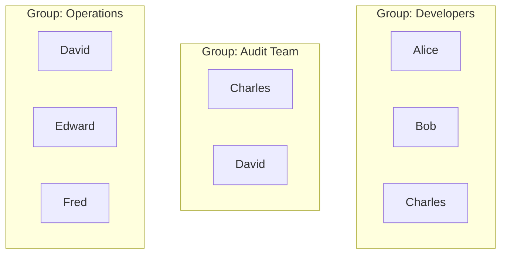

- Alice and Bob: Developers only
- **Charles**: Developers **and** Audit Team
- **David**: Audit Team **and** Operations
- Edward and Fred: Operations only
- A user inherits the permissions of **all** groups they belong to

Groups also **can't be principals** in a resource policy. If a question puts a group ARN in a bucket policy's `Principal`, that's wrong.

### IAM: permissions

- **Users or groups** can be assigned JSON documents called **policies**
- These policies define the **permissions** of the users
- In AWS you apply the **least privilege principle**: don't give more permissions than a user needs

```json
{
    "Version": "2012-10-17",
    "Statement": [
        {
            "Effect": "Allow",
            "Action": "ec2:Describe*",
            "Resource": "*"
        },
        {
            "Effect": "Allow",
            "Action": "elasticloadbalancing:Describe*",
            "Resource": "*"
        },
        {
            "Effect": "Allow",
            "Action": [
                "cloudwatch:ListMetrics",
                "cloudwatch:GetMetricStatistics",
                "cloudwatch:Describe*"
            ],
            "Resource": "*"
        }
    ]
}
```

### IAM policies inheritance

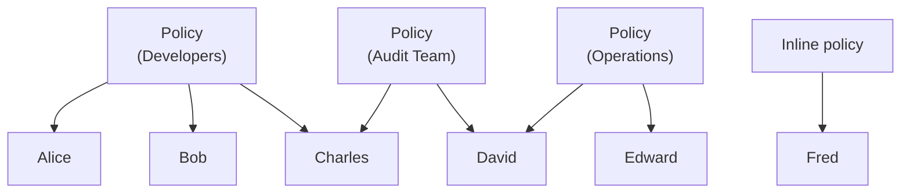

| User | Groups | Policies applied |
|---|---|---|
| Alice | Developers | Developers |
| Bob | Developers | Developers |
| **Charles** | Developers + Audit Team | Developers **and** Audit Team |
| **David** | Audit Team + Operations | Audit Team **and** Operations |
| Edward | Operations | Operations |
| **Fred** | none | **Inline policy** attached directly to the user |

- A policy attached to a **group** applies to every user in it
- Permissions are the **union** of all attached policies. There's no precedence between groups
- An **inline policy** is attached directly to one identity, with a strict one-to-one relationship, and is deleted with it
- A **managed policy** (AWS-managed or customer-managed) is a standalone object you attach to many identities and can version. This is the default choice for anything reused

### IAM policies structure

Consists of:

- **Version**: policy language version, always include `"2012-10-17"`
- **Id**: an identifier for the policy (optional)
- **Statement**: one or more individual statements (required)

Statements consist of:

- **Sid**: an identifier for the statement (optional)
- **Effect**: whether the statement allows or denies access (`Allow`, `Deny`)
- **Principal**: account/user/role to which this policy applies
- **Action**: list of actions this policy allows or denies
- **Resource**: list of resources the actions apply to
- **Condition**: conditions for when this policy is in effect (optional)

```json
{
    "Version": "2012-10-17",
    "Id": "S3-Account-Permissions",
    "Statement": [
        {
            "Sid": "1",
            "Effect": "Allow",
            "Principal": {
                "AWS": ["arn:aws:iam::123456789012:root"]
            },
            "Action": [
                "s3:GetObject",
                "s3:PutObject"
            ],
            "Resource": ["arn:aws:s3:::mybucket/*"]
        }
    ]
}
```

Two details that cause real bugs:

- `"arn:aws:s3:::mybucket/*"` means the **objects**. `"arn:aws:s3:::mybucket"` with no `/*` means the **bucket itself**. `s3:ListBucket` needs the bucket ARN, `s3:GetObject` needs the object ARN. Mixing these up is the most common S3 policy mistake
- `NotAction`, `NotResource`, and `NotPrincipal` exist as inverses and are easy to get backwards. Prefer explicit lists

### Identity-based vs resource-based policies

**`Principal` only appears in resource-based policies.**

| | Identity-based | Resource-based |
|---|---|---|
| Attached to | User, group, or role | The resource itself |
| Has `Principal` | **No** (the identity is the principal) | **Yes** |
| Examples | Any IAM policy | S3 bucket policy, SQS queue policy, SNS topic policy, **KMS key policy**, EventBridge bus policy, Glue Data Catalog resource policy, Lambda function policy |

So the example above, with its `Principal` block, is a **bucket policy**, not a user policy. You can tell at a glance.

Why it matters: **cross-account access needs both sides.** The resource policy in account A says "account B may act on me," and an identity policy in account B says "you may call this action." One alone does nothing.

### IAM policy evaluation logic

The order, which decides every "can this user do X" question:

1. **Explicit `Deny`** anywhere (identity policy, resource policy, SCP, permissions boundary, session policy) → **denied**, always, no exceptions
2. **Explicit `Allow`** → allowed, unless step 1 fired
3. **Neither** → **implicit deny**. Everything is denied by default

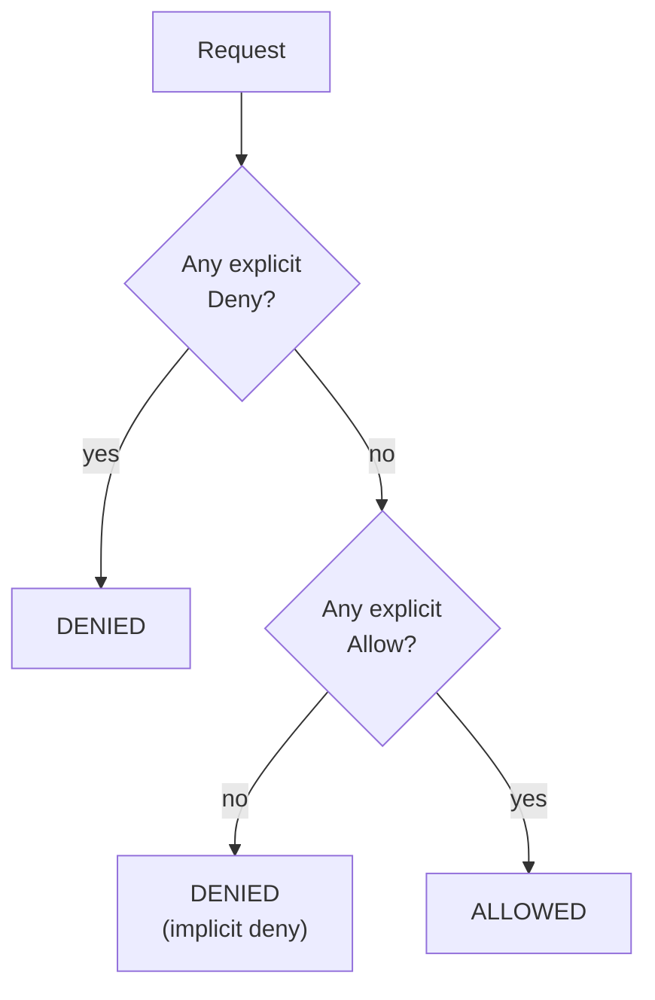

Add SCPs and permissions boundaries and it's an **AND**: the action must be allowed by the identity policy **and** permitted by the SCP **and** permitted by the boundary. Any one of them not allowing it blocks the request.

### IAM - password policy

- Strong passwords mean higher security for your account
- In AWS you can set up a password policy:
  - Set a **minimum password length**
  - Require specific character types: **lowercase**, **uppercase**, **numbers**, **non-alphanumeric characters**
- Allow all IAM users to **change their own passwords**
- Require users to change their password after some time (**password expiration**)
- **Prevent password reuse**

### Multi Factor Authentication (MFA)

- Users have access to your account and can possibly change configurations or delete resources
- You want to protect your **root account** and **IAM users**
- **MFA = password you _know_ + security device you _own_**

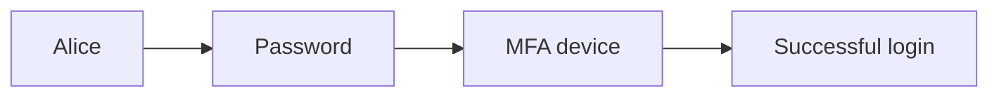

- **Main benefit of MFA:** if a password is stolen or hacked, the account is **not compromised**

Root MFA is the single highest-value security action in an account, because root can't be restricted by IAM policies or SCPs.

You can **require** MFA rather than hope for it, with a `Deny` plus:

```json
"Condition": {
    "BoolIfExists": { "aws:MultiFactorAuthPresent": "false" }
}
```

### MFA device options in AWS

**Virtual MFA device**
- **Google Authenticator** (phone only)
- **Authy** (phone only)
- Support for **multiple tokens on a single device**

**Universal 2nd Factor (U2F) security key**
- **YubiKey** by Yubico (3rd party)
- Support for **multiple root and IAM users using a single security key**

**Hardware key fob**
- Provided by **Gemalto** (3rd party)

**Hardware key fob for AWS GovCloud (US)**
- Provided by **SurePassID** (3rd party)

| | Virtual MFA | U2F security key |
|---|---|---|
| Form | App on your phone | Physical USB key |
| Multiplexing | Many **tokens** on one device | Many **users** on one key |
| Cost | Free | ~$25 to $50 |
| Phishing resistant | No (a code can be typed into a fake site) | **Yes** (bound to the real domain) |
| If you lose it | Locked out unless you saved backup codes | Locked out unless you registered a second key |

The naming trap: virtual MFA is one *device* holding many *tokens*. A U2F key is one *key* registered for many *identities*. And **GovCloud means SurePassID**.

### IAM roles

- Some AWS services need to perform actions on your behalf
- To do so, we assign **permissions** to AWS services with **IAM roles**
- Common roles:
  - EC2 instance roles
  - Lambda function roles
  - Roles for CloudFormation

A role has **two** policies, and confusing them is the most common IAM mistake:

| | Trust policy | Permissions policy |
|---|---|---|
| Answers | **Who can assume this role** | **What the role can do** |
| Shape | Resource-based, has a `Principal` | Identity-based, no `Principal` |
| Example principal | `glue.amazonaws.com`, `lambda.amazonaws.com`, another account ID | n/a |

```json
// Trust policy: a Glue job may assume this role
{
  "Version": "2012-10-17",
  "Statement": [{
    "Effect": "Allow",
    "Principal": { "Service": "glue.amazonaws.com" },
    "Action": "sts:AssumeRole"
  }]
}
```

Exam tell: "the Glue job gets `AccessDenied` on S3" is the **permissions** policy. "The Glue job can't start at all / can't assume the role" is the **trust** policy.

Related kinds of role:

- **Service role**: a role a service assumes to act for you (Glue, Lambda, EMR, Redshift)
- **Service-linked role**: a predefined role owned by the service, which you can't edit the permissions of
- **Instance profile**: the container that attaches a role to an EC2 instance. Credentials arrive via the instance metadata service, so **never put access keys on disk**
- **Cross-account role**: account B's users assume a role in account A, instead of A creating IAM users for them

### STS and assuming roles

- **AWS STS (Security Token Service)** issues **temporary credentials**
- `AssumeRole` returns an access key, secret key, and **session token** valid for 15 minutes to 12 hours
- Every role assumption, EC2 instance profile, Lambda execution role, and federated login is STS underneath

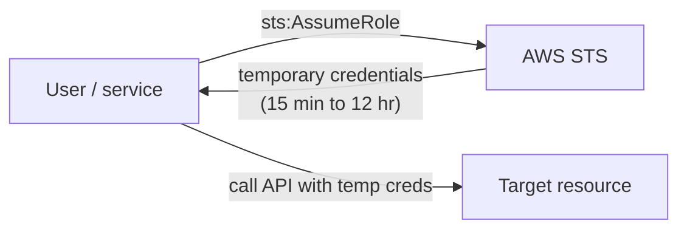

Related calls worth recognizing:

- `AssumeRoleWithSAML`: corporate identity provider federation
- `AssumeRoleWithWebIdentity`: Cognito, Google, Facebook. Also how **GitHub Actions OIDC** works, which is how CI deploys without long-lived keys
- `GetSessionToken`: MFA-protected sessions

The principle: **temporary credentials over long-lived access keys, always.** Any exam answer involving hardcoded access keys is wrong.

### Permissions boundaries and SCPs

Both are **limits**, not grants. Neither gives permission by itself.

| | Permissions boundary | Service Control Policy (SCP) |
|---|---|---|
| Applies to | One IAM user or role | Every principal in an account or OU |
| Set by | An admin, per identity | AWS Organizations management account |
| Use for | Letting developers create roles without privilege escalation | Org-wide guardrails (region restrictions, service blocks) |
| Affects root user | No | **Yes** |

SCPs are the right answer for anything phrased as "ensure no one in the organization can..." because they can't be worked around from inside a member account.

### IAM Access Analyzer

- Finds resources shared with **external entities** (buckets, roles, KMS keys, queues, Lambda functions)
- **Generates least-privilege policies** from CloudTrail activity, which is the "how do I tighten this policy" answer
- **Policy validation** checks syntax and flags overly permissive statements
- **Unused access findings** identify roles and permissions nobody has used

### IAM exam tells

| Scenario | Answer |
|---|---|
| Service needs to act on your behalf | IAM role, not a user with access keys |
| EC2 needs S3 access | Instance profile with a role |
| Role can't be assumed | Trust policy |
| Role assumed but gets AccessDenied | Permissions policy |
| Cross-account access | Resource policy on A **plus** identity policy on B |
| Ensure nobody in the org can use a region | SCP with `aws:RequestedRegion` |
| Let devs create roles without escalating | Permissions boundary |
| Tighten an over-broad policy | IAM Access Analyzer policy generation |
| CI/CD deploys without stored keys | OIDC federation + `AssumeRoleWithWebIdentity` |
| Conflicting allow and deny | Explicit **deny always wins** |
| Require MFA for sensitive actions | `aws:MultiFactorAuthPresent` condition on a Deny |

---

## Encryption 101

Three places data can be encrypted, and the exam cares about which one a scenario needs.

### Encryption in flight (TLS / SSL)

- Data is encrypted before sending and decrypted after **receiving**
- TLS certificates help with encryption (HTTPS)
- Encryption in flight ensures no **MITM (man in the middle)** attack can happen

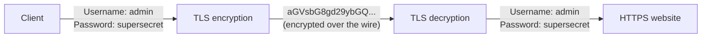

Enforce it rather than hope for it: `aws:SecureTransport` in a bucket policy `Deny` blocks plain HTTP, and Redshift has `require_ssl`.

### Server-side encryption at rest

- Data is encrypted after being **received** by the server
- Data is decrypted before being sent
- Encryption / decryption keys must be managed somewhere, and the server must have access to it

### Client-side encryption

- Data is encrypted by the client and **never decrypted by the server**
- Data will be decrypted by a **receiving** client
- The server should not be able to decrypt the data
- Could leverage **Envelope Encryption**

Exam tell: "AWS must never be able to see the plaintext" or "we control the keys outside AWS" → **client-side**. SSE of any flavor means AWS does the crypto, so AWS touches plaintext in memory.

The S3 server-side options, since they get compared constantly:

| Mode | Key managed by | Audit trail | Notes |
|---|---|---|---|
| **SSE-S3** | AWS, fully | No per-key audit | Default, free, AES-256 |
| **SSE-KMS** | You, a KMS key | **CloudTrail per request** | Subject to KMS API throttling on high-volume reads |
| **SSE-C** | You, sent per request | n/a | You supply the key on every call, AWS stores nothing |
| **CSE** | You, before upload | n/a | AWS never sees plaintext |

Gotcha for data engineering: **SSE-KMS plus millions of small Parquet files = KMS throttling**, because every `GetObject` becomes a `kms:Decrypt`. Fix with **S3 Bucket Keys**, which cut KMS calls by up to 99% by caching a bucket-level data key.

### Envelope encryption

Mentioned on the slide but never explained, and it's the mechanism behind basically all of KMS.

The problem: KMS's `Encrypt` API caps at **4 KB**. You can't send a 10 GB file to KMS.

The solution: don't. Encrypt the file locally with a **data key**, and only encrypt the **data key** with KMS.

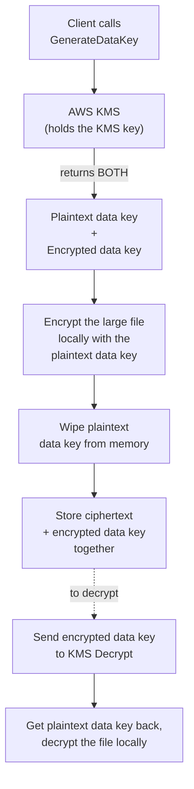

- **`GenerateDataKey`** is the envelope encryption API. It hands back the data key twice: once in plaintext (use it, then throw it away) and once encrypted (store it next to the data)
- The encrypted data key travels **with** the ciphertext, which is why an S3 object is self-describing about which key encrypted it
- Only the small encrypted data key ever goes over the wire to KMS, so the 4 KB limit never bites
- `Encrypt` / `Decrypt` directly is only for data under 4 KB (a password, a token, a connection string)

Exam tell: "data larger than 4 KB" → **envelope encryption / `GenerateDataKey`**, never a plain `kms:Encrypt` call. The **Encryption SDK** is the library that does this for you.

---

## AWS KMS

- Anytime you hear "encryption" for an AWS service, it's most likely KMS
- AWS **manages encryption** keys for us
- Fully integrated with IAM for authorization
- Easy way to control access to your data
- Able to **audit KMS Key usage using CloudTrail**
- Seamlessly integrated into most AWS services (EBS, S3, RDS, SSM)
- **Never ever store your secrets in plaintext, especially in your code**
  - KMS Key Encryption also available through API calls (SDK, CLI)
  - Encrypted secrets can be stored in the code / environment variables

Two facts that make or break questions:

- **KMS keys are regional.** A key in us-east-1 cannot decrypt data in eu-west-1. This is why cross-region copies re-encrypt
- **The key material never leaves KMS.** You never hold the KMS key, you only call the API. That's the whole security model

### KMS Key Types

- **KMS Keys is the new name of KMS Customer Master Key** (CMK)
- **Symmetric (AES-256 keys)**
  - Single encryption key that is used to Encrypt and Decrypt
  - AWS services that are integrated with KMS use **Symmetric** CMKs
  - You never get access to the KMS Key unencrypted (must call KMS API to use)
- **Asymmetric (RSA & ECC key pairs)**
  - Public (Encrypt) and Private Key (Decrypt) pair
  - Used for Encrypt/Decrypt, or Sign/Verify operations
  - The public key is **downloadable**, but you can't access the Private Key unencrypted
  - Use case: **encryption outside of AWS by users who can't call the KMS API**

Exam tell: every AWS service integration (S3, EBS, RDS, Glue, Redshift, Kinesis) uses **symmetric** keys. Asymmetric exists for signing and for external parties who can't reach the KMS API. If a question says "encrypt data in a service," the answer is symmetric.

### Types of KMS keys and cost

- **AWS Owned Keys (free):** SSE-S3, SSE-SQS, SSE-DDB (default key)
- **AWS Managed Key: free** (`aws/service-name`, example: `aws/rds` or `aws/ebs`)
- **Customer managed keys created in KMS: $1 / month**
- **Customer managed keys imported: $1 / month**
- Plus pay for **API calls** to KMS ($0.03 / 10,000)

| | AWS owned | AWS managed | Customer managed |
|---|---|---|---|
| Cost | Free | Free | **$1/month** |
| You see it in KMS console | **No** | Yes (`aws/...`) | Yes |
| You can edit the key policy | No | **No** | **Yes** |
| Rotation | AWS decides | Automatic, 1 year | Optional, configurable |
| Cross-account sharing | No | **No** | **Yes** |
| Audit in CloudTrail | No | Yes | Yes |

The decider: **cross-account access or your own key policy requires a customer managed key.** AWS managed keys can't be shared or edited. Any question about sharing an encrypted snapshot, or about needing a specific key policy, must use a CMK.

### Key rotation

- **AWS-managed KMS Key:** automatic every **1 year**
- **Customer-managed KMS Key:** (must be enabled) automatic & on-demand
- **Imported KMS Key:** only **manual** rotation possible, using an alias

How automatic rotation actually works, which is counterintuitive: KMS generates **new key material** but keeps the **same key ID and ARN**, and retains the old material so old ciphertext still decrypts. **Nothing is re-encrypted.** You don't have to touch your data, and your policies and references don't change.

For imported keys there's no material for AWS to generate, so you create a new key and repoint the **alias**. That's why aliases matter: application code should reference `alias/my-key`, not a raw key ID.

### KMS key policies

- Control access to KMS keys, "similar" to S3 bucket policies
- **Difference: you cannot control access without them**
- **Default KMS Key Policy:**
  - Created if you don't provide a specific KMS Key Policy
  - Complete access to the key to the root user = entire AWS account
- **Custom KMS Key Policy:**
  - Define users, roles that can access the KMS key
  - Define who can administer the key
  - Useful for **cross-account access** of your KMS key

This is the one resource policy that isn't optional. For S3, an IAM policy alone is enough. For KMS, **IAM permissions do nothing unless the key policy also allows it.** A user with `kms:*` in their IAM policy still gets `AccessDenied` if the key policy doesn't mention them.

The default policy's `"Principal": {"AWS": "arn:aws:iam::ACCOUNT:root"}` doesn't mean "the root user." It means **"delegate to IAM in this account"**, so normal IAM policies take effect. Deleting that statement can lock the key permanently, which is the classic KMS footgun.

Access to a key therefore needs **both**: an allow in the key policy **and** an allow in the caller's IAM policy. The only exception is when the key policy names the principal directly.

### Copying snapshots across regions

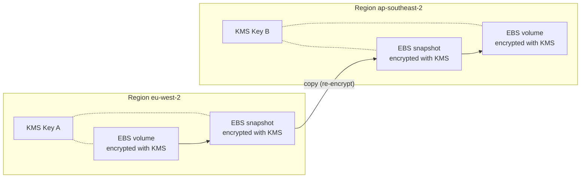

- **KMS keys are regional.** Key A exists only in eu-west-2, Key B only in ap-southeast-2
- A cross-region copy **decrypts with Key A and re-encrypts with Key B**
- You must specify the destination key in the copy request, or it uses the destination region's default key

Same mechanic for **S3 Cross-Region Replication** of SSE-KMS objects: you grant the replication role `kms:Decrypt` on the source key and `kms:Encrypt` on the destination key. Forgetting one is why CRR silently fails on encrypted objects.

### Copying snapshots across accounts

1. Create a Snapshot, encrypted with your own KMS Key (**Customer Managed Key**)
2. **Attach a KMS Key Policy to authorize cross-account access**
3. Share the encrypted snapshot
4. (in target) Create a copy of the snapshot, encrypt it with a CMK in your account
5. Create a volume from the snapshot

```json
{
    "Sid": "Allow use of the key with destination account",
    "Effect": "Allow",
    "Principal": {
        "AWS": "arn:aws:iam::TARGET-ACCOUNT-ID:role/ROLENAME"
    },
    "Action": [
        "kms:Decrypt",
        "kms:CreateGrant"
    ],
    "Resource": "*",
    "Condition": {
        "StringEquals": {
            "kms:ViaService": "ec2.REGION.amazonaws.com",
            "kms:CallerAccount": "TARGET-ACCOUNT-ID"
        }
    }
}
```

Reading that policy:

- **`kms:Decrypt`** lets the target account read the snapshot
- **`kms:CreateGrant`** is needed because EC2 creates a grant on your behalf to attach the volume. This is the step people forget
- **`kms:ViaService`** restricts use of the key to requests coming **through EC2**, so the target account can't call `Decrypt` directly on arbitrary data
- Step 4 is mandatory, not optional. The target account **re-encrypts with its own key** so it isn't permanently dependent on your key, which you could revoke

You cannot share a snapshot encrypted with an **AWS managed key** at all. That's the forcing function for a CMK.

### Multi-Region Keys and grants

**Multi-Region Keys**

- A primary key in one region plus **replicas** in others, sharing the **same key material and key ID** (with a different region in the ARN)
- Ciphertext encrypted in one region can be decrypted in another **without a re-encrypt step**
- Use cases: DynamoDB global tables, global client-side encryption, DR where you can't afford a re-encrypt

The tradeoff: it weakens regional isolation. A single-region key is a blast-radius boundary. AWS's own guidance is to use single-region keys unless you specifically need cross-region decrypt, so **"keys are regional" remains the default answer** unless the question says cross-region decrypt must work without re-encrypting.

**Grants**

- A way to give **temporary, programmatic** permission to use a key, without editing the key policy
- Created with `CreateGrant`, revoked with `RevokeGrant`
- How AWS services get just-in-time access (the EC2 snapshot case above)
- Can be scoped to specific operations and constrained by encryption context

Key policy vs grant: a key policy is durable and declarative, a grant is temporary and created at runtime by code or a service.

### KMS exam tells

| Scenario | Answer |
|---|---|
| Encrypt data larger than 4 KB | Envelope encryption / `GenerateDataKey` |
| Share an encrypted snapshot with another account | **Customer managed key** + key policy + `CreateGrant` |
| AWS must never see plaintext | Client-side encryption |
| Need an audit trail of every decrypt | SSE-KMS (CloudTrail), not SSE-S3 |
| Athena or Glue reads are throttling on KMS | **S3 Bucket Keys** |
| Rotate keys without re-encrypting data | Automatic rotation, same key ID |
| Encrypt outside AWS by parties with no KMS access | **Asymmetric** key, share the public key |
| Decrypt in another region with no re-encrypt | **Multi-Region Key** |
| User has `kms:*` but still gets AccessDenied | **Key policy** doesn't allow them |
| Cheapest possible encryption at rest | SSE-S3 (AWS owned key, free) |

---

## Amazon Macie

- Amazon Macie is a fully managed data security and data privacy service that uses **machine learning and pattern matching to discover and protect your sensitive data in AWS**
- Macie helps identify and alert you to **sensitive data, such as personally identifiable information (PII)**

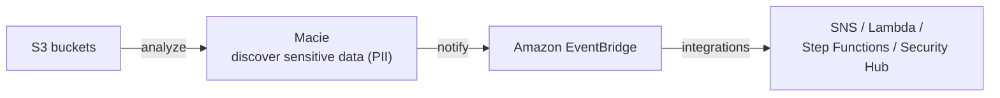

Details worth having:

- **S3 only.** Macie does not scan RDS, DynamoDB, EFS, or Redshift. If a question involves finding PII anywhere other than S3, Macie is wrong
- **Managed data identifiers** cover common PII out of the box (names, addresses, SSNs, credit cards, AWS keys). **Custom data identifiers** are your own regex plus keyword proximity rules, which is how you catch internal IDs like employee numbers
- **Allow lists** suppress known false positives (a test data set, a public address in a footer)
- Findings go to **EventBridge** and **Security Hub**, which is how you automate a response: a finding fires a Lambda that tags the object, moves it to a quarantine prefix, or revokes public access
- Also reports **bucket-level posture**: public access, unencrypted, shared outside the account
- Priced per bucket evaluated plus per GB inspected, so **scope the jobs**. Scanning an entire raw lake repeatedly is how Macie gets expensive

Where it fits in a pipeline: run Macie on the **raw** zone so PII is caught before Glue promotes it to curated. A finding triggers a Lambda that halts the Step Functions execution or routes the object aside.

Don't confuse it with its neighbors:

| Service | Finds |
|---|---|
| **Macie** | Sensitive data (PII) inside S3 objects |
| **GuardDuty** | Malicious or anomalous **activity** (crypto mining, credential exfiltration, S3 recon) |
| **Inspector** | **Vulnerabilities** in EC2, ECR images, Lambda |
| **Config** | Resource **configuration** drift against rules |
| **Security Hub** | Aggregates findings from all of the above |

---

## AWS Secrets Manager

- Newer service, meant for storing secrets
- Capability to force **rotation of secrets** every X days
- Automate generation of secrets on rotation (**uses Lambda**)
- Integration with **Amazon RDS** (MySQL, PostgreSQL, Aurora)
- Secrets can be encrypted using **KMS**
- Mostly meant for RDS integration

Beyond the slide:

- **Automatic rotation is the differentiator.** For RDS, Aurora, Redshift, and DocumentDB, AWS supplies the rotation Lambda. For anything else you write it, implementing four steps: `createSecret`, `setSecret`, `testSecret`, `finishSecret`
- **Version staging labels**: `AWSCURRENT` is what apps read, `AWSPENDING` is the in-flight rotation, `AWSPREVIOUS` is the last one. Rotation is safe because both the old and new credential are valid briefly
- **Resource policy** on the secret enables cross-account access
- About **$0.40 per secret per month** plus API calls, which matters when you have hundreds
- **Cache secrets in your application.** A Lambda that calls `GetSecretValue` on every invocation adds latency, cost, and risks throttling. Fetch once outside the handler

For data engineering, the typical use is a **Glue job or Lambda retrieving database credentials for a JDBC connection**. Glue connections can reference a Secrets Manager secret directly, so the password never appears in a job parameter.

### AWS Secrets Manager - Multi-Region Secrets

- Replicate Secrets across multiple AWS Regions
- Secrets Manager keeps **read replicas in sync** with the primary Secret
- Ability to **promote** a read replica Secret to a standalone Secret
- Use cases: multi-region apps, disaster recovery strategies, multi-region DB

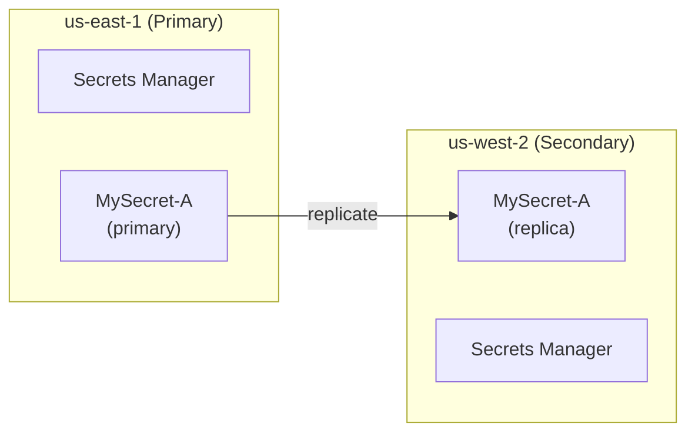

Replicas are **read-only** until promoted. Writes and rotation happen on the primary and flow outward. Each replica is encrypted with a KMS key **in its own region**, since KMS keys are regional.

### Secrets Manager vs SSM Parameter Store

Missing from the slides entirely and heavily tested. Both store configuration and secrets, and the exam wants to know when the extra cost of Secrets Manager is justified.

| | **Secrets Manager** | **SSM Parameter Store** |
|---|---|---|
| Built for | Secrets | Configuration **and** secrets |
| Cost | ~$0.40/secret/month + API calls | **Standard tier free** (10,000 params); advanced $0.05/param/month |
| **Automatic rotation** | **Yes, built in with Lambda** | **No** (you build it with EventBridge + Lambda) |
| RDS/Aurora/Redshift integration | **Native, managed rotation** | None |
| Encryption | KMS, always | KMS, only for `SecureString` |
| Size limit | 64 KB | 4 KB standard, **8 KB advanced** |
| Versioning | Staging labels (`AWSCURRENT`, `AWSPENDING`) | Numeric versions + labels |
| Cross-account | **Yes, resource policy** | Advanced tier only |
| Hierarchy / path queries | No | **Yes** (`/prod/db/host`, `GetParametersByPath`) |
| Can reference the other | n/a | **Yes**, can read a Secrets Manager secret via `/aws/reference/secretsmanager/` |
| Change notifications | Rotation events | Parameter Store **change events** to EventBridge |

The decision:

- Need **automatic rotation**, especially for a database → **Secrets Manager**
- Storing **plain configuration** (bucket names, table names, thresholds, feature flags) → **Parameter Store**, it's free
- Storing a secret with **no rotation requirement** and you want to minimize cost → Parameter Store `SecureString`
- Need **cross-account** sharing of a secret → Secrets Manager (or advanced-tier Parameter Store)
- Need **hierarchical config** fetched in one call per environment → Parameter Store `GetParametersByPath`

Exam tell: the words **"rotate automatically every 30/60/90 days"** mean Secrets Manager. The words **"minimize cost"** with configuration data mean Parameter Store. A question combining both usually wants parameters in Parameter Store and the one database password in Secrets Manager.

For a pipeline like the job-market one: EventBridge schedule names and S3 prefixes belong in Parameter Store, a Postgres password belongs in Secrets Manager, and the Lambda reads both at cold start, not per invocation.

---

## AWS WAF - Web Application Firewall

- Protects your web application from common web exploits (**Layer 7**)
- **Layer 7 is HTTP/HTTPS** (vs Layer 4 is TCP/UDP)
- Deploy on:
  - **Application Load Balancer**
  - **API Gateway**
  - **CloudFront**
  - **AppSync GraphQL API**
  - **Cognito User Pool**
- Define **Web ACL** (Web Access Control List) Rules:
  - **IP Set: up to 10,000 IP addresses** - use multiple Rules for more IPs
  - HTTP headers, HTTP body, or URL strings **protects** from common attacks: **SQL injection** and **Cross-Site Scripting (XSS)**
  - Size constraints, **geo-match (block countries)**
  - **Rate-based rules** (to count **occurrences** of events) for **DDoS protection**
- **Web ACLs are Regional, except for CloudFront** (which is global)

Note what's **not** on that list: **Network Load Balancer**. NLB is Layer 4, WAF is Layer 7, so they don't combine. If a question puts WAF on an NLB, it's wrong. The workaround is an ALB behind the NLB, or CloudFront in front.

Rule actions are **Allow**, **Block**, **Count**, and **CAPTCHA**. **Count mode is the operational answer**: deploy a new rule in Count first to see what it would have blocked, then switch it to Block. Deploying straight to Block is how you take down your own site.

**Managed rule groups** from AWS and the Marketplace cover the OWASP Top 10, bad inputs, SQLi, Linux/Windows exploits, and known bad IPs, so you rarely hand-write rules.

### WAF: fixed IP while using WAF with a load balancer

Problem: WAF needs a Layer 7 target (ALB), but some clients require a **fixed, static IP** to allowlist. An ALB's IPs change.

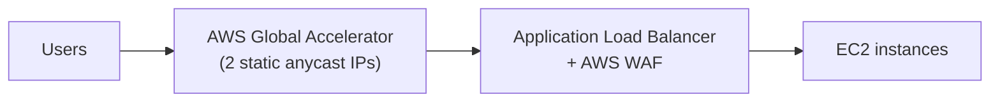

- **Global Accelerator** gives you **two static anycast IP addresses** that never change
- It sits in front of the ALB, so **WAF still inspects at Layer 7** on the ALB
- Bonus: traffic enters the AWS backbone at the nearest edge location, which improves latency and failover

Exam tell: "static IP" **and** "Layer 7 firewall" together → **Global Accelerator + ALB + WAF**. Global Accelerator alone gives you the static IP but no Layer 7 inspection.

---

## AWS Shield

### AWS Shield: protect from DDoS attacks

- **DDoS:** Distributed Denial of Service, many requests at the same time
- **AWS Shield Standard:**
  - **Free** service that is activated for every AWS customer
  - Provides protection from attacks such as **SYN/UDP Floods, Reflection attacks** and other **layer 3 / layer 4** attacks
- **AWS Shield Advanced:**
  - Optional DDoS **mitigation** service (**$3,000 per month per organization**)
  - Protect against more sophisticated attacks on **Amazon EC2, Elastic Load Balancing (ELB), Amazon CloudFront, AWS Global Accelerator, and Route 53**
  - **24/7 access to the AWS DDoS Response Team (DRT)**
  - Protect against **higher fees** during usage spikes due to DDoS (**cost protection**, you get credited for the scaling an attack caused)
  - Shield Advanced **automatic application layer DDoS mitigation** automatically creates, evaluates, and deploys **AWS WAF** rules to mitigate **layer 7** attacks

| | Shield Standard | Shield Advanced |
|---|---|---|
| Cost | Free, automatic | **$3,000/month** per organization, 1-year commitment |
| Layers | 3 and 4 | 3, 4, and **7** (via WAF) |
| DDoS Response Team | No | **Yes, 24/7** |
| Cost protection | No | **Yes** |
| WAF included | No, priced separately | **Yes, at no extra cost** |
| Real-time attack visibility | No | Yes |

Where the three overlap: **Shield** handles volumetric floods (3/4), **WAF** handles application-layer exploits and rate limiting (7), **Shield Advanced** is Shield plus managed WAF plus humans plus a refund for the bill.

Exam tells: "**$3,000**" or "**DDoS Response Team**" or "**protect against the cost of scaling during an attack**" → Shield Advanced. Plain layer 3/4 protection with no action needed → Shield Standard, it's already on. "Block SQL injection" → WAF, not Shield.

---

## Auditing and compliance

Not in the slides, but every "how do you prove it" and "who did that" question lands here, and the three services are constantly confused.

| Service | Question it answers |
|---|---|
| **CloudTrail** | **Who** did **what**, **when**? (API call history) |
| **CloudWatch** | **How is it performing?** (metrics, logs, alarms) |
| **AWS Config** | **What does the configuration look like, and has it drifted?** |

### CloudTrail

- Records **API calls** across your account: who, what, when, from which IP
- **Management events** are on by default and kept for **90 days** in Event History
- **Data events** are **off by default** and are the ones that matter for data engineering: **S3 object-level** (`GetObject`, `PutObject`, `DeleteObject`), **Lambda invocations**, DynamoDB item activity. High volume, so they cost money
- For retention beyond 90 days, create a **trail** delivering to **S3**. Add **CloudTrail Lake** or Athena to query it
- **Organization trail** captures every account in the org into one bucket
- **Log file validation** produces digest files so you can prove logs weren't tampered with
- **CloudTrail Insights** detects unusual API activity (a burst of `DeleteObject`, say)

Exam tell: "**who deleted the S3 object**" → CloudTrail **data events** on that bucket. Management events will not show it, which is the trap.

### AWS Config

- Records the **configuration** of resources over time and evaluates them against **rules**
- **Managed rules** cover the common ones: `s3-bucket-public-read-prohibited`, `rds-storage-encrypted`, `redshift-cluster-public-access-check`, `encrypted-volumes`
- **Custom rules** via Lambda or Guard
- **Remediation actions** can auto-fix a violation with an SSM document (re-enable encryption, remove a public ACL)
- **Configuration timeline** shows how a resource changed and which CloudTrail event caused it
- **Conformance packs** bundle rules for a framework (HIPAA, PCI)

Exam tell: "ensure all S3 buckets stay encrypted / detect when a bucket becomes public" → **Config rule**, optionally with auto-remediation. "Prevent it from happening at all" → **SCP** or bucket policy. Config **detects**, SCPs **prevent**.

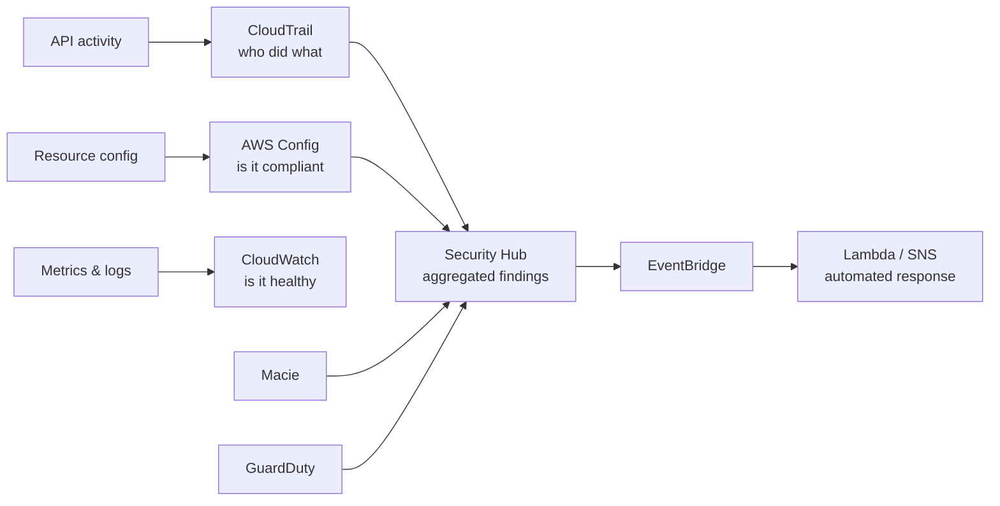

### CloudWatch for security

- **CloudWatch Logs** can be the destination for CloudTrail, which lets you set **metric filters** and alarm on patterns (root login, failed authentications, a specific `DeleteBucket` call)
- **Log group encryption** with KMS, and **retention settings** (default is never expire, which quietly costs money)
- Pattern worth remembering: CloudTrail → CloudWatch Logs → metric filter → alarm → SNS

---

## Network isolation: VPC endpoints

Scattered through the per-service notes below as "VPC Endpoint is provided through a gateway / interface." Here's the consolidated version, because the gateway-vs-interface distinction is directly tested.

The point: let resources in a **private subnet** reach AWS services **without** an internet gateway, NAT gateway, or public IP. Traffic stays on the AWS network.

| | **Gateway Endpoint** | **Interface Endpoint (PrivateLink)** |
|---|---|---|
| Services | **S3 and DynamoDB only** | Almost everything else |
| How it works | A **route table** entry (a prefix list) | An **ENI** with a private IP in your subnet |
| Cost | **Free** | ~$0.01/hour per AZ + data processing |
| Security control | Endpoint policy | Endpoint policy **+ security group** |
| On-premises access via VPN/DX | **No** | **Yes** |
| DNS | Prefix list, no DNS change | Private DNS overrides the public hostname |

Rules of thumb:

- **S3 and DynamoDB are free via gateway endpoints.** Use them. A Glue job or Lambda in a VPC hitting S3 through a NAT gateway is paying NAT data processing charges for nothing, and that's one of the most common AWS cost leaks
- **Interface endpoints** are what you need for Kinesis, SQS, SNS, KMS, Secrets Manager, Glue, Athena, Redshift Data API, CloudWatch Logs, and for reaching S3 from on-premises
- S3 also has an **interface** endpoint option, used when you need on-premises access or security-group control

**Endpoint policies** are the security win: restrict an endpoint so the VPC can only reach specific buckets. The mirror image is the bucket policy condition **`aws:SourceVpce`**, which locks a bucket to requests arriving through your endpoint. Together they give you "this data is only reachable from inside our network," which is what compliance questions are really asking for.

Gotcha from the Lambda notes: a **Lambda in a VPC has no internet access** without a NAT gateway, and that includes the public endpoints of AWS services. Either add VPC endpoints or accept the NAT cost.

---

## Per-service security deep dive

Every service follows the same four-part pattern, and it's worth reading the list that way rather than memorizing it service by service:

1. **Encryption in flight** (almost always TLS/HTTPS, occasionally JDBC with SSL)
2. **Encryption at rest** (almost always KMS)
3. **Authorization** (IAM policies, plus a resource policy where one exists)
4. **Network isolation** (VPC, security groups, VPC endpoints)

What varies, and therefore what gets tested, is **which services have a resource policy**, **which support IAM database authentication**, and **gateway vs interface endpoint**.

### Security - Kinesis

**Kinesis Data Streams**
- **SSL endpoints using the HTTPS protocol** for encryption in flight
- **AWS KMS provides server-side encryption** (encryption at rest)
- For **client-side encryption, you must use your own encryption libraries** (AWS provides nothing)
- Supported **Interface VPC Endpoints / PrivateLink** for private access
- **KCL must get read/write access to a DynamoDB table** (for checkpointing) and CloudWatch for metrics

**Amazon Data Firehose** (formerly Kinesis Data Firehose)
- Attach **IAM roles** so it can deliver to S3 / OpenSearch / Redshift / Splunk
- Can encrypt the delivery stream with **KMS** (server-side encryption)
- Supported **Interface VPC Endpoints / PrivateLink** for private access

**Managed Service for Apache Flink** (formerly Kinesis Data Analytics)
- Attach an **IAM role** so it can read from Kinesis Data Streams and reference sources, and write to an output destination (for example Amazon Data Firehose)

Gotchas worth knowing:

- **Server-side encryption on a stream applies to data written after you enable it.** Existing records in the retention window stay unencrypted, so a question about "all data must be encrypted" on an existing stream needs a new stream or a wait-out of the retention period
- Enabling KMS on a stream means **every `PutRecord` and `GetRecords` is a KMS call**, which counts against KMS throttle limits and costs money at high throughput
- The **KCL's DynamoDB table** is a real permissions trap: a consumer with perfect Kinesis permissions still fails if it can't create or write its lease table
- Firehose delivering into a **private OpenSearch domain in a VPC** needs the subnets and security group configured on the delivery stream

### Security - SQS

- Encryption in flight using the **HTTPS endpoint**
- **Server-side encryption using KMS**
- **IAM policy** must allow usage of SQS
- **SQS queue access policy** (resource-based)
- **Client-side encryption must be implemented manually**
- **VPC Endpoint is provided through an interface**

The queue access policy is what makes **S3 event notifications, SNS fan-out, and EventBridge** able to write to a queue. Those are services, not IAM principals in your account, so an IAM policy can't grant them anything. A failed S3-to-SQS notification is almost always a missing queue policy.

SSE-SQS uses an AWS managed key and is free. SSE-KMS with a CMK is what you need for cross-account or an audit trail, and it adds a KMS call per message batch.

### Security - IoT

- Attached to **X.509 certificates** or **Cognito Identities**
- Able to **revoke any device at any time**
- **IoT Policies are JSON documents**
- Can be **attached to groups** instead of individual Things
- **IAM Policies:**
  - Attached to users, groups or roles
  - Used for controlling **IoT AWS APIs**
- **Attach roles to the Rules Engine** so it can perform its actions

The split that gets tested: **IoT policies govern devices** (connect, publish, subscribe on MQTT topics), **IAM policies govern people and services** calling the IoT control-plane APIs. Two separate policy systems in one service.

Devices authenticate with certificates, not credentials, which is why revocation is per-certificate and instant.

### Security - Amazon S3

- **IAM policies**
- **S3 bucket policies**
- **Access Control Lists (ACLs)**
- Encryption in flight using **HTTPS**
- Encryption at rest:
  - **Server-side encryption: SSE-S3, SSE-KMS, SSE-C**
  - **Client-side encryption**, such as the Amazon S3 Encryption Client
- **Versioning + MFA Delete**
- **CORS** for protecting websites
- **VPC Endpoint is provided through a Gateway**
- **Glacier vault lock policies** to prevent deletes (**WORM**)

Current practice notes, since this is the most-changed service on the list:

- **ACLs are legacy.** New buckets have **Object Ownership = Bucket owner enforced**, which disables ACLs entirely, and AWS recommends policies instead. Keep ACLs in mind only for old buckets
- **Block Public Access** is on by default at the account and bucket level and overrides any policy or ACL that would make an object public. It's the first thing to check when something is unexpectedly inaccessible, and the first thing to check when something is unexpectedly public
- **Encryption at rest is now on by default** (SSE-S3) for all new objects. The question is no longer whether it's encrypted but which key
- **S3 Object Lock** is the modern WORM control for S3 (Governance mode, which admins can override, and Compliance mode, which nobody can), with **legal holds**. Glacier vault lock is the older Glacier-vault-only equivalent
- **MFA Delete** requires versioning, is configurable only by the **root user** via CLI, and blocks permanently deleting a version
- **Access Points** give each team or application its own policy and hostname against a shared bucket, which scales better than one enormous bucket policy

### Security - DynamoDB

- Data is encrypted in transit using **TLS (HTTPS)**
- **DynamoDB tables are encrypted at rest** (always, not optional)
  - KMS encryption for **base tables and secondary indexes**
  - **AWS owned key (default)**
  - AWS managed key, or **customer managed key** (your own)
- Access to tables / API / **DAX** using **IAM**
- **DynamoDB Streams are encrypted**
- **VPC Endpoint is provided through a Gateway**

The one feature worth adding: **fine-grained access control with IAM condition keys**. `dynamodb:LeadingKeys` restricts a principal to items whose partition key matches their identity, and `dynamodb:Attributes` restricts which attributes they can read or write. That's row-level and column-level security enforced by IAM, with no application code, and it's the answer to "each user may only access their own items."

Encryption at rest cannot be turned off. The only choice is the key type, and only a **customer managed key** gives you cross-account access and per-request CloudTrail.

### Security - RDS and Aurora

Nearly identical, so here's both with the difference called out.

- **VPC provides network isolation**
- **Security Groups control network access** to DB instances
- **KMS provides encryption at rest**
- **SSL provides encryption in flight**
- **IAM authentication** is supported by **PostgreSQL, MySQL, and MariaDB** (Aurora: PostgreSQL and MySQL)
- **Must manage user permissions within the database itself** (IAM gets you in the door, SQL grants decide what you can do)
- **MSSQL Server and Oracle support TDE** (Transparent Data Encryption) *(RDS only, not Aurora)*

The encryption gotcha that shows up constantly: **you cannot enable encryption on an existing unencrypted RDS instance.** The path is snapshot the instance, **copy the snapshot with encryption enabled**, restore from the encrypted copy, repoint the application. Same for turning encryption off, which you also can't do.

Further details:

- **Read replicas inherit the encryption** of the source. An encrypted primary cannot have an unencrypted replica
- **IAM database authentication** issues a **15-minute token** instead of a password, which eliminates stored credentials. The limit is roughly 200 new connections per second, so it fits applications with connection pooling, not ones that open a connection per request
- **`rds.force_ssl`** (PostgreSQL) and `require_secure_transport` (MySQL) are parameter-group settings that reject unencrypted connections
- **Automated backups and snapshots inherit the encryption** of the instance, which is why the cross-region/cross-account snapshot rules from the KMS section apply
- For DMS, an encrypted source is fine but **CDC requires logical replication settings** on the source, which is a separate concern from encryption

### Security - Lambda

- **IAM roles attached to each Lambda function** (the execution role) for:
  - **Sources** (what may invoke it)
  - **Targets** (what it may call)
- **KMS encryption for secrets**
- **SSM Parameter Store** for configurations
- **Deploy in a VPC** to access private resources

Two policies again, same shape as IAM roles generally:

| | Execution role | Resource-based policy |
|---|---|---|
| Controls | What the function **can call** | **Who can invoke** the function |
| Example | Read S3, write DynamoDB | S3, EventBridge, API Gateway, another account |

A failed S3 trigger is usually a missing **resource-based policy** (`lambda:InvokeFunction` for `s3.amazonaws.com`), not a missing execution role permission.

Environment variables are **encrypted at rest with KMS by default**. For a secret that other developers with console access shouldn't read, use **encryption helpers** so the value is ciphertext in the console and the function decrypts it at startup, or keep it in Secrets Manager.

VPC gotchas carried over from the compute notes: a function in a VPC has **no internet or public AWS endpoint access** without a NAT gateway or VPC endpoints, and the ENIs it creates count against your subnet's IP space.

### Security - Glue

- **IAM policies** for the Glue service
- Configure Glue to only access **JDBC through SSL**
- **Data Catalog:**
  - **Encrypted by KMS**
  - **Resource Policies to protect Data Catalog resources** (similar to an S3 bucket policy)
- **Connection passwords: encrypted by KMS**
- Data written by AWS Glue, via **Security Configurations:**
  - **S3 encryption mode:** SSE-S3 or SSE-KMS
  - **CloudWatch encryption mode**
  - **Job bookmark encryption mode**

Details that matter in practice:

- A **Security Configuration** is a reusable object you attach to a job, crawler, or dev endpoint. Without one, job output goes to S3 unencrypted even if the bucket has a default encryption policy backing you up. **Job bookmark encryption** matters because bookmarks can contain data values from your source
- The **Data Catalog resource policy** is how you share the catalog **cross-account**, and it's the layer Lake Formation sits on top of. Catalog encryption is a one-way door: once you enable it for a catalog, you can't disable it
- Glue's **execution role** needs S3 read on sources, S3 write on targets, `glue:*` on the catalog, CloudWatch Logs, and `kms:Decrypt`/`kms:GenerateDataKey` on any key involved. A `Job run failed` with a KMS error is almost always the missing `GenerateDataKey`
- **Connections** store JDBC credentials, either encrypted by KMS or, better, as a reference to a **Secrets Manager** secret
- A **Glue job that reads a private RDS instance** needs a connection with subnet and security group, a self-referencing security group rule, and a VPC endpoint (or NAT) for S3

For a lake, this is where **Lake Formation** takes over: instead of writing S3 bucket policies per team, you register the location with Lake Formation and grant table and column permissions. See the analytics notes for LF-Tags and data filters.

### Security - EMR

- Using an **Amazon EC2 key pair** for SSH credentials
- Attach **IAM roles to EC2 instances** for:
  - Proper S3 access
  - **EMRFS requests to S3**
  - DynamoDB scans through Hive
- **EC2 Security Groups:**
  - One for the **primary (master) node**
  - Another one for the **core and task nodes**
- **Kerberos authentication** (provides authentication from Active Directory)
- **Apache Ranger:** centralized authorization (**RBAC**, role-based access control), set up on an external EC2 instance

Worth adding:

- EMR uses **three** roles, and mixing them up is a classic debugging dead end: the **service role** (EMR managing the cluster), the **EC2 instance profile** (what jobs running on the cluster can reach), and the **Auto Scaling role**
- **EMRFS authorization** can map users to different IAM roles, so two users on the same cluster get different S3 access
- **Lake Formation integration** gives EMR fine-grained table and column permissions, which is the managed alternative to standing up Ranger
- **Block public access** for EMR is on by default and blocks a cluster with a security group open to 0.0.0.0/0
- Kerberos is about **authentication** (who you are), Ranger about **authorization** (what you may do). They're complementary, not alternatives, which is why hardened clusters run both

### Security - EMR encryption (security config)

- **At-rest data encryption for EMRFS:**
  - Encryption in Amazon S3 (**SSE-S3, SSE-KMS, client-side encryption**)
  - Encryption in local disks
- **At-rest data encryption for local disks:**
  - **Open-source HDFS encryption**
  - **EC2 Instance Store encryption:**
    - **NVMe encryption**, or **LUKS encryption**
  - **EBS volumes:**
    - **EBS encryption (KMS)** — **works with the root volume**
    - **LUKS encryption** — **does not work with the root volume**
- **In-transit encryption:**
  - Node-to-node communication
  - For EMRFS traffic between S3 and cluster nodes
  - **TLS encryption**

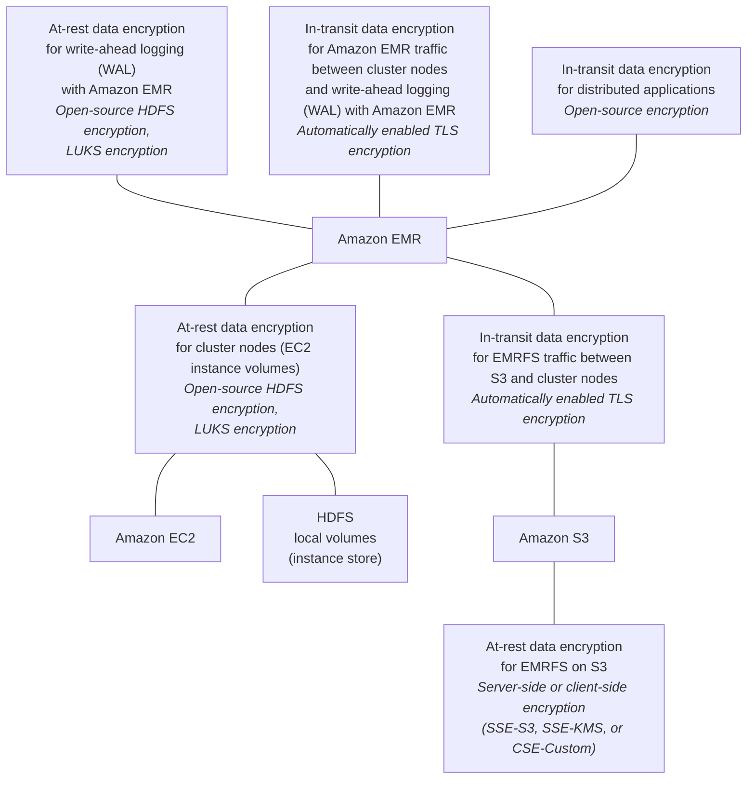

The one fact to carry out of that diagram: **LUKS does not encrypt the root volume, EBS encryption does.** If a question requires the root volume encrypted, the answer is EBS encryption with KMS.

Also: **local disk encryption and EMRFS encryption are configured separately.** "Encrypt the data EMR writes to S3" is EMRFS. "Encrypt the shuffle spills and HDFS on the nodes" is local disk. A compliance question saying "all data at rest" needs both, and in-transit TLS requires a **certificate provider** (a zipped PEM in S3, or a custom provider).

### Security - OpenSearch Service

- **Amazon VPC provides network isolation**
- **OpenSearch policy** (access policy) to manage security further
- Data security by **encrypting data at rest using KMS**
- **Encryption in transit using HTTPS (TLS)**
- **IAM or Cognito based authentication**
- **Amazon Cognito** allows end-users to log in to OpenSearch Dashboards through enterprise identity providers such as Microsoft Active Directory using **SAML**

Add **fine-grained access control (FGAC)**, which is what most real questions are about:

- Index-level, document-level, and **field-level** security, plus Dashboards multi-tenancy
- Requires **node-to-node encryption**, **encryption at rest**, and **HTTPS enforced**, all three, or you can't enable it
- Has its own internal user database, or maps IAM roles to OpenSearch roles

The deployment choice that gets tested: a **VPC domain** is reachable only from inside the VPC (plus VPN/Direct Connect), and that's the compliance answer. A **public domain** relies entirely on the access policy and IAM signing. **You cannot move a domain between the two** after creation, so it's a create-time decision.

### Security - Redshift

- **VPC provides network isolation**
- **Cluster security groups**
- **Encryption in flight using the JDBC driver enabled with SSL**
- **Encryption at rest using KMS or an HSM device** (must establish a connection)
- Supports **S3 SSE using the default managed key**
- **Use IAM Roles for Redshift** to access other AWS resources (for example S3 or KMS)
- Must be **referenced in the `COPY` or `UNLOAD` command** (alternatively paste access key and secret key credentials, which you should not do)

Additions:

- Modern practice is **`IAM_ROLE` with role chaining** in `COPY`/`UNLOAD`, or a **default IAM role** on the cluster so you can write `IAM_ROLE default`. Embedded credentials are the wrong answer on any exam question
- **Encryption at rest cannot be toggled in place on an older cluster**: you snapshot and restore into an encrypted cluster. (RA3 clusters can modify encryption, with a background migration.) Same shape as RDS
- **CloudHSM** is the "we must hold the keys in dedicated hardware" answer. KMS covers everything else
- **`require_ssl`** is a parameter-group setting that rejects non-SSL connections
- **Enhanced VPC Routing** forces `COPY`/`UNLOAD` traffic through your VPC, so it's subject to security groups, VPC endpoints, and flow logs instead of going out over the public path. This is the answer to "ensure all data loading traffic stays within our network"
- **Row-level security (RLS)** and **dynamic data masking** handle who sees which rows and which column values. **`GRANT`/`REVOKE`** at schema, table, and column level handles the rest
- **Redshift Spectrum** reads S3, so it needs an IAM role with S3 and Glue Catalog access, and it respects **Lake Formation** permissions when the catalog is managed there
- **Datashares** share live data across clusters and accounts with no copying, governed by `GRANT USAGE` on the datashare, and across accounts via AWS RAM

### Security - Athena

- **IAM policies** to control access to the service
- **Data is in S3:** IAM policies, bucket policies, and ACLs
- **Encryption of data according to S3 standards:** SSE-S3, SSE-KMS, CSE-KMS
- **Encryption in transit using TLS** between Athena and S3, and JDBC
- **Fine-grained access using the AWS Glue Catalog**

The thing to internalize: **Athena has no data of its own.** Every permission question decomposes into "may you call Athena," "may you read the Glue Catalog metadata," and "may you read the S3 objects." All three are required. A user with full `athena:*` and no `s3:GetObject` gets a permission error at query time, not at submit time.

- **Query results location** is a separate S3 prefix and often the overlooked leak: results contain the data. Encrypt it, and set a **workgroup** with `EnforceWorkGroupConfiguration` so users can't redirect results to an unencrypted bucket
- **Workgroups** are the isolation and cost boundary: per-workgroup result location, encryption, **data scan limits**, and CloudWatch metrics. Tag workgroups for cost allocation
- **Glue Catalog fine-grained access** means IAM policies on database and table resources (`glue:GetTable` on specific tables), which is coarser than Lake Formation. **Lake Formation** is what gives you column, row, and cell-level filtering
- **Federated queries** run a Lambda connector, so the **connector's execution role** is what reaches the external source. Audit it like any other role

### Security - QuickSight

- **Standard edition:**
  - IAM users
  - Email based accounts
- **Enterprise edition:**
  - **Active Directory**
  - **Federated login**
  - **Supports MFA**
  - **Encryption at rest and in SPICE**
- **Row Level Security (RLS)** to control which users can see which rows

Additions:

- **Column-level security (CLS)** is also Enterprise only, and so are RLS, encryption at rest, and VPC connectivity. The exam likes "which edition do I need," and the answer is almost always Enterprise
- **Private VPC access** works through an **ENI** that QuickSight creates in your VPC, which is how it reaches a private Redshift cluster or RDS instance without a public endpoint
- QuickSight needs its **own IAM permissions** to reach S3, Athena, and Redshift, granted in Manage QuickSight, not in your own user's policy. "QuickSight can't see my bucket" is nearly always this
- **SPICE is a copy of your data.** Row-level security applies to it, but it's still a duplicate sitting in QuickSight, which matters for data residency and for "the dashboard shows stale numbers" (the refresh schedule)
- **Namespaces** isolate groups of users entirely, which is the multi-tenancy answer for serving dashboards to external customers

---

## Decision cheat sheet

| Requirement | Answer |
|---|---|
| Service needs to act on your behalf | **IAM role**, never access keys |
| Explicit allow and explicit deny conflict | **Deny wins**, always |
| No policy mentions the action | **Implicit deny** |
| Block a region for the whole organization | **SCP** with `aws:RequestedRegion` |
| Let devs create roles safely | **Permissions boundary** |
| Generate a least-privilege policy from real usage | **IAM Access Analyzer** |
| Encrypt data larger than 4 KB | **Envelope encryption** (`GenerateDataKey`) |
| AWS must never see plaintext | **Client-side encryption** |
| Audit trail of every decrypt | **SSE-KMS** |
| Cheapest encryption at rest | **SSE-S3** (free, AWS owned key) |
| Share an encrypted snapshot cross-account | **Customer managed key** + key policy + `CreateGrant` |
| User has `kms:*` but gets AccessDenied | **Key policy** doesn't allow them |
| KMS throttling on many small S3 reads | **S3 Bucket Keys** |
| Decrypt in another region without re-encrypting | **Multi-Region Key** |
| Rotate a database password every 30 days | **Secrets Manager** |
| Store config cheaply (bucket names, flags) | **SSM Parameter Store** |
| Find PII you didn't know was in S3 | **Macie** |
| Transform PII out of a dataset, no code | **Glue DataBrew** |
| Hide columns or rows in the lake | **Lake Formation** data filters |
| Hide rows in Redshift | **Redshift RLS** |
| Each DynamoDB user sees only their own items | **IAM `dynamodb:LeadingKeys`** |
| Block SQL injection / XSS | **WAF** |
| Rate-limit abusive clients | **WAF rate-based rule** |
| Layer 3/4 DDoS, free and automatic | **Shield Standard** |
| DDoS Response Team, cost protection, managed WAF | **Shield Advanced** ($3,000/mo) |
| Static IP **and** Layer 7 firewall | **Global Accelerator + ALB + WAF** |
| Who deleted the S3 object | **CloudTrail data events** |
| Detect a bucket that became public | **AWS Config rule** (+ remediation) |
| Prevent a bucket from becoming public | **SCP** / **Block Public Access** |
| Detect credential exfiltration or crypto mining | **GuardDuty** |
| Find unpatched EC2 or container images | **Inspector** |
| One place for all security findings | **Security Hub** |
| Private S3 or DynamoDB access, no NAT cost | **Gateway endpoint** (free) |
| Private Kinesis / SQS / KMS / Secrets Manager access | **Interface endpoint** |
| Reach S3 privately from on-premises | **Interface endpoint** for S3 |
| Lock a bucket to your VPC only | Bucket policy with **`aws:SourceVpce`** |
| Force HTTPS on a bucket | Deny with **`aws:SecureTransport: false`** |
| Encrypt an existing unencrypted RDS cluster | **Snapshot, copy encrypted, restore** |
| Database login with no stored password | **IAM database authentication** (15-min token) |
| Keep Redshift `COPY` traffic inside the VPC | **Enhanced VPC Routing** |
| EMR root volume must be encrypted | **EBS encryption (KMS)**, not LUKS |
| EMR auth from Active Directory | **Kerberos** |
| EMR centralized authorization without Lake Formation | **Apache Ranger** |
| OpenSearch field-level security | **Fine-grained access control** (needs node-to-node + at-rest + HTTPS) |
| OpenSearch reachable only internally | **VPC domain** (create-time, irreversible) |
| QuickSight row or column security | **Enterprise edition** |
| Athena users can't redirect query results | **Workgroup** with enforced configuration |
| Cap how much data a query can scan | **Athena workgroup data scan limit** |
| Prove log files weren't tampered with | **CloudTrail log file validation** |
| WORM / immutable retention on S3 | **S3 Object Lock** (Compliance mode) |