# Networking and Content Delivery

How data moves between your resources, AWS services, on-prem, and users: VPC building blocks, private connectivity, hybrid links, DNS with Route 53, and caching with CloudFront. Plus the part the DEA exam actually leans on: how Glue, Lambda, Redshift, and EMR behave once you put them in a VPC. Exam tells inline, decision cheat sheet at the end.

## Contents

- [VPC basics](#vpc-basics)
  - [VPC and subnets](#vpc-and-subnets)
  - [VPC layout across AZs](#vpc-layout-across-azs)
  - [Route tables](#route-tables)
  - [Internet gateway and NAT gateway](#internet-gateway-and-nat-gateway)
- [Security groups, NACLs, and flow logs](#security-groups-nacls-and-flow-logs)
  - [NACLs and security groups](#nacls-and-security-groups)
  - [Security groups vs NACLs](#security-groups-vs-nacls)
  - [VPC Flow Logs](#vpc-flow-logs)
- [Connecting VPCs and AWS services](#connecting-vpcs-and-aws-services)
  - [VPC peering](#vpc-peering)
  - [Transit Gateway](#transit-gateway)
  - [VPC endpoints](#vpc-endpoints)
  - [Gateway vs interface endpoints](#gateway-vs-interface-endpoints)
  - [Locking a bucket to a VPC](#locking-a-bucket-to-a-vpc)
  - [AWS PrivateLink](#aws-privatelink-vpc-endpoint-services)
  - [Peering vs Transit Gateway vs PrivateLink](#peering-vs-transit-gateway-vs-privatelink)
- [Hybrid connectivity](#hybrid-connectivity)
  - [Site-to-Site VPN and Direct Connect](#site-to-site-vpn-and-direct-connect)
  - [VPN vs Direct Connect](#vpn-vs-direct-connect)
- [Networking for data services](#networking-for-data-services)
  - [Glue jobs in a VPC](#glue-jobs-in-a-vpc)
  - [Lambda in a VPC](#lambda-in-a-vpc)
  - [Redshift networking](#redshift-networking)
  - [EMR, DMS, and MWAA](#emr-dms-and-mwaa)
  - [NAT costs and endpoints](#nat-costs-and-endpoints)
- [VPC exam tells](#vpc-exam-tells)
- [DNS fundamentals](#dns-fundamentals)
  - [DNS terminology](#dns-terminology)
  - [Anatomy of a URL](#anatomy-of-a-url)
  - [How DNS works](#how-dns-works)
- [Amazon Route 53](#amazon-route-53)
  - [Records](#route-53-records)
  - [Record types](#route-53-record-types)
  - [CNAME vs Alias](#cname-vs-alias)
  - [Hosted zones](#route-53-hosted-zones)
  - [Public vs private hosted zones](#public-vs-private-hosted-zones)
  - [Routing policies](#route-53-routing-policies)
  - [Health checks](#route-53-health-checks)
  - [Route 53 Resolver for hybrid DNS](#route-53-resolver-for-hybrid-dns)
  - [Exam tells](#route-53-exam-tells)
- [Amazon CloudFront](#amazon-cloudfront)
  - [Origins](#cloudfront-origins)
  - [How a request flows](#how-a-cloudfront-request-flows)
  - [S3 as an origin](#s3-as-an-origin)
  - [ALB or EC2 as an origin](#alb-or-ec2-as-an-origin)
  - [Caching and TTLs](#caching-and-ttls)
  - [Cache invalidations](#cache-invalidations)
  - [Restricting access](#restricting-access)
  - [CloudFront vs S3 Cross-Region Replication](#cloudfront-vs-s3-cross-region-replication)
  - [CloudFront vs Global Accelerator](#cloudfront-vs-global-accelerator)
  - [Exam tells](#cloudfront-exam-tells)
- [Decision cheat sheet](#decision-cheat-sheet)

---

## VPC basics

### VPC and subnets

- **VPC (Virtual Private Cloud)**: a private network to deploy your resources. **Regional** resource
- **Subnet**: a partition of the VPC's IP range. **AZ-scoped**, a subnet lives in exactly one AZ
- **Public subnet**: has a route to an internet gateway, so resources with a public IP are reachable from the internet
- **Private subnet**: no route to an internet gateway. Not reachable from the internet
- **Route tables** decide where traffic goes, both to the internet and between subnets

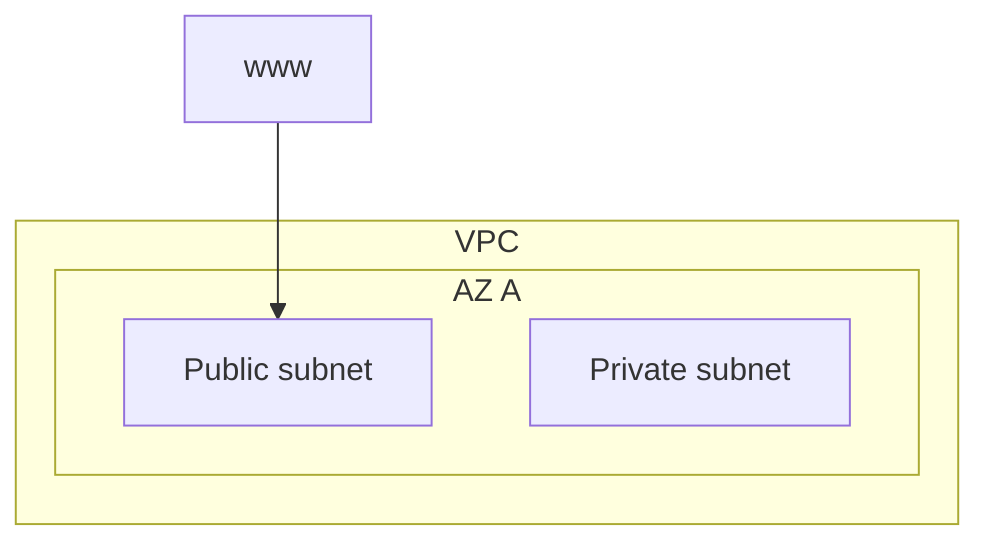

"Public" and "private" aren't settings on the subnet. The only difference is the route table: a `0.0.0.0/0` route to an internet gateway makes it public.

### VPC layout across AZs

- **AWS Cloud** > **Region** > **VPC**
- **VPC CIDR range:** `10.0.0.0/16` (65,536 IPs). Each subnet takes a slice, like `10.0.1.0/24`
- The VPC spans every AZ in the region, subnets don't
- Standard layout is **one public and one private subnet per AZ**, for high availability

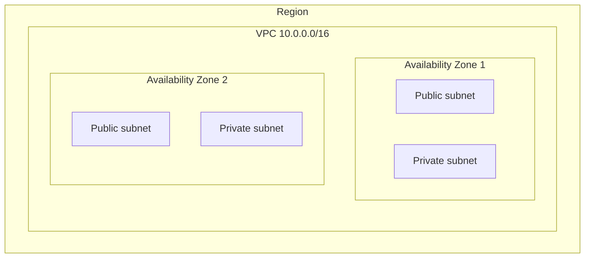

AWS reserves **5 IPs per subnet** (first four and the last one), so a `/24` gives you 251 usable addresses, not 256. Matters when Glue or Lambda chew through ENIs in a small subnet.

### Route tables

- Every subnet is associated with exactly one route table
- Every route table has a `local` route for the VPC CIDR, so all subnets can reach each other by default
- Typical routes:

| Destination | Target | Meaning |
|---|---|---|
| `10.0.0.0/16` | `local` | Anything in the VPC |
| `0.0.0.0/0` | `igw-...` | Internet, makes the subnet public |
| `0.0.0.0/0` | `nat-...` | Internet egress for a private subnet |
| `pl-...` (S3 prefix list) | `vpce-...` | S3 through a gateway endpoint |

### Internet gateway and NAT gateway

- **Internet gateway (IGW)**: attached at the **VPC level**, gives the VPC a path to the internet. One per VPC. Public subnets route `0.0.0.0/0` to it
- **NAT gateway** (AWS-managed) and **NAT instance** (self-managed EC2): let instances in **private subnets** reach the internet **outbound only**, while staying unreachable from outside

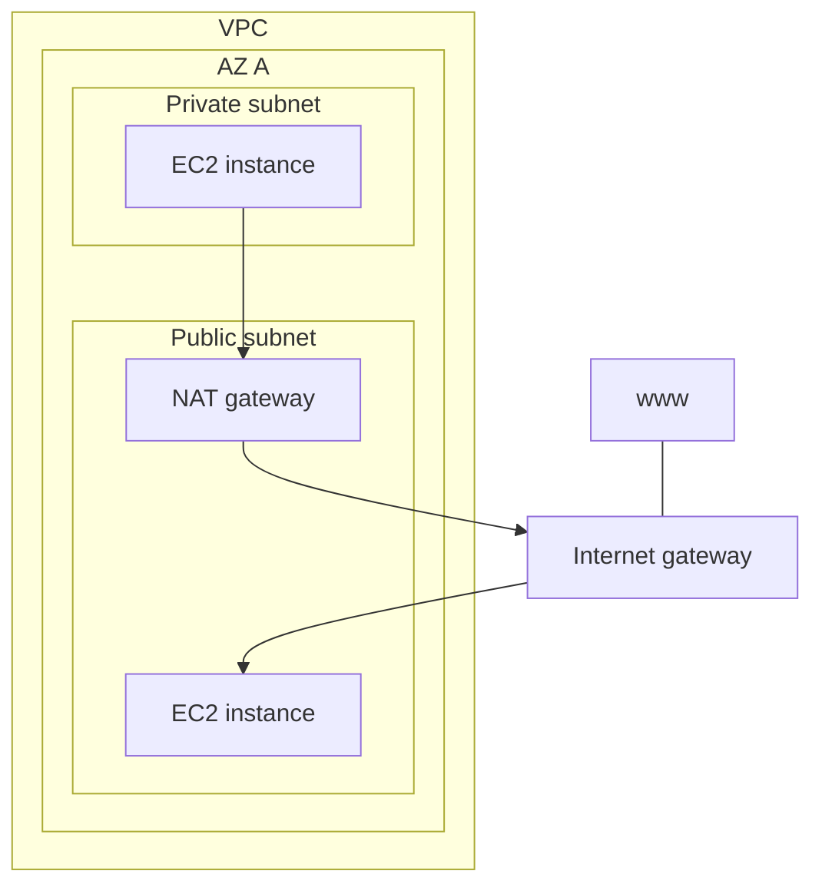

NAT gateway details that show up in questions:

- Lives in a **public subnet** and has an **Elastic IP**
- It's **AZ-scoped**. One NAT gateway in AZ A means private subnets in AZ B lose internet if AZ A goes down. HA means **one per AZ**
- Billed **per hour and per GB processed**. That per-GB charge is why S3 traffic through NAT gets expensive (see [NAT costs and endpoints](#nat-costs-and-endpoints))
- Outbound only. Nothing on the internet can start a connection through it

---

## Security groups, NACLs, and flow logs

### NACLs and security groups

- **Network ACL (NACL)**
  - A firewall controlling traffic to and from a **subnet**
  - Can have `ALLOW` and `DENY` rules
  - Rules reference **IP ranges (CIDR)**, ports, and protocols
- **Security group**
  - A firewall controlling traffic to and from **an ENI / EC2 instance**
  - Only `ALLOW` rules. Anything not allowed is denied
  - Rules reference **IP ranges and other security groups**

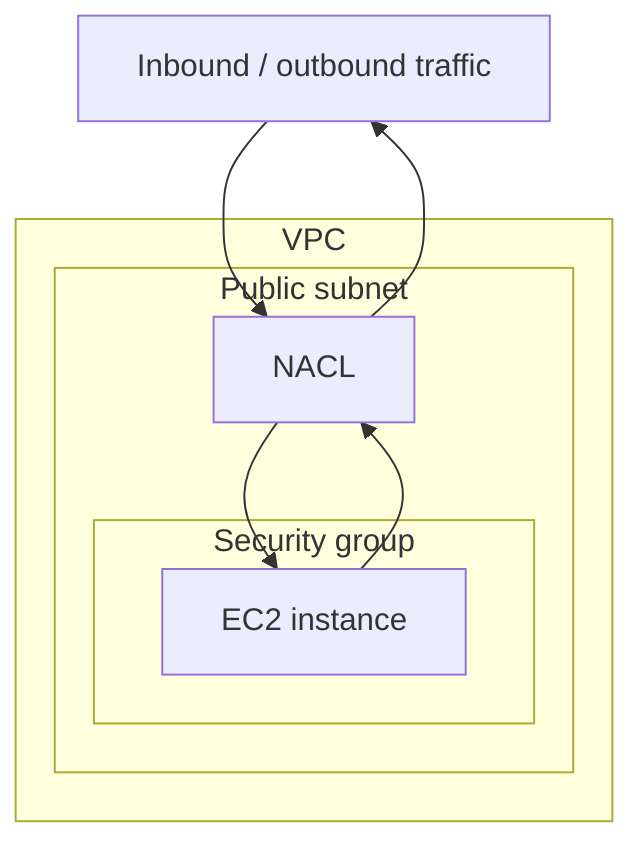

Traffic passes the NACL at the subnet boundary first, then the security group at the instance. Both have to allow it.

### Security groups vs NACLs

| Security group | Network ACL |
|---|---|
| Operates at the **instance (ENI) level** | Operates at the **subnet level** |
| **Allow rules only** | **Allow and deny** rules |
| **Stateful**: return traffic is automatically allowed, regardless of rules | **Stateless**: return traffic must be explicitly allowed |
| **All rules** are evaluated before deciding | Rules processed in **number order**, first match wins |
| Applies only to instances it's attached to | **Applies to everything** in the associated subnets |
| Can reference other security groups | IP ranges only |

The two rows that decide exam questions:

- **Block a specific IP**: only a NACL can, because security groups have no deny
- **Stateless trap**: a NACL that allows inbound `443` but has no outbound rule for **ephemeral ports (1024-65535)** breaks the connection, since the response leaves on a high port. Security groups don't have this problem

Referencing a security group instead of an IP is the clean way to say "only my ALB can talk to these instances" or "only my Glue job can talk to this RDS instance."

### VPC Flow Logs

- Capture information about IP traffic **going to and from** your network interfaces, at three levels:
  - **VPC** flow logs
  - **Subnet** flow logs
  - **ENI** flow logs
- Help monitor and troubleshoot connectivity:
  - Subnets to the internet
  - Subnets to subnets
  - Internet to subnets
- Also capture traffic from AWS-managed interfaces: ELB, ElastiCache, RDS, Aurora, etc.
- Destinations: **S3, CloudWatch Logs, and Amazon Data Firehose**

Flow logs record **metadata** (source/destination IP and port, protocol, bytes, `ACCEPT`/`REJECT`), not packet contents.

Data engineering angle: flow logs landing in S3 are a classic Athena use case. AWS can write them as **Parquet with Hive-compatible partitions**, which makes them cheap to query. A `REJECT` row tells you a security group or NACL blocked it. Two `REJECT`s where you expected one `ACCEPT` usually points at a stateless NACL missing its return rule.

---

## Connecting VPCs and AWS services

### VPC peering

- Connect two VPCs privately over AWS's network
- They behave as if they were one network
- **CIDRs must not overlap**
- **Not transitive**: A-B and A-C doesn't let B reach C. Every pair that needs to talk needs its own peering
- Works **cross-account and cross-region**
- You still have to **update route tables** on both sides

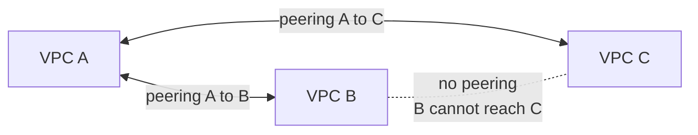

### Transit Gateway

- **Hub and spoke**: every VPC (and VPN or Direct Connect) attaches to one transit gateway
- **Transitive** routing, unlike peering
- Scales to thousands of VPCs, works cross-account via Resource Access Manager

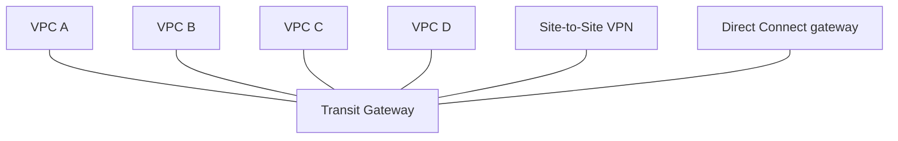

Exam tell: "dozens of VPCs and on-prem all need to talk to each other" is Transit Gateway. Peering would need a connection for every pair (n(n-1)/2).

### VPC endpoints

- Connect to AWS services over **AWS's private network** instead of the public internet
- Better security (no IGW or NAT needed) and lower latency
- **Gateway endpoint**: S3 and DynamoDB only
- **Interface endpoint**: most services (including S3 and DynamoDB), built on PrivateLink
- Gateway endpoints are **only usable from inside your VPC**

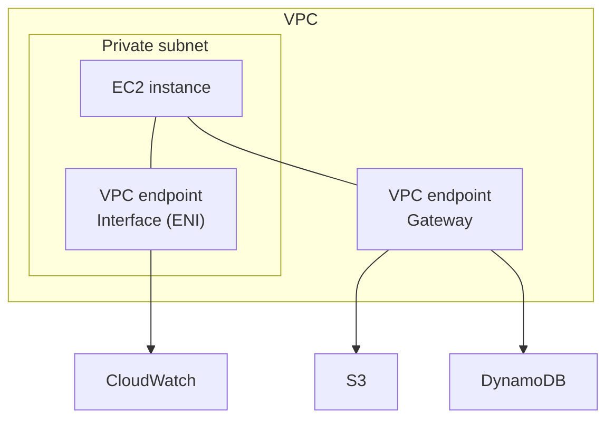

### Gateway vs interface endpoints

| | Gateway endpoint | Interface endpoint |
|---|---|---|
| Services | **S3 and DynamoDB only** | Most AWS services, plus S3 and DynamoDB |
| How it works | A **route table entry** pointing at a prefix list | An **ENI with a private IP** in your subnet |
| Cost | **Free** | Per hour per AZ, plus per GB |
| Security | Endpoint policy | Endpoint policy **and security groups** |
| Reachable from on-prem / peered VPCs | **No** | **Yes** (over VPN or Direct Connect) |
| DNS | Uses the normal public service name | Private DNS name resolves to the ENI IP |

Default pick: **gateway endpoint for S3 and DynamoDB from inside the VPC**, it's free. Pick the **interface endpoint for S3** only when on-prem or another VPC needs to reach S3 privately through your network.

Interface endpoints you'll see in data pipelines: Glue, Kinesis Data Streams, Firehose, Athena, STS, KMS, Secrets Manager, CloudWatch Logs, SQS, SNS.

### Locking a bucket to a VPC

Endpoints have their own **endpoint policy** (what can go through this endpoint), and S3 bucket policies can require traffic to come **from** a specific endpoint:

```json
{
  "Version": "2012-10-17",
  "Statement": [
    {
      "Sid": "DenyUnlessFromMyEndpoint",
      "Effect": "Deny",
      "Principal": "*",
      "Action": "s3:*",
      "Resource": [
        "arn:aws:s3:::curated-data-lake",
        "arn:aws:s3:::curated-data-lake/*"
      ],
      "Condition": {
        "StringNotEquals": { "aws:SourceVpce": "vpce-0abc123def456" }
      }
    }
  ]
}
```

- `aws:SourceVpce`: must come through this endpoint
- `aws:SourceVpc`: must come through any endpoint in this VPC
- `aws:SourceIp` **doesn't work** for endpoint traffic, since requests arrive with private IPs. Classic wrong answer

Careful: this deny also blocks you in the console, since the console doesn't go through the endpoint.

### AWS PrivateLink (VPC endpoint services)

- Most secure and scalable way to **expose a service to thousands of VPCs**
- No VPC peering, internet gateway, NAT, or route table changes
- Needs a **Network Load Balancer** in the service provider's VPC and an **ENI (interface endpoint)** in the consumer's VPC
- Overlapping CIDRs are fine, since the consumer only sees the ENI's IP

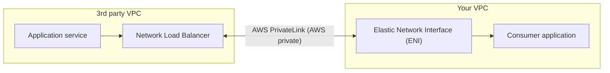

- Connections are **one direction**: consumer initiates, provider responds. The provider can't reach into your VPC
- Interface endpoints for AWS services are PrivateLink under the hood, AWS is just the provider
- SaaS vendors (Snowflake, Datadog, Salesforce for AppFlow) offer PrivateLink so your data never touches the internet

### Peering vs Transit Gateway vs PrivateLink

| | VPC peering | Transit Gateway | PrivateLink |
|---|---|---|---|
| Shape | Pair to pair | Hub and spoke | Service to consumers |
| Transitive | No | Yes | N/A |
| Overlapping CIDRs | No | No | **Yes** |
| Exposes | The whole VPC | Whole VPCs, controlled by route tables | **One service** behind an NLB |
| Best for | A few VPCs | Many VPCs + on-prem | Sharing one service with many VPCs/accounts |

---

## Hybrid connectivity

### Site-to-Site VPN and Direct Connect

- **Site-to-Site VPN**
  - Connects an on-premises network to AWS
  - **Encrypted** automatically (IPsec)
  - Goes over the **public internet**
  - Set up in minutes
- **Direct Connect (DX)**
  - A **physical, dedicated connection** between on-premises and AWS
  - **Private, consistent, high bandwidth** (1, 10, 100 Gbps dedicated)
  - Goes over a **private network**
  - **Takes weeks to a month or more to set up**
  - **Not encrypted by default**

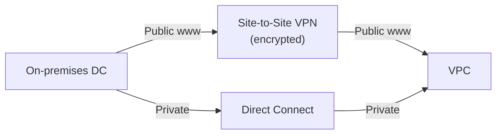

### VPN vs Direct Connect

| | Site-to-Site VPN | Direct Connect |
|---|---|---|
| Path | Public internet | Private dedicated line |
| Encryption | Yes, IPsec | **No by default** (add VPN over DX, or MACsec) |
| Setup time | Minutes | Weeks to months |
| Bandwidth | Limited, variable | High, consistent |
| Cost | Low | Higher (port hours + data out) |

Combos that show up:

- **Encrypted and private**: run a **VPN over Direct Connect**
- **Need it now, DX is coming**: VPN today, migrate to DX later
- **Resilient**: DX primary, VPN as backup

Exam tell: "migrate 100 TB from on-prem in a week" is **Snowball**, not DX. DX takes too long to provision and the bandwidth math rarely works for a one-time bulk move. "Ongoing, consistent high-throughput replication from on-prem" is DX (often with DMS or DataSync over it).

---

## Networking for data services

This is where networking shows up on the DEA exam: not "design a VPC," but "my Glue job can't reach X, why?"

### Glue jobs in a VPC

When a Glue job uses a **connection** (JDBC to RDS/Redshift, or a Network connection), Glue launches ENIs in the connection's subnet. Then:

- The subnet needs a path to **S3**, since Glue reads scripts and writes data there. Use an **S3 gateway endpoint** (or NAT)
- The **security group must have a self-referencing inbound rule** allowing all TCP from itself. Glue workers talk to each other through it, and the job fails without it
- Glue ENIs get **private IPs only**, so internet access (like a public API) needs a **NAT gateway**
- Other AWS APIs the job calls (Secrets Manager, KMS, CloudWatch Logs) need NAT or interface endpoints
- Small subnets run out of IPs: each worker consumes one

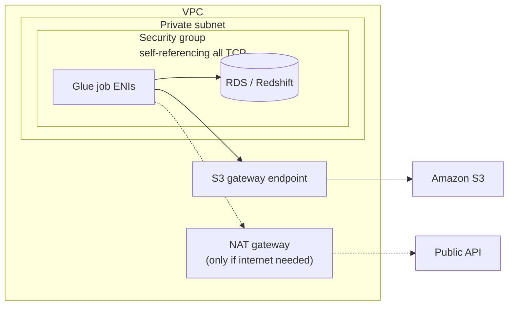

Exam tell: "Glue job with a JDBC connection fails to reach S3" is a missing **S3 VPC endpoint**. "Glue connection test fails" is usually the **self-referencing security group rule**.

### Lambda in a VPC

- By default Lambda runs in an AWS-managed VPC with internet access
- Attach it to your VPC and it can reach private resources (RDS, Redshift, ElastiCache) but **loses internet access**
- Even in a public subnet, Lambda ENIs get **no public IP**, so an IGW alone doesn't help
- Fix: put it in a **private subnet with a route to a NAT gateway**, and/or add **VPC endpoints** for the AWS services it calls
- Only attach Lambda to a VPC when it actually needs private resources

### Redshift networking

- **Enhanced VPC Routing**: forces `COPY` and `UNLOAD` traffic through your VPC instead of the public internet. Turn it on and Redshift then needs an **S3 gateway endpoint** (or NAT) or `COPY` breaks
- **Publicly accessible** setting controls whether the cluster gets a public IP. Default answer for a data warehouse is no
- **Redshift-managed VPC endpoints** let other VPCs or accounts reach the cluster privately without peering
- Clients outside AWS (BI tools on-prem) reach a private cluster over VPN or DX

Exam tell: "ensure COPY traffic between Redshift and S3 never leaves the VPC" is **Enhanced VPC Routing + S3 gateway endpoint**.

### EMR, DMS, and MWAA

- **EMR in a private subnet** needs an **S3 gateway endpoint** (EMR reads and writes S3 constantly, and uses it for logs) plus interface endpoints or NAT for other services
- **DMS** replication instances run in a VPC. On-prem sources come in over **VPN or DX**. Replication instance and endpoints need security group access to source and target ports
- **MWAA** private web server mode needs VPN, DX, or a bastion to reach the Airflow UI. Workers need NAT or endpoints to reach the services DAGs call

### NAT costs and endpoints

- NAT gateway charges **per GB processed**. A Glue or EMR job moving terabytes to S3 through NAT pays that on every byte
- An **S3 gateway endpoint is free** and takes that traffic off the NAT
- Same for DynamoDB

Exam tell: "reduce data transfer cost for EC2/EMR/Glue in a private subnet reading from S3" is **S3 gateway endpoint**.

---

## VPC exam tells

| Scenario | Answer |
|---|---|
| Private subnet instances need outbound internet | NAT gateway (in a public subnet) |
| NAT survives an AZ failure | One NAT gateway per AZ |
| Block one malicious IP | NACL deny rule |
| Only the ALB / Glue job may reach this resource | Security group referencing the source SG |
| Inbound allowed but connection still hangs | Stateless NACL missing outbound ephemeral ports |
| Troubleshoot rejected traffic | VPC Flow Logs (query with Athena) |
| Private access to S3 or DynamoDB from a VPC | Gateway endpoint (free) |
| Private access to Kinesis, Glue, KMS, Secrets Manager | Interface endpoint |
| On-prem needs private access to S3 | S3 interface endpoint over VPN/DX |
| Bucket only accessible from my VPC | Bucket policy with `aws:SourceVpce` / `aws:SourceVpc` |
| Glue job with a JDBC connection can't reach S3 | S3 VPC endpoint |
| Glue connection test fails | Self-referencing SG rule (all TCP) |
| Lambda in a VPC can't reach the internet | Private subnet + NAT gateway |
| Redshift COPY must stay in the VPC | Enhanced VPC Routing + S3 endpoint |
| Cut NAT costs on S3 traffic | S3 gateway endpoint |
| Connect two VPCs | VPC peering |
| Connect many VPCs and on-prem | Transit Gateway |
| Expose one service to many VPCs, overlapping CIDRs | PrivateLink |
| Encrypted connection to on-prem, quickly | Site-to-Site VPN |
| Consistent, high-bandwidth private link | Direct Connect |
| Private and encrypted | VPN over Direct Connect |

---

## DNS fundamentals

- **Domain Name System**: translates human-friendly hostnames into IP addresses, the backbone of the internet
- Hierarchical naming:
  - `.com`
  - `example.com`
  - `www.example.com`
  - `api.example.com`

### DNS terminology

- **Domain registrar**: where you buy the domain. Route 53, GoDaddy, ...
- **DNS records**: A, AAAA, CNAME, NS, ...
- **Zone file**: contains the DNS records for a domain
- **Name server**: resolves DNS queries (authoritative or non-authoritative)
- **Top Level Domain (TLD)**: `.com`, `.us`, `.in`, `.gov`, `.org`, ...
- **Second Level Domain (SLD)**: `amazon.com`, `google.com`, ...

### Anatomy of a URL

**URL:** `http://api.www.example.com.`

- **Protocol:** `http`
- **FQDN (Fully Qualified Domain Name):** `api.www.example.com.`
  - **Sub domain:** `www.example.com.`
    - **SLD (Second Level Domain):** `example.com.`
      - **TLD (Top Level Domain):** `com.`
        - **Root:** `.` (the trailing dot)

### How DNS works

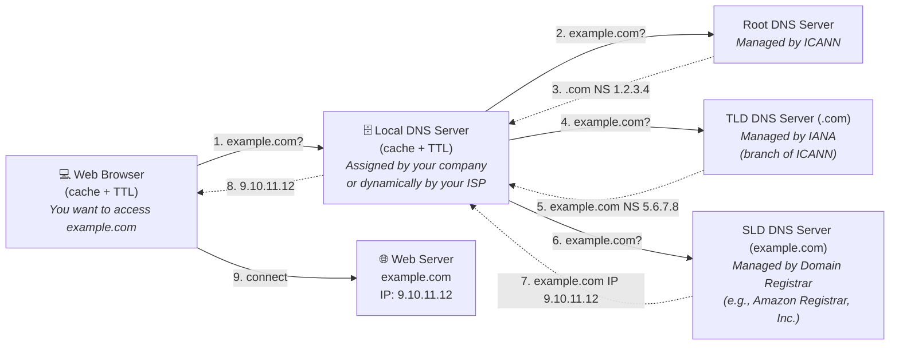

1. **Browser asks the Local DNS Server.** You type `example.com`. The browser checks its own cache first. If there's nothing cached (or the TTL expired), it asks the Local DNS Server for the IP
2. **Local DNS asks the Root.** The Local DNS Server checks its own cache too. On a miss, it starts at the top of the hierarchy with a Root DNS Server
3. **Root points to the TLD.** The Root doesn't know example.com, but knows who handles `.com`: `.com NS 1.2.3.4`
4. **Local DNS asks the TLD server** about example.com
5. **TLD points to the SLD.** It doesn't have the IP either, but knows which name server is authoritative for example.com: `example.com NS 5.6.7.8`
6. **Local DNS asks the SLD server**, the authoritative one for example.com
7. **SLD returns the actual IP:** `example.com IP 9.10.11.12`
8. **Local DNS answers the browser.** It caches the result for the record's TTL and returns `9.10.11.12`. The browser caches it too
9. **Browser connects to the web server** at `9.10.11.12` directly. DNS is done

Key takeaways:

- Each server only knows the **next step down**. Root → TLD → SLD narrows it level by level
- **Caching + TTL** is why the full chain rarely runs. High TTL = fewer lookups, but changes propagate slowly. Low TTL = changes show up fast, but more DNS traffic (and more billed Route 53 queries)
- **Route 53 plays the SLD (authoritative) role** for your domains, hosting records in a hosted zone. If you also register the domain through AWS, Amazon Registrar is the registrar

---

## Amazon Route 53

- Highly available, scalable, fully managed, **authoritative** DNS
  - Authoritative = you (the customer) can update the DNS records
- Also a **domain registrar**
- Can **health check** your resources
- The only AWS service with a **100% availability SLA**
- Why "53"? Port 53 is the traditional DNS port

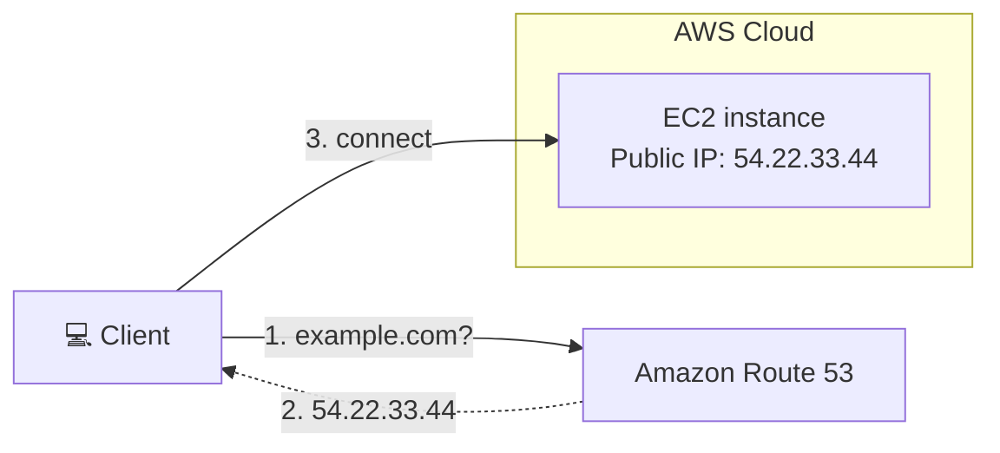

### Route 53 records

- Define how you route traffic for a domain
- Each record contains:
  - **Domain/subdomain name**: e.g. `example.com`
  - **Record type**: e.g. A or AAAA
  - **Value**: e.g. `12.34.56.78`
  - **Routing policy**: how Route 53 responds to queries
  - **TTL**: how long the record is cached at DNS resolvers
- Supported record types:
  - **Must know**: A / AAAA / CNAME / NS
  - Advanced: CAA / DS / MX / NAPTR / PTR / SOA / TXT / SPF / SRV

### Route 53 record types

- **A**: hostname to IPv4
- **AAAA**: hostname to IPv6
- **CNAME**: hostname to another hostname
  - The target must ultimately resolve to an A or AAAA record
  - **Can't be created at the zone apex** (top node of the namespace)
  - Example: not allowed for `example.com`, allowed for `www.example.com`
- **NS**: name servers for the hosted zone. Control how traffic is routed for the domain

### CNAME vs Alias

**Alias** is Route 53's own extension, and the answer to the CNAME apex limitation.

| | CNAME | Alias |
|---|---|---|
| Points to | Any hostname | **AWS resources** (and records in the same zone) |
| Zone apex (`example.com`) | **No** | **Yes** |
| Query cost | Charged | **Free** for alias to AWS resources |
| TTL | You set it | Set by Route 53, not configurable |
| Native health check | No | Yes, can evaluate target health |

Alias targets: ELB (ALB/NLB), CloudFront, API Gateway, S3 static website, Elastic Beanstalk, Global Accelerator, VPC interface endpoints, another record in the same zone.

**Can't alias to an EC2 DNS name.** Use an A record with the IP, or put a load balancer in front.

Exam tell: "point `example.com` (the root) at a CloudFront distribution or ALB" is an **Alias record**. CNAME at the apex is the trap.

### Route 53 hosted zones

- A container for records that define how to route traffic to a domain and its subdomains
- **Public hosted zone**: routes traffic on the internet (public domain names)
- **Private hosted zone**: routes traffic within one or more VPCs (private domain names, like `application1.company.internal`)
- **$0.50 per month per hosted zone**

### Public vs private hosted zones

#### Public hosted zone

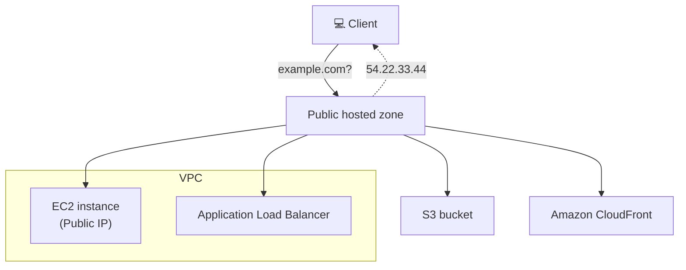

#### Private hosted zone

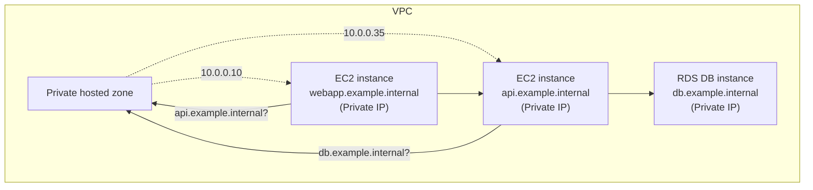

- **Public hosted zone**: answers queries from anywhere on the internet. Routes to public-facing resources like S3, CloudFront, EC2 with a public IP, and ALBs
- **Private hosted zone**: only answers queries from **inside the VPCs you associate with it**. Internal names (like `*.example.internal`) resolve to private IPs. Requires **`enableDnsHostnames` and `enableDnsSupport`** on the VPC

Practical win: point `db.example.internal` at your RDS endpoint and Glue connections, Lambda, and EC2 all use the friendly name. Swap the database and only the record changes.

### Route 53 routing policies

The routing policy decides **what answer Route 53 returns**. It doesn't route the traffic itself, the client does after resolving.

| Policy | What it does | Use for |
|---|---|---|
| **Simple** | Returns one or more values, no health checks | A single resource |
| **Weighted** | Splits answers by weight (e.g. 90/10) | Canary deploys, A/B tests |
| **Latency-based** | Returns the region with lowest latency to the user | Multi-region apps |
| **Failover** | Primary/secondary, switches when the primary health check fails | Active-passive DR |
| **Geolocation** | Answers based on the user's country/continent | Compliance, localized content |
| **Geoproximity** | Based on distance, with a **bias** to shift traffic | Gradually moving load between regions |
| **IP-based** | Answers based on the client's IP CIDR | Routing specific ISPs or networks |
| **Multi-value answer** | Up to 8 healthy records, client picks | Simple client-side load balancing (not an ELB replacement) |

Geolocation vs latency is the common mix-up: **geolocation is about where the user is** (rules, compliance), **latency is about which region is fastest** (performance).

### Route 53 health checks

- **Endpoint health checks**: health checkers around the world hit your endpoint (HTTP, HTTPS, TCP)
- **Calculated health checks**: combine several child checks with AND/OR/threshold
- **CloudWatch alarm health checks**: for **private resources**, since health checkers live on the public internet and can't reach into a VPC
- Health checks drive **failover**, and can trigger CloudWatch alarms and SNS notifications

### Route 53 Resolver for hybrid DNS

Route 53 Resolver is the DNS server built into every VPC (at the VPC CIDR base +2). For hybrid setups:

- **Inbound endpoint**: on-prem DNS servers forward queries **into** AWS, so on-prem can resolve private hosted zone names
- **Outbound endpoint**: forwarding rules send queries for on-prem domains **out** to your on-prem DNS

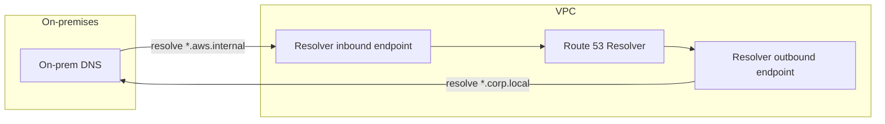

Exam tell: "on-prem apps can't resolve private hosted zone names over Direct Connect" is a **Resolver inbound endpoint**.

### Route 53 exam tells

| Scenario | Answer |
|---|---|
| Point the zone apex at an ALB or CloudFront | Alias record |
| Point `www` at another hostname outside AWS | CNAME |
| Internal names for resources in a VPC | Private hosted zone |
| Private hosted zone not resolving | Enable `enableDnsHostnames` and `enableDnsSupport` |
| Send 10% of traffic to a new version | Weighted routing |
| Lowest latency region for global users | Latency-based routing |
| Users in a country must hit a specific region | Geolocation routing |
| Active-passive DR | Failover routing + health checks |
| Health check a private resource | CloudWatch alarm-based health check |
| On-prem resolves AWS private names | Resolver inbound endpoint |
| AWS resolves on-prem names | Resolver outbound endpoint + forwarding rule |
| DNS changes take too long to propagate | Lower the TTL ahead of the change |

---

## Amazon CloudFront

- Content Delivery Network (CDN)
- **Improves read performance, content is cached at the edge**
- Improves user experience
- Hundreds of Points of Presence globally (edge locations and regional edge caches)
- **DDoS protection** (because it's spread worldwide), integrates with **AWS Shield** and **AWS WAF**

### CloudFront origins

- **S3 bucket**
  - Distribute files and cache them at the edge
  - Upload files to S3 through CloudFront
  - Secured with **Origin Access Control (OAC)**
- **VPC origin**
  - Applications in **private subnets**: private ALB, NLB, or EC2 instances
- **Custom origin (HTTP)**
  - S3 static website endpoint (enable static website hosting first)
  - Any public HTTP backend (e.g. a public ALB)

OAC works with the **S3 REST endpoint, not the S3 website endpoint**. If the bucket is set up as a static website, it's a custom origin and OAC doesn't apply. OAC replaced the older **Origin Access Identity (OAI)**, which still shows up in older questions.

### How a CloudFront request flows

Example request from the client:

```http
GET /beach.jpg?size=300x300 HTTP/1.1
User-Agent: Mozilla/4.0 (compatible; MSIE5.01; Windows NT)
Host: www.example.com
Accept-Encoding: gzip, deflate
```

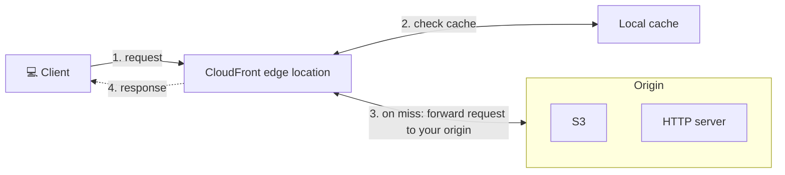

The request hits the nearest edge location. If the object is cached, it's returned immediately. On a miss, the edge forwards the request to the origin (S3 or any HTTP server), caches the response, and returns it. Later requests for the same object are served from the edge.

### S3 as an origin

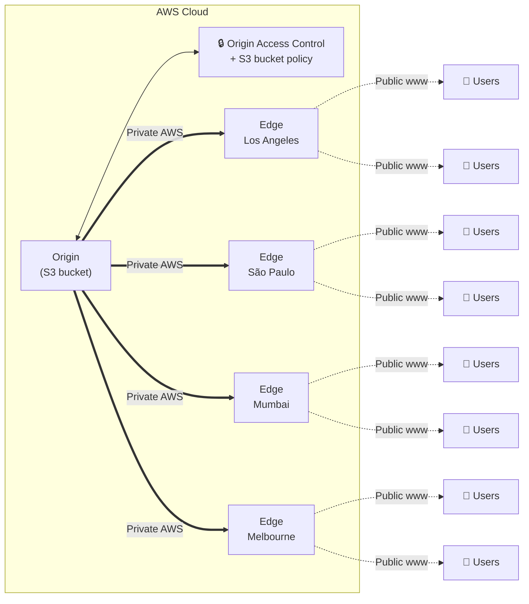

Users hit their nearest edge over the public internet. Each edge pulls from the single S3 origin over AWS's private network and caches locally. **OAC plus a bucket policy** lets only CloudFront read the bucket, so users can't bypass CloudFront and hit S3 directly.

The bucket policy grants `s3:GetObject` to the `cloudfront.amazonaws.com` service principal, conditioned on your distribution's ARN:

```json
{
  "Effect": "Allow",
  "Principal": { "Service": "cloudfront.amazonaws.com" },
  "Action": "s3:GetObject",
  "Resource": "arn:aws:s3:::my-bucket/*",
  "Condition": {
    "StringEquals": {
      "AWS:SourceArn": "arn:aws:cloudfront::123456789012:distribution/EDFDVBD6EXAMPLE"
    }
  }
}
```

If the bucket uses **SSE-KMS**, the KMS key policy also has to let CloudFront decrypt. OAC supports this, OAI didn't.

### ALB or EC2 as an origin

#### Using VPC origins (private)

- Deliver content from apps in **private subnets**, no need to expose them to the internet
- Works with **private ALB, NLB, and EC2 instances**

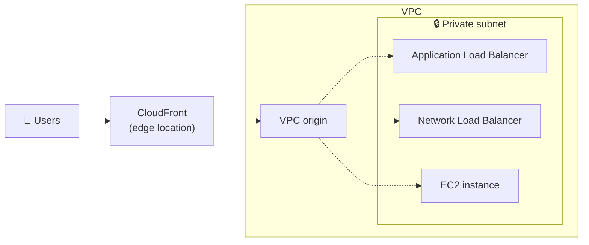

This is now the preferred option: nothing in the path is public.

#### Using the public network

**EC2 as an origin**

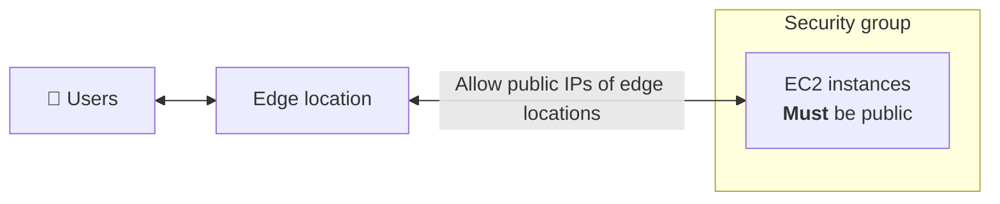

**ALB as an origin**

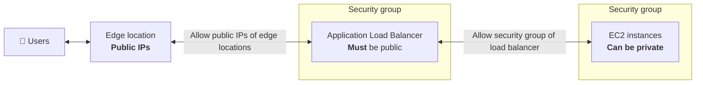

- The public origin's security group must allow CloudFront's edge IPs. Use the AWS-managed **prefix list `com.amazonaws.global.cloudfront.origin-facing`** instead of maintaining the IP list by hand
- Behind an ALB, instances stay private and only allow the ALB's security group
- Still public, so anyone could hit the ALB directly. A common hardening trick is a secret custom header that CloudFront adds and the ALB checks. VPC origins make this unnecessary

### Caching and TTLs

- The **cache key** decides what counts as "the same object": by default the URL path, optionally plus query strings, headers, or cookies
- Every extra element in the cache key **lowers the cache hit ratio**. Only include what actually changes the response (`?size=300x300` should be in it, a tracking parameter shouldn't)
- **TTL** comes from the origin's `Cache-Control` / `Expires` headers, bounded by the cache policy's min/default/max TTL (default 24 hours)
- **Cache behaviors** route path patterns to different origins and settings: `/static/*` to S3 with a long TTL, `/api/*` to an ALB with caching off
- **Origin groups**: primary and secondary origin, automatic failover on error codes. Pairs with S3 CRR for an HA static site

### Cache invalidations

- When you update the origin, CloudFront doesn't know. Edges keep serving the old version until the TTL expires
- A **CloudFront invalidation** forces a full or partial refresh, bypassing the TTL
- Invalidate everything (`/*`) or a path (`/images/*`)

```mermaid
flowchart TB
    U1["👤 User"]
    U2["👤 Admin"]
    U3["👤 User"]
    CF["CloudFront"]

    subgraph E1["Edge location"]
        C1["Cache<br/>❌ index.html<br/>❌ /images/"]
    end

    subgraph E2["Edge location"]
        C2["Cache<br/>❌ index.html<br/>❌ /images/"]
    end

    S3["S3 bucket<br/>(origin)"]

    U1 -- "GET /index.html" --> CF
    U2 -- "Invalidate<br/>- /index.html<br/>- /images/*" --> CF
    CF -- "invalidate" --> E1
    CF -- "invalidate" --> E2
    E1 --> S3
    U3 -- "update files" --> S3
```

- First **1,000 invalidation paths per month are free**, then charged per path (a wildcard counts as one path)
- Invalidations take time to propagate to every edge
- **Better practice for frequently updated assets: versioned file names** (`app.v42.js`, `report-2026-11-09.csv`). A new name is a new cache key, so there's nothing to invalidate and no stale-cache window
- Invalidate for the rare "fix it now" case, version for routine deploys

### Restricting access

| Need | Use |
|---|---|
| Only CloudFront can read the S3 bucket | **OAC** + bucket policy |
| Give one user access to **one file** | **CloudFront signed URL** |
| Give a user access to **many files** (a whole members area) | **CloudFront signed cookies** |
| Block or allow whole countries | **Geo restriction** (allowlist or blocklist) |
| Block SQL injection, bad bots, rate limiting | **AWS WAF** on the distribution |
| DDoS protection | **Shield Standard** (free, automatic), Shield Advanced for more |
| Use only cheaper edge locations | **Price class** (100, 200, All) |

CloudFront signed URL vs **S3 presigned URL**:

- **CloudFront signed URL**: goes through the CDN, so you keep edge caching. Can restrict by IP, start/end date. Signed with a CloudFront key pair (trusted key group). Works for any origin
- **S3 presigned URL**: goes straight to S3, no caching. Uses the IAM permissions of whoever signed it. Short-lived. Good for **one-off uploads or downloads**, like letting a partner drop a file into your raw bucket

### CloudFront vs S3 Cross-Region Replication

- **CloudFront**
  - Global edge network
  - Files cached for a TTL (maybe a day)
  - **Great for static content that must be available everywhere**
- **S3 Cross-Region Replication**
  - Must be set up for each region you want to replicate to
  - Files updated in near real time
  - Read-only in the destination
  - **Great for dynamic content that needs low latency in a few regions**

CRR also has a **data** use: compliance copies, DR, or putting data near compute in another region. CloudFront is purely about serving reads to users.

### CloudFront vs Global Accelerator

Both use the AWS edge network, which is why they get confused:

| | CloudFront | Global Accelerator |
|---|---|---|
| Caches content | **Yes** | No |
| Protocols | HTTP / HTTPS | **TCP and UDP** (any) |
| Entry point | DNS name | **2 static anycast IPs** |
| Good for | Static and dynamic web content | Gaming, IoT, VoIP, apps needing fixed IPs or fast regional failover |

Exam tell: "static IP addresses" or "UDP" is Global Accelerator. "Cache" is CloudFront.

### CloudFront exam tells

| Scenario | Answer |
|---|---|
| Serve static content to global users with low latency | CloudFront |
| Users must not bypass CloudFront to hit S3 | OAC + bucket policy |
| CloudFront in front of a private ALB or EC2 | VPC origin |
| Public ALB origin, lock it to CloudFront | SG with CloudFront managed prefix list |
| Users see stale content after an update | Invalidation (or versioned file names) |
| Frequent deploys, avoid invalidation cost | Versioned object names |
| Premium content, one file per user | Signed URL |
| Premium content, many files per user | Signed cookies |
| Block a country | Geo restriction |
| Different paths to different origins | Cache behaviors |
| Low cache hit ratio | Trim query strings, headers, cookies from the cache key |
| Automatic failover between two origins | Origin group |
| Static IPs, TCP/UDP, non-HTTP | Global Accelerator |
| Low-latency dynamic data in a few regions | S3 CRR |
| Partner uploads one file directly to S3 | S3 presigned URL |

---

## Decision cheat sheet

**Getting to the internet**

| Need | Use |
|---|---|
| Inbound and outbound for a public subnet | Internet gateway |
| Outbound only for a private subnet | NAT gateway (one per AZ for HA) |

**Firewalls**

| Need | Use |
|---|---|
| Per-resource allow rules, reference other SGs | Security group (stateful) |
| Subnet-wide rules, explicit deny | NACL (stateless) |
| See what got accepted or rejected | VPC Flow Logs |

**Reaching AWS services privately**

| Need | Use |
|---|---|
| S3 or DynamoDB from inside the VPC | Gateway endpoint (free) |
| Any other AWS service, or S3 from on-prem | Interface endpoint |
| Restrict a bucket to the VPC | `aws:SourceVpce` / `aws:SourceVpc` in the bucket policy |

**Connecting networks**

| Need | Use |
|---|---|
| Two VPCs | VPC peering |
| Many VPCs and on-prem, transitive | Transit Gateway |
| One service to many VPCs, overlapping CIDRs | PrivateLink |
| On-prem, quick and encrypted | Site-to-Site VPN |
| On-prem, dedicated and consistent | Direct Connect |
| On-prem, dedicated and encrypted | VPN over Direct Connect |
| One-time huge bulk transfer | Snowball, not networking |

**Data services in a VPC**

| Symptom | Fix |
|---|---|
| Glue/EMR in a VPC can't reach S3 | S3 gateway endpoint |
| Glue connection fails | Self-referencing SG rule |
| Lambda in a VPC can't reach the internet | Private subnet + NAT |
| Redshift COPY must stay private | Enhanced VPC Routing + S3 endpoint |
| High NAT bill from S3 traffic | S3 gateway endpoint |

**DNS**

| Need | Use |
|---|---|
| Zone apex to an AWS resource | Alias |
| Hostname to a non-AWS hostname | CNAME |
| Internal names inside VPCs | Private hosted zone |
| Hybrid DNS | Route 53 Resolver inbound/outbound endpoints |
| Fastest region | Latency routing |
| Country rules | Geolocation routing |
| DR | Failover routing + health checks |

**Content delivery**

| Need | Use |
|---|---|
| Cache content near users | CloudFront |
| Lock S3 to CloudFront | OAC |
| Private backend behind CloudFront | VPC origin |
| Protect content per user | Signed URLs (one file) / signed cookies (many) |
| Static IPs, TCP/UDP | Global Accelerator |
| Data replicated to a few regions | S3 CRR |