# Management and Governance

How you watch, audit, and control what's running: CloudWatch (metrics, logs, alarms), CloudTrail (who did what), Config (what changed and is it compliant), CloudFormation (infrastructure as code), Systems Manager Parameter Store and Secrets Manager (config and secrets), the Well-Architected Framework, and Managed Grafana. Exam tells inline, decision cheat sheet at the end.

## Contents

- [CloudWatch vs CloudTrail vs Config](#cloudwatch-vs-cloudtrail-vs-config)
- [Amazon CloudWatch Metrics](#amazon-cloudwatch-metrics)
  - [Resolution and retention](#resolution-and-retention)
  - [Custom metrics](#custom-metrics)
  - [Metric Streams](#cloudwatch-metric-streams)
- [Amazon CloudWatch Logs](#amazon-cloudwatch-logs)
  - [Sources](#cloudwatch-logs-sources)
  - [Logs Insights](#cloudwatch-logs-insights)
  - [S3 export](#cloudwatch-logs-s3-export)
  - [Subscriptions](#cloudwatch-logs-subscriptions)
  - [Export vs subscription](#export-vs-subscription)
  - [Logs Agent and Unified Agent](#cloudwatch-logs-agent-and-unified-agent)
- [CloudWatch Alarms](#cloudwatch-alarms)
  - [States and evaluation](#alarm-states-and-evaluation)
  - [Targets](#alarm-targets)
  - [Composite alarms](#composite-alarms)
  - [EC2 instance recovery](#ec2-instance-recovery)
  - [Alarms from log metric filters](#alarms-from-log-metric-filters)
- [Monitoring a data pipeline](#monitoring-a-data-pipeline)
- [CloudWatch exam tells](#cloudwatch-exam-tells)
- [AWS CloudTrail](#aws-cloudtrail)
  - [Event history vs trails](#event-history-vs-trails)
  - [Event types](#cloudtrail-event-types)
  - [CloudTrail Insights](#cloudtrail-insights)
  - [Retention](#cloudtrail-retention)
  - [CloudTrail Lake](#aws-cloudtrail-lake)
  - [Advanced event selectors](#advanced-event-selectors)
  - [Exam tells](#cloudtrail-exam-tells)
- [AWS Config](#aws-config)
  - [Config rules](#config-rules)
  - [Resource timeline](#config-resource-timeline)
  - [Remediations](#config-remediations)
  - [Notifications](#config-notifications)
  - [Exam tells](#config-exam-tells)
- [Putting it together: an ELB](#putting-it-together-an-elb)
- [AWS CloudFormation](#aws-cloudformation)
  - [Benefits](#cloudformation-benefits)
  - [Template anatomy](#template-anatomy)
  - [Stacks, change sets, StackSets, drift](#stacks-change-sets-stacksets-drift)
  - [Infrastructure Composer](#cloudformation-and-infrastructure-composer)
  - [Exam tells](#cloudformation-exam-tells)
- [SSM Parameter Store](#ssm-parameter-store)
  - [Hierarchy](#parameter-store-hierarchy)
  - [Standard vs advanced tiers](#standard-vs-advanced-tiers)
  - [Parameter Store vs Secrets Manager](#parameter-store-vs-secrets-manager)
  - [Other Systems Manager features](#other-systems-manager-features)
- [AWS Well-Architected](#aws-well-architected)
  - [General guiding principles](#general-guiding-principles)
  - [The 6 pillars](#the-6-pillars)
  - [Well-Architected Tool](#aws-well-architected-tool)
- [Amazon Managed Grafana](#amazon-managed-grafana)
- [Decision cheat sheet](#decision-cheat-sheet)

---

## CloudWatch vs CloudTrail vs Config

The three get swapped in questions constantly. One question each answers:

| Service | Answers | Example |
|---|---|---|
| **CloudWatch** | How is it **performing**? | CPU at 95%, Glue job took 3x longer, alert me |
| **CloudTrail** | **Who** did **what**, and when? | Who deleted the bucket? Who changed the IAM policy? |
| **Config** | What is it **configured as**, and is that **compliant**? | Is any bucket public? How did this SG change over time? |

- **CloudWatch**
  - Performance monitoring (metrics, CPU, network, etc.) and dashboards
  - Events and alerting
  - Log aggregation and analysis
- **CloudTrail**
  - Records API calls made in your account by everyone (users, roles, services)
  - Can define trails for specific resources and events
  - Regional service, but a trail can cover all regions (and a whole Organization)
- **Config**
  - Records configuration changes
  - Evaluates resources against compliance rules
  - Timeline of changes and compliance

Rule of thumb: **metrics/logs = CloudWatch, API calls = CloudTrail, resource state = Config**.

---

## Amazon CloudWatch Metrics

- CloudWatch provides metrics for every service in AWS
- **Metric**: a variable to monitor (`CPUUtilization`, `NetworkIn`, ...)
- Metrics belong to **namespaces** (`AWS/EC2`, `AWS/Glue`, `AWS/Kinesis`, or your own)
- **Dimension**: an attribute of a metric (instance ID, environment, job name, ...)
- Up to **30 dimensions** per metric
- Metrics have **timestamps**
- Can build **CloudWatch dashboards** of metrics
- Can create **custom metrics** (for RAM, for example, which EC2 doesn't report)

### Resolution and retention

- **Standard resolution**: 1-minute data points
- **High resolution** (custom metrics only): down to **1 second**
- EC2 **basic monitoring** = every 5 minutes. **Detailed monitoring** (paid) = every 1 minute
- Retention: **15 months**, rolled up over time (1-second data kept 3 hours, 1-minute data 15 days, 5-minute data 63 days, 1-hour data 15 months)

That rollup is why CloudWatch isn't a long-term metrics store. Need years of history? Stream it out ([Metric Streams](#cloudwatch-metric-streams)) to S3.

### Custom metrics

- Push with the **`PutMetricData`** API (or the Unified Agent)
- **Embedded Metric Format (EMF)**: write metrics as structured JSON in your logs and CloudWatch extracts them automatically. Handy in Lambda, no extra API calls
- Each unique combination of dimensions is a **separate metric**, and you pay per metric. A dimension like `request_id` explodes your bill

### CloudWatch Metric Streams

- Continually stream CloudWatch metrics to a destination of your choice with **near-real-time delivery** and low latency
  - **Amazon Data Firehose** (and then its destinations)
  - 3rd party service providers: Datadog, Dynatrace, New Relic, Splunk, Sumo Logic, ...
- Option to **filter metrics** to only stream a subset of them

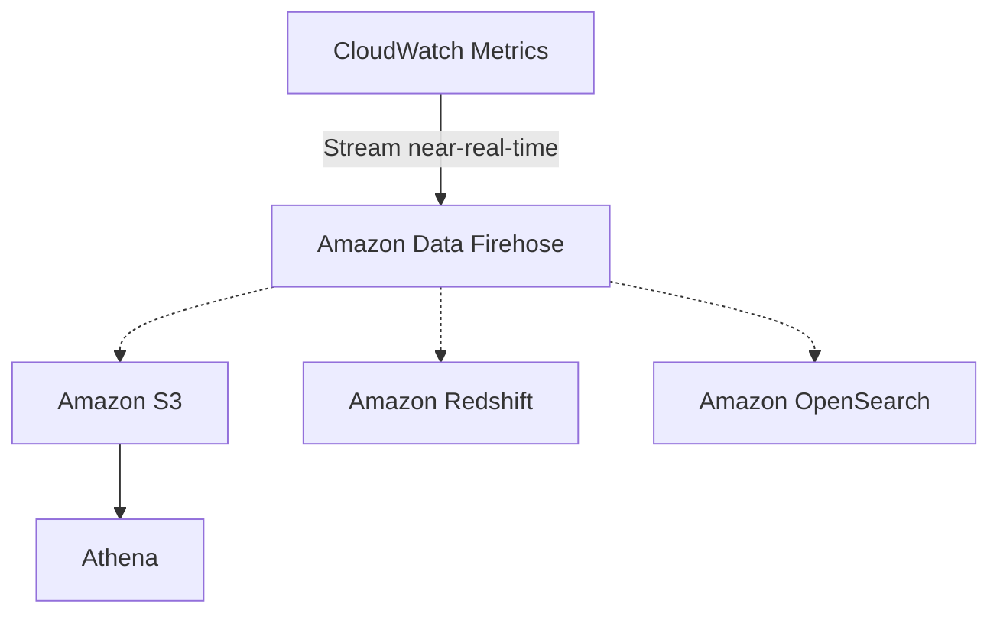

Exam tell: "send CloudWatch metrics to a third-party tool" or "keep metrics long-term in S3 for analysis" is **Metric Streams**. Polling `GetMetricData` on a schedule with Lambda is the distractor.

---

## Amazon CloudWatch Logs

- **Log group**: arbitrary name, usually one per application (`/aws/lambda/my-fn`, `/aws-glue/jobs/output`)
- **Log stream**: instances within an application, log files, containers
- **Retention policy** per log group: never expire, or 1 day to 10 years
  - Default is **never expire**, which is a silent cost leak. Set retention on every group
- CloudWatch Logs can send logs to:
  - Amazon S3 (export)
  - Kinesis Data Streams
  - Amazon Data Firehose
  - AWS Lambda
  - OpenSearch
- Logs are **encrypted by default**
- Can set up **KMS encryption with your own keys** (at the log group level)

### CloudWatch Logs sources

- SDK, CloudWatch Logs Agent, CloudWatch Unified Agent
- Elastic Beanstalk: application logs
- ECS: container logs
- AWS Lambda: function logs
- VPC Flow Logs
- API Gateway
- CloudTrail (based on filter)
- Route 53: DNS query logs
- **Glue**: job driver/executor logs (with continuous logging enabled, you see them while the job runs)

### CloudWatch Logs Insights

- Search and analyze log data stored in CloudWatch Logs
- Example: find a specific IP inside a log, count occurrences of "ERROR" in your logs
- **Purpose-built query language**
  - Automatically discovers fields from AWS services and JSON log events
  - Fetch fields, filter on conditions, calculate aggregates, sort, limit
  - Save queries and add them to CloudWatch Dashboards
- Can query **multiple log groups across AWS accounts**
- It's a **query engine, not a real-time engine**
- Billed **per GB scanned**, so narrow the time range

Sample queries:

**25 most recently added log events**

```
fields @timestamp, @message
| sort @timestamp desc
| limit 25
```

**Number of exceptions logged every 5 minutes**

```
filter @message like /Exception/
| stats count(*) as exceptionCount by bin(5m)
| sort exceptionCount desc
```

**List of log events that are not exceptions**

```
fields @message
| filter @message not like /Exception/
```

### CloudWatch Logs S3 export

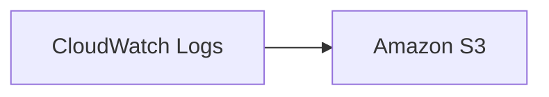

- Log data can take **up to 12 hours** to become available for export
- The API call is **`CreateExportTask`**
- One-off batch job, **not near-real time or real time**. Use **Logs Subscriptions** instead

### CloudWatch Logs subscriptions

- Get **real-time** log events from CloudWatch Logs for processing and analysis
- Send to **Kinesis Data Streams, Amazon Data Firehose, or Lambda** (and OpenSearch)
- **Subscription filter**: filter which log events are delivered to the destination
- Up to **2 subscription filters per log group**
- **Cross-account**: send to a CloudWatch Logs **destination** in a central account, backed by Kinesis or Firehose

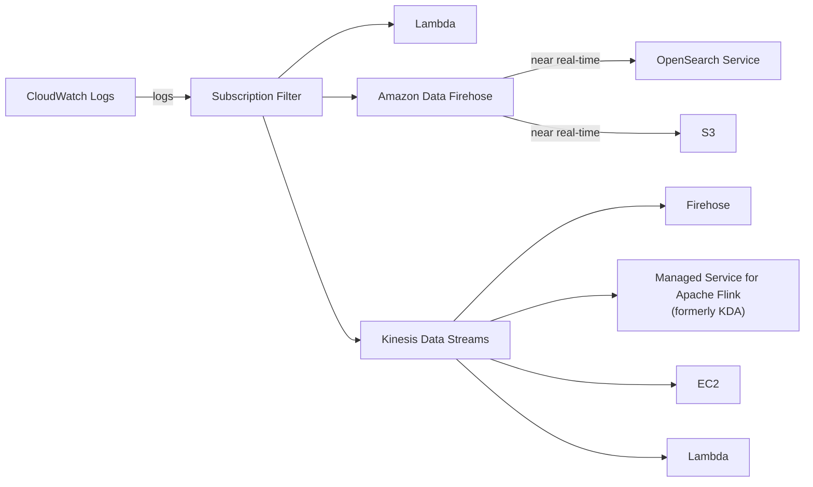

Centralized logging across accounts, the classic pattern:

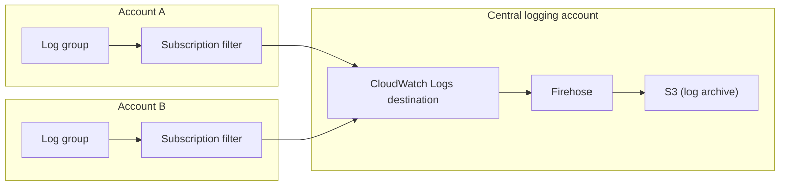

### Export vs subscription

| | S3 export (`CreateExportTask`) | Subscription filter |
|---|---|---|
| Latency | Up to 12 hours | Real time |
| Trigger | Manual / scheduled task | Continuous |
| Destinations | S3 only | KDS, Firehose, Lambda, OpenSearch |
| Use for | Occasional archive | Pipelines, alerting, central log lake |

Exam tell: "logs in S3 in near real time" is **subscription → Firehose → S3**, never export.

### CloudWatch Logs Agent and Unified Agent

- For virtual servers (EC2 instances, on-premises servers)
- **CloudWatch Logs Agent**
  - Old version, deprecated
  - Can only send to CloudWatch Logs
- **CloudWatch Unified Agent**
  - Collects **additional system-level metrics** such as RAM, processes, etc.
  - Collects logs to send to CloudWatch Logs
  - **Centralized configuration using SSM Parameter Store**

Unified Agent metrics, collected directly on the Linux server / EC2 instance:

- **CPU** (active, guest, idle, system, user, steal)
- **Disk** (free, used, total), **Disk IO** (writes, reads, bytes, IOPS)
- **RAM** (free, inactive, used, total, cached)
- **Netstat** (TCP and UDP connections, net packets, bytes)
- **Processes** (total, dead, blocked, idle, running, sleep)
- **Swap space** (free, used, used %)

Reminder: out-of-the-box EC2 metrics are only high-level disk, CPU, and network. **No memory, no disk space used.**

Exam tell: "monitor memory utilization on EC2" is the **Unified Agent**. It's the most repeated CloudWatch question there is.

---

## CloudWatch Alarms

- Trigger notifications for any metric
- Various statistics (sampling, %, max, min, average, percentiles)
- **Period**: length of time in seconds to evaluate the metric
  - High-resolution custom metrics: 10 sec, 30 sec, or multiples of 60 sec

### Alarm states and evaluation

- States:
  - `OK`
  - `INSUFFICIENT_DATA`
  - `ALARM`
- **Evaluation periods** and **datapoints to alarm**: "3 out of 5 periods breaching" (M of N) cuts flapping
- **Missing data treatment**: `missing`, `notBreaching`, `breaching`, `ignore`. A Glue job that only runs nightly emits no data all day, so `notBreaching` keeps it from sitting in `INSUFFICIENT_DATA`
- **Anomaly detection** alarms: alarm on a band learned from history instead of a fixed threshold

### Alarm targets

- **EC2 actions**: stop, terminate, reboot, or recover an instance
- **Auto Scaling** action
- **SNS** notification (and from SNS, pretty much anything: email, Lambda, SQS)
- Systems Manager OpsItem / incident

### Composite alarms

- Regular alarms watch a **single metric**
- **Composite alarms monitor the states of multiple other alarms**
- `AND` and `OR` (and `NOT`) conditions
- Reduce **alarm noise**: only page someone when CPU is high **and** IOPS is high, not on every blip

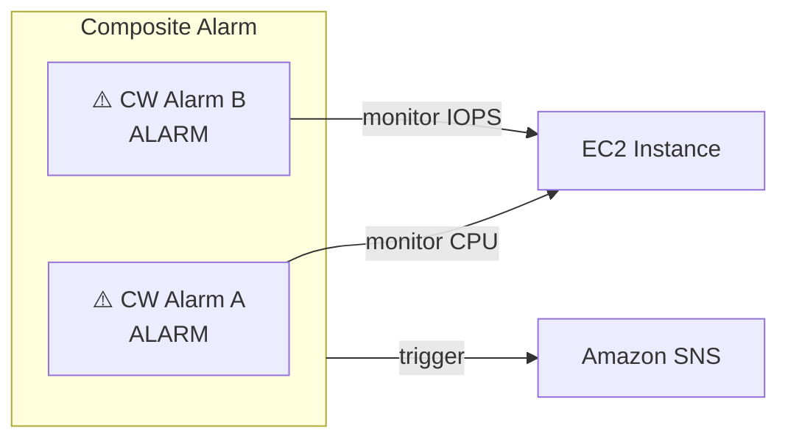

### EC2 instance recovery

- **Status checks:**
  - **Instance status**: checks the EC2 VM
  - **System status**: checks the underlying hardware
  - **Attached EBS status**: checks attached EBS volumes

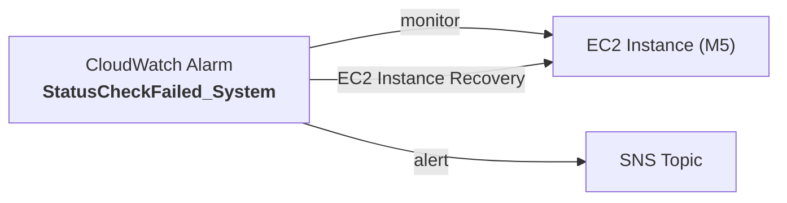

- **Recovery** keeps the same private, public, and Elastic IP, metadata, and placement group

### Alarms from log metric filters

- A **metric filter** turns matching log lines into a metric (count of `ERROR`, sum of a latency field)
- Alarms can then be created on that metric

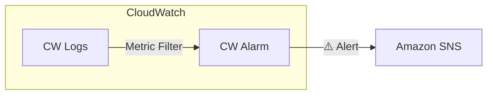

- Metric filters only apply to **new** log events, not history
- To test alarms and notifications, set the alarm state to `ALARM` with the CLI:

```bash
aws cloudwatch set-alarm-state --alarm-name "myalarm" --state-value ALARM --state-reason "testing purposes"
```

---

## Monitoring a data pipeline

Where CloudWatch actually shows up on the DEA exam. The metric to know per service:

| Service | Metric / signal | What it tells you |
|---|---|---|
| Kinesis Data Streams | **`GetRecords.IteratorAgeMilliseconds`** | Consumers falling behind. Rising = lag |
| Kinesis Data Streams | `WriteProvisionedThroughputExceeded` | Producers throttled, hot shard or too few shards |
| Firehose | `DeliveryToS3.DataFreshness` | How old the oldest undelivered record is |
| Lambda | `Errors`, `Throttles`, `Duration`, `IteratorAge` (stream sources) | Failures, concurrency limits, stream lag |
| SQS | `ApproximateNumberOfMessagesVisible`, `ApproximateAgeOfOldestMessage` | Backlog, stuck consumers |
| Glue | Job metrics (with job metrics enabled), job run state | Executor usage, memory, skew, failures |
| Redshift | `PercentageDiskSpaceUsed`, query duration, WLM queue length | Disk pressure, slow queries, queueing |
| Athena | `ProcessedBytes` per workgroup | Scan cost |
| DMS | `CDCLatencySource`, `CDCLatencyTarget` | Replication lag |

Alerting patterns that keep coming up:

- **Job failed** (Glue, EMR, Step Functions): **EventBridge rule** on the state-change event → SNS. Not a CloudWatch alarm, since a failure is an event, not a metric threshold
- **Lag or backlog building**: **CloudWatch alarm** on the metric above → SNS
- **Errors in logs**: **metric filter** → alarm → SNS

---

## CloudWatch exam tells

| Scenario | Answer |
|---|---|
| Monitor EC2 memory or disk space | CloudWatch Unified Agent |
| Kinesis consumers falling behind | Alarm on `IteratorAgeMilliseconds` |
| Count "ERROR" lines and alert | Metric filter + alarm |
| Ad hoc search across log groups | Logs Insights |
| Logs to S3 in near real time | Subscription filter → Firehose → S3 |
| One-time archive of old logs to S3 | `CreateExportTask` |
| Centralize logs from many accounts | Subscription filters → cross-account destination |
| Send metrics to Datadog/Splunk | Metric Streams |
| Keep metrics longer than 15 months | Metric Streams → Firehose → S3 |
| Only alert when two conditions are true | Composite alarm |
| Fewer false alarms from spikes | M of N datapoints, or anomaly detection |
| Nightly job leaves alarm in `INSUFFICIENT_DATA` | Treat missing data as `notBreaching` |
| Notify when a Glue job fails | EventBridge rule on Glue Job State Change → SNS |
| Log storage cost creeping up | Set log group retention |
| Recover EC2 on hardware failure | Alarm on `StatusCheckFailed_System` with recover action |

---

## AWS CloudTrail

- Provides **governance, compliance, and audit** for your AWS account
- Records the **history of API calls** made in your account by:
  - Console
  - SDK
  - CLI
  - AWS services
- Can send logs to **CloudWatch Logs or S3**
- **A trail can apply to all regions (default) or a single region**
- An **organization trail** covers every account in an AWS Organization
- If a resource is deleted in AWS, **investigate CloudTrail first**

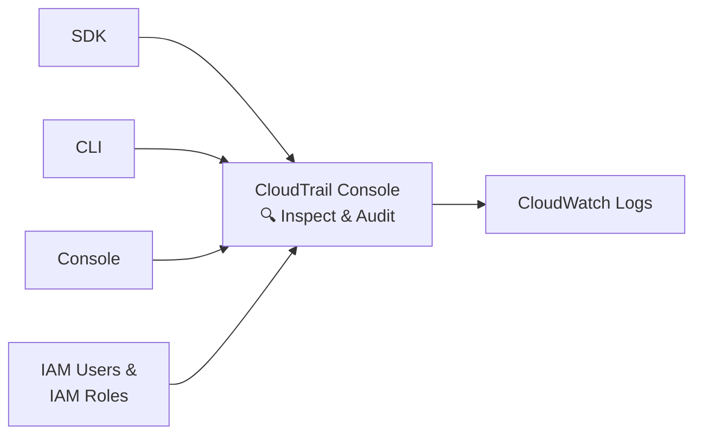

### Event history vs trails

"CloudTrail is enabled by default" is half true, and the half matters:

| | Event history (default) | Trail (you create it) |
|---|---|---|
| Enabled | **Automatically**, no setup | Must be created |
| Covers | Management events only | Management, data, and Insights events (your choice) |
| Retention | **90 days** | As long as you keep it in S3 |
| Destination | CloudTrail console only | S3, optionally CloudWatch Logs and EventBridge |

For anything beyond 90 days, or for data events, you need a **trail**.

Trail hardening worth knowing:

- **Log file integrity validation**: digest files prove logs weren't modified or deleted
- **SSE-KMS** on the log bucket
- Send logs to a **separate, locked-down account** with S3 Object Lock if tampering is a concern

### CloudTrail event types

- **Management events**
  - Operations performed **on resources** in your account (the control plane)
  - Examples:
    - Configuring security (IAM `AttachRolePolicy`)
    - Configuring rules for routing data (EC2 `CreateSubnet`)
    - Setting up logging (CloudTrail `CreateTrail`)
  - **Trails log management events by default**
  - Can separate **read events** (don't modify resources) from **write events** (may modify resources)
- **Data events**
  - Operations **on the data inside resources** (the data plane)
  - **Not logged by default** (high volume, and they cost extra)
  - S3 object-level activity (`GetObject`, `DeleteObject`, `PutObject`): can separate read and write events
  - Lambda function execution (the `Invoke` API)
  - Also DynamoDB item-level, Glue tables, and more
- **Insights events**: unusual activity detection (next section)

Exam tell: "audit who read objects in the data lake bucket" requires **S3 data events** on a trail. Management events won't show `GetObject`.

### CloudTrail Insights

- Detects **unusual activity** in your account:
  - Inaccurate resource provisioning
  - Hitting service limits
  - Bursts of IAM actions
  - Gaps in periodic maintenance activity
- Analyzes normal management events to build a **baseline**
- Then **continuously analyzes write events to detect unusual patterns**
  - Anomalies appear in the CloudTrail console
  - Event is sent to Amazon S3
  - An EventBridge event is generated (for automation)

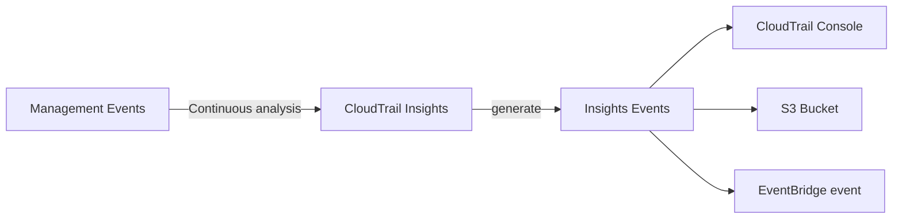

### CloudTrail retention

- Events are stored for **90 days** in CloudTrail event history
- To keep events longer, **log them to S3 with a trail and query with Athena**

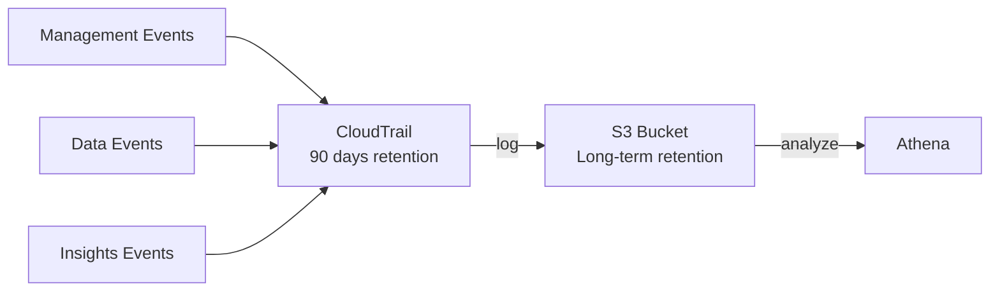

The CloudTrail console can **create the Athena table for you** from the trail's bucket. Use partition projection on the date path so queries don't scan every log ever written.

### AWS CloudTrail Lake

- **Managed data lake for CloudTrail events**, no S3 bucket or Athena table to manage
- Handles collection, storage, preparation, and optimization for query (events stored in a columnar ORC format)
- Query with **SQL** directly in the console
- Enable it with **"Create event data store"** in the console
- Long retention (up to 7 or 10 years depending on the pricing option)
- Specify the event types you want to track
  - **KMS events add up fast** and can blow up costs
  - Basic event selectors in the UI, finer control with **advanced event selectors**, which help control ingestion and storage costs
- **Channels** ingest events from outside AWS
  - Built-in support for Okta, LaunchDarkly, Clumio, and other partners
  - Or custom integrations

Querying:

- Lake dashboards to visualize events
- Write your own SQL, or start from sample queries in the CloudTrail Lake editor
- **Always bound queries by `eventTime`** to constrain scan costs

Trail → S3 → Athena vs CloudTrail Lake:

| | Trail + S3 + Athena | CloudTrail Lake |
|---|---|---|
| Setup | Bucket, table, partitions | One event data store |
| Cost model | Cheap S3 storage + Athena per TB scanned | Pay per GB ingested (includes retention) |
| Flexibility | Join with any other lake data | CloudTrail (and channel) data only |
| Best for | Big volumes, cost-sensitive, joins | Least operational overhead |

### Advanced event selectors

```bash
aws cloudtrail put-event-selectors --trail-name TrailName \
--advanced-event-selectors \
'[
  {
    "Name": "Log readOnly and writeOnly management events",
    "FieldSelectors": [
      { "Field": "eventCategory", "Equals": ["Management"] }
    ]
  },
  {
    "Name": "Log PutObject and DeleteObject events for two S3 prefixes",
    "FieldSelectors": [
      { "Field": "eventCategory", "Equals": ["Data"] },
      { "Field": "resources.type", "Equals": ["AWS::S3::Object"] },
      { "Field": "eventName", "Equals": ["PutObject","DeleteObject"] },
      { "Field": "resources.ARN", "StartsWith": ["arn:aws:s3:::mybucket/prefix","arn:aws:s3:::mybucket2/prefix2"] }
    ]
  }
]'
```

Logs all management events, plus `PutObject` and `DeleteObject` calls in the specified bucket prefixes. This is how you get data-event auditing on the sensitive part of a lake without paying to log every `GetObject` on every bucket.

### CloudTrail exam tells

| Scenario | Answer |
|---|---|
| Who deleted / changed this resource? | CloudTrail |
| Audit API activity older than 90 days | Trail to S3 + Athena (or CloudTrail Lake) |
| Audit who read objects in a bucket | S3 data events on a trail |
| Only log writes on a couple of prefixes | Advanced event selectors |
| Prove logs weren't tampered with | Log file integrity validation |
| One trail for every account | Organization trail |
| Detect unusual API activity | CloudTrail Insights |
| SQL over audit logs, least ops | CloudTrail Lake |
| React to an API call in real time | CloudTrail → EventBridge rule |
| Alert on root sign-in | EventBridge rule on the sign-in event → SNS |

---

## AWS Config

- Auditing and recording **compliance** of your AWS resources
- Records **configurations and changes over time**
- Questions Config answers:
  - Is there any unrestricted SSH access on my security groups?
  - Do my buckets have any public access?
  - How has my ALB configuration changed over time?
- Can receive **SNS notifications** for any change
- **Per-region** service
- Can be **aggregated across regions and accounts** (aggregator)
- Configuration snapshots and history can be stored in **S3 and queried with Athena**

### Config rules

- **AWS managed rules**: hundreds of prebuilt checks (the slide says 75, it's 400+ now)
  - Data lake relevant ones: `s3-bucket-public-read-prohibited`, `s3-bucket-server-side-encryption-enabled`, `s3-bucket-versioning-enabled`, `redshift-cluster-public-access-check`, `rds-storage-encrypted`, `cloudtrail-enabled`
- **Custom rules**:
  - **Lambda**-backed: any logic you can code
  - **Guard** (CloudFormation Guard policy-as-code): custom rules **without writing a Lambda**
  - Ex: evaluate if each EBS disk is of type gp2
  - Ex: evaluate if each EC2 instance is t2.micro
- Rules can be evaluated / triggered:
  - On each config change
  - And / or at regular time intervals
- **Conformance packs**: a bundle of rules and remediations deployed as one unit (e.g. an operational best practices pack for S3)
- **Config rules do not prevent actions (no deny)**. They detect and report. Prevention is IAM, SCPs, or bucket policies

**Pricing:** no free tier, $0.003 per configuration item recorded per region, $0.001 per config rule evaluation per region.

### Config resource timeline

- **Compliance of a resource over time**

| Resource | Type | Compliance |
|---|---|---|
| `sg-077b425b1649da83e` | EC2 SecurityGroup | ✅ Compliant |
| `sg-0831434f1876c0c74` | EC2 SecurityGroup | ⚠️ Noncompliant |
| `sg-09f10ed254d464f30` | EC2 SecurityGroup | ✅ Compliant |

- **Configuration of a resource over time**

| July 3, 2021 | Event | Changes |
|---|---|---|
| 14:37:44 | Configuration change | 1 field change(s) |
| 14:33:26 | Configuration change | 0 field change(s) |

- **CloudTrail API calls of a resource over time**

| July 3, 2021 | Event |
|---|---|
| 14:35:31 | CloudTrail Event |
| 14:32:46 | CloudTrail Event |
| 14:32:45 | CloudTrail Event |

That third view is Config and CloudTrail working together: Config shows **what** changed, the linked CloudTrail events show **who** changed it.

### Config remediations

- Automate remediation of non-compliant resources with **SSM Automation documents**
- Use **AWS-managed Automation documents** or create **custom** ones
  - Tip: a custom Automation document can invoke a Lambda function
- **Remediation retries** if the resource is still non-compliant after auto-remediation

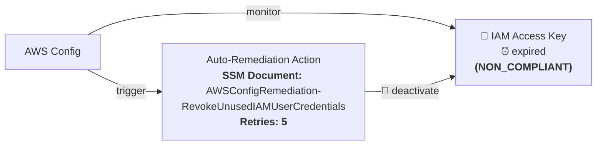

Data lake example: a bucket gets public read → Config flags it → remediation runs `AWS-DisableS3BucketPublicReadWrite`.

### Config notifications

- **EventBridge** to trigger notifications when resources become non-compliant

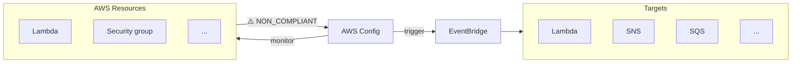

- Can also send **all configuration changes and compliance state notifications to SNS** (everything, so use SNS filtering or filter client-side)

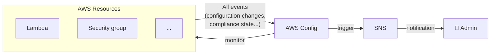

EventBridge is the better pick when you only care about specific events (like `NON_COMPLIANT`), since the rule does the filtering.

### Config exam tells

| Scenario | Answer |
|---|---|
| Detect public or unencrypted buckets continuously | Config managed rule |
| Auto-fix non-compliant resources | Config remediation (SSM Automation) |
| Custom compliance check without Lambda | Config custom rule with Guard |
| Deploy a standard set of rules everywhere | Conformance pack |
| How did this resource's configuration change over time? | Config timeline |
| Compliance view across accounts and regions | Config aggregator |
| Notify only on non-compliance | Config → EventBridge rule → SNS |
| **Prevent** a non-compliant change | Not Config: IAM / SCP / bucket policy |

---

## Putting it together: an ELB

- **CloudWatch:**
  - Monitor incoming connections metric
  - Visualize error codes as a % over time
  - Dashboard for load balancer performance
- **Config:**
  - Track security group rules for the load balancer
  - Track configuration changes
  - Ensure an SSL certificate is always assigned (compliance)
- **CloudTrail:**
  - Track **who** made changes to the load balancer via API calls

Same split works for any resource. For a Redshift cluster: CloudWatch for disk and query performance, Config to ensure it's encrypted and not publicly accessible, CloudTrail for who resized it or changed its parameter group.

---

## AWS CloudFormation

- A **declarative** way of describing your AWS infrastructure, for (almost) any resource
- Within a template you say:
  - I want a security group
  - I want two EC2 instances using this security group
  - I want an S3 bucket
  - I want a load balancer (ELB) in front of these machines
- CloudFormation creates them in the **right order** with the **exact configuration** you specify

### CloudFormation benefits

- **Infrastructure as code**
  - No resources created manually, which is excellent for control
  - Infrastructure changes are reviewed through code
- **Cost**
  - Every resource in the stack is tagged with an identifier, so you can see what a stack costs
  - Estimate costs from the template
  - Savings strategy: in dev, delete stacks at 5 PM and recreate at 8 AM, safely
- **Productivity**
  - Destroy and re-create infrastructure on the fly
  - Automated diagrams of your templates
  - Declarative (no need to figure out ordering and orchestration)
- **Don't reinvent the wheel**
  - Leverage existing templates on the web
  - Leverage the documentation
- **Supports (almost) all AWS resources**
  - Everything in this course is supported
  - **Custom resources** (Lambda-backed) for anything that isn't

Same idea as Terraform. The exam only asks about CloudFormation, and the main difference to remember is that CloudFormation's state is managed by AWS (no state file to store and lock).

### Template anatomy

```yaml
AWSTemplateFormatVersion: "2010-09-09"
Parameters:
  Env:
    Type: String
    AllowedValues: [dev, prod]
Resources:
  RawBucket:
    Type: AWS::S3::Bucket
    DeletionPolicy: Retain
    Properties:
      BucketName: !Sub "raw-data-${Env}-${AWS::AccountId}"
      VersioningConfiguration:
        Status: Enabled
Outputs:
  RawBucketArn:
    Value: !GetAtt RawBucket.Arn
    Export:
      Name: !Sub "${Env}-RawBucketArn"
```

- **Parameters**: inputs at deploy time
- **Resources**: the only required section
- **Outputs**: values to display or **export** for other stacks (`!ImportValue`)
- **Mappings** and **Conditions**: static lookups and conditional resources
- Intrinsic functions: `!Ref`, `!GetAtt`, `!Sub`, `!Join`, `!If`, `!ImportValue`
- **`DeletionPolicy: Retain`** (or `Snapshot` for RDS/Redshift) keeps the data when the stack is deleted. The default is `Delete`, which deletes your bucket or database with the stack
- Pull secrets with **dynamic references** (`{{resolve:secretsmanager:...}}` or `{{resolve:ssm:...}}`) instead of hardcoding

### Stacks, change sets, StackSets, drift

- **Stack**: one deployed template. Create, update, delete as a unit
- **Rollback**: a failed create or update rolls back automatically by default
- **Change sets**: preview exactly what an update will add, modify, or **replace** before running it. Replacement of a database is the thing you want to catch
- **StackSets**: deploy one template across **many accounts and regions** (e.g. a Config rule or a CloudTrail trail in every account)
- **Drift detection**: finds resources someone changed by hand outside CloudFormation
- **Nested stacks**: reuse common components inside a parent stack
- Related tools: **AWS CDK** (write in Python/TypeScript, synthesizes CloudFormation) and **AWS SAM** (shorthand for serverless: Lambda, API Gateway, DynamoDB)

### CloudFormation and Infrastructure Composer

- **Infrastructure Composer** (formerly Application Composer) is a visual designer for CloudFormation templates
- Example: WordPress CloudFormation stack
- See all the **resources**
- See the **relations** between components

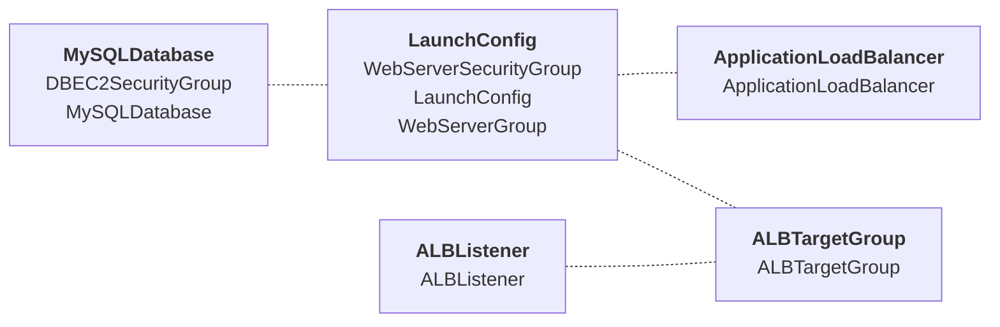

### CloudFormation exam tells

| Scenario | Answer |
|---|---|
| Repeatable infrastructure, reviewed as code | CloudFormation |
| Same stack in every account and region | StackSets |
| Preview what an update will change | Change set |
| Someone edited resources by hand | Drift detection |
| Keep the S3 bucket or DB when the stack is deleted | `DeletionPolicy: Retain` / `Snapshot` |
| Resource type not supported | Custom resource (Lambda) |
| Don't hardcode a password in a template | Dynamic reference to Secrets Manager / SSM |
| Share a value (bucket ARN) between stacks | Outputs + Export / `!ImportValue` |
| Define infrastructure in Python | CDK |

---

## SSM Parameter Store

- Secure storage for **configuration and secrets**
- Optional seamless encryption with **KMS** (`SecureString` parameters)
- Serverless, scalable, durable, easy SDK
- **Version tracking** of configurations and secrets
- Security through **IAM**
- Notifications with **Amazon EventBridge**
- Integration with **CloudFormation**

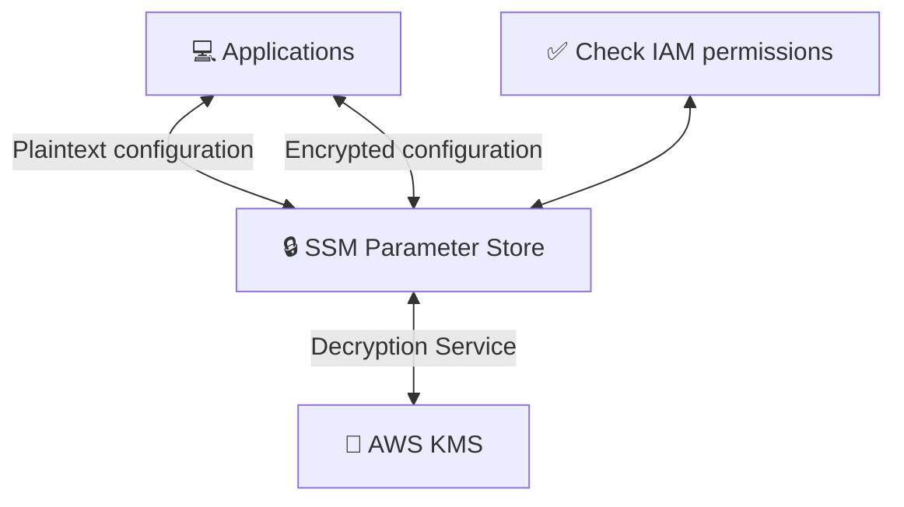

Reading a `SecureString` needs IAM permission on the parameter **and** `kms:Decrypt` on the key. Missing the KMS permission is the classic "access denied even though the IAM policy allows `ssm:GetParameter`."

### Parameter Store hierarchy

- `/my-department/`
  - `my-app/`
    - `dev/`
      - `db-url`
      - `db-password`
    - `prod/`
      - `db-url`
      - `db-password`
  - `other-app/`
- `/other-department/`
- `/aws/reference/secretsmanager/secret_ID_in_Secrets_Manager` (read a Secrets Manager secret through Parameter Store)
- `/aws/service/ami-amazon-linux-latest/amzn2-ami-hvm-x86_64-gp2` (public, AWS-published)

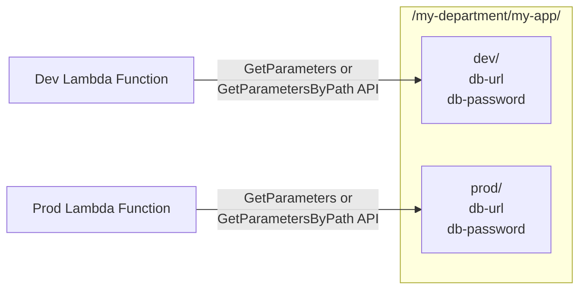

The hierarchy is what makes IAM clean: grant the dev function `ssm:GetParametersByPath` on `/my-department/my-app/dev/*` only, and it physically can't read prod values.

### Standard vs advanced tiers

| | Standard | Advanced |
|---|---|---|
| Total parameters allowed (per account and region) | 10,000 | 100,000 |
| Max size of a parameter value | 4 KB | 8 KB |
| Parameter policies available | No | Yes |
| Cost | No additional charge | Charges apply |
| Storage pricing | Free | $0.05 per advanced parameter per month |

**Parameter policies** (advanced only):

- **Expiration**: delete the parameter at a set time (force a password change)
- **ExpirationNotification**: EventBridge event before it expires
- **NoChangeNotification**: EventBridge event if it hasn't changed in X days

### Parameter Store vs Secrets Manager

The comparison the exam actually asks:

| | Parameter Store | Secrets Manager |
|---|---|---|
| Built for | Config values, some secrets | Secrets |
| **Automatic rotation** | **No** (build it yourself) | **Yes**, Lambda-based, every N days |
| Native DB integration | No | **RDS, Aurora, Redshift, DocumentDB** (rotation handled for you) |
| Encryption | Optional (`SecureString`) | Always (KMS) |
| Cost | Standard tier free | ~$0.40 per secret per month + API calls |
| Cross-region replication | No | Yes |
| Used by Glue connections, Redshift, DMS | Sometimes | Commonly |

Exam tell: "rotate the database password automatically" is **Secrets Manager**, every time. "Store config values cheaply" or "hierarchical config by environment" is Parameter Store.

### Other Systems Manager features

Parameter Store is one piece of **AWS Systems Manager (SSM)**. Others that show up:

- **Session Manager**: shell into EC2 without SSH keys or open port 22, logged to CloudWatch/S3
- **Run Command**: run a script across a fleet of instances
- **Patch Manager**: automate OS patching
- **Automation**: runbooks (the same documents Config remediations use)

---

## AWS Well-Architected

### General guiding principles

- https://aws.amazon.com/architecture/well-architected
- Stop guessing your capacity needs
- Test systems at production scale
- Automate to make architectural experimentation easier
- Allow for evolutionary architectures
  - Design based on changing requirements
- Drive architectures using data
- Improve through game days
  - Simulate applications for flash sale days

### The 6 pillars

| Pillar | Focus | Data engineering example |
|---|---|---|
| **Operational Excellence** | Run and monitor, improve processes | IaC, alarms on pipeline failures, runbooks |
| **Security** | Protect data and systems | Encryption, least privilege, Lake Formation, CloudTrail |
| **Reliability** | Recover from failure, meet demand | Retries, DLQs, idempotent jobs, multi-AZ |
| **Performance Efficiency** | Use resources efficiently | Parquet + partitioning, right worker types |
| **Cost Optimization** | Avoid unnecessary cost | Lifecycle to Glacier, Spot for EMR, Athena scan limits |
| **Sustainability** | Minimize environmental impact | Right-sizing, serverless, less data scanned |

The course frames the pillars as a synergy, not trade-offs. They mostly reinforce each other, but AWS's own docs do describe trade-offs (multi-region reliability costs more, for example). If a question asks you to optimize one pillar, it's fine for the answer to cost a bit on another.

### AWS Well-Architected Tool

- Free tool to **review your architectures** against the 6 pillars and **adopt best practices**
- How it works:
  - Select your workload and answer questions
  - Review your answers against the 6 pillars
  - Get advice: videos and documentation, a generated report, and results in a dashboard
- **Lenses** add domain-specific questions, including a **Data Analytics Lens** and Serverless Lens

---

## Amazon Managed Grafana

- Grafana: popular open-source platform to monitor, visualize, and alert on metrics and logs
- User management through **IAM Identity Center** (formerly AWS SSO) and/or **SAML**
- Compatible with Grafana plugins and alerts
- Fully managed, scales automatically
- Encrypted at rest and in transit, can use KMS
- Integrated with AWS sources:
  - CloudWatch, OpenSearch, Timestream, Athena, Redshift, X-Ray
  - **Amazon Managed Service for Prometheus (AMP)**
- And everything else Grafana integrates with:
  - GitHub, Google, Azure, MySQL, Redis, JSON, OpenTelemetry, and more

Grafana vs QuickSight vs CloudWatch dashboards:

| | Use for |
|---|---|
| **CloudWatch dashboards** | AWS metrics and logs, quick, no extra service |
| **Managed Grafana** | Operational monitoring across many sources (AWS + non-AWS), teams already on Grafana |
| **QuickSight** | Business intelligence: reports and dashboards on business data for analysts |

Exam tell: "operational dashboards combining CloudWatch, Prometheus, and third-party data sources" is **Managed Grafana**. "Business users need interactive reports on sales data" is **QuickSight**.

---

## Decision cheat sheet

**Which service answers the question?**

| Question | Use |
|---|---|
| Is it healthy / performing? | CloudWatch |
| Who did it? | CloudTrail |
| What's its configuration, is it compliant? | Config |

**Monitoring**

| Need | Use |
|---|---|
| EC2 memory or disk space | Unified Agent |
| Alert on a threshold | CloudWatch alarm |
| Alert on a job failure event | EventBridge rule → SNS |
| Alert on log patterns | Metric filter + alarm |
| Combine alarm conditions | Composite alarm |
| Search logs ad hoc | Logs Insights |
| Logs to S3 in near real time | Subscription → Firehose → S3 |
| Metrics to a third party or S3 | Metric Streams |
| Ops dashboards across many sources | Managed Grafana |

**Audit**

| Need | Use |
|---|---|
| Last 90 days of management events | CloudTrail event history (free, default) |
| Longer retention | Trail → S3 → Athena, or CloudTrail Lake |
| Who read data in S3 | S3 data events |
| Unusual API activity | CloudTrail Insights |
| Tamper-evident logs | Log file integrity validation |

**Compliance**

| Need | Use |
|---|---|
| Detect drift from policy | Config rules |
| Auto-fix | Config remediation (SSM Automation) |
| Prevent the change in the first place | IAM / SCPs / resource policies |
| Infrastructure changed outside IaC | CloudFormation drift detection |

**Infrastructure and config**

| Need | Use |
|---|---|
| Infrastructure as code | CloudFormation (or CDK on top) |
| Same stack across accounts and regions | StackSets |
| Config values by environment | Parameter Store |
| Secrets with automatic rotation | Secrets Manager |
| Shell into instances without SSH | Session Manager |
| Review an architecture | Well-Architected Tool |