# Machine Learning and Generative AI

The ML and GenAI services a data engineer is expected to know. The SageMaker AI data-prep tools are Feature Store, Ground Truth, Data Wrangler, Canvas and Lineage Tracking. Bedrock covers foundation models and managed RAG. The vector stores are OpenSearch, Aurora pgvector and S3 Vectors. The employee-facing AI services are Amazon Quick, Q Apps and Kendra. Exam tells are inline, and there's a decision cheat sheet at the end.

## Contents

- [Which AI service?](#which-ai-service)
- [Amazon SageMaker AI](#amazon-sagemaker-ai)
- [SageMaker Feature Store](#sagemaker-feature-store)
  - [Where features come from](#where-the-features-come-from-is-up-to-you)
  - [How Feature Store organizes data](#how-sagemaker-feature-store-organizes-your-data)
  - [Online vs offline store](#online-vs-offline-store)
  - [Data ingestion](#data-ingestion-streaming-or-batch)
  - [Security](#sagemaker-feature-store-security)
- [SageMaker ML Lineage Tracking](#sagemaker-ml-lineage-tracking)
  - [Lineage tracking entities](#lineage-tracking-entities)
- [SageMaker Ground Truth](#sagemaker-ground-truth)
  - [Active learning](#but-its-more-than-that)
  - [Who are the labelers?](#who-are-these-human-labelers)
  - [Other ways to generate labels](#other-ways-to-generate-training-labels)
  - [Ground Truth Plus](#ground-truth-plus)
- [SageMaker Data Wrangler](#sagemaker-data-wrangler)
  - [Sources and destinations](#data-wrangler-sources-and-destinations)
  - [Troubleshooting](#data-wrangler-troubleshooting)
- [SageMaker Canvas](#sagemaker-canvas)
- [SageMaker exam tells](#sagemaker-exam-tells)
- [Amazon Bedrock](#amazon-bedrock)
  - [Foundation models](#foundation-models)
  - [Models available in Bedrock](#models-available-in-bedrock)
  - [What Bedrock is](#what-bedrock-is)
  - [IAM permissions](#bedrock-iam-permissions)
  - [Model access](#bedrock-model-access)
  - [Other Bedrock features](#other-bedrock-features-worth-knowing)
- [Retrieval Augmented Generation (RAG)](#retrieval-augmented-generation-rag)
  - [Pros and cons](#rag-pros-and-cons)
  - [RAG vs fine-tuning](#rag-vs-fine-tuning)
  - [Example: Jeopardy!](#rag-example-approach-winning-at-jeopardy)
- [Vector Stores and Semantic Search](#vector-stores-and-semantic-search)
  - [Choosing a database](#choosing-a-database-knowledge-base-data-store-for-rag)
  - [Embeddings](#review-embeddings)
  - [Vector databases](#embeddings-are-vectors-so-store-them-in)
  - [Example: Star Trek](#rag-example-with-a-vector-database-making-data-from-star-trek-by-cheating)
- [Pre-Retrieval and Chunking Strategies](#pre-retrieval-and-chunking-strategies)
  - [Breaking up the R in RAG](#breaking-up-the-r-in-rag)
  - [Pre-retrieval](#pre-retrieval)
  - [More on chunking](#more-on-chunking)
- [Amazon Bedrock Knowledge Bases](#amazon-bedrock-knowledge-bases)
  - [Data sources and vector stores](#knowledge-base-data-sources-and-vector-stores)
  - [Retrieve vs RetrieveAndGenerate](#retrieve-vs-retrieveandgenerate)
- [Managing Chunking Strategies with Bedrock](#managing-chunking-strategies-with-bedrock)
  - [Standard chunking](#chunking-with-bedrock-standard-chunking)
  - [Hierarchical chunking](#chunking-with-bedrock-hierarchical-chunking)
  - [Semantic chunking](#chunking-with-bedrock-semantic-chunking)
  - [Chunking cheat sheet](#chunking-cheat-sheet)
- [Optimizing Your Vector Stores and Embeddings](#optimizing-your-vector-stores-and-embeddings)
  - [Optimizing embeddings](#optimizing-your-embeddings)
  - [Sparse vs dense embeddings](#sparse-vs-dense-embeddings)
  - [Retrieval with metadata](#optimizing-retrieval-with-metadata)
  - [Keeping your KB up to date](#keeping-your-kb-up-to-date)
  - [Post-retrieval: reranking](#post-retrieval-reranking)
- [OpenSearch as a Vector Store](#opensearch-as-a-vector-store)
  - [Semantic vs hybrid search](#semantic-vs-hybrid-search)
  - [Engines and ANN algorithms](#opensearch-engines-and-ann-algorithms)
  - [HNSW tuning](#hnsw-tuning)
  - [Vector compression](#vector-compression)
  - [Sharding and multi-index](#sharding-and-multi-index-approaches)
  - [Hierarchical indices](#opensearch-hierarchical-indices)
  - [Neural plugin](#opensearch-neural-plugin)
- [Amazon Aurora as a Vector Store](#amazon-aurora-as-a-vector-store)
- [Other Vector Store Options](#other-vector-store-options)
- [RAG and vector store exam tells](#rag-and-vector-store-exam-tells)
- [Amazon Quick](#amazon-quick)
  - [Capabilities](#amazon-quick-capabilities)
  - [IAM Identity Center](#amazon-quick--iam-identity-center)
  - [Integrations](#amazon-quick-integrations)
  - [Apps in Amazon Quick](#apps-in-amazon-quick)
- [Amazon Q Apps (Q Business)](#amazon-q-apps-q-business)
- [Amazon Kendra](#amazon-kendra)
- [Decision cheat sheet](#decision-cheat-sheet)

---

## Which AI service?

These get swapped in questions. One line each:

| Service | Who it's for | What it does |
|---|---|---|
| **SageMaker AI** | Data scientists, ML engineers | Build, train, deploy **your own** ML models |
| **SageMaker Canvas** | Business analysts | No-code ML predictions |
| **Bedrock** | Developers | API for **pre-trained foundation models** (GenAI), plus managed RAG and agents |
| **Amazon Quick** (formerly Q Business) | Employees | Ready-made AI assistant over company data |
| **Kendra** | Developers building search | ML-powered enterprise **document search** |
| **Comprehend / Rekognition** | Developers | Pre-trained NLP / image analysis APIs |

Rule of thumb: **build a model = SageMaker, use a foundation model = Bedrock, give employees an assistant = Quick, search documents = Kendra**.

---

## Amazon SageMaker AI

- Fully managed service for developers / data scientists to build ML models
- Typically difficult to do all the processes in one place + provision servers
- Machine learning process (simplified): predicting your exam score

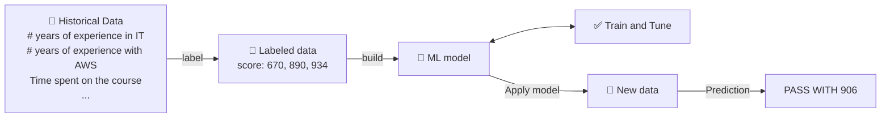

Naming note: "SageMaker" is now an umbrella brand (SageMaker Unified Studio, SageMaker Lakehouse). The ML build/train/deploy service is **SageMaker AI**. The exam may use either name.

---

## SageMaker Feature Store

- A "feature" is just a property used to train a machine learning model
  - Like, you might predict someone's political party based on "features" such as their address, income, age, etc.
- Machine learning models require fast, secure access to feature data for training
- It's also a challenge to keep it organized and share features across different models
- Feature Store is the central place to **store, share, and reuse features** across teams and models

### Where the Features Come From Is Up to You

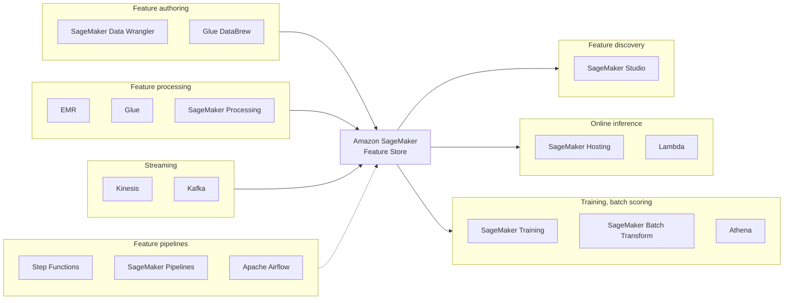

### How SageMaker Feature Store Organizes Your Data

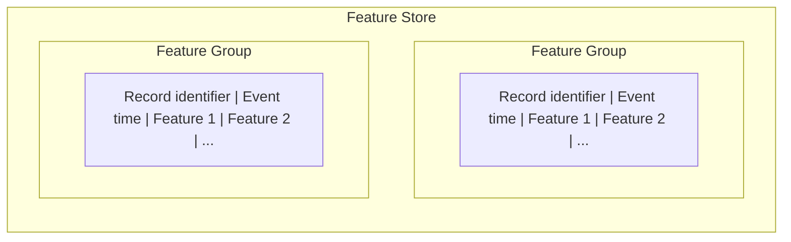

- A **feature group** is like a table. Each row is a **record**
- Every feature group must define two special features:
  - **Record identifier**: uniquely identifies the record (like a primary key, e.g. `customer_id`)
  - **Event time**: timestamp of when the record was created or updated (used for versioning and time travel)
- The rest of the columns are your actual features

### Online vs Offline Store

| | Online store | Offline store |
|---|---|---|
| Storage | Low-latency key-value store | **S3** (Parquet, or Apache Iceberg table format) |
| Holds | **Latest** value per record | **Full history** of every record |
| Access | `GetRecord` / `BatchGetRecord` APIs, milliseconds | Athena, Spark, Data Wrangler, anything that reads S3 |
| Use for | **Real-time inference** | **Training** and batch scoring, point-in-time queries |
| Catalog | n/a | **Glue Data Catalog table created automatically** |

You can enable one or both per feature group. With both, records written to the online store are replicated to the offline store automatically.

### Data Ingestion (Streaming or Batch)

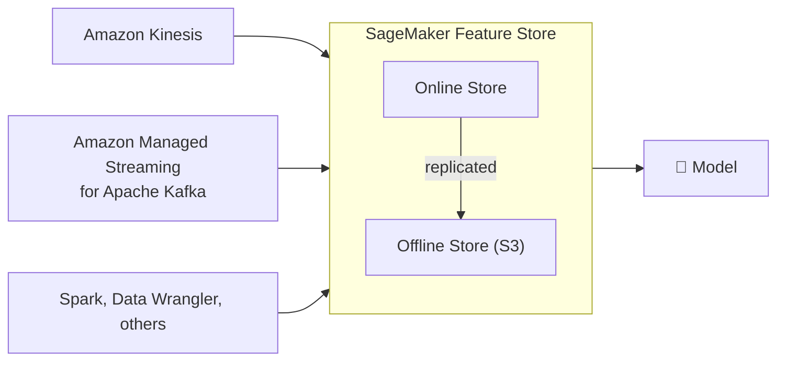

- **STREAMING** ingestion via the `PutRecord` API, real-time reads via `GetRecord`
- **BATCH** ingestion via Spark connector, Data Wrangler, or SageMaker Processing. Batch reads come from the offline S3 store (Athena, Data Wrangler, anything that hits S3)

### SageMaker Feature Store Security

- Encrypted at rest and in transit
- Works with **KMS customer managed keys** (the slide says "customer master keys," the old name)
- Fine-grained access control with **IAM**
- May also be secured with **AWS PrivateLink**

---

## SageMaker ML Lineage Tracking

- Creates & stores your ML workflow (MLOps)
- Keep a running history of your models
- Tracking for auditing and compliance
- Automatically or manually-created tracking entities
- Integrates with **AWS Resource Access Manager** for cross-account lineage
- Sample SageMaker-created lineage graph:

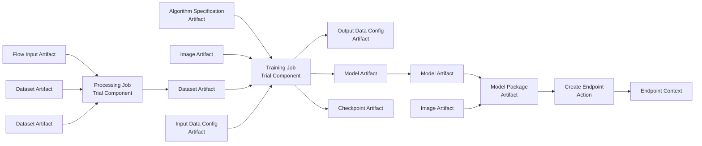

SageMaker automatically creates this connected graph of lineage entity metadata tracking your workflow. You can query it to answer "which dataset trained the model behind this endpoint?"

### Lineage Tracking Entities

- **Trial component** (processing jobs, training jobs, transform jobs)
- **Trial** (a model composed of trial components)
- **Experiment** (a group of Trials for a given use case)
- **Context** (logical grouping of entities)
- **Action** (workflow step, model deployment)
- **Artifact** (object or data, such as an S3 bucket or an image in ECR)
- **Association** (connects entities together), has optional `AssociationType`:
  - `ContributedTo`
  - `AssociatedWith`
  - `DerivedFrom`
  - `Produced`
  - `SameAs`

---

## SageMaker Ground Truth

### What is Ground Truth?

- Sometimes you don't have training data at all, and it needs to be **generated by humans** first
- Example: training an image classification model. Somebody needs to tag a bunch of images with what they are images of before training a neural network
- **Ground Truth manages humans who will label your data** for training purposes

Labeling task types shown in the console:

| Task type | What workers do | Example |
|---|---|---|
| **Image classification** | Categorize images into specific classes | Basketball ☑ / Soccer ☐ |
| **Bounding box** | Draw boxes around specified objects | Boxing two birds on a branch |
| **Semantic segmentation** | Draw pixel-level labels around objects and segments | Outlining a person and a car in a street scene |

Also supports text (classification, named entity recognition), video, and 3D point cloud labeling.

### But It's More Than That

- Ground Truth **creates its own model** as images are labeled by people (**active learning** / automated data labeling)
- As this model learns, **only images the model isn't sure about are sent to human labelers**
- This can **reduce the cost of labeling jobs by up to 70%**

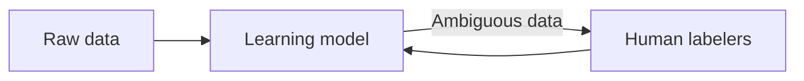

### Who Are These Human Labelers?

- **Amazon Mechanical Turk** (public workforce)
- **Your own internal team** (private workforce, for sensitive data)
- **Professional labeling companies** (vendor workforce, via AWS Marketplace)

### Other Ways to Generate Training Labels

- **Rekognition**
  - AWS service for image recognition
  - Automatically classify images
- **Comprehend**
  - AWS service for text analysis and topic modeling
  - Automatically classify text by topics, sentiment
- Any **pre-trained model** or **unsupervised technique** that may be helpful

### Ground Truth Plus

- Turnkey solution
- "Our team of AWS Experts" manages the workflow and team of labelers
  - You fill out an intake form
  - They contact you and discuss pricing
- You track progress via the Ground Truth Plus Project Portal
- Get labeled data from S3 when done

| | Ground Truth | Ground Truth Plus |
|---|---|---|
| Who runs the labeling workflow | You | AWS |
| Who picks the workforce | You | AWS |
| Use when | You want control | You want it done for you, least effort |

---

## SageMaker Data Wrangler

- Visual interface (in SageMaker Studio, and now built into **SageMaker Canvas**) to prepare data for machine learning
- Import data
- Visualize data
- Transform data (300+ transformations to choose from)
  - Or integrate your own custom transforms with pandas, PySpark, PySpark SQL
- "Quick Model" to train your model with your data and measure its results
- **Data quality and insights report**: detects missing values, outliers, target leakage, class imbalance
- Export the flow as code (notebook, Processing job, Pipeline) to run at scale

### Data Wrangler Sources and Destinations

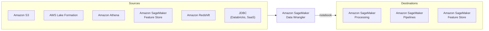

### Data Wrangler Troubleshooting

- Make sure your Studio user has appropriate **IAM roles**
- Make sure permissions on your data sources allow Data Wrangler access
  - Add **`AmazonSageMakerFullAccess`** policy
- **EC2 instance limit**
  - If you get "The following instance type is not available..." errors
  - May need to request a **quota increase**
  - Service Quotas / Amazon SageMaker / Studio KernelGateway Apps running on `ml.m5.4xlarge` instance

Data Wrangler vs Glue DataBrew: both are visual data prep. **Data Wrangler is for ML** (feature engineering, bias checks, export to Feature Store/Pipelines). **DataBrew is for general analytics cleaning** (recipes run as jobs on S3/Redshift data).

---

## SageMaker Canvas

- No-code machine learning for business analysts
- Upload CSV data, select a column to predict, build it, and make predictions
- Can also join datasets
- Classification or regression (also time-series forecasting)
- Automatic data cleaning
  - Missing values
  - Outliers
  - Duplicates
- Share models & datasets with SageMaker Studio
- Also has generative AI support via Bedrock or JumpStart foundation models
  - Many are fine-tunable within Canvas

---

## SageMaker exam tells

| Scenario | Answer |
|---|---|
| Share and reuse features across teams and models | Feature Store |
| Millisecond feature lookups for real-time inference | Feature Store **online store** |
| Train on historical features, query with Athena | Feature Store **offline store** (S3 + Glue catalog) |
| Need humans to label training data | Ground Truth |
| Cut labeling cost by only sending hard cases to humans | Ground Truth automated labeling (active learning) |
| Labeling fully managed by AWS, least effort | Ground Truth Plus |
| Sensitive data, labelers must be employees | Ground Truth private workforce |
| Visual data prep and feature engineering for ML | Data Wrangler |
| Business analysts want predictions without code | Canvas |
| Audit which data and jobs produced a deployed model | ML Lineage Tracking |
| Automatically tag images / classify text sentiment | Rekognition / Comprehend |
| Cross-account lineage | Lineage Tracking + Resource Access Manager |

---

## Amazon Bedrock

### Foundation Models

- The giant, **pre-trained transformer models** we are fine-tuning for specific tasks, or applying to new applications
- GPT-n (OpenAI)
- Claude (Anthropic)
- DALL-E (OpenAI)
- Llama (Meta)
- DeepSeek
- Nova (Amazon)

### Models Available in Bedrock

- **Jurassic-2** (AI21 Labs)
  - Multilingual LLMs for text generation
  - Spanish, French, German, Portuguese, Italian, Dutch
  - Note: AI21 has since replaced Jurassic-2 with **Jamba** in Bedrock
- **Claude** (Anthropic)
  - LLMs for conversations
  - Question answering
  - Workflow automation
- **Stable Diffusion** (Stability AI)
  - Image, art, logo, design generation
- **Llama** (Meta)
  - Open-weight LLM
- **Amazon Titan**
  - Text summarization
  - Text generation
  - Q&A
  - **Embeddings** (Titan Text Embeddings, Titan Multimodal Embeddings)
    - Personalization
    - Search
- **Amazon Nova**
  - Nova Micro / Lite / Pro / Premier: text and multimodal LLMs
  - Nova Canvas: images
  - Nova Reel: video

| Model | Provider |
|---|---|
| Jurassic-2 / Jamba | AI21 Labs |
| Titan, Nova | Amazon |
| Claude | Anthropic |
| Command, Embed, Rerank | Cohere |
| Llama | Meta |
| Mistral | Mistral AI |
| Stable Diffusion | Stability AI |

The model list changes constantly. Exam questions care about **categories** (text, image, embeddings), not specific model versions.

### What Bedrock Is

- An **API for generative AI foundation models**
  - Invoke chat, text, image, or embedding models
  - Pre-built, your own fine-tuned models, or your own imported models
  - Third-party models bill you through AWS via their own pricing
  - Support for **RAG** (Retrieval-Augmented Generation) via **Knowledge Bases**
  - Support for **LLM agents**
- **Serverless**: no infrastructure to manage, pay per token
- Your prompts and data are **not used to train** the base models
- Can integrate with **SageMaker Canvas**

### Bedrock IAM Permissions

- Use with an **IAM user or role (not root)**
- User must have relevant Bedrock permissions
  - **`AmazonBedrockFullAccess`**
  - **`AmazonBedrockReadOnly`**
- For least privilege, scope `bedrock:InvokeModel` to specific model ARNs

### Bedrock Model Access

- Amazon has **phased out the need to request access** to most models. Serverless models are available by default
  - Some third-party models may still need a one-time use-case form
  - Admins can still **restrict** which models can be used, with IAM or SCPs
- Be sure to **check pricing**
  - aws.amazon.com/bedrock/pricing

### Other Bedrock Features Worth Knowing

- **Knowledge Bases**: fully managed RAG (see [Amazon Bedrock Knowledge Bases](#amazon-bedrock-knowledge-bases))
- **Agents**: LLMs that call APIs/Lambda functions (action groups) and query knowledge bases to complete multi-step tasks
- **Guardrails**: filter harmful content, block denied topics, **redact PII**, and run **contextual grounding checks** that catch hallucinations
- **Model customization**
  - **Fine-tuning**: labeled data (prompt/response pairs) to teach a task or style
  - **Continued pre-training**: unlabeled domain data to teach domain knowledge
  - Custom models need **Provisioned Throughput** (or on-demand for some models) to serve
- **Batch inference**: submit JSONL from S3, results back to S3, about **50% cheaper** than on-demand
- **Model evaluation**: compare models with automatic metrics or human reviewers
- **Invocation logging**: log prompts and responses to CloudWatch Logs or S3 (off by default)

---

## Retrieval Augmented Generation (RAG)

- Like an open-book exam for LLMs
- You query some external database for the answers instead of relying on the LLM
- Then, work those answers into the prompt for the LLM to work with
  - Or, use tools and functions to incorporate the search into the LLM in a slightly more principled way

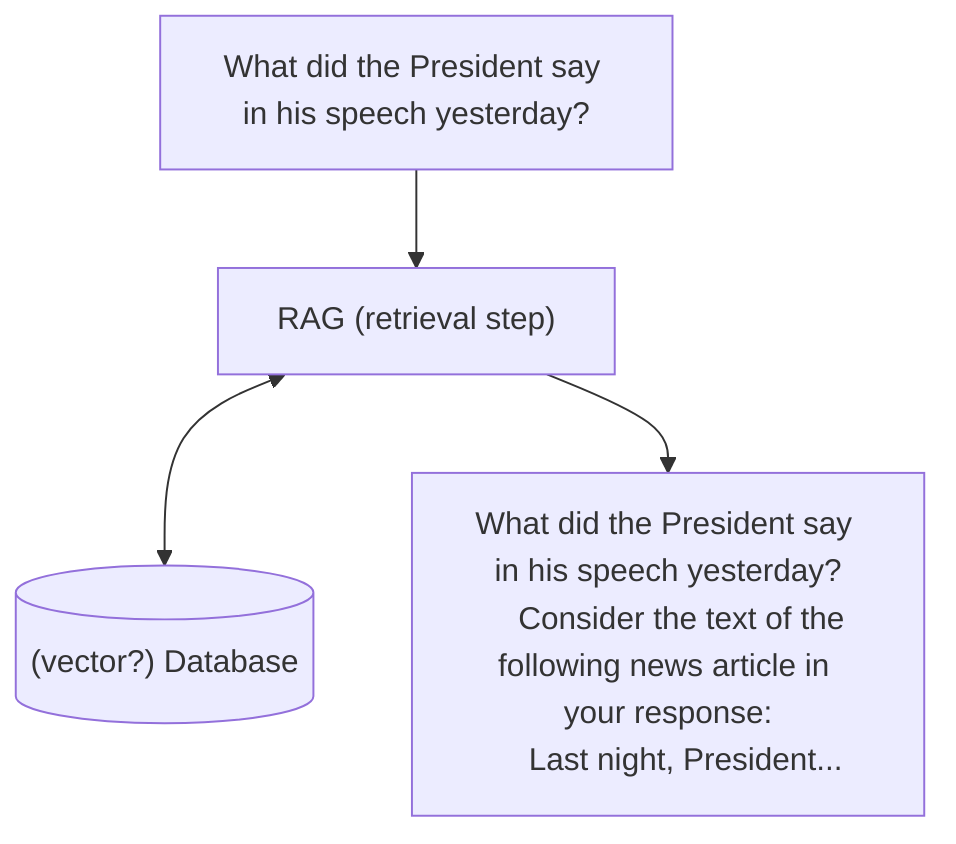

Note: dropping a small file into a chatbot usually isn't RAG. The whole file gets pasted into the context window ("context stuffing"). It becomes RAG when the content is too big to fit and only the most relevant chunks are retrieved per question.

### RAG: Pros and Cons

#### Pros

- Faster & cheaper way to incorporate new or proprietary information into "GenAI" vs. fine-tuning
- Updating info is just a matter of updating a database
- Can leverage "semantic search" via vector stores
- Can prevent "hallucinations" when you ask the model about something it wasn't trained on
- If your boss wants "AI search", this is an easy way to deliver it
- Technically you aren't "training" a model with this data
- Responses can **cite sources** (the retrieved chunks)

#### Cons

- You have made the world's most overcomplicated search engine
- Very sensitive to the prompt templates you use to incorporate your data
- Non-deterministic
- It can still hallucinate
- Very sensitive to the relevancy of the information you retrieve

### RAG vs Fine-Tuning

| | RAG | Fine-tuning |
|---|---|---|
| Teaches the model | **Facts / knowledge** | **Behavior, style, format, domain jargon** |
| Data changes often | Great: just re-sync the database | Bad: retrain every time |
| Cost | Cheap to set up and update | Training cost + Provisioned Throughput |
| Citations | Yes | No |
| Model weights change | No | Yes |

Cost ladder (cheapest first): **prompt engineering → RAG → fine-tuning → continued pre-training → training from scratch**. The exam usually wants the cheapest option that works.

### RAG: Example Approach (winning at Jeopardy!)

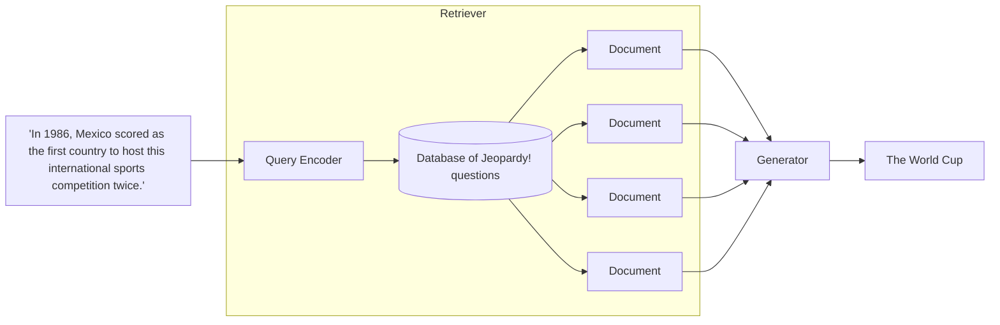

---

## Vector Stores and Semantic Search

### Choosing a Database (Knowledge Base Data Store) for RAG

- You could just use whatever database is appropriate for the type of data you are retrieving
  - Graph database (i.e., Neo4j, Neptune) for retrieving product recommendations or relationships between items
  - OpenSearch or something for traditional text search (TF/IDF, BM25)
  - But almost every example you find of RAG uses a Vector database
  - Note Elasticsearch / OpenSearch can function as a vector DB

#### Example: natural-language queries mapped to structured filters

An LLM can turn a question into structured filters for a traditional database:

**Q: "Which pink items are suitable for children?"**

```json
{
  "color": "pink",
  "age_group": "children"
}
```

**Q: "Help me find gardening gear that is waterproof"**

```json
{
  "category": "gardening gear",
  "characteristic": "waterproof"
}
```

**Q: "I'm looking for a bench with dimensions 100x50 for my living room"**

```json
{
  "measurement": "100x50",
  "category": "home decoration"
}
```

### Review: Embeddings

- An **embedding** is just a big vector associated with your data
- Think of it as a point in multi-dimensional space (typically 100's or thousands of dimensions)
- Embeddings are computed such that items that are similar to each other are close to each other in that space
- We can use embedding base models (like Titan) to compute them en masse

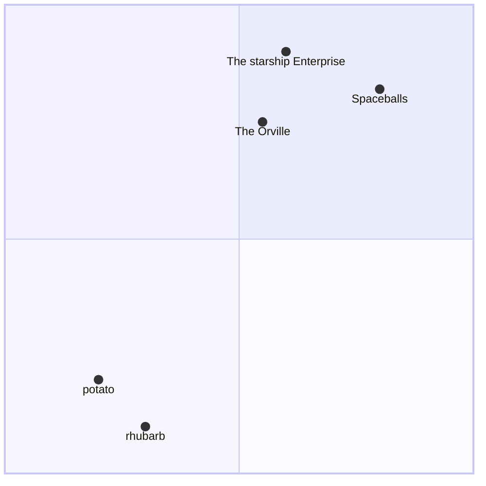

Important: **query and documents must be embedded with the same model**. Switch embedding models and you have to re-embed everything.

### Embeddings are vectors, so store them in...

- ...a vector database!
- It just stores your data alongside their computed embedding vectors
- Leverages the embeddings you might already have for ML
- Retrieval looks like this:
  - Compute an embedding vector for the thing you want to search for
  - Query the vector database for the top items close to that vector
  - You get back the top-N most similar things (K-Nearest Neighbor)
  - "Vector search"
- Examples of vector databases
  - Coercing existing databases to do vector search
    - OpenSearch / Elasticsearch, SQL (Aurora/RDS PostgreSQL with pgvector), Neptune, Redis / MemoryDB, MongoDB / DocumentDB, Cassandra
  - Purpose-built vector DBs
    - Pinecone, Weaviate (commercial)
    - Chroma, Marqo, Vespa, Qdrant, LanceDB, Milvus, vectordb (open source)

### RAG Example with a Vector Database: Making Data from Star Trek, by Cheating

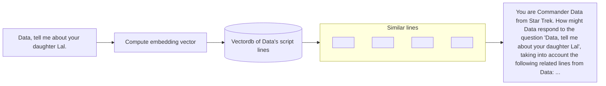

---

## Pre-Retrieval and Chunking Strategies

### Breaking up the R in RAG

- Pre-Retrieval
  - Indexing
    - Granularity / chunking
    - Data extraction
  - Query Rewriting
- Retrieval
- Post-Retrieval (reranking, filtering, compressing what you retrieved)

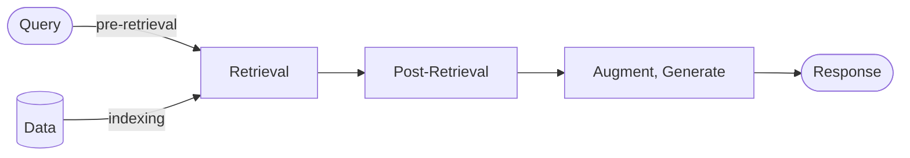

### Pre-Retrieval

- What should you be storing in your database?
- Data granularity matters
- Example: Every set of lines Data had, or individual sentences? Or blocks of text of a fixed length? Why just Data's lines?
  - Or maybe summaries of those lines?
  - You can use an LLM for this too...
- The process of splitting up your data prior to storage is referred to as **CHUNKING**
- **Query rewriting**: rephrase or break a complex question into sub-queries before searching. Bedrock Knowledge Bases offers this as **query decomposition**

#### Chunking example

**Before (one big block):**

```text
DATA:
I cannot become nervous. However,
I do sense a certain...
anticipation regarding my role in the wedding.
(beat)
All systems normal, sir.
Sickbay reported that Lieutenant Juarez
went into labor at zero four hundred hours.
We remain on station awaiting the arrival
of the starship Zhukov and guest quarters
have been prepared for Ambassador T'Pel.
```

⬇️

**After (chunked):**

```text
I cannot become nervous.
```

```text
However,
I do sense a certain...
anticipation regarding my role in the wedding.
```

```text
All systems normal, sir.
```

```text
Sickbay reported that Lieutenant Juarez
went into labor at zero four hundred hours.
```

```text
We remain on station awaiting the arrival
of the starship Zhukov and guest quarters
have been prepared for Ambassador T'Pel.
```

### More on Chunking

- Make sure we don't end up feeding more info into the LLM than it can handle
- Stay within the limit of how many tokens can be used within a context
  - This limit is becoming larger and larger though
- Chunk size tradeoff
  - **Too small**: precise matches, but each chunk lacks context
  - **Too large**: plenty of context, but the embedding gets "averaged out" and matches less precisely
- Semantic Chunking
  - Ensure each chunk contains semantically independent information
  - Embedding-based (LlamaIndex / LangChain)
  - Model-based (BERT)
  - LLM-based (Basically tell it to do semantic chunking)
    - This is costly

#### Sample LLM prompt for chunking

```text
Decompose the "Content" into clear and simple propositions, ensuring they are
interpretable out of context.
1. Split compound sentence into simple sentences. Maintain the original phrasing
   from the input whenever possible.
2. For any named entity that is accompanied by additional descriptive information,
   separate this information into its own distinct proposition.
3. Decontextualize the proposition by adding necessary modifier to nouns or entire
   sentences and replacing pronouns (e.g., "it", "he", "she", "they", "this", "that")
   with the full name of the entities they refer to.
4. Present the results as a list of strings, formatted in JSON.
```

*Sample LLM prompt for chunking from the paper "Dense X Retrieval: What Retrieval Granularity Should We Use?" (Chen et al.), also used within LlamaIndex*

---

## Amazon Bedrock Knowledge Bases

AWS's **fully managed RAG** pipeline. "KB" in the course means this.

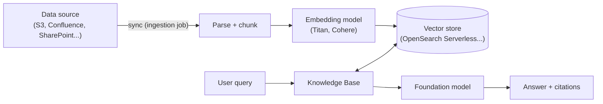

- You pick: data source, parsing, chunking strategy, embedding model, vector store
- KB handles: ingestion, chunking, embedding, storage, retrieval, prompt augmentation
- **Parsing options**: default text parser, or an FM / Bedrock Data Automation parser for PDFs with tables and images
- **Custom transformation**: a Lambda function can run your own chunking logic during ingestion
- **Not automatic**: the KB doesn't watch your source. You run a **sync** (`StartIngestionJob`) to pick up changes. Syncs are incremental

### Knowledge Base Data Sources and Vector Stores

| Data sources | Vector stores |
|---|---|
| **Amazon S3** | **OpenSearch Serverless** (default "quick create") |
| Web Crawler | OpenSearch Service managed clusters |
| Confluence | Aurora PostgreSQL (pgvector) |
| Salesforce | Neptune Analytics (GraphRAG) |
| SharePoint | **Amazon S3 Vectors** (lowest cost) |
| Custom (push docs via API) | Pinecone, Redis Enterprise Cloud, MongoDB Atlas |

Also: **structured data** knowledge bases over **Redshift** (the KB turns questions into SQL), and **Kendra GenAI Index** as the retriever.

### Retrieve vs RetrieveAndGenerate

| API | Returns | Use when |
|---|---|---|
| **`Retrieve`** | The relevant **chunks** (with scores and metadata) | You want to build your own prompt or use your own model |
| **`RetrieveAndGenerate`** | A **generated answer** with citations | You want the whole RAG flow handled for you |

---

## Managing Chunking Strategies with Bedrock

### Chunking with Bedrock: Standard Chunking

- Fixed Size
  - You specify tokens per chunk and overlap percentage
- Default
  - **300 tokens** per chunk, while honoring sentence boundaries (complete sentences preserved within each chunk)
- No chunking
  - Every document is a chunk
  - You could pre-process your own data to "chunk" it however you want per document

#### Fixed chunking example (chunk size 5, overlap 20%)

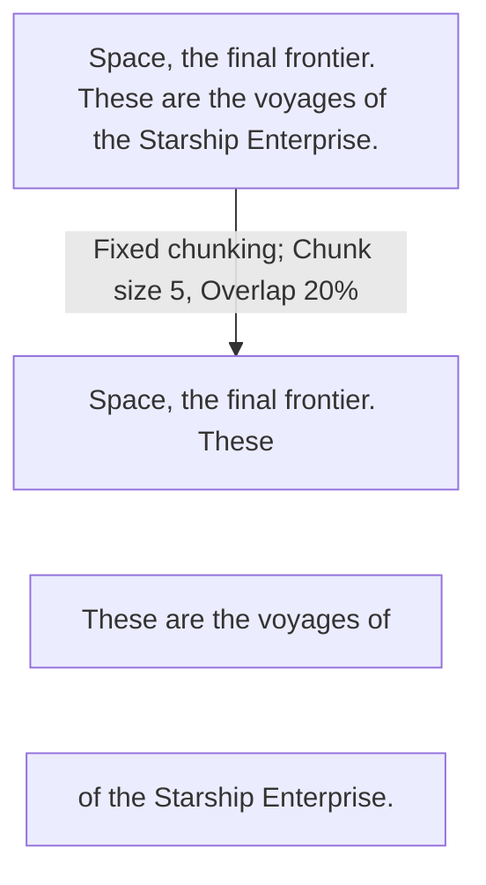

Note the overlap: each chunk repeats the last word of the previous one ("These", "of"). Overlap keeps an idea that spans a chunk boundary from getting cut in half.

### Chunking with Bedrock: Hierarchical Chunking

- Nested parent/child chunks
- Initial search hits the child chunks
  - But then replaces them with parent chunks to get more context when appropriate
- The idea is to get better precision in retrieval from the smaller embeddings
  - But then reclaim comprehensiveness from the parents
- You set parent max tokens, child max tokens, and overlap (Bedrock defaults: parent 1,500, child 300, overlap 60)

#### Hierarchical chunking example (parent 6, child 3, overlap 1)

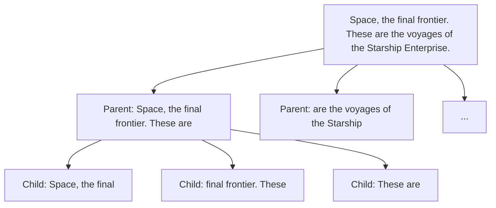

*Note: assumes 1 token = 1 word in this example. That's not necessarily true (a token is roughly 3/4 of a word).*

### Chunking with Bedrock: Semantic Chunking

- Hits a foundation model to break up chunks based on "semantic content" and not just things like sentences or a fixed chunk size
- You specify:
  - Maximum tokens (while honoring sentence boundaries)
  - Buffer size
    - Number of surrounding sentences per sentence to consider when embedding
    - i.e., buffer size of 1 results in 3 sentences
    - Too large = introducing noise; too small = missing important context (but more precise)
  - Breakpoint percentile threshold
    - How "semantically similar" a chunk must be
    - Higher = more distinguishable chunks, less of them, larger chunks
- Bedrock defaults: max 300 tokens, buffer 0, breakpoint 95%
- This costs money; you're charged for the underlying FM used for this

#### Semantic chunking example

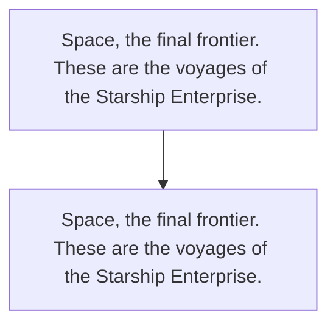

Well, this is all part of the same idea, so it would probably just keep it all together as long as it's within your max tokens.

### Chunking cheat sheet

| Situation | Strategy |
|---|---|
| Don't know yet, general docs | Default (300 tokens, sentence-aware) |
| Need control over size and overlap | Fixed size |
| Data already chunked, or each doc is small (FAQ entries, product records) | No chunking |
| Need precise matches **and** surrounding context | Hierarchical |
| Long docs that shift topics (reports, transcripts) | Semantic (costs FM calls) |
| Totally custom logic | Custom transformation Lambda |

---

## Optimizing Your Vector Stores and Embeddings

### Optimizing your Embeddings

- Smaller vector sizes are a good way to reduce cost
  - I'm talking vector size here, not chunk size
  - Smaller vectors = fewer dimensions per chunk = less storage, memory, and cost
  - However there is a tradeoff with your retrieval performance
- Amazon Titan Text Embeddings V2 defaults to **1,024 dimensions** (and can go down to **512 or 256**). V1 used 1,536
  - This might be more than you need!
  - Balance dimensionality with domain fit
    - Are the semantic concepts you are searching for really that complex?

### Sparse vs. Dense Embeddings

- Sparse = large vectors that are mostly empty
  - i.e., one-hot encoding, or keyword weights like TF-IDF / BM25
- Dense = smaller vectors that contain more semantic information
  - This is what you generally use
- There is a tradeoff
  - Sparse vectors are better at **exact keyword matching** (product codes, names, error IDs). The slide says they "give greater similarity factors"
  - Dense vectors capture **meaning** ("car" matches "automobile") and are more efficient (in memory, and in general)
  - Classical AI systems have ways to compress sparse vectors
  - **Hybrid search** combines both to get the best of each
- Wait, what's a similarity factor?
  - Some measure of how close two vectors are
  - A common one is **cosine similarity**
  - Remember your trig? Cosine is related to the angle between two vectors
    - And it has a nice smoothness to it
  - Others: **Euclidean (L2) distance**, **dot (inner) product**

#### Sparse vectors

| Chicken | Squid | Lemur | Bonobo | Amoeba |
|---|---|---|---|---|
| 1 | 0 | 0 | 0 | 0 |
| 0 | 0 | 0 | 1 | 0 |

#### Dense vectors

| | Dim0 | Dim1 | Dim2 | Dim3 | Dim4 |
|---|---|---|---|---|---|
| **Chicken** | 0.43 | 0.2423 | 0.542 | 0.123 | 0.532 |
| **Bonobo** | 0.24 | 0.34 | 0.53 | 0.632 | 0.23 |

#### Cosine similarity

```text
          /|
         / |
        /  |
       /θ  |
      /____|
```

cos(θ) = A · B / (‖A‖ ‖B‖)

- 1 = pointing the same direction (very similar)
- 0 = unrelated (perpendicular)
- -1 = opposite

### Optimizing Retrieval with Metadata

- Your vector DB can store more than just vectors and the raw text of the chunk
  - Bedrock Knowledge Bases can treat certain columns as content vs. metadata
  - Pass in a `metadata.json` file to specify what's what (for S3, a `<filename>.metadata.json` sits next to each document)
  - This makes sure you aren't chunking up metadata (like creation date) but can still retrieve it
- If you add metadata tags for things like topics, what section of the document we're in, etc... you can use this for better retrieval too
  - **Metadata filtering**: only search chunks where `department = "finance"` or `year >= 2024`
  - Relevance scoring against metadata can be used for ranking
- Other examples of metadata
  - Document ID, category, access control, data lineage, additional context

#### Metadata example

"A chicken is a domesticated bird commonly raised for meat and eggs."

⬇️

```json
{
  "section": "introduction",
  "topic": "biology",
  "keywords": ["chicken", "domesticated", "bird", "meat", "eggs"]
}
```

### Keeping Your KB Up to Date

- New or changed content can trigger a Lambda function
- This Lambda function can then generate new embeddings (by starting a KB sync)
- Batch-generate them for greater efficiency
  - Instead of syncing on every change, maybe you can do so on a schedule (EventBridge Scheduler → Lambda)

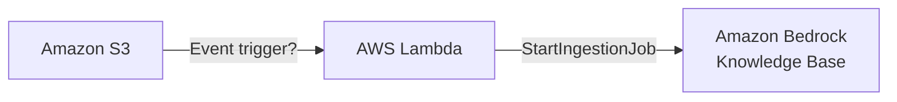

### Post-Retrieval: Reranking

- Vector search returns the top-N "close" chunks, but close isn't always relevant
- A **reranker model** (Amazon Rerank, Cohere Rerank in Bedrock) re-scores those results against the query and keeps the best ones
- Pattern: retrieve wide (e.g. top 50), rerank, pass the top 5 to the FM
- Better answers, fewer tokens sent to the FM

---

## OpenSearch as a Vector Store

- Serverless vector stores
  - Note "serverless" does not mean "scales to zero"
    - OpenSearch Serverless bills a minimum number of OCUs (compute units) even when idle. Delete collections you aren't using, or you'll keep getting billed
  - The exam treats OpenSearch as the primary implementation for backing Bedrock Knowledge Bases
    - But this might get subsumed by the newer S3 Vectors feature
- Not limited to Bedrock Knowledge Bases
  - Can also integrate with SageMaker AI and HuggingFace or custom models for RAG

### Semantic vs Hybrid Search

- Semantic refers to vector search
  - As we've seen, relevancy can be elusive and dependent on your chunking strategy
- Hybrid **combines vector and keyword search**
  - Requires indexing filterable keyword fields for metadata
  - Catches exact terms (SKUs, names) that pure vector search misses
- **This is important** for the exam

### OpenSearch Engines and ANN Algorithms

- Top-level engines are Facebook AI Similarity Search (**FAISS**), Non-Metric Space Library (**NMSLib**), and **Apache Lucene**
  - NMSLib is deprecated in newer OpenSearch versions. Use FAISS or Lucene
- Exact Nearest Neighbor search
  - This is slow (compares against every vector)
- Approximate Nearest Neighbor (ANN) search
  - Hierarchical Navigable Small World (**HNSW**)
    - Fast, high-quality, simple, but uses lots of RAM
  - Inverted File (**IVF**)
    - Better for really huge datasets, can trade recall for speed & memory
    - Needs a training step before indexing

| | HNSW | IVF |
|---|---|---|
| Speed | Fast | Fast |
| Recall | High | Tunable, usually a bit lower |
| Memory | **High** | Lower |
| Best for | Most workloads | Very large datasets, memory constrained |

### HNSW Tuning

- `M` = How many edges per node
  - Higher M -> denser graph, higher recall, but **more memory**
- `ef_construction` = Size of dynamic list used for KNN graph
  - Higher -> more accurate graph, **slower indexing speed**
- `ef_search` = How thoroughly the graph is explored
  - Higher -> higher recall, but **slower search performance**

`M` and `ef_construction` are set at **index time**. `ef_search` is a **query-time** knob, so it's the one to adjust without reindexing.

### Vector Compression

- Different ANN methods have their own techniques (HNSW, IVF)
- Dense embeddings add up fast
- **Binary vectors**
  - Bit sequences (stored as bytes)
  - Each dimension is a single bit, used for fast distance search (Hamming distance)
  - **32x compression** compared to float32
- **FP16**
  - A form of **scalar quantization**
  - Store embedding dimensions as 16-bit values instead of 32-bit (half the memory)
  - Done with the FAISS engine for HNSW or IVF indexes (the slide just says "what HNSW does")
- Others: byte vectors (8-bit), product quantization (PQ)
- Every form of compression trades some recall for memory and cost

### Sharding and Multi-Index Approaches

- Sharding strategies
  - Balance shard size and CPU ratio
  - Larger shards for semantic search (30-50 GB)
    - Vector search benefits from fewer, larger shards because there is less cross-shard coordination
  - Smaller for hybrid (10-30 GB)
  - On OpenSearch Serverless, this is automatic
- Multi-index approaches
  - Different document types belong in their own index
  - This way you can tune performance for each corpus
  - You might want different embedding models for different types of data
  - You'll need some sort of query routing to pull this off

### OpenSearch Hierarchical Indices

- A top level index can serve as a general / summary layer
  - This index is small and fast
  - It routes you to an index with more detailed data per domain
  - It's a way to implement multiple indices that are specialized for different domains or data types
    - With their own embedding models, shard sizes, tuning
- You could also use a FM to route to the right index

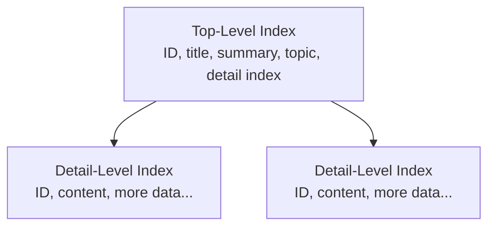

### OpenSearch Neural Plugin

- Allows you to integrate your embedding model into an OpenSearch ingest pipeline
- "Neural queries" just allow OpenSearch to accept text queries and generate embeddings under the hood for vector queries
- This is an alternative to using the built-in Bedrock Knowledge Base integration with OpenSearch Serverless
- The Neural plugin allows OpenSearch to call your Bedrock model for embeddings as part of search or ingestion

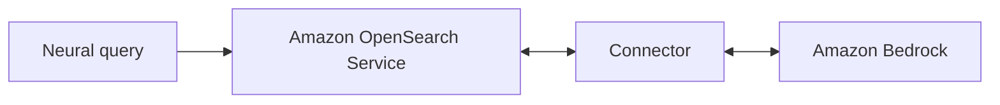

---

## Amazon Aurora as a Vector Store

- **pgvector** extension (Aurora PostgreSQL and RDS PostgreSQL)
  - Creates a new "vector" column type
  - Can compute cosine, L2, or inner product distances
  - Can do similarity search with IVF (`ivfflat`) or HNSW indexes
  - Also adds vector operators for SQL
    - This gives it an advantage over OpenSearch if you need complex filtering logic, joins, and transactions
- Allows you to store structured and vector data in the same place
- Can be appropriate for small / medium RAG systems with mostly structured data
- Supported as a Bedrock Knowledge Base vector store
- Related: **Trusted Language Extensions (TLE) for PostgreSQL** lets you build and run your own extensions safely on Aurora/RDS

```sql
CREATE EXTENSION vector;
CREATE TABLE docs (id bigserial PRIMARY KEY, content text, embedding vector(1024));
CREATE INDEX ON docs USING hnsw (embedding vector_cosine_ops);

-- 5 nearest neighbors, filtered with plain SQL
SELECT content FROM docs
WHERE category = 'finance'
ORDER BY embedding <=> '[...]'
LIMIT 5;
```

---

## Other Vector Store Options

| Option | Why pick it |
|---|---|
| **OpenSearch Serverless** | Default for Bedrock KB, hybrid search, no cluster management |
| **OpenSearch Service (managed clusters)** | Full control over engine, sharding, instance types |
| **Aurora / RDS PostgreSQL (pgvector)** | Vectors next to relational data, SQL filtering and joins |
| **Amazon S3 Vectors** | **Cheapest** at large scale, durable, fine with sub-second (not millisecond) latency |
| **Neptune Analytics** | Graph + vector (**GraphRAG**), relationships between entities |
| **MemoryDB** | **Lowest latency** in-memory vector search |
| **DocumentDB** | Vector search alongside JSON documents |
| **Kendra** | Managed semantic retriever, no embeddings to manage yourself |
| Pinecone / Redis Enterprise Cloud / MongoDB Atlas | Third-party stores supported by Bedrock KB |

---

## RAG and vector store exam tells

| Scenario | Answer |
|---|---|
| Add proprietary, frequently changing data to an FM, cheaply | RAG (Bedrock Knowledge Bases), not fine-tuning |
| Change the model's tone, format, or teach domain jargon | Fine-tuning |
| Teach domain knowledge from lots of unlabeled text | Continued pre-training |
| Managed RAG with least operational overhead | Bedrock Knowledge Bases |
| Default / "quick create" vector store for a KB | OpenSearch Serverless |
| Cheapest vector storage at scale, latency not critical | S3 Vectors |
| Need exact keyword matches and semantic matches | Hybrid search (OpenSearch) |
| Vectors plus relational data with complex SQL filters | Aurora PostgreSQL + pgvector |
| Relationships between entities matter | Neptune Analytics (GraphRAG) |
| Precise retrieval but answers lack context | Hierarchical chunking |
| Long docs that switch topics | Semantic chunking |
| Data is already chunked | No chunking |
| Ideas getting cut off at chunk boundaries | Add chunk overlap |
| Cut embedding storage and memory cost | Fewer dimensions (Titan V2 512/256), binary or FP16 vectors |
| HNSW recall too low at query time | Raise `ef_search` |
| HNSW index using too much RAM | Lower `M`, quantize, or use IVF |
| Docs in S3 changed, KB returns stale answers | Sync: `StartIngestionJob` (Lambda on S3 event, or scheduled) |
| Only search docs from a department or date range | Metadata + metadata filtering |
| Retrieved chunks are close but not relevant | Reranker model |
| Just want chunks to feed your own prompt/model | `Retrieve` API |
| Want a generated answer with citations | `RetrieveAndGenerate` API |
| Block harmful content, redact PII, catch hallucinations | Bedrock Guardrails |
| Run prompts over millions of records cheaply | Bedrock batch inference |
| OpenSearch Serverless bill while idle | It doesn't scale to zero: delete unused collections |
| Generate embeddings inside OpenSearch at ingest/query | Neural plugin + Bedrock connector |

---

## Amazon Quick

- *Successor to Amazon Q Business*
- Agentic AI assistant for your employees: answer, research, analyze, act
  - Connects to your company's documents, apps, databases and the Internet
- Built on Amazon Bedrock, your data is never used to train models

### What can you ask Amazon Quick?

- "Research our top 3 competitors and write a report with citations..."
- "Show me last quarter's sales by region as a chart..."
- "Every Monday, email the latest sales dashboard to my team..."

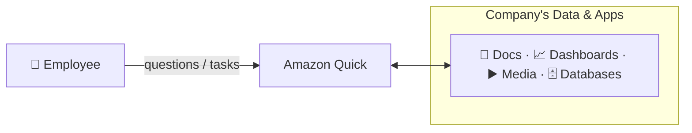

### Amazon Quick: Capabilities

- **Quick Index**: unified, searchable knowledge base of your company data (fully managed RAG)
  - Knowledge bases from S3, SharePoint, OneDrive, Google Drive, Confluence, web pages...
- **Quick Research**: deep research agent, combines internal data and the Internet, cited reports
- **Quick Flows**: simple automations built with natural language (e.g., weekly report email)
- **Quick Automate**: multi-step agentic workflows across systems, with human approvals
- **Quick Sight**: AI-powered BI dashboards, ask questions about your data (formerly QuickSight)
- **Spaces**: shared workspace of documents, dashboards and agents for a team

```mermaid
flowchart TD
    subgraph DATA["Company Data & Apps"]
        D["📄 Docs · 📈 Dashboards · ▶️ Media · 🗄️ Databases"]
    end

    Q["Amazon Quick"]

    subgraph AGENTS["Agents & Automations"]
        R["Quick Research"]
        S["Quick Sight"]
        F["Quick Flows"]
        A["Quick Automate"]
    end

    DATA -- "index using Quick Index" --> Q
    Q --> AGENTS
```

### Amazon Quick + IAM Identity Center

- Users can be authenticated through **IAM Identity Center**
- Users receive responses generated only from the documents they have access to (source permissions / ACLs are respected)
- IAM Identity Center can be configured with external Identity Providers
  - IdP: Google Login, Microsoft Active Directory, Okta...

```mermaid
flowchart LR
    U["👥 Users<br/>(AWS sign-in)"] <-- "Authentication" --> IC["IAM Identity Center"]
    IC <-- "integration" --> IDP["External IdP<br/>Microsoft Active Directory / Google"]
    AU["👤 Authenticated User"] -- "🔒 ask questions" --> Q["Amazon Quick"]
```

### Amazon Quick: Integrations

- **Knowledge Bases** (fully managed RAG): index your company data into Quick Index
  - Amazon S3, Google Drive, OneDrive, SharePoint, Confluence, Web Crawler...
  - 30+ structured data sources for Quick Sight: Redshift, Athena, RDS, Snowflake...
- **Actions**: allows agents to perform tasks in 3rd party services
  - Jira, ServiceNow, Zendesk, Salesforce, Slack, Outlook... (100+ pre-built connectors)
  - **MCP & OpenAPI**: connects to your own APIs and MCP servers (custom connectors)

```mermaid
flowchart TD
    subgraph DS["Data Sources"]
        D["S3 · RDS · Aurora · MS 365 · SharePoint · ..."]
    end

    Q["Amazon Quick"]

    subgraph TP["3rd Party Services"]
        T["Salesforce · Slack · Zendesk · Jira Software · ServiceNow · ..."]
    end

    DS -- "index using Knowledge Bases" --> Q
    Q -- "act using Actions (MCP)<br/>e.g., create a Jira issue" --> TP
```

### Apps in Amazon Quick

- Build and publish web applications without coding by describing them in natural language
- Example: project tracker, customer dashboard, training portal, data entry form...
- Apps can embed Quick Sight visuals, use Actions (Salesforce, Jira...), Spaces as knowledge base, and call an FM for summaries or classification

```mermaid
flowchart LR
    E["👤 Employee"] --> D["Describe<br/>'Build a project tracker...'"]
    D --> G["Generate<br/>code is generated live"]
    G --> P["Preview<br/>test it in the editor"]
    P --> I["Iterate<br/>'add a chart of overdue tasks'"]
    I --> PB["Publish<br/>share with your team"]
    PB --> A["Apps in Quick"]
```

---

## Amazon Q Apps (Q Business)

- Create Gen AI-powered apps without coding by using natural language
- Leverages your company's internal data
- Possibility to leverage plugins (Jira, etc...)
- This is the **Q Business** version of "Apps in Amazon Quick." Since Quick replaced Q Business, the exam may use either name

```mermaid
flowchart LR
    C["Amazon Q Apps Creator<br/>'Your generative AI productivity app generator'<br/>describe the app you need"] --> A["Generated app<br/>e.g., Document Editing Assistant<br/>(upload document → edit suggestions)"]
```

Source: https://aws.amazon.com/blogs/aws/amazon-q-business-now-generally-available-helps-boost-workforce-productivity-with-generative-ai/

---

## Amazon Kendra

- Fully managed **document search service** powered by Machine Learning
- Extract answers from within a document (text, pdf, HTML, PowerPoint, MS Word, FAQs...)
- Natural language search capabilities
- Learn from user interactions/feedback to promote preferred results (**Incremental Learning**)
- Ability to manually fine-tune search results (importance of data, freshness, custom, ...)
- Can act as the **retriever for RAG**: the `Retrieve` API returns relevant passages to feed an FM, and a **Kendra GenAI Index** can back Bedrock Knowledge Bases and Quick
- Respects document access control lists (users only see results they're allowed to)

```mermaid
flowchart LR
    subgraph DS["Data Sources"]
        D["Amazon S3 · Amazon RDS · Google Drive · MS SharePoint<br/>MS OneDrive · Salesforce · ServiceNow<br/>3rd party, APNs, Custom"]
    end

    subgraph K["Amazon Kendra"]
        KI["Knowledge Index<br/>(powered by ML)"]
    end

    U["👤 User"]

    DS -- "indexing" --> KI
    U -- "Where is the IT support desk?" --> KI
    KI -- "1st floor" --> U
```

Kendra vs OpenSearch: **Kendra** is turnkey natural-language enterprise search with connectors and no tuning. **OpenSearch** is a search/analytics engine you configure yourself (log analytics, custom search, vector store).

---

## Decision cheat sheet

**Which service?**

| Need | Use |
|---|---|
| Build, train, deploy your own model | SageMaker AI |
| No-code ML predictions for analysts | SageMaker Canvas |
| Use a pre-trained FM via API | Bedrock |
| Managed RAG over your documents | Bedrock Knowledge Bases |
| Employee AI assistant over company data, no code | Amazon Quick (formerly Q Business) |
| Natural-language enterprise document search | Kendra |
| Image / text analysis without training | Rekognition / Comprehend |

**SageMaker data tools**

| Need | Use |
|---|---|
| Store and share features, real-time lookups | Feature Store online store |
| Historical features for training | Feature Store offline store |
| Human labeling | Ground Truth (Plus if AWS should run it) |
| Visual ML data prep | Data Wrangler |
| Track model provenance | ML Lineage Tracking |

**Vector store picker**

| Need | Use |
|---|---|
| Default, hybrid search | OpenSearch Serverless |
| Lowest cost at scale | S3 Vectors |
| Vectors + relational SQL | Aurora pgvector |
| Graph relationships | Neptune Analytics |
| Lowest latency | MemoryDB |

**RAG tuning**

| Problem | Fix |
|---|---|
| Stale answers | Sync the KB (`StartIngestionJob`) |
| Missing exact keyword matches | Hybrid search |
| Chunks lack context | Hierarchical chunking or larger chunks |
| Irrelevant chunks retrieved | Reranker, metadata filtering, better chunking |
| Embedding cost too high | Fewer dimensions, quantization |
| Hallucinations / unsafe output | Guardrails (contextual grounding, content filters) |