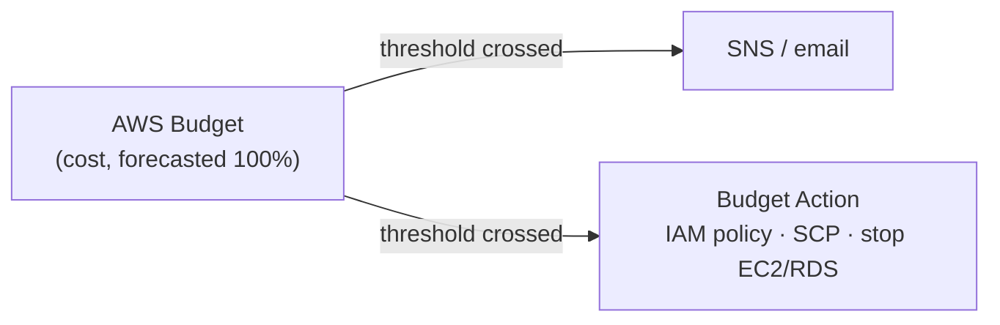
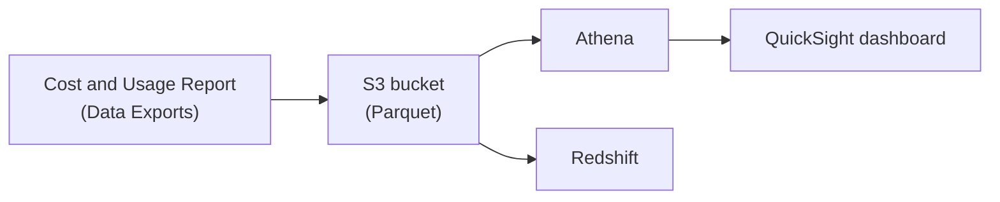
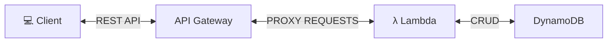
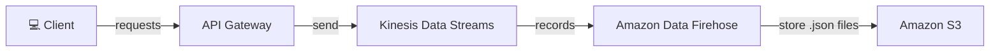

# Everything Else

The leftovers that still show up on the exam. The cost tools are Budgets, Cost Explorer, Cost Anomaly Detection, and the Cost and Usage Report. Then there's Amazon API Gateway, the front door for serverless APIs and a way to expose AWS services (like Kinesis) over HTTP. Exam tells are inline, and there's a decision cheat sheet at the end.

## Contents

- [Cost management at a glance](#cost-management-at-a-glance)
- [AWS Budgets](#aws-budgets)
  - [Budget alerts and actions](#budget-alerts-and-actions)
- [AWS Cost Explorer](#aws-cost-explorer)
- [AWS Cost Anomaly Detection](#aws-cost-anomaly-detection)
- [Cost and Usage Report (Data Exports)](#cost-and-usage-report-data-exports)
- [Cost allocation tags](#cost-allocation-tags)
- [Cost exam tells](#cost-exam-tells)
- [Amazon API Gateway](#amazon-api-gateway)
  - [Example: building a serverless API](#example-building-a-serverless-api)
  - [API types: REST vs HTTP vs WebSocket](#api-types-rest-vs-http-vs-websocket)
  - [Integrations](#api-gateway-integrations)
  - [AWS service integration: Kinesis example](#api-gateway-aws-service-integration-kinesis-data-streams-example)
  - [Endpoint types](#api-gateway-endpoint-types)
  - [Security](#api-gateway-security)
  - [Throttling, caching, and limits](#api-gateway-throttling-caching-and-limits)
  - [Stages and deployments](#api-gateway-stages-and-deployments)
- [API Gateway exam tells](#api-gateway-exam-tells)
- [Decision cheat sheet](#decision-cheat-sheet)

---

## Cost management at a glance

| Tool | Answers | Looks |
|---|---|---|
| **Budgets** | Am I going to **exceed** what I planned? Alert or act | Forward (actual + forecast vs threshold) |
| **Cost Explorer** | **Where** is my money going, what's the trend? | Backward (plus a short forecast) |
| **Cost Anomaly Detection** | Is anything spending **unusually**? | ML on spend patterns |
| **Cost and Usage Report / Data Exports** | Give me **every line item** to analyze myself | Raw data in S3, query with Athena |

Rule of thumb: **alert = Budgets, explore = Cost Explorer, surprises = Anomaly Detection, raw data = CUR**.

---

## AWS Budgets

- Create budget and **send alarms when costs exceed the budget**
- 4 types of budgets: **Usage, Cost, Reservation, Savings Plans**
- For Reserved Instances (RI)
  - Track utilization
  - Supports EC2, ElastiCache, RDS, Redshift, OpenSearch
- Up to 5 notifications per budget (each to SNS and/or email)
- Can filter by: Service, Linked Account, Tag, Purchase Option, Instance Type, Region, Availability Zone, API Operation, etc...
- Same options as AWS Cost Explorer!
- Pricing: the course says "2 budgets free, then $0.02/day/budget." AWS has since changed this. Plain monitoring budgets are free, and the charge applies to **action-enabled** budgets (first 2 free, then a small daily fee each). Check the pricing page if it matters

### Budget alerts and actions

- Alert on **actual** spend (already happened) or **forecasted** spend (projected to happen by month end)
- Thresholds as an absolute amount or a % of the budget (e.g. 80%, 100%)
- **Budget Actions** do something automatically when a threshold is crossed:
  - Apply an **IAM policy** (e.g. deny launching new resources)
  - Apply a **Service Control Policy** (SCP) to an account in AWS Organizations
  - **Stop EC2 or RDS instances**
  - Run automatically, or wait for someone to approve
- Budgets are **not real time**. Billing data updates a few times a day, so alerts can lag spend by hours

---

## AWS Cost Explorer

- Visualize, understand, and manage your AWS costs and usage over time
- Create custom reports that analyze cost and usage data
- Analyze your data at a high level: total costs and usage across all accounts
- Or monthly, daily, hourly, resource level granularity (hourly and resource-level are opt-in and cost extra)
- Choose an optimal **Savings Plan** (to lower prices on your bill)
- **Forecast** usage for the coming months based on past usage
- **Rightsizing recommendations** for EC2 instances
- Also has an API, if you want to pull the numbers into your own tools

---

## AWS Cost Anomaly Detection

- Continuously monitors your spend using **machine learning** to detect unusual spikes
- No thresholds to set: it learns your normal pattern
- Monitors by service, linked account, cost category, or cost allocation tag
- Sends alerts (individual or daily/weekly summary) via **SNS or email**, with a **root-cause analysis** (which service, account, region, usage type)

Example: a Glue job accidentally runs with 100 workers instead of 10. Budgets might not fire until month end, but Anomaly Detection flags the spike within a day.

---

## Cost and Usage Report (Data Exports)

- The **most detailed** billing data AWS offers: every line item, by hour, by resource
- Delivered to an **S3 bucket** on a schedule, in **Parquet** or CSV
- Now managed through **AWS Data Exports** (CUR 2.0), the legacy CUR still works
- Integrates with **Athena** (query with SQL), **Redshift**, and **QuickSight** (dashboards)
- Includes cost allocation tags and resource IDs

This is the data-engineering answer to "build a custom cost dashboard" or "analyze spend by team with SQL."

---

## Cost allocation tags

- Tag resources (e.g. `team=data-eng`, `project=job-market`) to break costs down
- **Must be activated** in the Billing console before they show up in Cost Explorer, Budgets, or CUR
- Only apply **going forward** from activation, not retroactively
- Two kinds: **AWS-generated** (e.g. `aws:createdBy`) and **user-defined**

Classic gotcha: "we tagged everything but the tags don't show up in Cost Explorer" means the tags weren't **activated as cost allocation tags**.

---

## Cost exam tells

| Scenario | Answer |
|---|---|
| Alert when monthly spend will exceed $X | Budgets (forecasted alert) |
| Automatically stop instances or block launches when over budget | Budget Actions |
| Track Reserved Instance or Savings Plans utilization | Reservation / Savings Plans budget |
| See which services drove last month's bill | Cost Explorer |
| Pick the right Savings Plan | Cost Explorer recommendations |
| Detect an unexpected spending spike, no thresholds | Cost Anomaly Detection |
| Query detailed billing data with SQL | Cost and Usage Report → S3 → Athena |
| Cost dashboard for finance | CUR → Athena → QuickSight |
| Break costs down by team or project | Cost allocation tags (activated) |
| Tags missing from cost reports | Activate them as cost allocation tags |

---

## Amazon API Gateway

### Example: Building a Serverless API

- AWS Lambda + API Gateway: No infrastructure to manage
- Support for the WebSocket Protocol
- Handle API versioning (v1, v2...)
- Handle different environments (dev, test, prod...)
- Handle security (Authentication and Authorization)
- Create API keys, handle request throttling
- Swagger / OpenAPI import to quickly define APIs
- Transform and validate requests and responses
- Generate SDK and API specifications
- Cache API responses

### API types: REST vs HTTP vs WebSocket

| | REST API | HTTP API | WebSocket API |
|---|---|---|---|
| Use for | Full-featured APIs | Simple, cheap, fast proxies to Lambda / HTTP | Real-time two-way communication (chat, live dashboards) |
| Cost | Higher | **~70% cheaper** | Per message + connection minutes |
| API keys, usage plans | ✅ | ❌ | ❌ |
| Caching | ✅ | ❌ | ❌ |
| Request validation / transformation | ✅ | Limited | Limited |
| AWS service integrations (e.g. Kinesis) | ✅ any service | Only a few (SQS, Kinesis, Step Functions, EventBridge, AppConfig) | Lambda / HTTP / AWS services |
| Private endpoint | ✅ | ❌ | ❌ |
| Auth | IAM, Cognito, Lambda authorizer | IAM, **JWT/OIDC**, Lambda authorizer | IAM, Lambda authorizer |

Rule of thumb: need caching, API keys, or usage plans = **REST**. Just a cheap proxy to Lambda = **HTTP**.

### API Gateway Integrations

- **Lambda Function**
  - Invoke Lambda function
  - Easy way to expose REST API backed by AWS Lambda
  - **Lambda proxy integration**: API Gateway passes the whole request to Lambda and returns whatever Lambda returns (most common)
- **HTTP**
  - Expose HTTP endpoints in the backend
  - Example: internal HTTP API on premise, Application Load Balancer
  - Why? Add rate limiting, caching, user authentication, API keys, etc...
- **AWS Service**
  - Expose any AWS API through the API Gateway
  - Why? Add authentication, deploy publicly, rate control...
- **Mock**
  - Return a fixed response without calling a backend (testing, placeholders)

### API Gateway: AWS Service Integration (Kinesis Data Streams example)

- API Gateway calls the Kinesis `PutRecord` API directly, no Lambda in between
- Clients never get AWS credentials, they just hit an HTTP endpoint
- Needs an **IAM role** that lets API Gateway call `kinesis:PutRecord`, and a **mapping template** (VTL) to reshape the HTTP request into the Kinesis API format
- Same pattern works for SQS, Step Functions, DynamoDB, EventBridge
- (Kinesis Data Firehose has been renamed **Amazon Data Firehose**)

Exam tell: "ingest clickstream events from a web app into a stream **without managing servers or Lambda**" is API Gateway → Kinesis Data Streams (service integration).

### API Gateway: Endpoint Types

- **Edge-Optimized (default)**: For global clients
  - Requests are routed through the CloudFront Edge locations (improves latency)
  - The API Gateway still lives in only one region
- **Regional**:
  - For clients within the same region
  - Could manually combine with CloudFront (more control over the caching strategies and the distribution)
- **Private**:
  - Can only be accessed from your VPC using an interface VPC endpoint (ENI)
  - Use a **resource policy** to define access

### API Gateway: Security

- **User Authentication** through
  - **IAM Roles** (useful for internal applications), requests are signed with **SigV4**
  - **Cognito** user pools (identity for external users, example mobile users)
  - **Custom Authorizer** (your own logic), now called a **Lambda authorizer**
    - Token-based (e.g. a JWT or OAuth token in a header) or request-based (headers, query strings)
    - The result can be cached so the Lambda doesn't run on every request
- **Resource policies**: allow or deny by AWS account, IP range, or VPC endpoint (required for private APIs)
- **Custom Domain Name HTTPS** security through integration with AWS Certificate Manager (ACM)
  - If using Edge-Optimized endpoint, then the certificate must be in **us-east-1**
  - If using Regional endpoint, the certificate must be in the API Gateway region
  - Must setup CNAME or A-alias record in Route 53
- Can be fronted by **AWS WAF** to block common attacks (SQL injection, bots, IP blocklists)

| Who are your users? | Use |
|---|---|
| AWS users / roles, internal apps | IAM authorization |
| External users signing up and logging in | Cognito user pools |
| Third-party tokens or custom logic | Lambda authorizer |

### API Gateway: Throttling, Caching, and Limits

- **Throttling**
  - Default account limit: **10,000 requests/second** per region (soft limit), burst of 5,000
  - Too many requests = **429 Too Many Requests**
  - Set per-stage or per-method limits, or per-client limits with **usage plans + API keys** (REST only)
- **Caching** (REST only)
  - Caches responses per stage, default TTL **300 seconds** (0 to 3600)
  - Reduces calls to your backend, costs extra
- **Limits worth knowing**
  - Integration timeout: **29 seconds** default. Long jobs should go async (return immediately, process with Step Functions or SQS)
  - Max payload: **10 MB**. For big files, return an **S3 pre-signed URL** and upload directly to S3
- **Common errors**: 4xx = client side (403 auth, 429 throttled), 5xx = backend side (502 bad Lambda response, 504 integration timeout)

### API Gateway: Stages and Deployments

- Changes don't go live until you **deploy** to a **stage** (e.g. `dev`, `test`, `prod`)
- Each stage has its own URL, settings, cache, throttling, and logs
- **Stage variables**: like environment variables, e.g. point `prod` at the `prod` Lambda alias
- **Canary deployments**: send a % of traffic on a stage to a new deployment before full rollout
- Logging and monitoring: **CloudWatch Logs** (access and execution logs), **CloudWatch metrics** (`Count`, `Latency`, `IntegrationLatency`, `4XXError`, `5XXError`), **X-Ray** tracing

---

## API Gateway exam tells

| Scenario | Answer |
|---|---|
| Serverless REST API with no servers to manage | API Gateway + Lambda (+ DynamoDB) |
| Cheapest simple proxy to a Lambda function | HTTP API |
| Need API keys, usage plans, or caching | REST API |
| Real-time two-way messaging | WebSocket API |
| Push events into Kinesis / SQS without Lambda | API Gateway AWS service integration |
| API only reachable from inside a VPC | Private endpoint + interface VPC endpoint + resource policy |
| Global clients, lower latency | Edge-optimized endpoint |
| Custom domain on edge-optimized API | ACM certificate in **us-east-1** |
| Internal callers using AWS credentials | IAM authorization (SigV4) |
| Mobile app users who sign up and log in | Cognito user pools |
| Validate a custom or third-party token | Lambda authorizer |
| Limit how many requests each customer can make | Usage plans + API keys |
| Clients getting 429 errors | Throttling: raise limits or add backoff/retries |
| Clients getting 504 on long requests | 29 s integration timeout: make it async |
| Upload files larger than 10 MB | S3 pre-signed URL |
| Reduce load on the backend for repeated reads | API Gateway caching |
| Separate dev / test / prod | Stages + stage variables |
| Block SQL injection and bad bots | AWS WAF on API Gateway |

---

## Decision cheat sheet

**Cost**

| Need | Use |
|---|---|
| Alert before overspending | Budgets |
| Auto-respond to overspending | Budget Actions |
| Explore and trend spend | Cost Explorer |
| Catch unusual spikes automatically | Cost Anomaly Detection |
| Line-item billing data for SQL / BI | Cost and Usage Report → S3 → Athena / QuickSight |
| Costs by team or project | Activated cost allocation tags |

**API Gateway**

| Need | Use |
|---|---|
| Full-featured API (caching, keys, validation) | REST API |
| Cheap, fast Lambda/HTTP proxy | HTTP API |
| Bi-directional real time | WebSocket API |
| Call an AWS service directly over HTTP | AWS service integration |
| Global users | Edge-optimized |
| Same-region users or your own CloudFront | Regional |
| VPC-only access | Private |
| Auth for AWS principals / end users / custom tokens | IAM / Cognito / Lambda authorizer |